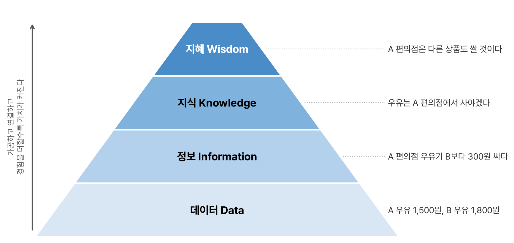

ADsP 공부는 1과목 '데이터 이해'부터 시작했다. 첫 단원 '데이터의 이해'는 데이터와 정보, 데이터베이스의 정의와 특징, 데이터베이스 활용 세 부분으로 나뉜다. 거의 개념 암기라서 헷갈리기 쉬운 용어 쌍 위주로 정리했다.

## 요약

- 데이터는 있는 그대로의 사실(존재적 특성)이면서, 추론과 예측의 근거(당위적 특성)이기도 한다.
- 데이터는 표현 방식에 따라 정성·정량 데이터로, 구조에 따라 정형·반정형·비정형 데이터로 나뉜다.
- 지식은 암묵지와 형식지가 공통화, 표출화, 연결화, 내면화를 돌면서 커진다(SECI 모델).
- DIKW 피라미드는 데이터가 정보, 지식, 지혜로 올라가는 과정을 설명한다.
- 데이터베이스는 통합된·저장된·공용·변화되는 데이터라는 네 가지 특징을 가진다.
- 기업은 OLTP와 OLAP, CRM·SCM·ERP, 데이터 웨어하우스로 데이터를 쓰고, 사회는 EDI, CALS, GIS 같은 기반 데이터베이스로 데이터를 쓴다.

## 1. 데이터와 정보

### 데이터의 정의

데이터(data)는 라틴어 datum(주어진 것)의 복수형이다. 데이터에는 두 가지 성격이 있다.

| 특성 | 뜻 |
|---|---|
| 존재적 특성 | 있는 그대로의 객관적 사실(fact, raw material) |
| 당위적 특성 | 추론, 예측, 전망, 추정을 위한 근거(basis) |

데이터 하나하나는 그 자체로 큰 의미가 없다. 다른 데이터와 연결되고 비교될 때 가치가 생긴다.

### 데이터의 유형

표현 방식에 따라 나누면 다음과 같다.

| 구분 | 형태 | 예 | 특징 |
|---|---|---|---|
| 정성적 데이터(qualitative) | 언어, 문자 | 설문 주관식 응답, SNS 글, 상담 기록 | 형태와 형식이 정해져 있지 않아 저장·검색·분석에 비용과 기술이 많이 든다 |
| 정량적 데이터(quantitative) | 수치, 도형, 기호 | 키, 나이, 기온, 매출액 | 양이 많아져도 데이터베이스로 관리하고 분석하기 쉽다 |

구조에 따라 나누면 다음과 같다.

| 구분 | 뜻 | 예 |
|---|---|---|
| 정형 데이터(structured) | 정해진 형식(스키마)이 있고 바로 연산할 수 있다 | 관계형 DB 테이블, 엑셀, CSV |
| 반정형 데이터(semi-structured) | 형식을 설명하는 정보(메타데이터)는 있지만 그대로 연산하기는 어렵다 | JSON, XML, HTML, 서버 로그 |
| 비정형 데이터(unstructured) | 정해진 형식이 없다 | 문서, 이미지, 영상, 음성 |

> **쉬운 설명**
>
> 정형 데이터는 칸이 미리 그려진 엑셀 표, 반정형 데이터는 '이름: 홍길동'처럼 이름표가 붙은 메모, 비정형 데이터는 사진첩이라고 생각하면 된다. 이름표가 있으면 컴퓨터가 어디에 무엇이 있는지는 알지만, 표처럼 바로 더하거나 평균을 내기는 어렵다.

### 암묵지와 형식지

| 구분 | 뜻 | 예 |
|---|---|---|
| 암묵지(tacit knowledge) | 학습과 경험으로 개인에게 쌓였지만 겉으로 드러나지 않는 지식. 공유하기 어렵다 | 김장 손맛, 자전거 타는 감각 |
| 형식지(explicit knowledge) | 문서, 매뉴얼, 교과서처럼 형태를 갖춘 지식. 전달과 공유가 쉽다 | 요리책, 업무 매뉴얼 |

노나카 이쿠지로는 두 지식이 서로 바뀌며 조직의 지식이 커진다고 보고, 이 과정을 네 단계로 정리했다. 각 단계 영문의 첫 글자를 따서 **SECI 모델**이라고 부른다.

| 단계 | 영문 | 변환 방향 | 예 |
|---|---|---|---|
| 공통화 | Socialization | 암묵지 → 암묵지 | 선배 옆에서 일하며 노하우를 몸으로 익힌다 |
| 표출화 | Externalization | 암묵지 → 형식지 | 그 노하우를 매뉴얼로 쓴다 |
| 연결화 | Combination | 형식지 → 형식지 | 여러 매뉴얼을 엮어 사내 교재를 만든다 |
| 내면화 | Internalization | 형식지 → 암묵지 | 교재를 익혀 자기 노하우로 만든다 |


flowchart LR
  S["공통화 암묵지 → 암묵지"] --> E["표출화 암묵지 → 형식지"]
  E --> C["연결화 형식지 → 형식지"]
  C --> N["내면화 형식지 → 암묵지"]
  N --> S


> **쉬운 설명**
>
> 할머니 손맛을 옆에서 보고 배우는 게 공통화, 그걸 레시피로 적는 게 표출화, 여러 레시피를 모아 요리책을 만드는 게 연결화, 요리책대로 계속 만들다 내 손맛이 되는 게 내면화다. '표출'은 밖으로 꺼내기, '내면'은 안으로 넣기라고 기억하면 방향이 헷갈리지 않는다.

### DIKW 피라미드

DIKW는 데이터(Data), 정보(Information), 지식(Knowledge), 지혜(Wisdom)의 첫 글자다.

| 단계 | 뜻 | 예 |
|---|---|---|
| 데이터 | 다른 데이터와 관계를 맺기 전의 객관적 사실. 그 자체로는 의미가 없다 | A 편의점 우유 1,500원, B 편의점 우유 1,800원 |
| 정보 | 데이터를 가공하고 서로 연관 지어 의미를 끌어낸 것. 그 의미가 꼭 쓸모 있지는 않을 수 있다 | A 편의점 우유가 B보다 300원 싸다 |
| 지식 | 여러 정보를 구조화하고 개인의 경험과 결합해 내 것으로 만든 것 | 우유는 A 편의점에서 사야겠다 |
| 지혜 | 지식이 쌓이고 아이디어가 더해져 나온 창의적 통찰 | A 편의점은 다른 상품도 B보다 쌀 것이다 |

_DIKW 피라미드. 아래의 데이터가 가공되고 연결되며 위로 올라갈수록 의사결정에 쓰기 좋은 가치가 커진다_

> **쉬운 설명**
>
> 영수증에 찍힌 숫자가 데이터, 두 영수증을 비교해 알게 된 사실이 정보, 그 사실로 정한 나만의 장보기 규칙이 지식, 처음 사 보는 물건에도 그 규칙을 넓혀 쓰는 감이 지혜다.

## 2. 데이터베이스의 정의와 특징

### 용어의 유래

1950년대 미국 군대가 군비 상황을 한곳에서 관리하려고 컴퓨터 도서관을 만들면서 '데이터의 기지'라는 뜻의 Data Base라는 말이 생겼다. 1963년 미국 SDC(System Development Corporation)가 연 'Development and Management of a Computer-centered Data Base' 심포지엄에서 공식 용어로 쓰였다.

### 정의

- **일반적 정의:** 필요한 정보를 체계적으로 수집하고 축적해 제공하는 데이터의 집합체다.
- **저작권법의 정의:** '소재를 체계적으로 배열 또는 구성한 편집물로서 개별적으로 그 소재에 접근하거나 그 소재를 검색할 수 있도록 한 것'(저작권법 제2조)이다.
- **DBMS(Database Management System):** 사용자가 데이터베이스를 쉽게 만들고, 고치고, 조회할 수 있게 해 주는 소프트웨어다. Oracle, MySQL, PostgreSQL 등이 있다.

데이터베이스는 저장 방식에 따라 크게 둘로 나뉜다.

| 종류 | 특징 | 예 |
|---|---|---|
| 관계형 DB(RDB) | 데이터를 행과 열로 된 표(테이블)에 저장하고 SQL로 다룬다 | Oracle, MySQL, PostgreSQL |
| NoSQL(Not Only SQL) | 표 대신 문서, 키-값, 그래프 같은 구조를 쓴다. 비정형 데이터와 대용량 분산 처리에 유리하다 | MongoDB, Redis, Cassandra |

### 일반적인 특징 네 가지

| 특징 | 뜻 |
|---|---|
| 통합된 데이터(integrated data) | 같은 내용의 데이터가 중복되어 있지 않다 |
| 저장된 데이터(stored data) | 컴퓨터가 접근할 수 있는 저장 매체에 저장된다 |
| 공용 데이터(shared data) | 여러 사용자가 서로 다른 목적으로 함께 이용한다 |
| 변화되는 데이터(changeable data) | 삽입, 삭제, 갱신으로 바뀌면서도 항상 현재의 정확한 상태를 유지한다 |

> **쉬운 설명**
>
> 동네 도서관 장서 목록을 떠올리면 쉽다. 같은 책을 두 번 적지 않고(통합), 컴퓨터에 저장해 두고(저장), 여러 사람이 각자 목적으로 검색하고(공용), 새 책이 들어오거나 폐기될 때마다 목록이 바뀐다(변화).

### 여러 측면에서 본 특징

| 측면 | 특징 |
|---|---|
| 정보의 축적과 전달 | 기계가 읽을 수 있고(기계가독성), 원하는 정보를 찾을 수 있고(검색가능성), 멀리서도 이용할 수 있다(원격조작성) |
| 정보 이용 | 이용자가 원하는 정보를 정확하고 경제적으로 찾아낼 수 있다 |
| 정보 관리 | 방대한 정보를 체계적으로 쌓고, 새 내용을 추가하거나 갱신하기 쉽다 |
| 정보기술 발전 | 정보 처리, 검색·관리 소프트웨어, 하드웨어, 네트워크 기술의 발전을 이끈다 |
| 경제·산업 | 필요한 정보를 빠르게 공급하는 기반이 되어 경제와 사회 활동의 효율을 높인다 |

### 함께 알아 둘 용어

- **메타데이터(metadata):** 데이터를 설명하는 데이터다. 사진 파일의 촬영 날짜와 카메라 기종이 예다.
- **인덱스(index):** 데이터를 빨리 찾도록 만든 색인이다. 책 맨 뒤의 찾아보기와 같다.
- **SQL 명령어의 종류:** 구조를 정의하는 DDL(CREATE, ALTER, DROP), 데이터를 다루는 DML(SELECT, INSERT, UPDATE, DELETE), 권한을 제어하는 DCL(GRANT, REVOKE)이 있다.

## 3. 데이터베이스 활용

### 기업 내부 데이터베이스

기업 시스템은 거래를 처리하는 쪽과 분석하는 쪽으로 나눌 수 있다.

| 구분 | OLTP(On-Line Transaction Processing) | OLAP(On-Line Analytical Processing) |
|---|---|---|
| 목적 | 주문, 결제 같은 거래를 실시간으로 처리 | 쌓인 데이터를 여러 관점에서 분석 |
| 주된 작업 | 데이터 삽입, 수정, 삭제 | 데이터 조회와 집계 |
| 데이터 | 현재 시점의 상세 데이터 | 과거부터 쌓인 요약·이력 데이터 |
| 예 | 은행 계좌 이체, 쇼핑몰 주문 | 지역별·월별 매출 분석 |

기업이 쓰는 대표 시스템은 다음과 같다.

| 시스템 | 풀이 | 하는 일 |
|---|---|---|
| ERP | Enterprise Resource Planning, 전사적 자원 관리 | 인사, 재무, 생산, 재고 같은 회사 자원을 하나의 시스템으로 통합 관리 |
| CRM | Customer Relationship Management, 고객 관계 관리 | 고객 정보와 구매 이력을 분석해 마케팅과 고객 유지에 활용 |
| SCM | Supply Chain Management, 공급망 관리 | 원자재 조달부터 생산, 유통, 판매까지의 흐름을 관리 |
| EAI | Enterprise Application Integration | 회사 안의 여러 시스템을 연결해 데이터를 주고받게 함 |
| KMS | Knowledge Management System, 지식 관리 시스템 | 조직의 지식을 모으고 공유 |
| BI | Business Intelligence | 데이터를 보고서와 대시보드로 보여 주어 의사결정을 도움. 주로 과거와 현재의 현황을 본다 |
| BA | Business Analytics | 통계와 예측 모델로 미래를 예측하고 최적안을 찾는다 |

### 데이터 웨어하우스

**데이터 웨어하우스(DW, Data Warehouse)** 는 여러 시스템의 데이터를 분석용으로 모아 둔 저장소다. 원천 시스템에서 데이터를 꺼내고(Extract), 형식을 맞추고(Transform), 적재하는(Load) **ETL** 과정을 거쳐 채운다. DW의 일부를 특정 부서용으로 떼어 낸 작은 저장소는 **데이터 마트(Data Mart)** 라고 한다.

| DW의 특징 | 뜻 |
|---|---|
| 주제 지향성(subject-oriented) | 업무 처리 단위가 아니라 고객, 상품 같은 분석 주제를 중심으로 구성된다 |
| 통합성(integrated) | 여러 원천 데이터의 형식과 코드를 하나로 맞춘다 |
| 시계열성(time-variant) | 과거부터 현재까지의 이력을 시간 순서로 보관한다 |
| 비휘발성(non-volatile) | 한번 적재된 데이터는 바뀌지 않고 조회 위주로 쓰인다 |

### 사회기반구조 데이터베이스

| 분야 | 시스템 | 설명 |
|---|---|---|
| 무역 | EDI(Electronic Data Interchange) | 기업 간 서류를 표준화된 전자 문서로 주고받는다 |
| 통신 | VAN(Value Added Network) | 부가가치통신망. EDI 같은 서비스를 중계한다 |
| 산업 | CALS(Commerce At Light Speed) | 제품의 설계, 생산, 유통 전 과정의 정보를 디지털로 공유하는 광속상거래 |
| 물류 | CVO, PORT-MIS | 화물 운송 정보, 항만 운영 정보를 관리한다 |
| 지리 | GIS(Geographic Information System), LBS(Location Based Service) | 지리 정보를 저장·분석하고 위치 기반 서비스를 제공한다 |
| 교통 | ITS(Intelligent Transport Systems) | 교통 정보를 수집해 신호와 흐름을 제어한다 |
| 의료 | PACS(Picture Archiving and Communication System) | 엑스레이, CT 같은 의료 영상을 저장하고 전송한다 |
| 교육 | NEIS(National Education Information System) | 교육행정정보시스템. 학생 성적과 학사 정보를 관리한다 |

> **쉬운 설명**
>
> OLTP는 계산대, OLAP는 사장님이 퇴근 후 보는 매출 장부다. 계산대는 한 건 한 건 빠르게 처리해야 하고, 장부는 몇 달 치를 모아 보며 패턴을 찾는다. 데이터 웨어하우스는 여러 계산대의 기록을 한곳에 정리해 모아 둔 장부 창고다.

## 헷갈렸던 것들

- 반정형은 semi-structured, 비정형은 unstructured이다. 영문과 한글을 바꿔 짝지은 보기가 자주 나온다.
- 암묵지를 형식지로 바꾸는 단계는 **표출화**, 형식지를 암묵지로 바꾸는 단계는 **내면화**이다.
- DIKW에서 정보는 '의미가 도출된 것'이지만 그 의미가 반드시 유용하지는 않다. '반드시 유용하다'는 보기는 틀린 말이다.
- 데이터베이스의 특징 '통합된 데이터'는 중복이 없다는 뜻이다.
- DW는 비휘발성이다. '실시간으로 갱신된다'는 설명은 OLTP의 특징이다.

## 용어 정리

| 용어 | 뜻 |
|---|---|
| 존재적 특성 | 데이터가 있는 그대로의 객관적 사실이라는 성격 |
| 당위적 특성 | 데이터가 추론과 예측의 근거가 된다는 성격 |
| SECI 모델 | 공통화, 표출화, 연결화, 내면화로 이루어진 지식 순환 모델 |
| DIKW 피라미드 | 데이터 → 정보 → 지식 → 지혜의 계층 구조 |
| DBMS | 데이터베이스를 만들고 관리하는 소프트웨어 |
| OLTP / OLAP | 거래 처리 시스템 / 다차원 분석 시스템 |
| 데이터 웨어하우스 | 분석용으로 통합한 주제 지향·시계열·비휘발성 저장소 |
| ETL | 추출(Extract), 변환(Transform), 적재(Load) |

## 복습 문제

**1.** 다음 중 반정형 데이터에 해당하는 것은?

① 관계형 데이터베이스 테이블 ② 통화 녹음 파일 ③ JSON 파일 ④ CCTV 영상

**2.** 개인의 노하우를 문서로 정리해 다른 사람이 볼 수 있게 만드는 단계는?

① 공통화 ② 표출화 ③ 연결화 ④ 내면화

**3.** DIKW 피라미드에서 'A 편의점 우유가 B 편의점보다 300원 싸다'는 어느 단계인가?

① 정보 ② 데이터 ③ 지식 ④ 지혜

**4.** 데이터베이스의 일반적인 특징이 아닌 것은?

① 통합된 데이터 ② 고정된 데이터 ③ 저장된 데이터 ④ 공용 데이터

**5.** 데이터 웨어하우스의 특징이 아닌 것은?

① 휘발성 ② 주제 지향성 ③ 통합성 ④ 시계열성

## 답과 풀이

1. ③ JSON은 키 이름 같은 구조 정보를 담고 있지만 표처럼 바로 연산할 수는 없는 반정형 데이터다. ①은 정형, ②와 ④는 비정형이다.
2. ② 암묵지를 형식지로 꺼내는 단계가 표출화다.
3. ① 두 데이터를 비교해 의미를 끌어냈으므로 정보다. '그러니 A에서 사야겠다'까지 가면 지식이다.
4. ② 데이터베이스는 삽입, 삭제, 갱신으로 계속 바뀌는 '변화되는 데이터'이다.
5. ① DW는 한번 적재한 데이터를 바꾸지 않는 비휘발성 저장소다.

## 참고 자료

- 한국데이터산업진흥원 데이터자격검정, ADsP 출제기준: <https://www.dataq.or.kr>
- 국가법령정보센터, 저작권법 제2조(정의): <https://www.law.go.kr/법령/저작권법>
