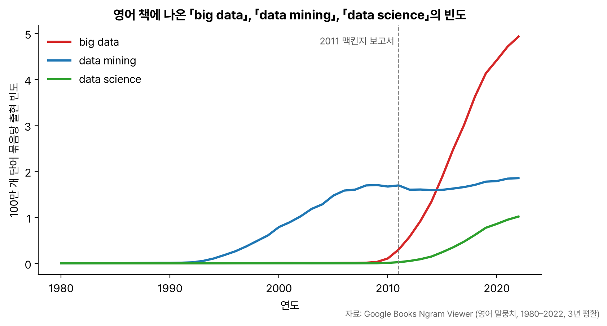

1과목 두 번째 단원 '데이터의 가치와 미래'. 빅데이터의 이해, 가치와 영향, 비즈니스 모델, 위기 요인과 통제 방안, 미래의 빅데이터까지 다섯 부분이다. 용어와 설명을 짝지어 고르는 문제가 많아서 짝이 되는 것끼리 표로 묶었다.

## 요약

- 빅데이터는 흔히 3V(규모, 다양성, 속도)로 정의하고, 여기에 가치나 정확성을 더해 4V로 말하기도 한다.
- 빅데이터는 데이터를 다루는 방식을 바꾼다. 사전처리에서 사후처리로, 표본조사에서 전수조사로, 질에서 양으로, 인과관계에서 상관관계로 무게중심이 옮겨 갔다.
- 빅데이터의 가치는 재사용, 재조합, 새로운 분석 기법 때문에 미리 산정하기 어렵다.
- 비즈니스에서는 연관규칙, 유형분석, 유전 알고리즘, 기계학습, 회귀분석, 감정분석, 소셜 네트워크 분석의 일곱 가지 기법을 쓴다.
- 위기 요인은 사생활 침해, 책임 원칙 훼손, 데이터 오용이고, 각각 동의제에서 책임제로의 전환, 결과 기반 책임 원칙, 알고리즈미스트로 대응한다.
- 빅데이터 활용의 세 요소는 데이터, 기술, 인력이다.


flowchart LR
  A["빅데이터의 이해 정의와 출현 배경"] --> B["가치와 영향 기업 · 정부 · 개인"]
  B --> C["비즈니스 모델 7가지 분석 기법"]
  C --> D["위기 요인 사생활 · 책임 · 오용"]
  D --> E["미래 데이터 · 기술 · 인력"]


## 1. 빅데이터의 이해

### 빅데이터의 정의

빅데이터에는 하나로 정해진 정의가 없고, 보는 관점에 따라 범위가 넓어진다.

| 관점 | 정의 |
|---|---|
| 좁은 의미(데이터 자체) | 기존 데이터베이스 관리 도구로 수집, 저장, 관리, 분석할 수 있는 수준을 넘는 규모의 데이터(맥킨지, 2011) |
| 중간 의미(처리 기술 포함) | 다양한 종류의 대규모 데이터에서 낮은 비용으로 가치를 뽑아내고, 빠르게 수집·발굴·분석하도록 설계된 차세대 기술과 아키텍처(IDC, 2011) |
| 넓은 의미(인재와 조직 포함) | 데이터, 처리 기술, 그리고 이를 다룰 인재와 조직까지 아우르는 개념 |

가장 널리 쓰이는 정의는 2001년 메타그룹(현 가트너)의 더그 레이니가 제시한 **3V**이다.

| 요소 | 뜻 |
|---|---|
| Volume(규모) | 데이터의 양이 매우 크다 |
| Variety(다양성) | 정형뿐 아니라 반정형, 비정형 데이터까지 종류가 다양하다 |
| Velocity(속도) | 데이터가 매우 빠르게 생성되고, 빠르게 처리해야 한다 |

여기에 **Value(가치)** 를 더해 4V라고 부르는 경우가 많고, 데이터의 정확성과 신뢰성을 뜻하는 **Veracity(정확성)** 를 넣는 자료도 있다.

> **쉬운 설명**
>
> 하루에 편지 몇 통 오는 우체통이 일반 데이터라면, 빅데이터는 1초에 수천 통이 쏟아지는데(속도) 편지뿐 아니라 사진, 소포, 음성 메시지까지 섞여 들어오고(다양성) 쌓아 둘 창고가 계속 모자란(규모) 우체국이다.

### 빅데이터의 출현 배경

| 배경 | 내용 |
|---|---|
| 산업계 | 고객 데이터가 쌓이면서 숨은 가치를 찾기 시작했다. 양이 많아지면 질적 변화가 생긴다는 양질 전환 법칙이 적용되었다 |
| 학계 | 인간 게놈 프로젝트, 기후, 천문, 소립자 물리학처럼 거대한 데이터를 다루는 연구가 늘었다 |
| 기술 발전 | 디지털화, 저장 장치 가격 하락, 인터넷과 모바일 보급, 스마트 단말과 센서 확산, 그리고 클라우드 컴퓨팅 이 대용량 처리를 경제적으로 만들었다 |

### 빅데이터를 설명하는 비유

| 비유 | 뜻 |
|---|---|
| 산업혁명의 석탄과 철 | 서비스, 제조, 과학 등 사회 전반을 바꾸는 원동력이다 |
| 21세기의 원유 | 경제에 생산성을 높이는 새로운 범주의 비즈니스를 만들어 낸다 |
| 렌즈 | 현미경이 생물학을 바꿨듯 세상을 보는 방식을 바꾼다. 책 속 단어 빈도를 시대별로 보여 주는 구글 Ngram Viewer가 예다 |
| 플랫폼 | 다른 사람들이 그 위에서 서비스를 만드는 공동 활용의 기반이 된다. 페이스북이 외부 개발자에게 데이터를 열어 준 F8 행사가 예다 |

_'렌즈'로서의 빅데이터. Google Books Ngram Viewer로 책 수백만 권의 단어 빈도를 그려 보면, 'big data'는 2010년 무렵부터 가파르게 늘어 2015년에 'data mining'을 앞질렀다. 자료: [Google Books Ngram Viewer](https://books.google.com/ngrams)_

### 빅데이터가 가져온 본질적 변화

| 이전 | 이후 | 설명 |
|---|---|---|
| 사전처리 | 사후처리 | 필요한 정보만 골라 저장하던 방식에서, 일단 모두 쌓아 두고 나중에 조합해 숨은 정보를 찾는 방식으로 |
| 표본조사 | 전수조사 | 저장과 처리 비용이 내려가 일부가 아닌 전체를 분석할 수 있게 됨 |
| 질 | 양 | 데이터 몇 개의 품질 문제보다 많은 양이 주는 정확한 경향이 더 중요해짐 |
| 인과관계 | 상관관계 | '왜'를 끝까지 밝히기 전에 '무엇이 함께 일어나는가'만으로도 의사결정을 할 수 있게 됨 |

> **쉬운 설명**
>
> 예전에는 사진을 인화해야 해서 잘 나온 것만 골라 찍었다면(사전처리, 질), 지금은 휴대폰으로 일단 다 찍고 나중에 고른다(사후처리, 양). '비 오는 날 파전이 잘 팔린다'는 사실은 이유를 몰라도 재료 준비에 바로 쓸 수 있다(상관관계).

## 2. 빅데이터의 가치와 영향

### 가치를 산정하기 어려운 이유

| 이유 | 설명 |
|---|---|
| 데이터 활용 방식 | 재사용, 재조합(mashup), 다목적 개발이 일반화되어 누가 언제 어디서 쓸지 알 수 없다 |
| 새로운 가치 창출 | 기존에 없던 가치를 만들어 내므로 기존 기준으로 측정하기 어렵다 |
| 분석 기술의 발전 | 지금은 가치가 없어 보이는 데이터도 새 분석 기법이 나오면 가치가 생긴다 |

### 빅데이터의 영향

| 대상 | 영향 |
|---|---|
| 기업 | 혁신, 경쟁력 강화, 생산성 향상 |
| 정부 | 환경 탐색, 상황 분석, 미래 대응 |
| 개인 | 목적에 맞는 활용, 맞춤형 서비스 이용 |

## 3. 비즈니스 모델

빅데이터를 실제 사업에 쓸 때 기본이 되는 일곱 가지 분석 기법이 자주 출제된다. 기법 이름과 활용 예를 짝지어 기억해야 한다.

| 기법 | 핵심 질문 | 활용 예 |
|---|---|---|
| 연관규칙 학습(Association rule learning) | 무엇과 무엇이 함께 일어나는가? | 커피를 사는 고객이 탄산음료도 많이 사는가? |
| 유형분석(Classification tree analysis) | 이 대상은 어느 그룹에 속하는가? | 문서 분류, 조직을 그룹으로 나누기, 온라인 수강생의 특성에 따른 분류 |
| 유전 알고리즘(Genetic algorithms) | 최적의 해는 무엇인가? (진화를 흉내 내 점점 나은 해를 찾음) | 택배 차량 배치, 방사선 치료의 최적 배합, 물류 경로 최적화 |
| 기계학습(Machine learning) | 기존 데이터로 학습해 무엇을 예측할 수 있는가? | 시청 기록으로 좋아할 영화 추천 |
| 회귀분석(Regression analysis) | 독립변수를 바꾸면 종속변수가 어떻게 변하는가? | 고객 만족도가 충성도에 미치는 영향, 사용자의 나이가 구매 차량 종류에 미치는 영향 |
| 감정분석(Sentiment analysis) | 이 글에 담긴 감정은 긍정인가 부정인가? | 새 환불 정책에 대한 고객 반응, 상품평 분석 |
| 소셜 네트워크 분석(Social network analysis) | 누가 누구와 연결되어 있고, 누가 영향력이 큰가? | 고객 관계망에서 오피니언 리더(영향력자) 찾기 |

> **쉬운 설명**
>
> 마트를 예로 들면, 라면과 계란을 같이 사는지 보는 게 연관규칙, 손님을 알뜰형·충동형으로 나누는 게 유형분석, 트럭 배송 경로를 가장 짧게 짜는 게 유전 알고리즘, 단골의 다음 구매를 맞히는 게 기계학습, 할인율을 올리면 매출이 얼마나 느는지 보는 게 회귀분석, 리뷰가 칭찬인지 불만인지 읽는 게 감정분석, 입소문을 퍼뜨리는 손님을 찾는 게 소셜 네트워크 분석이다.

## 4. 위기 요인과 통제 방안

| 위기 요인 | 내용 | 통제 방안 |
|---|---|---|
| 사생활 침해 | 목적 외로 쓰인 개인정보가 사생활을 위협한다. 여행 사실을 SNS에 올렸다가 빈집털이를 당하는 경우가 예다 | 개인정보 제공자의 동의제 에서 개인정보 사용자의 책임제 로 바꾼다 |
| 책임 원칙 훼손 | 예측만으로 사람을 처벌하거나 불이익을 준다. 범죄 예측으로 미리 체포하는 영화 '마이너리티 리포트', 신용도가 높아도 특정 집단이라는 이유로 대출이 거절되는 경우가 예다 | 행동의 결과 에 대해서만 책임을 묻는 원칙을 지킨다 |
| 데이터 오용 | 데이터와 알고리즘이 틀릴 수 있는데 그 결과를 그대로 믿는다. 잘못된 지표로 판단해 피해가 생기는 경우가 예다 | 알고리즘에 접근할 수 있게 하고, 알고리즘을 해석하고 피해를 구제하는 전문가인 알고리즈미스트(algorithmist) 를 둔다 |

### 개인정보 비식별화 기법

개인정보를 안전하게 쓰려면 특정 개인을 알아볼 수 없게 처리해야 한다. 대표적인 기법은 다음과 같다.

| 기법 | 방법 | 예 |
|---|---|---|
| 가명처리(pseudonymization) | 식별자를 다른 값으로 바꾼다 | 홍길동, 35세 → 임꺽정, 30대 |
| 총계처리(aggregation) | 개별 값 대신 합계나 평균을 보여 준다 | 김씨 170cm, 이씨 160cm → 평균 165cm |
| 데이터 값 삭제(data reduction) | 식별에 쓰일 수 있는 값을 지운다 | 주민등록번호 901206-1234567 → 90년대생, 남 |
| 범주화(data suppression) | 정확한 값을 구간이나 범주로 바꾼다 | 나이 35세 → 30~40세 |
| 데이터 마스킹(data masking) | 값의 일부를 다른 문자로 가린다 | 홍길동 → 홍○○, 010-1234-5678 → 010--5678 |

> **쉬운 설명**
>
> 반 성적표를 공개할 때 이름을 별명으로 바꾸면 가명처리, 반 평균만 알려 주면 총계처리, 주소 칸을 지우면 값 삭제, '80점대'로만 적으면 범주화, '김○○'처럼 일부를 가리면 마스킹이다.

## 5. 미래의 빅데이터

빅데이터 활용에는 세 가지 요소가 필요하다.

| 요소 | 미래의 모습 |
|---|---|
| 데이터 | 모든 것이 데이터가 된다(datafication). 사물인터넷(IoT) 센서가 사람과 사물의 움직임을 기록한다 |
| 기술 | 알고리즘과 인공지능이 진화해 데이터에서 더 많은 가치를 뽑아낸다 |
| 인력 | 데이터 사이언티스트와 알고리즈미스트처럼 데이터를 해석하고 책임지는 전문가가 필요하다 |

## 헷갈렸던 것들

- 빅데이터의 본질적 변화는 '인과관계 → 상관관계' 방향이다. 거꾸로 적은 보기가 자주 나온다.
- 빅데이터 출현 배경에서 경제성을 크게 높인 기술은 **클라우드 컴퓨팅** 이다.
- 사생활 침해의 통제 방안은 '동의제 강화'가 아니라 '책임제로 전환'이다.
- 기법과 예를 짝짓는 문제에서 '최적화'가 보이면 유전 알고리즘, '영향을 미치는가'가 보이면 회귀분석, '함께 구매'가 보이면 연관규칙이다.
- 범주화는 값을 구간으로 바꾸는 것이고, 마스킹은 일부를 가리는 것이다.

## 용어 정리

| 용어 | 뜻 |
|---|---|
| 3V | Volume, Variety, Velocity |
| 양질 전환 법칙 | 양이 쌓이면 질적인 변화가 일어난다는 원리 |
| 데이터화(datafication) | 세상의 현상을 데이터로 바꾸는 것 |
| 알고리즈미스트 | 알고리즘이 낸 결과로 피해를 입은 사람을 돕고 알고리즘을 해석하는 전문가 |
| 비식별화 | 개인을 알아볼 수 없도록 개인정보를 처리하는 것 |

## 복습 문제

**1.** 빅데이터가 가져온 본질적 변화로 옳지 않은 것은?

① 사전처리 → 사후처리 ② 표본조사 → 전수조사 ③ 인과관계 → 상관관계 ④ 양 → 질

**2.** '택배 차량을 어떻게 배치해야 배송 비용이 가장 적을까?'에 가장 알맞은 기법은?

① 연관규칙 학습 ② 감정분석 ③ 소셜 네트워크 분석 ④ 유전 알고리즘

**3.** 빅데이터 시대에 사생활 침해를 막기 위한 통제 방안으로 알맞은 것은?

① 개인정보 제공자의 동의 절차를 늘린다 ② 개인정보 사용자에게 책임을 지운다 ③ 예측 결과로 미리 책임을 묻는다 ④ 알고리즘을 비공개로 둔다

**4.** 나이 35세를 '30~40세'로 바꾸는 비식별화 기법은?

① 가명처리 ② 총계처리 ③ 범주화 ④ 데이터 마스킹

**5.** 빅데이터 활용의 3요소가 아닌 것은?

① 데이터 ② 기술 ③ 인력 ④ 법률

## 답과 풀이

1. ④ 빅데이터 시대에는 질보다 **양** 이 중요해졌다. '질 → 양'이 맞는 방향이다.
2. ④ 여러 후보를 진화시키며 최적의 해를 찾는 문제는 유전 알고리즘의 대표 예다.
3. ② 동의제에서 사용자 책임제로 바꾸는 것이 사생활 침해의 통제 방안이다. ③은 책임 원칙 훼손에 해당하고, ④는 데이터 오용의 통제 방안(알고리즘 접근 허용)과 반대다.
4. ③ 정확한 값을 구간으로 바꾸는 것은 범주화다.
5. ④ 빅데이터 활용의 3요소는 데이터, 기술, 인력이다.

## 참고 자료

- 한국데이터산업진흥원 데이터자격검정, ADsP 출제기준: <https://www.dataq.or.kr>
- 개인정보보호위원회, 가명정보 처리 가이드라인: <https://www.pipc.go.kr>
