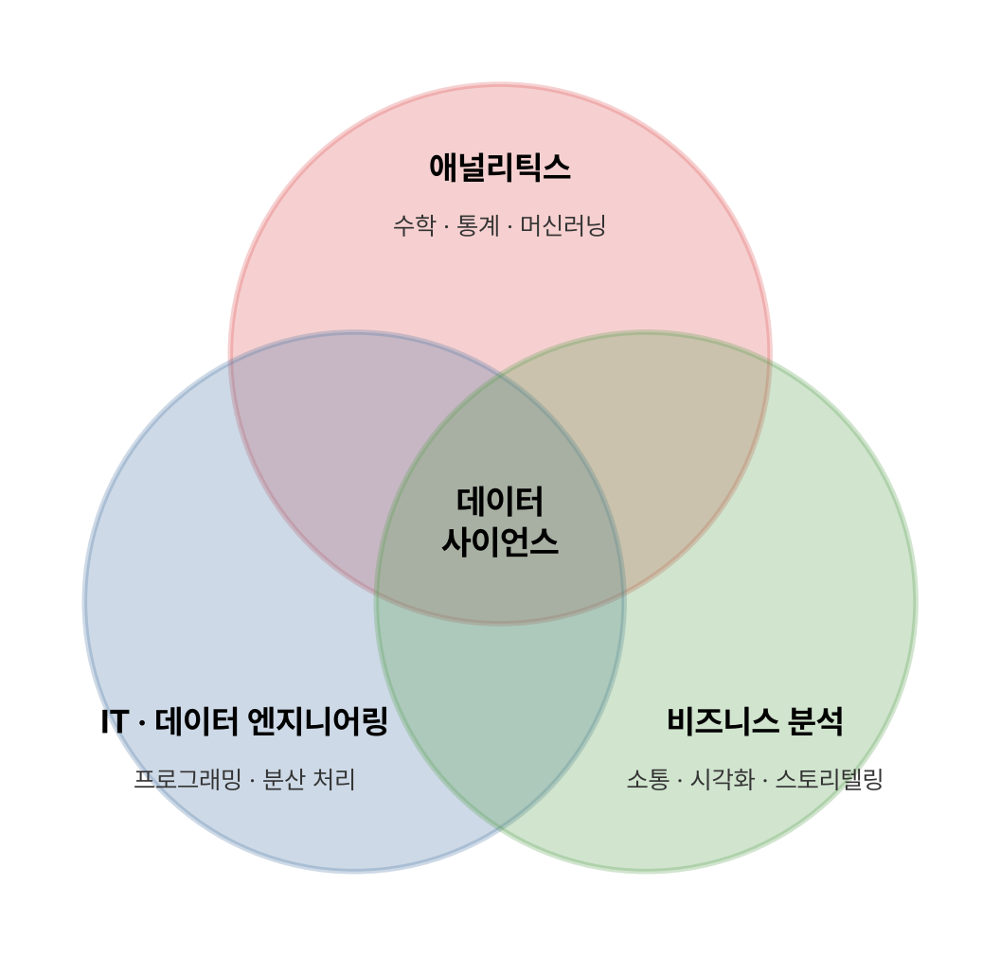

단원 이름은 '가치 창조를 위한 데이터 사이언스와 전략 인사이트'로 길지만, 내용은 빅데이터 분석과 전략 인사이트, 데이터 사이언티스트에게 필요한 역량, 데이터 사이언스의 미래 세 가지다.

## 요약

- 빅데이터 분석의 핵심은 데이터의 크기가 아니라, 분석으로 사업 전략에 쓸 통찰(인사이트)을 얻는 것이다.
- 일차원적 분석은 부서 단위의 업무 개선에 그친다. 전략적 인사이트를 얻으려면 사업 환경 전체를 보는 분석이 필요하다.
- 데이터 사이언스는 정형·비정형 데이터에서 의미를 뽑고, 그 결과를 사업에 전달하는 과정까지 포함한다.
- 데이터 사이언티스트에게는 이론과 분석 기술(하드 스킬)과 통찰력, 전달력, 협업 능력(소프트 스킬)이 함께 필요하다.
- 가치 패러다임은 디지털화에서 연결로, 연결에서 에이전시로 옮겨 가고 있다.
- 모든 분석 모델은 가정 위에 서 있으므로, 인문학적 사고로 그 가정을 의심해야 한다.

_데이터 사이언스는 애널리틱스, IT, 비즈니스 분석이 겹치는 곳에 있다_

## 1. 빅데이터 분석과 전략 인사이트

### 빅데이터 회의론

빅데이터가 유행하자 '또 하나의 거품'이라는 회의론도 함께 나왔다. 과거 고객관계관리(CRM) 같은 대규모 IT 투자가 큰 성과 없이 끝난 경험이 있어서, 기업들이 같은 실패를 되풀이할까 걱정한 것이다. 이를 **부정적 학습효과** 라고 한다. 또한 잘 알려진 빅데이터 성공 사례 가운데 상당수가 기존 데이터 분석으로도 할 수 있던 일을 이름만 바꾼 경우였다.

### '빅'이 핵심이 아니다

데이터가 크다고 가치가 저절로 생기지는 않는다. 성과를 가르는 건 데이터의 양보다 유형과 분석 방식, 곧 **어떤 시각과 질문으로 분석하느냐**다. 분석으로 얻은 통찰을 실제 전략에 반영하는 능력도 여기에 들어간다.

### 일차원적 분석과 전략 도출을 위한 가치 기반 분석

| 구분 | 일차원적 분석 | 전략 도출을 위한 가치 기반 분석 |
|---|---|---|
| 범위 | 부서 단위, 개별 업무 | 사업 전체, 경쟁 환경 |
| 질문 | 이 업무를 어떻게 더 효율적으로 할까? | 우리는 어디서 어떻게 경쟁해야 할까? |
| 성과 | 비용 절감, 업무 효율 개선 | 새로운 기회 발견, 비즈니스 모델 혁신 |

산업별 일차원적 분석의 예는 다음과 같다.

| 산업 | 일차원적 분석 예 |
|---|---|
| 금융 서비스 | 신용점수 산정, 사기 탐지, 가격 책정, 프로그램 트레이딩, 클레임 분석, 고객 수익성 분석 |
| 소매업 | 프로모션, 매장 레이아웃, 상품 배치, 수요 예측, 재고 보충 |
| 제조업 | 맞춤형 상품 개발, 신상품 개발 |
| 에너지 | 트레이딩, 공급과 수요 예측 |
| 온라인 | 고객 추천, 사이트 설계 |
| 병원 | 가격 책정, 고객 로열티, 수익 관리 |
| 정부 | 사기 탐지, 사례 관리, 범죄 방지, 수익 최적화 |

> **쉬운 설명**
>
> 동네 빵집이 '어제 많이 팔린 빵을 오늘 더 굽자'고 정하는 건 일차원적 분석이다. '근처에 회사가 늘어나니 아침 샌드위치 세트를 새로 내자'처럼 바깥 변화까지 읽어 사업 방향을 바꾸는 게 전략적 인사이트다.

## 2. 전략 인사이트 도출을 위한 필요 역량

### 데이터 사이언스란

**데이터 사이언스(data science)** 는 데이터에서 의미 있는 정보를 추출하는 학문이다. 통계학과 비교하면 차이가 분명하다.

| 구분 | 통계학 | 데이터 사이언스 |
|---|---|---|
| 데이터 | 주로 정형 데이터 | 정형, 반정형, 비정형 데이터 모두 |
| 범위 | 분석 자체에 집중 | 분석에 더해, 결과를 구현하고 전달하는 과정까지 포함 |
| 지향 | 이론과 방법론 | 실제 비즈니스 문제 해결 |

데이터 사이언스는 세 영역이 겹치는 곳에 있다.

| 영역 | 내용 |
|---|---|
| 애널리틱스(Analytics) | 수학, 확률 모델, 머신러닝, 분석학, 패턴 인식, 데이터 마이닝, 불확실성 모델링 |
| IT(데이터 엔지니어링) | 프로그래밍, 데이터 웨어하우징, 고성능 컴퓨팅, 분산 컴퓨팅 |
| 비즈니스 분석 | 커뮤니케이션, 프레젠테이션, 스토리텔링, 시각화 |

### 데이터 사이언티스트의 역량

| 구분 | 역량 | 내용 |
|---|---|---|
| 하드 스킬(Hard skill) | 빅데이터에 대한 이론적 지식 | 관련 기법을 이해하고 방법론을 익힌다 |
| | 분석 기술에 대한 숙련 | 최적의 분석을 설계하고 노하우를 쌓는다 |
| 소프트 스킬(Soft skill) | 통찰력 있는 분석 | 창의적 사고, 호기심, 논리적 비판 |
| | 설득력 있는 전달 | 스토리텔링, 시각화(visualization) |
| | 다분야 간 협력 | 커뮤니케이션 |

가트너는 데이터 사이언티스트에게 필요한 역량으로 **데이터 관리, 분석 모델링, 비즈니스 분석, 소프트 스킬** 네 가지를 꼽았다.

> **쉬운 설명**
>
> 데이터 사이언티스트는 요리사와 비슷하다. 칼질과 불 조절(하드 스킬)을 잘해야 하지만, 손님이 무엇을 원하는지 알아채고(통찰력), 메뉴를 맛있게 소개하고(전달력), 주방 사람들과 손발을 맞추는 능력(협력)이 있어야 좋은 식당을 꾸릴 수 있다.

### 인문학이 필요한 이유

빅데이터 시대에 인문학이 주목받는 배경은 세 가지다.

| 변화 | 이전 | 이후 |
|---|---|---|
| 세계화 | 단순한 세계화 | 복잡한 세계화(국가와 문화마다 다른 차이를 이해해야 함) |
| 비즈니스의 중심 | 제품 생산 | 서비스 |
| 경제와 산업의 논리 | 공급자 중심의 생산 | 시장 창조 |

모든 분석 모델은 **가정** 위에 만들어진다. 2008년 금융 위기 때 많은 금융 모델이 '집값은 크게 떨어지지 않는다'는 가정에 기대고 있었고, 그 가정이 깨지자 모델도 무너졌다. 그래서 데이터 사이언티스트는 숫자 너머의 맥락을 읽고 가정을 의심하는 인문학적 사고를 갖춰야 한다. 정량 분석이 모든 것을 설명하지는 못한다는 점을 기억해야 한다.

## 3. 빅데이터 그리고 데이터 사이언스의 미래

### 가치 패러다임의 변화


flowchart LR
  D["디지털화 Digitalization"] --> C["연결 Connection"]
  C --> A["에이전시 Agency"]


| 단계 | 핵심 | 예 |
|---|---|---|
| 디지털화(Digitalization) | 아날로그를 디지털로 바꾸는 것이 가치를 만든다 | 운영체제, 워드프로세서 같은 소프트웨어 |
| 연결(Connection) | 디지털화된 정보와 대상을 서로 연결하는 것이 가치를 만든다 | 검색 엔진, 포털 |
| 에이전시(Agency) | 복잡하게 얽힌 연결을 효과적이고 믿을 수 있게 관리하는 능력이 가치를 만든다 | 사물인터넷, 개인화 서비스 |

> **쉬운 설명**
>
> 종이 주소록을 휴대폰 연락처로 옮긴 게 디지털화, 연락처가 메신저와 SNS로 이어진 게 연결, 수많은 연결 가운데 지금 나에게 필요한 연락과 알림만 골라 주는 비서 역할이 에이전시다.

## 헷갈렸던 것들

- 데이터 사이언스는 정형 데이터만 다루지 않는다. 비정형 데이터까지 다루고, 결과를 전달하는 과정도 포함한다.
- 스토리텔링과 시각화는 **소프트 스킬** 이다. '분석 기술의 숙련'은 하드 스킬이다.
- 가치 패러다임의 순서는 디지털화 → 연결 → 에이전시다.
- 빅데이터 분석에서 가장 중요한 것은 '데이터의 크기'가 아니다.
- 인문학 열풍의 배경은 '서비스 → 제품'이 아니라 '제품 → 서비스'이다.

## 용어 정리

| 용어 | 뜻 |
|---|---|
| 전략 인사이트 | 분석으로 얻어 사업 전략에 반영하는 통찰 |
| 부정적 학습효과 | 과거 IT 투자 실패 경험 때문에 새 기술 투자를 꺼리는 현상 |
| 데이터 사이언스 | 데이터에서 의미를 추출하고 전달하는 학문 |
| 하드 스킬 / 소프트 스킬 | 이론과 분석 기술 / 통찰력, 전달력, 협업 능력 |
| 에이전시 | 복잡한 연결을 효과적이고 믿을 만하게 관리하는 능력 |

## 복습 문제

**1.** 데이터 사이언티스트의 소프트 스킬에 해당하지 않는 것은?

① 분석 기술에 대한 숙련 ② 창의적 사고 ③ 스토리텔링 ④ 다분야 간 협력

**2.** 데이터 사이언스에 대한 설명으로 옳지 않은 것은?

① 정형 데이터와 비정형 데이터를 모두 다룬다 ② 분석 결과를 효과적으로 전달하는 과정을 포함한다 ③ 애널리틱스, IT, 비즈니스 분석 영역이 겹친다 ④ 통계학과 달리 분석 자체에만 집중한다

**3.** 가치 패러다임의 변화 순서로 옳은 것은?

① 디지털화 → 연결 → 에이전시 ② 연결 → 디지털화 → 에이전시 ③ 에이전시 → 연결 → 디지털화 ④ 디지털화 → 에이전시 → 연결

**4.** 다음 중 일차원적 분석에 가장 가까운 것은?

① 경쟁사와 시장 변화를 분석해 새로운 사업 모델을 만든다 ② 산업 구조 변화를 읽고 진출 시장을 정한다 ③ 고객 가치 변화에 맞춰 사업 방향을 바꾼다 ④ 소매점에서 재고 보충량을 예측한다

## 답과 풀이

1. ① 분석 기술에 대한 숙련은 하드 스킬이다.
2. ④ 데이터 사이언스는 분석에 그치지 않고 결과를 구현하고 전달하는 과정까지 포함한다.
3. ① 디지털화 → 연결 → 에이전시 순서다.
4. ④ 재고 보충 예측은 부서 단위의 업무 효율을 높이는 일차원적 분석이다. 나머지는 사업 전체의 전략을 다루는 분석이다.

## 참고 자료

- 한국데이터산업진흥원 데이터자격검정, ADsP 출제기준: <https://www.dataq.or.kr>
