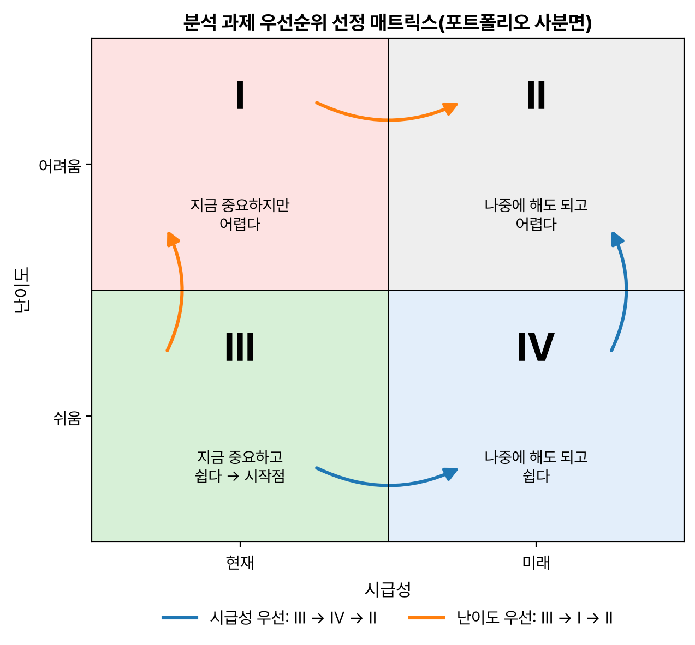
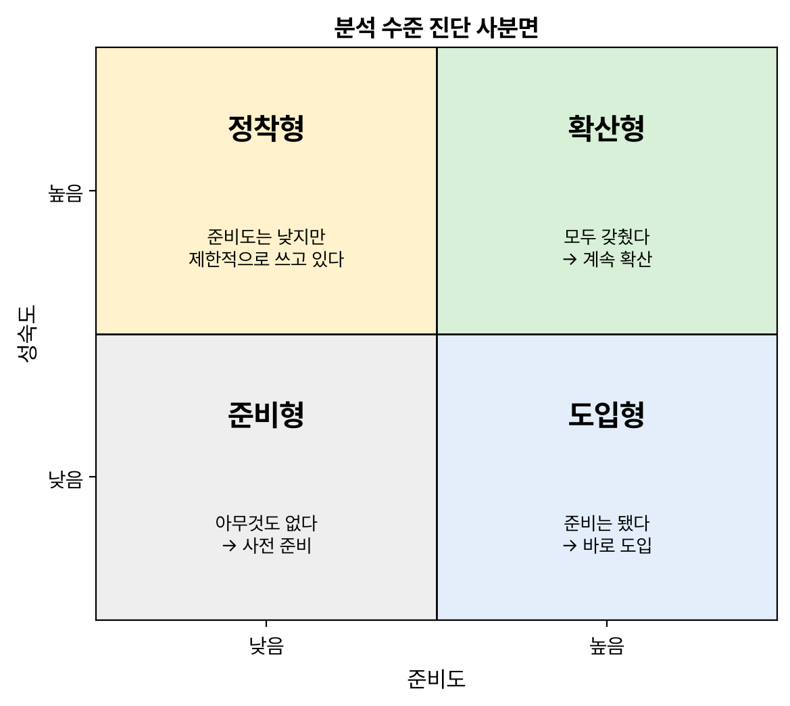

2과목 마지막 단원 '분석 마스터 플랜'. 마스터 플랜 수립 프레임워크와 분석 거버넌스 체계를 정리했다. 포트폴리오 사분면과 분석 성숙도 단계는 거의 매번 나오는 것 같아서 특히 신경 써서 적었다.

## 요약

- 마스터 플랜은 과제의 우선순위(무엇부터 할지)와 적용 범위·방식(어디까지 어떻게 할지)을 정해 중장기 로드맵을 만드는 일이다.
- 우선순위는 시급성과 난이도로 평가하고, 포트폴리오 사분면에서 시급성이 높고 난이도가 낮은 **Ⅲ사분면**부터 시작한다.
- 분석 거버넌스는 조직, 프로세스, 시스템, 데이터, 인력(교육)의 다섯 요소로 구성된다.
- 분석 성숙도는 도입, 활용, 확산, 최적화의 4단계이고, 준비도와 성숙도를 묶으면 준비형, 정착형, 도입형, 확산형으로 나뉜다.
- 데이터 거버넌스는 원칙, 조직, 프로세스로 구성되고, 데이터 표준화부터 표준화 활동까지 네 가지 체계로 운영한다.
- 분석 조직 구조는 집중 구조, 기능 구조, 분산 구조가 있다.

## 1. 마스터 플랜 수립 프레임워크

### ISP와 분석 마스터 플랜

**ISP(Information Strategy Planning, 정보전략계획)** 는 정보기술과 정보시스템을 전략적으로 활용하려고 조직 안팎의 환경을 분석하고, 기회와 문제를 찾고, 시스템 구축의 우선순위를 정하는 중장기 마스터 플랜 수립 절차다. 분석 마스터 플랜은 이 ISP 방법론을 쓰되 데이터 분석 기획의 특성을 반영한다.

### 두 가지 고려 요소

| 구분 | 고려 요소 |
|---|---|
| 우선순위 결정 | 전략적 중요도, 비즈니스 성과와 ROI(투자 대비 수익), 실행 용이성 |
| 적용 범위와 방식 결정 | 업무 내재화 적용 수준, 분석 데이터 적용 수준, 기술 적용 수준 |

### 우선순위 평가 절차


flowchart LR
  A["분석 과제 도출"] --> B["우선순위 평가"] --> C["우선순위 정련"]


우선순위 정련 단계에서는 과제 사이의 선후행 관계를 따져 순서를 조정한다. 예를 들어 고객 데이터를 정리하는 과제가 고객 이탈 예측 과제보다 먼저 끝나야 한다.

### ROI 관점에서 본 빅데이터의 4V

| 구분 | 4V 요소 | 평가 기준 |
|---|---|---|
| 투자 비용 요소 | Volume(규모), Variety(다양성), Velocity(속도) | 난이도 |
| 비즈니스 효과 | Value(가치) | 시급성 |

- **시급성:** 전략적 중요도와 목표 가치가 판단 기준이다. 지금 당장 필요한지 나중에 해도 되는지를 본다.
- **난이도:** 지금 과제를 추진할 때 비용과 범위 측면에서 쉬운지(Easy) 어려운지(Difficult)를 본다.

### 포트폴리오 사분면

| | 시급성: 현재 | 시급성: 미래 |
|---|---|---|
| 난이도: 어려움(Difficult) | Ⅰ사분면 | Ⅱ사분면 |
| 난이도: 쉬움(Easy) | Ⅲ사분면 | Ⅳ사분면 |

| 사분면 | 특징 |
|---|---|
| Ⅰ | 전략적으로 중요해 지금 해야 하지만, 난이도가 높아 바로 적용하기 어렵다 |
| Ⅱ | 지금은 중요도가 높지 않지만 중장기적으로 해야 하고, 난이도도 높다 |
| Ⅲ | 지금 중요하고 난이도도 낮아 바로 시작할 수 있다 |
| Ⅳ | 지금은 중요도가 낮지만 난이도가 낮아 나중에 쉽게 할 수 있다 |

- **시급성을 우선**하면 Ⅲ → Ⅳ → Ⅱ 순서다.
- **난이도를 우선**하면 Ⅲ → Ⅰ → Ⅱ 순서다.
- Ⅰ사분면 과제는 경영진이나 실무 담당자의 의사결정, 데이터 양과 특성, 분석 범위에 따라 우선순위를 조정할 수 있다. 예를 들어 범위를 줄여 난이도를 낮추면 Ⅰ에서 Ⅲ으로 옮길 수 있다.

_포트폴리오 사분면. 출발점은 언제나 Ⅲ이고, 기준으로 정한 축을 따라 먼저 옮겨 간다_

> **쉬운 설명**
>
> 출발점은 늘 '지금 필요하고 쉬운 일'인 Ⅲ이다. 그다음은 **기준으로 정한 축을 따라 먼저 한 칸 옮긴다**고 기억하면 쉽다.
>
> - 시급성 우선: 쉬운 줄은 그대로 두고 시급성 축을 따라 '현재 → 미래'로 옮겨 Ⅳ, 마지막에 Ⅱ. 그래서 Ⅲ → Ⅳ → Ⅱ.
> - 난이도 우선: 현재 열은 그대로 두고 난이도 축을 따라 '쉬움 → 어려움'으로 옮겨 Ⅰ, 마지막에 Ⅱ. 그래서 Ⅲ → Ⅰ → Ⅱ.
>
> 어느 쪽이든 미래에 할 어려운 일(Ⅱ)이 맨 마지막이다.

### 이행 계획 수립

| 단계 | 내용 |
|---|---|
| 로드맵 수립 | 포트폴리오 사분면으로 정한 우선순위에 과제별 적용 범위와 방식을 반영해 최종 우선순위를 정하고, 단계적 구현 로드맵을 만든다 |
| 세부 이행 계획 수립 | 폭포수 방식도 쓰지만, 반복적인 정련 과정으로 완성도를 높이는 방식을 주로 쓴다. 특히 모든 단계를 반복하기보다 모델링 단계만 반복하는 혼합형을 많이 쓴다 |

## 2. 분석 거버넌스 체계 수립

### 거버넌스 체계의 구성 요소

**분석 거버넌스**는 기업이 분석을 체계적으로 하고 계속 발전시키기 위한 관리 체계다.

| 구성 요소 | 내용 |
|---|---|
| 조직(Organization) | 분석 기획과 관리를 맡을 조직 |
| 과제 기획 및 운영 프로세스(Process) | 과제를 발굴하고 수행하는 절차 |
| 분석 관련 시스템(System) | 분석을 지원하는 IT 시스템 |
| 데이터(Data) | 데이터 거버넌스 |
| 분석 관련 교육 및 마인드 육성 체계(Human Resource) | 분석 역량을 키우는 교육과 문화 |

### 데이터 분석 성숙도 모델

조직의 분석 수준을 진단하는 틀로, 소프트웨어 개발 능력 성숙도 모델인 **CMMI(Capability Maturity Model Integration)** 를 바탕으로 만들었다. 비즈니스, 조직·역량, IT의 세 부문을 4단계로 진단한다.


flowchart LR
  A["도입 분석 시작"] --> B["활용 업무에 적용"] --> C["확산 전사 공유"] --> D["최적화 혁신과 성과 향상"]


| 단계 | 설명 | 비즈니스 부문 | 조직·역량 부문 | IT 부문 |
|---|---|---|---|---|
| 도입 | 분석을 시작해 환경과 시스템을 구축한다 | 실적 분석과 통계, 정기 보고 | 일부 부서에서 수행, 담당자 역량에 의존 | 데이터 웨어하우스, 데이터 마트, ETL/EAI, OLAP |
| 활용 | 분석 결과를 실제 업무에 적용한다 | 미래 결과 예측, 시뮬레이션 | 전문 담당 부서에서 수행, 분석 기법 도입 | 실시간 대시보드, 통계 분석 환경 |
| 확산 | 전사 차원에서 분석을 관리하고 공유한다 | 전사 성과 실시간 분석, 분석 규칙 관리 | 모든 부서에서 수행, 분석 COE(Center of Excellence) 운영, 데이터 사이언티스트 확보 | 빅데이터 관리 환경, 시뮬레이션·최적화, 비주얼 분석 |
| 최적화 | 분석을 진화시켜 혁신과 성과 향상에 기여한다 | 외부 환경 분석, 최적화 업무 적용, 비즈니스 모델 진화 | 데이터 사이언스 그룹, 경영진이 분석을 활용하고 전략과 연계 | 분석 협업 환경, 분석 샌드박스, 프로세스 내재화 |

### 분석 준비도

**분석 준비도(Readiness)** 는 조직이 분석을 할 준비가 얼마나 되어 있는지 보는 지표로, 여섯 영역을 진단한다.

| 영역 | 진단 내용 예 |
|---|---|
| 분석 업무 파악 | 발생한 사실 분석, 예측 분석, 최적화 분석 업무가 있는가 |
| 인력 및 조직 | 분석 전문가와 전담 조직이 있는가 |
| 분석 기법 | 업무별로 적합한 분석 기법을 쓰고 있는가 |
| 분석 데이터 | 데이터가 충분하고 신뢰할 만한가 |
| 분석 문화 | 사실에 근거해 의사결정을 하는가 |
| IT 인프라 | 운영 시스템과 분석 환경이 갖춰져 있는가 |

### 분석 수준 진단 결과: 사분면 분석

준비도와 성숙도를 두 축으로 놓으면 조직의 현재 위치를 네 유형으로 나눌 수 있다.

| | 준비도 낮음 | 준비도 높음 |
|---|---|---|
| 성숙도 높음 | 정착형 | 확산형 |
| 성숙도 낮음 | 준비형 | 도입형 |

| 유형 | 설명 |
|---|---|
| 준비형(Preparation) | 분석에 필요한 데이터, 조직, 인력, 분석 업무, 기법이 갖춰지지 않아 사전 준비가 필요하다 |
| 정착형(Establishment) | 준비도는 낮지만 조직, 인력, 분석 업무, 기법을 내부에서 제한적으로 쓰고 있어 1차적으로 정착이 필요하다 |
| 도입형(Introduction) | 분석 업무와 기법은 부족하지만 조직과 인력 등 준비도가 높아 바로 도입할 수 있다 |
| 확산형(Diffusion) | 여섯 가지 분석 구성 요소를 모두 갖췄고 부분적으로 도입되어 있어 지속적인 확산이 필요하다 |

_분석 수준 진단 사분면. 가로축이 준비도, 세로축이 성숙도다_

> **쉬운 설명**
>
> 준비도는 '운동할 장비와 시간이 있는가', 성숙도는 '실제로 운동을 얼마나 해 봤는가'이다. 장비도 경험도 없으면 준비형, 장비는 없는데 맨몸으로 꾸준히 해 왔으면 정착형, 헬스장 등록은 했는데 아직 안 가 봤으면 도입형, 장비도 경험도 다 있으면 확산형이다.

### 데이터 거버넌스 체계 수립

**데이터 거버넌스**는 전사의 모든 데이터에 대해 정책과 지침, 표준화, 운영 조직과 책임 같은 관리 체계를 세우고, 이를 운영할 프레임워크와 저장소를 만드는 일이다. 마스터 데이터, 메타데이터, 데이터 사전이 주요 관리 대상이다.

| 구성 요소 | 내용 |
|---|---|
| 원칙(Principle) | 데이터를 유지하고 관리하기 위한 지침과 가이드. 보안, 품질 기준, 변경 관리 |
| 조직(Organization) | 데이터를 관리할 조직의 역할과 책임. 데이터 관리자, 데이터베이스 관리자, 데이터 아키텍트 |
| 프로세스(Process) | 데이터 관리를 위한 활동과 체계. 작업 절차, 모니터링 활동, 측정 활동 |

| 체계 | 내용 |
|---|---|
| 데이터 표준화 | 데이터 표준 용어 설정, 명명 규칙(naming rule) 수립, 메타데이터 구축, 데이터 사전 구축 |
| 데이터 관리 체계 | 메타데이터와 데이터 사전의 관리 원칙을 세우고, 데이터 생명 주기 관리 방안을 마련한다 |
| 데이터 저장소 관리 | 메타데이터와 표준 데이터를 관리할 전사 저장소(Repository)를 만든다. 데이터 구조를 바꿀 때 미치는 영향을 미리 따지는 사전 영향 평가도 포함한다 |
| 표준화 활동 | 표준을 잘 지키는지 주기적으로 점검하고 모니터링한다 |

빅데이터 거버넌스는 여기에 빅데이터의 특성을 더한다. 데이터 양이 매우 많으므로 모든 데이터를 똑같이 관리하기보다 데이터의 가치와 비용을 따져 **데이터 최적화**와 **정보 생명 주기 관리**를 하고, 데이터 범주별로 관리 책임자인 **데이터 스튜어드(Data Steward)** 를 지정한다.

### 데이터 분석을 위한 조직 구조


flowchart TB
  subgraph C["집중 구조"]
    direction TB
    C0["경영진"] --- CA["분석 전담 조직"]
    C0 --- C1["현업 부서"]
  end
  subgraph F["기능 구조"]
    direction TB
    F0["경영진"] --- F1["현업 부서 (부서 안에서 분석)"]
  end
  subgraph D["분산 구조"]
    direction TB
    D0["경영진"] --- DA["분석 조직"]
    DA -.->|"인력 파견"| D1["현업 부서"]
  end


| 구조 | 특징 | 장단점 |
|---|---|---|
| 집중 구조 | 전사 분석 업무를 별도의 분석 전담 조직이 맡는다 | 전략적 중요도에 따라 우선순위를 정해 진행할 수 있다. 현업 부서의 분석 업무와 이중으로 겹칠 수 있다 |
| 기능 구조 | 별도 분석 조직 없이 각 현업 부서가 직접 분석한다. 가장 일반적인 형태다 | 전사 관점의 핵심 분석이 어렵고, 과거 실적 분석에 그칠 가능성이 높다 |
| 분산 구조 | 분석 조직의 인력을 현업 부서에 배치해 함께 일한다 | 전사 차원의 우선순위로 일하면서 결과를 빠르게 실행할 수 있고, 베스트 프랙티스를 공유할 수 있다. 부서 분석 업무와 역할을 분명히 나눠야 한다 |

### 분석 과제 관리 프로세스


flowchart LR
  subgraph S1["과제 발굴"]
    direction TB
    A1["분석 아이디어 발굴"] --> A2["분석 과제 후보 제안"] --> A3["분석 과제 확정"]
  end
  subgraph S2["과제 수행"]
    direction TB
    B1["팀 구성"] --> B2["분석 과제 실행"] --> B3["분석 과제 진행 관리"] --> B4["결과 공유와 개선"]
  end
  S1 --> S2


발굴한 아이디어와 진행한 과제의 결과는 **분석 과제 풀(Pool)** 로 모아 관리해, 다음 과제를 기획할 때 다시 쓴다.

### 분석 교육과 변화 관리

분석 교육은 도구 사용법보다 **분석 역량을 키우는 데** 초점을 둬야 한다. 경영진과 현업 직원이 데이터에 근거해 판단하는 분석 문화가 자리 잡도록 꾸준히 변화를 관리해야 한다.

## 헷갈렸던 것들

- 4V 가운데 Value만 비즈니스 효과(시급성)이고, 나머지 셋은 투자 비용 요소(난이도)이다.
- 포트폴리오 사분면은 Ⅲ사분면에서 시작한다. 시급성 우선 Ⅲ → Ⅳ → Ⅱ, 난이도 우선 Ⅲ → Ⅰ → Ⅱ이다.
- 세부 이행 계획은 모델링 단계만 반복하는 **혼합형**을 많이 쓴다.
- 분석 성숙도 단계는 도입 → 활용 → 확산 → 최적화다. '분석 COE 운영'과 '데이터 사이언티스트 확보'는 확산 단계다.
- 준비도는 낮고 성숙도가 높으면 **정착형**, 준비도는 높고 성숙도가 낮으면 **도입형**이다.
- 데이터 거버넌스 구성 요소는 원칙, 조직, 프로세스 세 가지다. '시스템'은 분석 거버넌스 구성 요소다.
- 별도 분석 조직이 없는 구조는 **기능 구조**이다.

## 용어 정리

| 용어 | 뜻 |
|---|---|
| ISP | 정보 전략 계획. 정보시스템 구축을 위한 중장기 마스터 플랜 |
| 포트폴리오 사분면 | 시급성과 난이도로 과제 우선순위를 정하는 2×2 표 |
| CMMI | 능력 성숙도 통합 모델. 분석 성숙도 모델의 바탕 |
| 분석 COE | 분석 전문가가 모인 전사 분석 역량 센터 |
| 데이터 스튜어드 | 데이터 범주별 관리 책임자 |
| 사전 영향 평가 | 데이터 구조 변경이 미칠 영향을 미리 따지는 활동 |

## 복습 문제

**1.** 포트폴리오 사분면에서 난이도를 우선해 과제 순서를 정할 때 옳은 것은?

① Ⅲ → Ⅳ → Ⅱ ② Ⅲ → Ⅰ → Ⅱ ③ Ⅰ → Ⅲ → Ⅱ ④ Ⅳ → Ⅲ → Ⅱ

**2.** ROI 관점에서 빅데이터의 4V 가운데 비즈니스 효과에 해당하는 것은?

① Volume ② Variety ③ Value ④ Velocity

**3.** 분석 성숙도 모델의 단계 순서로 옳은 것은?

① 도입 → 확산 → 활용 → 최적화 ② 활용 → 도입 → 확산 → 최적화 ③ 도입 → 활용 → 최적화 → 확산 ④ 도입 → 활용 → 확산 → 최적화

**4.** 분석 준비도는 높지만 분석 성숙도가 낮은 기업의 유형은?

① 준비형 ② 도입형 ③ 정착형 ④ 확산형

**5.** 데이터 거버넌스의 구성 요소가 아닌 것은?

① 분석 시스템 ② 원칙 ③ 조직 ④ 프로세스

**6.** 분석 조직 인력을 현업 부서에 배치해 전사 차원의 우선순위로 분석하는 구조는?

① 집중 구조 ② 기능 구조 ③ 분산 구조 ④ 매트릭스 구조

## 답과 풀이

1. ② 난이도 우선이면 Ⅲ → Ⅰ → Ⅱ, 시급성 우선이면 Ⅲ → Ⅳ → Ⅱ이다.
2. ③ Value가 비즈니스 효과이고 나머지 셋은 투자 비용 요소다.
3. ④ 도입 → 활용 → 확산 → 최적화다.
4. ② 준비도가 높아 바로 도입할 수 있는 도입형이다.
5. ① 데이터 거버넌스는 원칙, 조직, 프로세스로 구성된다.
6. ③ 분산 구조의 특징이다.

## 참고 자료

- 한국데이터산업진흥원 데이터자격검정, ADsP 출제기준: <https://www.dataq.or.kr>
