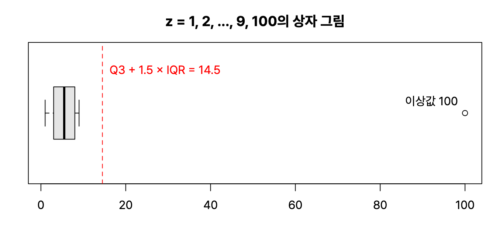

3과목은 'R 기초와 데이터 마트'부터 시작한다. R 기초, 데이터 마트, 결측값 처리와 이상값 검색을 정리했다. 코드는 전부 R 4.6.0에서 직접 돌려 보고 실제 출력을 붙였다.

## 요약

- R은 통계 분석과 시각화에 강한 무료 오픈소스 언어이고, 패키지로 기능을 넓힌다.
- R의 자료구조는 벡터, 행렬, 배열, 리스트, 데이터 프레임, 팩터다. 벡터와 행렬은 한 가지 타입만, 리스트와 데이터 프레임은 여러 타입을 담을 수 있다.
- 데이터 마트는 분석 목적에 맞게 데이터 웨어하우스에서 떼어 낸 작은 저장소이고, R에서는 reshape2, plyr, data.table 같은 패키지로 만든다.
- 결측값은 생긴 이유에 따라 완전 무작위 결측(MCAR), 무작위 결측(MAR), 비무작위 결측(MNAR)으로 나누고, 삭제하거나 대치한다.
- 이상값은 평균 ± 3 표준편차나 사분위수 범위(IQR)의 1.5배를 기준으로 찾는다.


flowchart LR
  DW["데이터 웨어하우스"] --> DM["데이터 마트<br>분석 목적별 요약"]
  DM --> C["정제<br>결측값 · 이상값 처리"]
  C --> A["분석과 모델링"]


## 1. R 기초

### R의 특징

| 특징 | 내용 |
|---|---|
| 오픈소스 | 무료로 쓸 수 있고, CRAN(Comprehensive R Archive Network)에 2만 개가 넘는 패키지가 있다 |
| 인터프리터 언어 | 코드를 한 줄씩 바로 실행하고 결과를 확인한다 |
| 객체 지향·함수형 | 모든 것이 객체이고, 함수로 데이터를 다룬다 |
| 그래픽 | 시각화 기능이 강력하다 |
| 인메모리 처리 | 데이터를 메모리에 올려 처리하므로 빠르지만, 메모리보다 큰 데이터는 다루기 어렵다 |

### 데이터 타입과 특수 값

| 타입 | 예 |
|---|---|
| numeric(숫자) | 3.14, 10 |
| integer(정수) | 10L |
| character(문자) | "a", "서울" |
| logical(논리) | TRUE, FALSE |
| complex(복소수) | 1+2i |

| 특수 값 | 뜻 |
|---|---|
| NA | 결측값(Not Available). 값이 비어 있다 |
| NULL | 객체 자체가 없다 |
| NaN | 숫자가 아니다(Not a Number). 0/0의 결과 |
| Inf, -Inf | 무한대. 1/0의 결과 |

### 자료구조

| 자료구조 | 차원 | 담을 수 있는 타입 | 만드는 함수 |
|---|---|---|---|
| 벡터(vector) | 1차원 | 한 가지 | c(), seq(), rep() |
| 행렬(matrix) | 2차원 | 한 가지 | matrix() |
| 배열(array) | 다차원 | 한 가지 | array() |
| 리스트(list) | 1차원 | 여러 가지(벡터, 데이터 프레임도 담음) | list() |
| 데이터 프레임(data frame) | 2차원 | 열마다 다를 수 있음 | data.frame() |
| 팩터(factor) | 1차원 | 범주형 | factor() |

벡터에 타입이 다른 값을 섞으면 R은 한 타입으로 강제 변환한다. 우선순위는 **문자 > 숫자 > 논리**이다.

```r
x <- c(1, "a", TRUE); x; class(x)
y <- c(1, TRUE, FALSE); y; class(y)
```

```text
[1] "1"    "a"    "TRUE"
[1] "character"
[1] 1 1 0
[1] "numeric"
```

R의 인덱스는 **1부터** 시작하고, 음수 인덱스는 '그 위치를 빼고'라는 뜻이다.

```r
v <- c(10, 20, 30, 40, 50)
v[2]; v[-1]; v[v > 25]
seq(1, 10, by = 3); rep(1:2, times = 3); rep(1:2, each = 3)
```

```text
[1] 20
[1] 20 30 40 50
[1] 30 40 50
[1]  1  4  7 10
[1] 1 2 1 2 1 2
[1] 1 1 1 2 2 2
```

행렬은 기본적으로 **열 방향**으로 값을 채운다. 행 방향으로 채우려면 `byrow = TRUE`를 쓴다.

```r
m <- matrix(1:6, nrow = 2); m
dim(m); t(m)
```

```text
     [,1] [,2] [,3]
[1,]    1    3    5
[2,]    2    4    6
[1] 2 3
     [,1] [,2]
[1,]    1    2
[2,]    3    4
[3,]    5    6
```

리스트, 팩터, 데이터 프레임은 다음과 같다. 팩터는 범주를 내부적으로 정수로 저장한다.

```r
l <- list(name = "kim", age = 30, score = c(90, 85)); str(l)
f <- factor(c("low", "high", "mid", "low"), levels = c("low", "mid", "high"))
f; levels(f); as.integer(f)
df <- data.frame(id = 1:3, name = c("A", "B", "C"), score = c(80, NA, 95))
str(df)
mean(df$score); mean(df$score, na.rm = TRUE)
```

```text
List of 3
 $ name : chr "kim"
 $ age  : num 30
 $ score: num [1:2] 90 85
[1] low  high mid  low 
Levels: low mid high
[1] "low"  "mid"  "high"
[1] 1 3 2 1
'data.frame':	3 obs. of  3 variables:
 $ id   : int  1 2 3
 $ name : chr  "A" "B" "C"
 $ score: num  80 NA 95
[1] NA
[1] 87.5
```

NA가 하나라도 있으면 `mean()`의 결과도 NA가 된다. `na.rm = TRUE`를 줘야 NA를 빼고 계산한다.

> **쉬운 설명**
>
> 벡터는 같은 종류만 넣는 약통, 리스트는 무엇이든 넣는 가방, 데이터 프레임은 열마다 다른 종류를 담는 엑셀 표다. 약통에 사탕 하나(문자)를 넣으면 R은 약통 전체를 '사탕 통'으로 바꿔 버린다. 그래서 숫자와 문자를 섞으면 모두 문자가 된다.

### 자주 쓰는 함수

| 함수 | 하는 일 |
|---|---|
| head(), tail() | 앞, 뒤 몇 행 보기 |
| str() | 구조 보기 |
| summary() | 요약 통계(최솟값, 사분위수, 평균, 최댓값) |
| mean(), median(), var(), sd() | 평균, 중앙값, 분산, 표준편차 |
| quantile(), IQR() | 사분위수, 사분위수 범위 |
| table() | 빈도표 |
| rbind(), cbind() | 행으로 붙이기, 열로 붙이기 |
| merge() | 키를 기준으로 두 데이터 프레임 결합 |
| subset() | 조건에 맞는 행과 열 고르기 |
| order(), sort() | 정렬 순서, 정렬 |

### apply 계열 함수

반복문 없이 여러 값에 함수를 한꺼번에 적용한다. 시험에서는 어느 함수가 무엇을 돌려주는지 자주 묻는다.

| 함수 | 입력 | 출력 | 설명 |
|---|---|---|---|
| apply(X, MARGIN, FUN) | 행렬, 배열 | 벡터, 행렬 | MARGIN이 1이면 행, 2면 열 방향으로 적용 |
| lapply(X, FUN) | 벡터, 리스트 | 리스트 | 각 원소에 적용 |
| sapply(X, FUN) | 벡터, 리스트 | 벡터, 행렬(단순화) | lapply 결과를 단순한 형태로 |
| tapply(X, INDEX, FUN) | 벡터 | 배열 | 그룹(INDEX)별로 적용 |

```r
sapply(iris[, 1:4], mean)
apply(matrix(1:6, nrow = 2), 1, sum)
tapply(iris$Sepal.Length, iris$Species, mean)
aggregate(Sepal.Length ~ Species, data = iris, FUN = mean)
```

```text
Sepal.Length  Sepal.Width Petal.Length  Petal.Width 
    5.843333     3.057333     3.758000     1.199333 
[1]  9 12
    setosa versicolor  virginica 
     5.006      5.936      6.588 
     Species Sepal.Length
1     setosa        5.006
2 versicolor        5.936
3  virginica        6.588
```

### 데이터 결합: merge

```r
a <- data.frame(id = c(1, 2, 3), x = c("p", "q", "r"))
b <- data.frame(id = c(2, 3, 4), y = c(TRUE, FALSE, TRUE))
merge(a, b, by = "id")              # 양쪽에 모두 있는 id만
merge(a, b, by = "id", all = TRUE)  # 한쪽에만 있는 id도 모두
```

```text
  id x     y
1  2 q  TRUE
2  3 r FALSE
  id    x     y
1  1    p    NA
2  2    q  TRUE
3  3    r FALSE
4  4 <NA>  TRUE
```

`all = TRUE`는 SQL의 FULL OUTER JOIN, 기본값은 INNER JOIN과 같다. `all.x = TRUE`는 LEFT JOIN이다.

## 2. 데이터 마트

**데이터 마트(Data Mart)** 는 데이터 웨어하우스의 데이터 가운데 특정 부서나 분석 목적에 필요한 것만 모아 요약한 저장소다. 분석가는 원천 데이터를 바로 쓰기보다, 고객 한 명당 한 행처럼 분석 단위에 맞춘 **요약 변수**와 **파생 변수**를 만들어 마트를 구성한다.

| 변수 | 뜻 | 예 |
|---|---|---|
| 요약 변수 | 수집한 데이터를 분석에 맞게 종합한 변수. 재활용성이 높다 | 월별 구매 금액 합계, 구매 횟수 |
| 파생 변수 | 사용자가 특정 조건이나 함수로 의미를 부여해 만든 변수. 주관적일 수 있어 논리적 타당성이 필요하다 | 주 구매 시간대, 고객 등급, 선호 카테고리 |

### reshape2: melt와 dcast

**reshape2** 패키지는 데이터의 모양을 바꾼다. `melt()`는 넓은(wide) 형태를 긴(long) 형태로, `dcast()`는 다시 넓은 형태로 바꾼다. 옛 `reshape` 패키지에서는 `cast()`라는 이름을 썼다.

```r
library(reshape2)
w <- data.frame(id = 1:2, math = c(90, 70), eng = c(80, 60))
long <- melt(w, id.vars = "id", variable.name = "subject", value.name = "score"); long
dcast(long, id ~ subject, value.var = "score")
```

```text
  id subject score
1  1    math    90
2  2    math    70
3  1     eng    80
4  2     eng    60
  id math eng
1  1   90  80
2  2   70  60
```

### plyr: ddply

**plyr** 패키지는 데이터를 나누고(split), 함수를 적용하고(apply), 다시 합치는(combine) 작업을 한다. 함수 이름의 앞 두 글자가 입력과 출력 형태다. `ddply`는 데이터 프레임(d)을 받아 데이터 프레임(d)을 돌려준다.

```r
library(plyr)
ddply(iris, "Species", summarise, mean_len = mean(Sepal.Length), n = length(Sepal.Length))
```

```text
     Species mean_len  n
1     setosa    5.006 50
2 versicolor    5.936 50
3  virginica    6.588 50
```

| 입력 \ 출력 | 배열(a) | 데이터 프레임(d) | 리스트(l) |
|---|---|---|---|
| 배열(a) | aaply | adply | alply |
| 데이터 프레임(d) | daply | ddply | dlply |
| 리스트(l) | laply | ldply | llply |

### data.table

**data.table**은 데이터 프레임보다 훨씬 빠른 처리를 위한 패키지다. 키(key)로 색인을 만들어 검색이 빠르고, `DT[i, j, by]` 문법으로 행 선택(i), 열 계산(j), 그룹(by)을 한 줄에 쓴다.

```r
library(data.table)
dt <- as.data.table(iris)
dt[, .(mean_len = mean(Sepal.Length)), by = Species]
```

```text
      Species mean_len
       <fctr>    <num>
1:     setosa    5.006
2: versicolor    5.936
3:  virginica    6.588
```

### sqldf

**sqldf** 패키지는 R의 데이터 프레임에 SQL을 그대로 쓴다. 예를 들어 `sqldf("select Species, avg([Sepal.Length]) from iris group by Species")`처럼 쓴다. 점(.)이 들어간 열 이름은 대괄호로 감싸야 한다. 이 글을 쓴 환경에서는 sqldf를 설치할 수 없어 실행 결과는 싣지 않았다.

> **쉬운 설명**
>
> melt는 '가로로 길게 늘어선 과목 칸을 세로 한 줄로 쌓기', dcast는 그 반대다. ddply는 '반별로 나눠서 평균 내고 다시 한 표로 합치기', data.table은 같은 일을 훨씬 빠르게 해 주는 고속 엑셀이다.

## 3. 결측값 처리와 이상값 검색

### 결측값의 유형

| 유형 | 뜻 | 예 |
|---|---|---|
| 완전 무작위 결측(MCAR, Missing Completely At Random) | 결측이 다른 어떤 변수와도 관계없이 생긴다 | 설문지가 우편으로 오다 무작위로 분실됨 |
| 무작위 결측(MAR, Missing At Random) | 결측이 관측된 다른 변수와는 관계있지만, 결측된 값 자체와는 관계없다 | 남성이 여성보다 몸무게 문항에 덜 답함 |
| 비무작위 결측(MNAR, Missing Not At Random) | 결측이 결측된 값 자체와 관계있다 | 몸무게가 많이 나가는 사람일수록 몸무게 문항에 답하지 않음 |

### 결측값 처리 방법

| 방법 | 설명 |
|---|---|
| 완전 분석법(완전 제거법) | 결측값이 있는 행을 모두 지운다. 쉽지만 데이터가 줄어 효율이 떨어진다 |
| 평균 대치법 | 결측값을 평균이나 중앙값 같은 대표값으로 채운다. 쉽지만 분산이 작아지는 문제가 있다 |
| 단순 확률 대치법 | 평균 대치법의 분산 축소 문제를 줄이려고 확률적으로 값을 채운다. 핫덱(Hot-deck), 최근접 이웃(Nearest Neighbor) 대치가 있다 |
| 다중 대치법(Multiple Imputation) | 대치를 여러 번 해 여러 개의 완전한 데이터셋을 만들고, 각각 분석한 뒤 결과를 합친다. 대치 → 분석 → 결합 3단계 |

```r
aq <- airquality
colSums(is.na(aq))        # 변수별 결측값 개수
sum(complete.cases(aq))   # 결측이 없는 행 수
nrow(na.omit(aq))         # 결측 행을 지운 뒤 행 수
oz <- aq$Ozone
oz[is.na(oz)] <- mean(oz, na.rm = TRUE)   # 평균 대치
round(mean(oz), 2); sum(is.na(oz))
```

```text
  Ozone Solar.R    Wind    Temp   Month     Day 
     37       7       0       0       0       0 
[1] 111
[1] 111
[1] 42.13
[1] 0
```

153행 가운데 결측이 없는 행은 111개라서, 완전 분석법을 쓰면 42행을 잃는다. 평균 대치를 하면 평균은 그대로(42.13)지만 같은 값이 37개 생겨 분산이 줄어든다.

### 이상값 검색

**이상값(outlier)** 은 다른 값들과 동떨어진 값이다. 입력 실수일 수도 있지만, 부정 거래 탐지처럼 이상값 자체가 분석 목적일 때도 있다.

| 방법 | 기준 |
|---|---|
| ESD(Extreme Studentized Deviation) | 평균에서 ±3 표준편차를 벗어나면 이상값 |
| 기하평균 활용 | 기하평균 ±2.5 표준편차를 벗어나면 이상값 |
| 사분위수 활용 | Q1 − 1.5 × IQR보다 작거나 Q3 + 1.5 × IQR보다 크면 이상값(IQR = Q3 − Q1). 상자 그림(boxplot)이 이 기준을 쓴다 |

```r
z <- c(1, 2, 3, 4, 5, 6, 7, 8, 9, 100)
q <- quantile(z); q
iqr <- IQR(z); iqr
z[z < q[2] - 1.5 * iqr | z > q[4] + 1.5 * iqr]
boxplot.stats(z)$out
```

```text
    0%    25%    50%    75%   100% 
  1.00   3.25   5.50   7.75 100.00 
[1] 4.5
[1] 100
[1] 100
```

Q3 + 1.5 × IQR = 7.75 + 6.75 = 14.5이므로 100이 이상값이다.


_`boxplot(z, horizontal = TRUE)`의 결과. 빨간 점선(Q3 + 1.5 × IQR)보다 바깥에 있는 100이 동그라미로 따로 표시된다_

| 처리 방법 | 설명 |
|---|---|
| 절단(Trimming) | 이상값이 있는 행을 지운다 |
| 조정(Winsorizing) | 이상값을 상한값이나 하한값으로 바꾼다 |

> **쉬운 설명**
>
> 반 친구들의 용돈이 대부분 1만~9만 원인데 한 명이 100만 원이라면, 그 한 명 때문에 평균이 크게 올라간다. 사분위수 기준은 '가운데 절반이 퍼진 폭의 1.5배보다 더 멀리 떨어지면 수상하다'고 보는 규칙이다. 그 친구를 표에서 빼면 절단, '상한 14.5만 원'으로 적어 두면 조정이다.

## 헷갈렸던 것들

- `c(1, "a", TRUE)`는 모두 문자형이 된다. `c(1, TRUE)`는 숫자형(1, 1)이다.
- R의 인덱스는 1부터 시작하고, `v[-1]`은 첫 번째 원소를 **뺀** 나머지다.
- `matrix()`는 기본적으로 열 방향으로 채운다.
- `lapply`는 항상 리스트를, `sapply`는 가능하면 벡터나 행렬을 돌려준다.
- NA가 섞인 벡터의 `mean()`은 NA이다. `na.rm = TRUE`가 필요하다.
- 평균 대치법은 분산을 **작게** 만든다. 다중 대치법의 순서는 대치 → 분석 → 결합이다.
- 몸무게가 많이 나가는 사람이 몸무게를 적지 않는 것은 **MNAR**이다.

## 용어 정리

| 용어 | 뜻 |
|---|---|
| 데이터 프레임 | 열마다 타입이 다를 수 있는 2차원 표 |
| 팩터 | 범주형 데이터. 수준(level)을 정수로 저장 |
| 요약 변수 / 파생 변수 | 데이터를 종합한 변수 / 의미를 부여해 새로 만든 변수 |
| MCAR / MAR / MNAR | 완전 무작위 결측 / 무작위 결측 / 비무작위 결측 |
| IQR | 사분위수 범위, Q3 − Q1 |
| 다중 대치법 | 여러 번 대치하고 분석해 결과를 결합하는 방법 |

## 복습 문제

**1.** R에서 `x <- c(3, "5", FALSE)`를 실행했을 때 `class(x)`의 결과는?

① "numeric" ② "logical" ③ "character" ④ "list"

**2.** 다음 중 항상 리스트를 돌려주는 함수는?

① apply ② sapply ③ tapply ④ lapply

**3.** 결측값이 결측된 값 자체와 관련 있어서 생기는 유형은?

① MCAR ② MAR ③ 이상값 ④ MNAR

**4.** 다중 대치법의 단계 순서로 옳은 것은?

① 분석 → 대치 → 결합 ② 대치 → 결합 → 분석 ③ 대치 → 분석 → 결합 ④ 결합 → 대치 → 분석

**5.** 1사분위수가 20, 3사분위수가 40일 때 사분위수 기준으로 이상값이 아닌 것은?

① −15 ② 5 ③ 75 ④ 80

## 답과 풀이

1. ③ 문자가 하나라도 있으면 모두 문자형으로 변환된다.
2. ④ lapply는 결과를 항상 리스트로 돌려준다.
3. ④ 결측 여부가 결측된 값 자체에 따라 달라지면 비무작위 결측(MNAR)이다.
4. ③ 대치 → 분석 → 결합이다.
5. ② IQR = 20이므로 정상 범위는 20 − 30 = −10부터 40 + 30 = 70까지다. 5만 범위 안에 있다.

## 참고 자료

- 한국데이터산업진흥원 데이터자격검정, ADsP 출제기준: <https://www.dataq.or.kr>
- The R Project for Statistical Computing: <https://www.r-project.org>
- data.table 공식 문서: <https://rdatatable.gitlab.io/data.table/>
