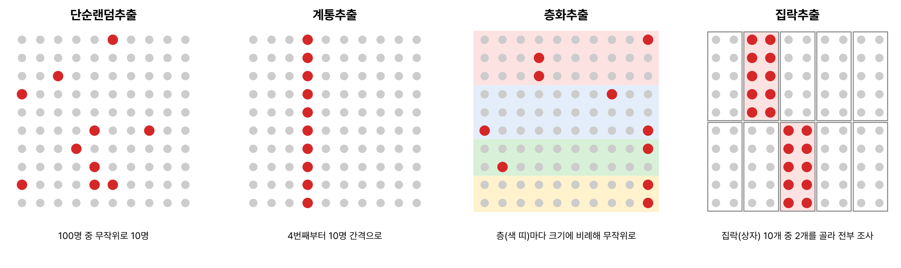
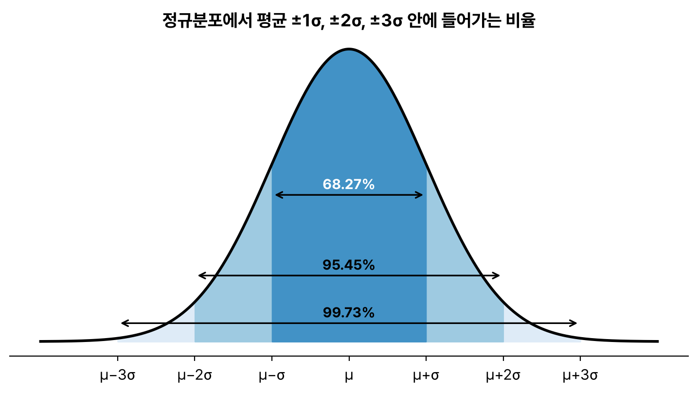
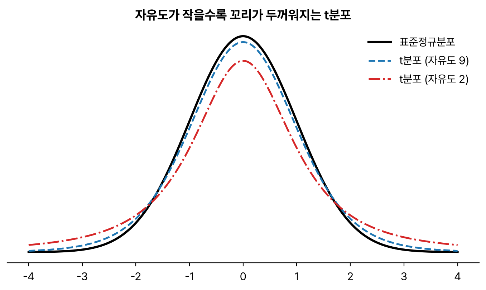
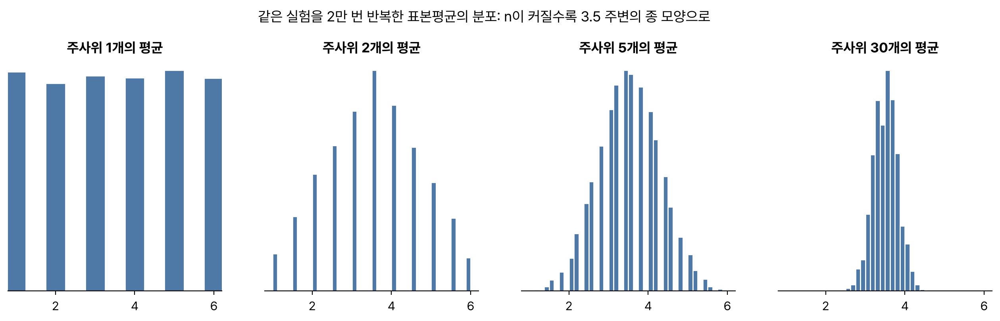



3과목 통계분석 첫 번째. '통계학 개론' 중 표본추출과 척도, 확률과 확률분포 부분이다. 다음 글의 추정과 가설검정이 전부 이 위에 올라가서 따로 떼어 정리했다. R 출력은 R 4.6.0에서 돌린 결과다.

## 요약

- 통계는 모집단 전체를 조사하기 어려울 때 표본으로 모집단의 성질(모수)을 추측한다.
- 확률 표본추출 방법은 단순랜덤, 계통, 집락, 층화 추출이 있다.
- 측정 척도는 명목, 순서, 구간, 비율 척도의 네 가지이고, 뒤로 갈수록 할 수 있는 연산이 많아진다.
- 확률분포는 이산형(베르누이, 이항, 기하, 다항, 포아송)과 연속형(균일, 정규, 지수, t, 카이제곱, F)으로 나뉜다.
- 중심극한정리에 따르면 표본이 충분히 크면 표본평균은 모집단 분포와 관계없이 정규분포를 따른다.


flowchart LR
  P["모집단<br>모수: μ, σ²"] -->|"표본추출"| S["표본<br>통계량: x̄, s²"]
  S -->|"추정 · 검정"| P


## 1. 통계의 기본 용어

| 용어 | 뜻 | 예 |
|---|---|---|
| 모집단(population) | 알고 싶은 대상 전체 | 대한민국 성인 전체 |
| 표본(sample) | 모집단에서 뽑은 일부 | 성인 1,000명 |
| 모수(parameter) | 모집단의 특성을 나타내는 값 | 모평균 μ, 모분산 σ² |
| 통계량(statistic) | 표본에서 계산한 값 | 표본평균 x̄, 표본분산 s² |
| 전수조사 | 모집단 전체를 조사한다. 비용과 시간이 많이 든다 | 인구주택총조사 |
| 표본조사 | 표본만 조사해 모집단을 추측한다 | 여론조사 |

## 2. 표본추출 방법

### 확률 표본추출

| 방법 | 방법 설명 | 예 |
|---|---|---|
| 단순랜덤추출(simple random sampling) | 모든 원소에 번호를 매기고 무작위로 n개를 뽑는다. 뽑은 것을 되돌려 놓으면 복원추출, 아니면 비복원추출 | 제비뽑기 |
| 계통추출(systematic sampling) | 번호를 매긴 뒤 첫 구간에서 하나를 무작위로 고르고, 이후 일정한 간격(K)마다 뽑는다 | 명단에서 7번, 17번, 27번… |
| 집락추출(cluster sampling) | 모집단을 여러 집락(군집)으로 나누고, 집락 몇 개를 무작위로 골라 그 안을 조사한다. 집락 안은 이질적, 집락 사이는 동질적이어야 좋다 | 전국 학교 중 몇 학교를 뽑아 그 학교 학생 전체 조사 |
| 층화추출(stratified sampling) | 모집단을 서로 겹치지 않는 층으로 나누고, 각 층에서 무작위로 뽑는다. 층 안은 동질적, 층 사이는 이질적이다 | 학년별로 나눠 학년마다 20명씩 뽑기 |

층화추출에서 각 층의 크기에 비례해 뽑으면 **비례층화추출**, 비례하지 않게 뽑으면 **불비례층화추출**이다.


_모집단 100명(점)에서 표본(빨간 점)을 뽑는 네 가지 방법. 층화추출은 색 띠(층)마다 고르게, 집락추출은 상자(집락)를 통째로 뽑는다_

```r
set.seed(1); sample(1:10, 3)   # 1부터 10까지에서 3개를 비복원 단순랜덤추출
```

```text
[1] 9 4 7
```

### 비확률 표본추출

편의추출(쉽게 접근할 수 있는 대상), 판단추출(조사자가 판단해 고름), 할당추출(특성별 할당량을 채울 때까지), 눈덩이추출(응답자가 다음 응답자를 소개)이 있다. 확률에 기반하지 않아 모집단을 대표한다고 보장하기 어렵다.

> **쉬운 설명**
>
> 학교 급식 만족도를 조사한다고 해 보자. 전교생 명단에서 제비뽑기하면 단순랜덤, 출석부 10번째마다 고르면 계통, 몇 개 반을 통째로 뽑아 그 반 전원을 조사하면 집락, 1·2·3학년에서 각각 몇 명씩 뽑으면 층화추출이다. 집락은 '반'이라는 덩어리를 통째로, 층화는 '학년'이라는 층마다 골고루 뽑는다는 점이 다르다.

## 3. 측정 척도

| 척도 | 특징 | 가능한 연산 | 예 |
|---|---|---|---|
| 명목척도(nominal) | 이름이나 분류만 나타낸다 | 같다, 다르다 | 성별, 혈액형, 출생지 |
| 순서척도(ordinal, 서열척도) | 순서가 있지만 간격은 의미가 없다 | 크다, 작다 | 학년, 만족도(상·중·하), 메달 순위 |
| 구간척도(interval, 등간척도) | 간격이 같지만 절대적인 0이 없다 | 덧셈, 뺄셈 | 섭씨온도, 지능지수, 연도 |
| 비율척도(ratio) | 절대적인 0이 있어 비율 계산이 가능하다 | 사칙연산 | 키, 무게, 나이, 소득 |

명목척도와 순서척도는 **질적(범주형) 자료**, 구간척도와 비율척도는 **양적(수치형) 자료**이다.

> **쉬운 설명**
>
> 섭씨 20도는 10도보다 '두 배 덥다'고 말할 수 없다. 0도가 '온도가 없다'는 뜻이 아니기 때문이다. 그래서 온도는 구간척도다. 반면 몸무게 0kg은 정말 '무게가 없다'는 뜻이라 40kg은 20kg의 두 배이고, 이게 비율척도다.

## 4. 확률

### 확률의 기본

- **표본공간(S):** 실험에서 나올 수 있는 모든 결과의 집합이다.
- **사건(event):** 표본공간의 부분집합이다.
- **배반사건(mutually exclusive):** 동시에 일어날 수 없는 두 사건이다. A ∩ B = ∅
- **독립사건(independent):** 한 사건이 다른 사건의 확률에 영향을 주지 않는다. P(A ∩ B) = P(A) × P(B)

**조건부 확률**은 사건 B가 일어났다는 조건에서 A가 일어날 확률이다.

$$
P(A \mid B) = \frac{P(A \cap B)}{P(B)}
$$

두 사건이 독립이면 P(A | B) = P(A)이다. 확률이 0보다 큰 두 배반사건은 독립이 **아니다**. 하나가 일어나면 다른 하나는 절대 일어나지 않으니 서로 영향을 주기 때문이다.

**베이즈 정리**는 결과를 보고 원인의 확률을 거꾸로 계산한다.

$$
P(A \mid B) = \frac{P(B \mid A)\,P(A)}{P(B)}
$$

### 확률변수와 기댓값

**확률변수**는 실험 결과에 숫자를 대응시킨 변수다. 값이 셀 수 있으면 **이산형**, 연속적인 구간의 값이면 **연속형**이다. 이산형은 확률질량함수(PMF), 연속형은 확률밀도함수(PDF)로 분포를 나타내고, 어떤 값 이하일 확률은 누적분포함수(CDF)로 나타낸다.

| 개념 | 식 |
|---|---|
| 이산형 기댓값 | E(X) = Σ x · P(X = x) |
| 분산 | Var(X) = E(X²) − [E(X)]² |
| 선형 변환 | E(aX + b) = aE(X) + b, Var(aX + b) = a²Var(X) |
| 독립인 두 확률변수의 합 | Var(X + Y) = Var(X) + Var(Y) |

분산은 상수 b를 더해도 바뀌지 않고, a를 곱하면 a²배가 된다. 시험에서 계산 문제로 자주 나온다.

## 5. 이산형 확률분포

| 분포 | 상황 | 기댓값 | 분산 |
|---|---|---|---|
| 베르누이(Bernoulli) | 결과가 성공(1)과 실패(0) 두 가지인 시행 1번 | p | p(1 − p) |
| 이항(Binomial) B(n, p) | 성공 확률이 p인 시행을 n번 했을 때 성공 횟수 | np | np(1 − p) |
| 기하(Geometric) | 첫 성공이 나올 때까지의 시행 횟수 | 1/p | (1 − p)/p² |
| 다항(Multinomial) | 결과가 셋 이상인 시행을 n번 했을 때 각 결과의 횟수 | | |
| 포아송(Poisson) | 단위 시간이나 공간에서 사건이 일어나는 횟수 | λ | λ |

이항분포의 확률질량함수는 다음과 같다.

$$
P(X = k) = \binom{n}{k} p^k (1-p)^{n-k}
$$

포아송분포는 기댓값과 분산이 모두 λ로 같다는 점이 특징이다. 1시간에 콜센터에 걸려 오는 전화 수, 책 한 쪽의 오타 수가 대표 예다.

```r
dbinom(2, size = 5, prob = 0.5)   # 동전 5번 중 앞면이 정확히 2번
pbinom(2, size = 5, prob = 0.5)   # 앞면이 2번 이하
dpois(0, lambda = 2)              # 평균 2번 일어나는 사건이 0번 일어날 확률
```

```text
[1] 0.3125
[1] 0.5
[1] 0.1353353
```

R에서 `d`로 시작하는 함수는 확률(밀도), `p`는 누적확률, `q`는 분위수, `r`은 난수를 돌려준다.

## 6. 연속형 확률분포

| 분포 | 특징과 쓰임 |
|---|---|
| 균일분포(Uniform) | 구간 안의 모든 값이 나올 확률이 같다 |
| 정규분포(Normal) N(μ, σ²) | 평균을 중심으로 좌우 대칭인 종 모양. 평균 ±1σ에 약 68%, ±2σ에 약 95%, ±3σ에 약 99.7%가 들어간다 |
| 표준정규분포 Z | 평균 0, 분산 1인 정규분포. Z = (X − μ) / σ로 표준화한다 |
| 지수분포(Exponential) | 사건이 일어나기까지 걸리는 시간. 포아송분포와 짝을 이룬다 |
| t분포 | 표준정규분포보다 꼬리가 두껍다. 모분산을 모르고 표본이 작을 때 평균을 추정하고 검정한다. 자유도가 커지면 표준정규분포에 가까워진다 |
| 카이제곱분포(χ²) | 표준정규분포를 따르는 변수의 제곱합. 0 이상의 값만 가지며 오른쪽 꼬리가 길다. 모분산 검정, 적합도·독립성 검정에 쓴다 |
| F분포 | 두 카이제곱분포를 각자의 자유도로 나눈 비율. 두 모분산 비교, 분산분석에 쓴다 |


_정규분포에서 평균 ±1σ, ±2σ, ±3σ 안에 들어가는 비율_

```r
pnorm(1.96); qnorm(0.975); pnorm(1.645)
qt(0.975, df = 9)
qchisq(0.95, df = 1)
```

```text
[1] 0.9750021
[1] 1.959964
[1] 0.9500151
[1] 2.262157
[1] 3.841459
```

표준정규분포에서 1.96 이하일 확률이 0.975이므로 −1.96부터 1.96 사이에 95%가 들어간다. 자유도 9인 t분포의 같은 위치는 2.262로, 꼬리가 두꺼워서 1.96보다 크다. 자유도 1인 카이제곱분포의 95% 분위수 3.84는 1.96²와 같다.


_t분포는 표준정규분포보다 꼬리가 두껍고, 자유도가 커질수록 표준정규분포에 가까워진다_

### 중심극한정리

모집단이 어떤 분포를 따르든, 표본 크기 n이 충분히 크면(보통 30 이상) 표본평균 X̄는 정규분포에 가까워진다.

$$
\bar{X} \sim N\!\left(\mu,\ \frac{\sigma^2}{n}\right)
$$

표본평균의 표준편차 σ/√n을 **표준오차(standard error)** 라고 한다. 표본이 커질수록 표준오차가 작아져 표본평균이 모평균 근처에 모인다.


_중심극한정리 실험. 주사위 n개를 던져 평균을 내는 일을 2만 번 반복했다. 주사위 하나는 고르게 나오지만, n이 커질수록 평균은 3.5 근처의 좁은 종 모양으로 모인다_

> **쉬운 설명**
>
> 주사위 한 개를 던진 결과는 1부터 6까지 고르게 나와 종 모양이 아니다. 그런데 주사위 30개를 던져 평균을 내는 일을 여러 번 하면, 평균들은 3.5 근처에 몰리고 종 모양으로 퍼진다. 이게 중심극한정리다.

## 헷갈렸던 것들

- 층화추출은 층 **안이 동질적**, 집락추출은 집락 **안이 이질적**이다.
- 온도와 지능지수는 구간척도, 나이와 무게는 비율척도, 만족도와 학년은 순서척도다.
- 확률이 0보다 큰 배반사건은 독립이 아니다.
- Var(aX + b) = a²Var(X)이다. b는 분산에 영향을 주지 않는다.
- 포아송분포는 기댓값과 분산이 같다(λ).
- t분포는 자유도가 커질수록 표준정규분포에 가까워진다. 카이제곱분포와 F분포는 음수 값을 갖지 않는다.
- 중심극한정리는 모집단이 정규분포가 아니어도 성립한다.

## 용어 정리

| 용어 | 뜻 |
|---|---|
| 모수 / 통계량 | 모집단의 특성값 / 표본에서 계산한 값 |
| 층화추출 | 층으로 나눠 층마다 무작위 추출 |
| 집락추출 | 집락을 무작위로 골라 집락 안을 조사 |
| 비율척도 | 절대 0이 있어 사칙연산이 가능한 척도 |
| 조건부 확률 | 어떤 사건이 일어났다는 조건에서의 확률 |
| 표준오차 | 표본평균의 표준편차, σ/√n |
| 중심극한정리 | 표본이 크면 표본평균은 정규분포에 가까워진다는 정리 |

## 복습 문제

**1.** 모집단을 서로 겹치지 않는 여러 층으로 나누고 각 층에서 무작위로 표본을 뽑는 방법은?

① 단순랜덤추출 ② 층화추출 ③ 계통추출 ④ 집락추출

**2.** 다음 중 구간척도에 해당하는 것은?

① 혈액형 ② 몸무게 ③ 고객 만족도 순위 ④ 섭씨온도

**3.** 확률변수 X의 분산이 4일 때 Y = 3X + 5의 분산은?

① 12 ② 17 ③ 36 ④ 41

**4.** 동전을 10번 던질 때 앞면이 나오는 횟수의 기댓값과 분산은?

① 5, 2.5 ② 5, 5 ③ 2.5, 5 ④ 10, 5

**5.** 다음 설명 중 옳지 않은 것은?

① 포아송분포의 기댓값과 분산은 같다 ② 카이제곱분포는 음수 값을 가질 수 있다 ③ t분포는 자유도가 커질수록 표준정규분포에 가까워진다 ④ F분포는 분산분석에 쓰인다

## 답과 풀이

1. ② 층마다 무작위로 뽑는 것이 층화추출이다.
2. ④ 섭씨온도는 간격은 같지만 절대 0이 없는 구간척도다. ①은 명목, ②는 비율, ③은 순서척도다.
3. ③ Var(3X + 5) = 3² × 4 = 36이다.
4. ① 이항분포 B(10, 0.5)이므로 기댓값 np = 5, 분산 np(1 − p) = 2.5이다.
5. ② 카이제곱분포는 제곱합이라 0 이상의 값만 가진다.

## 참고 자료

- 한국데이터산업진흥원 데이터자격검정, ADsP 출제기준: <https://www.dataq.or.kr>
- R 문서, Distributions: <https://stat.ethz.ch/R-manual/R-devel/library/stats/html/Distributions.html>
