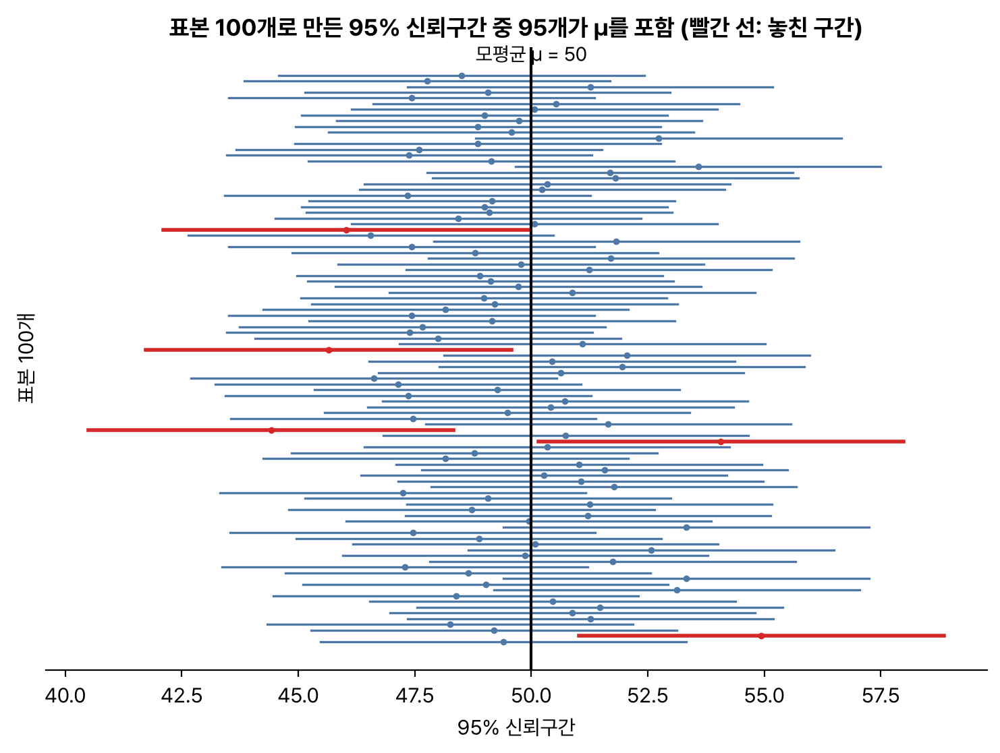
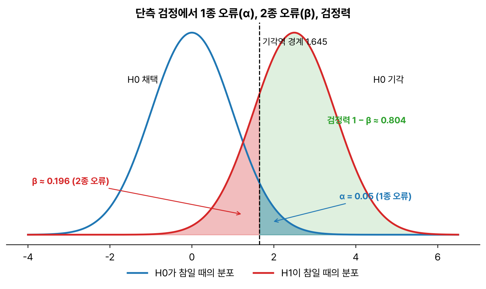



통계분석 두 번째. 추정, 가설검정, 비모수 검정이다. 1종·2종 오류와 p-value의 뜻은 거의 매회 나오는데 말장난처럼 헷갈리기 쉬워서 제일 공들여 정리했다. R 출력은 R 4.6.0 기준.

## 요약

- 추정은 표본으로 모수를 짐작하는 일이고, 한 값으로 짐작하면 점추정, 범위로 짐작하면 구간추정이다.
- 좋은 추정량은 불편성, 효율성, 일치성, 충족성을 갖춘다.
- 가설검정은 귀무가설이 맞다고 가정했을 때 지금 데이터가 얼마나 드문지(p-value)를 보고, 유의수준보다 작으면 귀무가설을 기각한다.
- 귀무가설이 참인데 기각하면 1종 오류(α), 거짓인데 채택하면 2종 오류(β)이다.
- 비모수 검정은 모집단 분포를 가정하지 않고 부호나 순위로 검정한다.


flowchart LR
  H["가설 설정<br>H0, H1"] --> A["유의수준 α 결정"]
  A --> T["검정통계량 계산"]
  T --> P{"p-value < α ?"}
  P -->|"예"| R["H0 기각<br>H1 채택"]
  P -->|"아니오"| K["H0 기각하지 못함"]


## 1. 추정

### 점추정

**점추정(point estimation)** 은 모수를 하나의 값으로 추정한다. 모평균은 표본평균으로, 모분산은 표본분산으로 추정한다. 좋은 추정량의 조건은 다음과 같다.

| 조건 | 뜻 |
|---|---|
| 불편성(unbiasedness) | 추정량의 기댓값이 모수와 같다. 평균적으로 치우치지 않는다 |
| 효율성(efficiency) | 추정량의 분산이 작다 |
| 일치성(consistency) | 표본이 커질수록 추정량이 모수에 가까워진다 |
| 충족성(sufficiency) | 추정량이 모수에 대한 정보를 충분히 담고 있다 |

표본분산을 n이 아니라 **n − 1로 나누는 이유**는 불편성 때문이다. n으로 나누면 모분산을 평균적으로 조금 작게 추정한다.

$$
s^2 = \frac{1}{n-1}\sum_{i=1}^{n}(x_i - \bar{x})^2
$$

### 구간추정

**구간추정(interval estimation)** 은 모수가 들어 있을 것으로 보이는 범위를 신뢰수준과 함께 제시한다. 모분산을 알 때 모평균의 신뢰구간은 다음과 같다.

$$
\bar{x} \pm z_{\alpha/2}\,\frac{\sigma}{\sqrt{n}}
$$

모분산을 모르면 σ 대신 표본표준편차 s를, z 대신 자유도 n − 1인 t분포의 값을 쓴다.

$$
\bar{x} \pm t_{\alpha/2,\,n-1}\,\frac{s}{\sqrt{n}}
$$

- **95% 신뢰구간의 뜻:** 같은 방법으로 표본을 뽑아 구간을 100번 만들면, 그중 약 95개가 모수를 포함한다는 뜻이다. '모수가 이 구간에 있을 확률이 95%'라는 해석은 엄밀히는 틀렸다. 모수는 정해진 값이고, 확률적인 것은 구간이다.
- **신뢰구간의 폭:** 표본 크기가 커지면 좁아지고, 신뢰수준을 높이면(95% → 99%) 넓어진다.


_평균 50, 표준편차 10인 모집단에서 25개씩 표본 100개를 뽑아 만든 95% 신뢰구간. 100개 중 95개가 모평균을 포함했고, 빨간 5개는 놓쳤다_

> **쉬운 설명**
>
> 어떤 반의 평균 키를 맞히는 놀이라고 해 보자. '163cm'라고 한 숫자로 말하면 점추정, '160~166cm 사이'라고 범위로 말하면 구간추정이다. 범위를 넓게 잡을수록 맞힐 자신(신뢰수준)은 커지지만 정보는 덜 쓸모 있어진다. 친구를 많이 재 볼수록(표본이 클수록) 범위를 좁혀도 자신 있게 말할 수 있다.

## 2. 가설검정

### 가설

| 가설 | 뜻 | 예 |
|---|---|---|
| 귀무가설(H0, null hypothesis) | '차이가 없다', '효과가 없다'는 현재의 통념 | 신약과 기존 약의 효과는 같다 |
| 대립가설(H1, alternative hypothesis) | 연구자가 입증하고 싶은 주장 | 신약의 효과가 더 좋다 |

검정은 귀무가설이 맞다고 가정하고 출발한다. 데이터가 그 가정과 너무 안 맞으면 귀무가설을 버리고 대립가설을 받아들인다.

### 용어

| 용어 | 뜻 |
|---|---|
| 검정통계량 | 표본으로 계산해 가설을 판단하는 값(t, z, χ², F 등) |
| 유의수준(α) | 1종 오류를 범할 확률의 최대 허용치. 보통 0.05 |
| 기각역 | 귀무가설을 기각하는 검정통계량의 범위 |
| p-value(유의확률) | 귀무가설이 참일 때, 지금 관측한 검정통계량만큼 또는 그보다 극단적인 값이 나올 확률 |

**판단 규칙:** p-value < α이면 귀무가설을 기각한다. p-value ≥ α이면 귀무가설을 기각하지 못한다. 이때 '귀무가설이 참이라고 증명했다'고 말하지 않고 '기각할 근거가 부족하다'고 말한다.

### 1종 오류와 2종 오류

| | H0가 참 | H0가 거짓 |
|---|---|---|
| H0 채택 | 옳은 결정 (확률 1 − α) | 2종 오류 (확률 β) |
| H0 기각 | 1종 오류 (확률 α) | 옳은 결정 (확률 1 − β, 검정력) |

- 1종 오류: 효과가 없는데 있다고 결론 내린다.
- 2종 오류: 효과가 있는데 없다고 결론 내린다.
- 표본 크기가 같을 때 α를 줄이면 β는 커진다. 둘을 동시에 줄이려면 표본을 늘려야 한다.


_기각역 경계를 오른쪽으로 옮겨 α를 줄이면, 빨간 β 영역은 그만큼 넓어진다_

> **쉬운 설명**
>
> 재판에서 귀무가설은 '피고는 무죄다'이다. 죄 없는 사람을 유죄로 판결하는 것이 1종 오류, 죄 있는 사람을 무죄로 풀어 주는 것이 2종 오류다. 법원은 억울한 사람을 만들지 않으려고 1종 오류를 엄격하게(α = 0.05처럼 작게) 관리한다.

### 양측 검정과 단측 검정

| 검정 | 대립가설 | 기각역 |
|---|---|---|
| 양측 검정 | μ ≠ μ0 | 양쪽 꼬리에 α/2씩 |
| 단측 검정(오른쪽) | μ > μ0 | 오른쪽 꼬리에 α |
| 단측 검정(왼쪽) | μ < μ0 | 왼쪽 꼬리에 α |

### R로 해 보는 일표본 t검정

과자 한 봉지의 무게가 평균 12g이라는 표시가 맞는지 10봉지를 재서 검정해 본다.

```r
x <- c(12.1, 11.8, 12.4, 12.0, 11.6, 12.3, 11.9, 12.2, 11.7, 12.5)
t.test(x, mu = 12)
```

```text
	One Sample t-test

data:  x
t = 0.52223, df = 9, p-value = 0.6141
alternative hypothesis: true mean is not equal to 12
95 percent confidence interval:
 11.83341 12.26659
sample estimates:
mean of x 
    12.05 
```

출력을 읽는 순서는 다음과 같다.

1. 표본평균은 12.05g이고, 자유도는 n − 1 = 9이다.
2. p-value 0.6141은 유의수준 0.05보다 크므로 귀무가설 '평균은 12g이다'를 기각하지 못한다.
3. 95% 신뢰구간 11.83~12.27이 12를 포함한다는 것으로도 같은 결론을 내릴 수 있다.

## 3. 모수 검정과 비모수 검정

**모수 검정**은 모집단이 정규분포 같은 특정 분포를 따른다고 가정하고 평균, 분산 같은 모수를 검정한다. **비모수 검정**은 분포를 가정하지 않고, 관측값의 **부호**나 **순위**를 써서 검정한다. 표본이 작거나, 정규성 가정이 맞지 않거나, 데이터가 순서척도일 때 쓴다. 비모수 검정의 가설은 주로 '분포가 같다', '중앙값이 같다'처럼 세운다.

| 상황 | 모수 검정 | 비모수 검정 |
|---|---|---|
| 한 집단의 중심 | 일표본 t검정 | 부호 검정, 윌콕슨 부호순위 검정 |
| 대응 표본 두 집단 | 대응표본 t검정 | 윌콕슨 부호순위 검정 |
| 독립 표본 두 집단 | 독립표본 t검정 | 만-위트니 U 검정(윌콕슨 순위합 검정) |
| 세 집단 이상 | 일원배치 분산분석 | 크루스칼-왈리스 검정 |
| 두 변수의 상관 | 피어슨 상관계수 | 스피어만 순위상관계수 |
| 데이터의 무작위성 | | 런 검정(run test) |

```r
wilcox.test(x, mu = 12, exact = FALSE)
```

```text
	Wilcoxon signed rank test with continuity correction

data:  x
V = 27, p-value = 0.6344
alternative hypothesis: true location is not equal to 12
```

같은 데이터에 비모수 검정을 해도 p-value가 0.6344로 커서 결론은 같다.

## 헷갈렸던 것들

- 표본분산은 n − 1로 나눈다. 불편추정량이 되기 위해서다.
- 신뢰수준을 높이면 신뢰구간은 **넓어지고**, 표본 크기를 늘리면 **좁아진다**.
- 1종 오류는 'H0가 참인데 기각', 2종 오류는 'H0가 거짓인데 채택'이다. 검정력은 1 − β이다.
- 유의수준 α는 1종 오류의 최대 허용 확률이다.
- p-value가 α보다 작으면 H0를 기각한다. p-value는 'H0가 참일 확률'이 아니다.
- 비모수 검정은 순위와 부호를 쓰고, 만-위트니 U 검정은 독립된 두 집단, 윌콕슨 부호순위 검정은 대응 표본에 쓴다.

## 용어 정리

| 용어 | 뜻 |
|---|---|
| 불편추정량 | 기댓값이 모수와 같은 추정량 |
| 신뢰구간 | 신뢰수준과 함께 제시하는 모수의 추정 범위 |
| 귀무가설 / 대립가설 | 차이나 효과가 없다는 가설 / 입증하려는 가설 |
| p-value | H0가 참일 때 관측값 이상으로 극단적인 결과가 나올 확률 |
| 1종 오류 / 2종 오류 | H0가 참인데 기각 / H0가 거짓인데 채택 |
| 검정력 | H0가 거짓일 때 올바르게 기각할 확률, 1 − β |
| 비모수 검정 | 분포를 가정하지 않고 부호나 순위로 하는 검정 |

## 복습 문제

**1.** 추정량의 기댓값이 모수와 같다는 성질은?

① 효율성 ② 일치성 ③ 충족성 ④ 불편성

**2.** 신뢰구간에 대한 설명으로 옳은 것은?

① 같은 방법으로 구간을 여러 번 만들면 그중 약 95%가 모수를 포함한다 ② 신뢰수준을 99%로 높이면 구간이 좁아진다 ③ 표본 크기를 늘리면 구간이 넓어진다 ④ 모수가 구간 안에 있을 확률이 정확히 95%다

**3.** 귀무가설이 거짓인데도 귀무가설을 채택하는 오류는?

① 1종 오류 ② 2종 오류 ③ 표본오차 ④ 검정력

**4.** 유의수준 0.05에서 p-value가 0.03으로 나왔을 때 옳은 결론은?

① 귀무가설을 채택한다 ② 대립가설을 기각한다 ③ 귀무가설을 기각한다 ④ 판단할 수 없다

**5.** 정규성을 가정할 수 없는 독립된 두 집단의 중심을 비교할 때 알맞은 검정은?

① 대응표본 t검정 ② 크루스칼-왈리스 검정 ③ 피어슨 상관분석 ④ 만-위트니 U 검정

## 답과 풀이

1. ④ 기댓값이 모수와 같으면 불편추정량이다.
2. ① 신뢰수준을 높이면 넓어지고, 표본을 늘리면 좁아진다. ④는 흔한 오해다.
3. ② 거짓인 귀무가설을 받아들이는 것은 2종 오류다.
4. ③ p-value(0.03) < α(0.05)이므로 귀무가설을 기각한다.
5. ④ 독립된 두 집단의 비모수 검정은 만-위트니 U 검정이다. 크루스칼-왈리스는 세 집단 이상에 쓴다.

## 참고 자료

- 한국데이터산업진흥원 데이터자격검정, ADsP 출제기준: <https://www.dataq.or.kr>
- R 문서, t.test: <https://stat.ethz.ch/R-manual/R-devel/library/stats/html/t.test.html>
