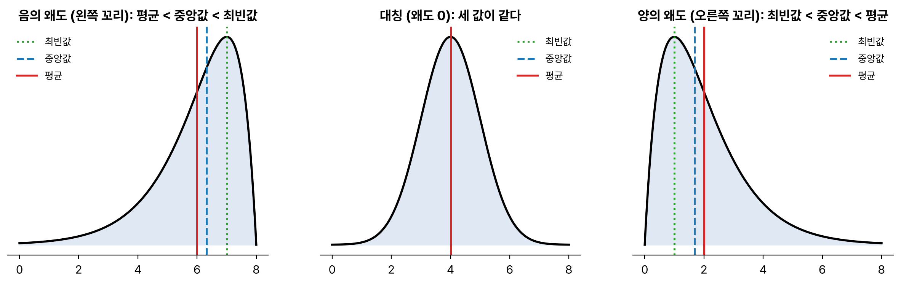
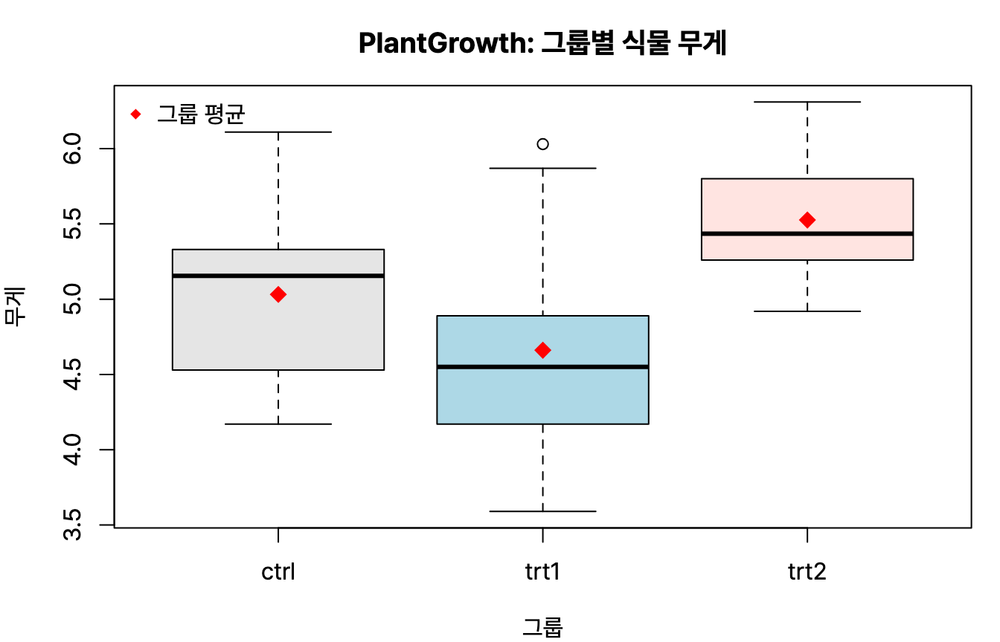



통계분석 세 번째. '기초 통계분석' 중 기술통계, 그리고 집단을 비교하는 t검정, 분산분석, 교차분석(카이제곱 검정)이다. 시험에서는 R 출력 일부를 주고 해석하라는 문제가 많아서, 출력에서 어느 숫자를 봐야 하는지 위주로 정리했다. R 4.6.0 실행 결과.

## 요약

- 기술통계는 데이터의 중심(평균, 중앙값, 최빈값), 퍼짐(분산, 표준편차, IQR), 모양(왜도, 첨도)을 요약한다.
- 두 집단의 평균은 t검정으로, 세 집단 이상의 평균은 분산분석(ANOVA)으로 비교한다.
- t검정은 일표본, 대응표본, 독립표본으로 나뉘고, 독립표본은 먼저 등분산 여부를 확인한다.
- 분산분석은 집단 간 변동과 집단 내 변동의 비율(F)로 검정하고, 차이가 있으면 사후검정으로 어느 집단이 다른지 찾는다.
- 범주형 변수는 카이제곱 검정으로 적합도, 독립성, 동질성을 검정한다.


flowchart TB
  Q{"무엇을 비교하나?"} -->|"수치형, 두 집단"| T["t검정"]
  Q -->|"수치형, 세 집단 이상"| F["분산분석 ANOVA"]
  Q -->|"범주형 × 범주형"| C["카이제곱 검정"]
  T --> T1["같은 대상 전후: 대응표본"]
  T --> T2["서로 다른 대상: 독립표본"]


## 1. 기술통계

**기술통계(descriptive statistics)** 는 데이터를 요약해 특징을 보여 주는 통계다. 모집단을 추측하는 **추론통계**와 구분된다.

| 구분 | 지표 | 설명 |
|---|---|---|
| 중심 경향 | 평균(mean) | 모든 값의 합 ÷ 개수. 이상값에 민감하다 |
| | 중앙값(median) | 크기순으로 늘어놓았을 때 가운데 값. 이상값에 강하다 |
| | 최빈값(mode) | 가장 자주 나오는 값 |
| 산포 | 범위(range) | 최댓값 − 최솟값 |
| | 분산, 표준편차 | 평균에서 떨어진 정도. 표준편차는 분산의 제곱근 |
| | 사분위수 범위(IQR) | Q3 − Q1 |
| | 변동계수(CV) | 표준편차 ÷ 평균. 단위나 평균이 다른 자료의 퍼짐을 비교한다 |
| 분포 모양 | 왜도(skewness) | 비대칭 정도. 0이면 대칭, 양수면 오른쪽 꼬리가 길다 |
| | 첨도(kurtosis) | 뾰족한 정도. 정규분포의 첨도는 3이다(3을 뺀 초과첨도로는 0) |

왜도가 양수(오른쪽 꼬리가 긴 분포, 예: 소득)이면 보통 **평균 > 중앙값 > 최빈값** 순서이고, 음수이면 그 반대다.


_꼬리가 긴 쪽으로 평균이 가장 많이 끌려간다_

```r
summary(mtcars$mpg)
round(sd(mtcars$mpg) / mean(mtcars$mpg), 4)   # 변동계수
```

```text
   Min. 1st Qu.  Median    Mean 3rd Qu.    Max. 
  10.40   15.43   19.20   20.09   22.80   33.90 
[1] 0.3
```

`summary()`는 최솟값, 1사분위수, 중앙값, 평균, 3사분위수, 최댓값을 보여 준다. 평균(20.09)이 중앙값(19.20)보다 커서 오른쪽 꼬리가 조금 긴 분포라는 것을 짐작할 수 있다.

| 그래프 | 쓰임 |
|---|---|
| 막대그래프 | 범주형 자료의 빈도. 막대 사이가 떨어져 있다 |
| 히스토그램 | 연속형 자료의 분포. 막대가 붙어 있다 |
| 상자 그림(boxplot) | 사분위수와 이상값을 한눈에 보여 준다 |
| 줄기-잎 그림 | 자료의 값을 그대로 살리며 분포를 보여 준다 |
| 산점도 | 두 수치형 변수의 관계 |

> **쉬운 설명**
>
> 반 친구 10명의 용돈 평균이 5만 원인데 한 명이 50만 원을 받으면 평균이 확 올라간다. 이럴 때는 가운데 사람의 용돈(중앙값)이 '보통 친구의 용돈'을 더 잘 보여 준다. 변동계수는 키(cm)와 몸무게(kg)처럼 단위가 다른 자료 가운데 어느 쪽이 더 들쭉날쭉한지 비교할 때 쓴다.

## 2. t검정

| 종류 | 상황 | 예 |
|---|---|---|
| 일표본 t검정 | 한 집단의 평균이 특정 값과 같은가 | 과자 무게가 표시된 12g과 같은가 |
| 대응표본 t검정(paired) | 같은 대상의 전후 또는 짝지은 두 측정값의 차이 | 같은 환자에게 약 A와 약 B를 차례로 투여한 효과 비교 |
| 독립표본 t검정 | 서로 다른 두 집단의 평균 비교 | 남학생과 여학생의 평균 키 |

### 대응표본 t검정

R의 `sleep` 데이터는 환자 10명에게 수면제 두 가지를 차례로 투여해 늘어난 수면 시간을 기록한 것이다. 같은 사람이 두 번 측정되었으니 대응표본이다.

```r
with(sleep, t.test(extra[group == 1], extra[group == 2], paired = TRUE))
```

```text
	Paired t-test

data:  extra[group == 1] and extra[group == 2]
t = -4.0621, df = 9, p-value = 0.002833
alternative hypothesis: true mean difference is not equal to 0
95 percent confidence interval:
 -2.4598858 -0.7001142
sample estimates:
mean difference 
          -1.58 
```

p-value가 0.0028로 0.05보다 작으므로 두 약의 효과에 차이가 있다고 결론 내린다. 차이의 평균은 −1.58시간이라 2번 약의 효과가 더 크다. 대응표본의 자유도는 쌍의 수 − 1 = 9이다.

### 독립표본 t검정

독립표본 t검정은 먼저 두 집단의 분산이 같은지(등분산) F검정으로 확인하고, 그 결과에 따라 방법을 고른다. `ToothGrowth`는 기니피그 60마리에게 비타민 C를 오렌지주스(OJ)나 아스코르브산(VC)으로 준 뒤 이빨 길이를 잰 데이터다.

```r
var.test(len ~ supp, data = ToothGrowth)
```

```text
	F test to compare two variances

data:  len by supp
F = 0.6386, num df = 29, denom df = 29, p-value = 0.2331
alternative hypothesis: true ratio of variances is not equal to 1
95 percent confidence interval:
 0.3039488 1.3416857
sample estimates:
ratio of variances 
         0.6385951 
```

p-value 0.2331 > 0.05이므로 '두 분산이 같다'는 귀무가설을 기각하지 못한다. 등분산을 가정하고 t검정을 한다.

```r
t.test(len ~ supp, data = ToothGrowth, var.equal = TRUE)
```

```text
	Two Sample t-test

data:  len by supp
t = 1.9153, df = 58, p-value = 0.06039
alternative hypothesis: true difference in means between group OJ and group VC is not equal to 0
95 percent confidence interval:
 -0.1670064  7.5670064
sample estimates:
mean in group OJ mean in group VC 
        20.66333         16.96333 
```

등분산 독립표본 t검정의 자유도는 n1 + n2 − 2 = 30 + 30 − 2 = 58이다. p-value 0.0604는 0.05보다 조금 커서, 유의수준 5%에서는 두 방법의 평균 차이가 유의하지 않다. 신뢰구간이 0을 포함한다는 것으로도 확인할 수 있다. 등분산을 가정하지 않으면 `var.equal = FALSE`(기본값)로 웰치(Welch) t검정을 한다.

## 3. 분산분석(ANOVA)

**분산분석(Analysis of Variance)** 은 세 집단 이상의 평균이 같은지 검정한다. 이름은 '분산'이지만 비교하는 것은 **평균**이다. t검정을 여러 번 반복하면 1종 오류가 쌓여 커지기 때문에 분산분석을 쓴다.

| 종류 | 설명 |
|---|---|
| 일원배치 분산분석 | 요인(독립변수)이 하나. 예: 비료 종류(3가지)에 따른 수확량 |
| 이원배치 분산분석 | 요인이 둘. 두 요인이 함께 작용해 생기는 교호작용(interaction) 도 검정한다 |

분산분석의 가정은 **정규성**, **등분산성**, **독립성**이다.

### 분산분석표

| 요인 | 자유도 | 제곱합(SS) | 평균제곱(MS) | F |
|---|---|---|---|---|
| 처리(집단 간) | k − 1 | SSB | MSB = SSB / (k − 1) | MSB / MSW |
| 잔차(집단 내) | N − k | SSW | MSW = SSW / (N − k) | |
| 전체 | N − 1 | SST = SSB + SSW | | |

k는 집단 수, N은 전체 관측값 수. 집단 간 차이(MSB)가 집단 내 흩어짐(MSW)보다 크면 F가 커지고, 평균이 다르다고 판단한다.

```r
fit <- aov(weight ~ group, data = PlantGrowth)   # 대조군과 처리 2가지, 각 10개
summary(fit)
```

```text
            Df Sum Sq Mean Sq F value Pr(>F)  
group        2  3.766  1.8832   4.846 0.0159 *
Residuals   27 10.492  0.3886                 
---
Signif. codes:  0 ‘***’ 0.001 ‘**’ 0.01 ‘*’ 0.05 ‘.’ 0.1 ‘ ’ 1
```

- 자유도: 집단 3개라 k − 1 = 2, 관측값 30개라 N − k = 27이다.
- 평균제곱: 3.766 / 2 = 1.8832, 10.492 / 27 = 0.3886이다.
- F = 1.8832 / 0.3886 = 4.846이고, p-value 0.0159 < 0.05이므로 **적어도 한 집단의 평균이 다르다**.

시험에서는 이 표의 빈칸(자유도, 평균제곱, F)을 계산하게 하는 문제가 자주 나온다.

### 사후검정

분산분석은 '어딘가 다르다'까지만 알려 준다. 어느 집단끼리 다른지는 **사후검정(post-hoc test)** 으로 찾는다. 투키(Tukey)의 HSD, 셰페(Scheffé), 본페로니(Bonferroni), 던컨(Duncan) 방법 등이 있다.

```r
TukeyHSD(fit)
```

```text
  Tukey multiple comparisons of means
    95% family-wise confidence level

Fit: aov(formula = weight ~ group, data = PlantGrowth)

$group
            diff        lwr       upr     p adj
trt1-ctrl -0.371 -1.0622161 0.3202161 0.3908711
trt2-ctrl  0.494 -0.1972161 1.1852161 0.1979960
trt2-trt1  0.865  0.1737839 1.5562161 0.0120064
```

조정된 p-value(p adj)가 0.05보다 작은 쌍은 trt2-trt1뿐이다. 처리 2와 처리 1 사이에만 유의한 차이가 있다.


_`boxplot(weight ~ group, data = PlantGrowth)`. 빨간 점이 그룹 평균이다. trt1과 trt2의 차이가 가장 커 보이고, 사후검정에서도 이 쌍만 유의했다_

> **쉬운 설명**
>
> 세 반의 수학 점수를 비교한다고 해 보자. 반끼리의 평균 차이(집단 간 변동)가 각 반 안에서 학생끼리 벌어진 정도(집단 내 변동)보다 훨씬 크면, '반에 따라 점수가 다르다'고 말할 수 있다. F는 이 두 크기의 비율이다. 어느 반이 다른지는 사후검정으로 한 쌍씩 확인한다.

## 4. 교차분석(카이제곱 검정)

**교차분석**은 범주형 변수를 분할표(교차표)로 정리하고 **카이제곱(χ²) 검정**으로 관계를 본다. 검정통계량은 관측도수(O)와 기대도수(E)의 차이로 계산한다.

$$
\chi^2 = \sum \frac{(O - E)^2}{E}
$$

| 검정 | 질문 | 자유도 |
|---|---|---|
| 적합도 검정(goodness of fit) | 관측된 비율이 기대한 비율과 같은가 | 범주 수 − 1 |
| 독립성 검정(independence) | 두 범주형 변수가 서로 관계없는가 | (행 수 − 1) × (열 수 − 1) |
| 동질성 검정(homogeneity) | 여러 모집단에서 범주의 분포가 같은가 | (행 수 − 1) × (열 수 − 1) |

### 적합도 검정

세 가지 상품이 25 : 25 : 50의 비율로 팔릴 것으로 기대했는데 실제로 30, 20, 50개가 팔렸다면?

```r
chisq.test(c(30, 20, 50), p = c(0.25, 0.25, 0.5))
```

```text
	Chi-squared test for given probabilities

data:  c(30, 20, 50)
X-squared = 2, df = 2, p-value = 0.3679
```

기대도수는 25, 25, 50이므로 χ² = (30 − 25)²/25 + (20 − 25)²/25 + 0 = 1 + 1 + 0 = 2이다. p-value 0.3679 > 0.05이므로 기대한 비율과 다르다고 할 수 없다.

### 독립성 검정

`mtcars`에서 변속기 종류(am)와 엔진 형태(vs)가 서로 관계있는지 본다.

```r
tb <- table(mtcars$am, mtcars$vs); tb
chisq.test(tb, correct = FALSE)
```

```text
   
     0  1
  0 12  7
  1  6  7

	Pearson's Chi-squared test

data:  tb
X-squared = 0.90688, df = 1, p-value = 0.3409
```

2 × 2 표라 자유도는 (2 − 1)(2 − 1) = 1이다. p-value 0.3409 > 0.05이므로 두 변수는 독립이라는 귀무가설을 기각하지 못한다. 2 × 2 표에서 R은 기본으로 연속성 보정(Yates)을 하는데, 여기서는 공식과 맞추려고 `correct = FALSE`로 껐다.

기대도수가 5보다 작은 칸이 전체의 20%를 넘으면 카이제곱 근사가 부정확해서 **피셔의 정확 검정(Fisher's exact test)** 을 쓴다.

## 헷갈렸던 것들

- 오른쪽 꼬리가 긴 분포(왜도 > 0)는 평균 > 중앙값 > 최빈값이다.
- 같은 대상을 두 번 측정했으면 대응표본, 서로 다른 대상이면 독립표본 t검정이다.
- 등분산 독립표본 t검정의 자유도는 n1 + n2 − 2, 대응표본은 쌍의 수 − 1이다.
- 분산분석은 분산이 아니라 **평균**을 비교한다. 처리 자유도는 k − 1, 잔차 자유도는 N − k이다.
- F = 처리 평균제곱 ÷ 잔차 평균제곱이다.
- 분산분석에서 유의하면 사후검정으로 어느 집단이 다른지 확인한다.
- 독립성 검정의 자유도는 (행 − 1)(열 − 1)이다. 기대도수 5 미만인 칸이 20%를 넘으면 피셔의 정확 검정을 쓴다.

## 용어 정리

| 용어 | 뜻 |
|---|---|
| 변동계수 | 표준편차 ÷ 평균. 상대적인 퍼짐 |
| 왜도 / 첨도 | 분포의 비대칭 정도 / 뾰족한 정도 |
| 대응표본 t검정 | 짝지은 두 측정값의 차이를 검정 |
| 등분산 검정 | 두 집단의 분산이 같은지 F검정으로 확인 |
| 분산분석 | 세 집단 이상의 평균 비교 |
| 교호작용 | 두 요인이 함께 작용해 생기는 효과 |
| 사후검정 | 분산분석 뒤 어느 집단끼리 다른지 찾는 검정 |
| 기대도수 | 귀무가설이 참일 때 기대되는 칸의 빈도 |

## 복습 문제

**1.** 다이어트 프로그램 참가자 20명의 참가 전후 몸무게를 비교할 때 알맞은 검정은?

① 일표본 t검정 ② 독립표본 t검정 ③ 대응표본 t검정 ④ 카이제곱 검정

**2.** 네 집단에서 각각 10명씩 뽑아 일원배치 분산분석을 할 때, 처리와 잔차의 자유도는?

① 4, 36 ② 3, 39 ③ 4, 40 ④ 3, 36

**3.** 분산분석표에서 처리 제곱합이 60, 처리 자유도가 3, 잔차 평균제곱이 5일 때 F값은?

① 4 ② 12 ③ 20 ④ 60

**4.** 3 × 4 분할표로 독립성 검정을 할 때 자유도는?

① 6 ② 7 ③ 11 ④ 12

**5.** 다음 R 출력에 대한 해석으로 옳은 것은?

```text
            Df Sum Sq Mean Sq F value Pr(>F)  
group        2  3.766  1.8832   4.846 0.0159 *
Residuals   27 10.492  0.3886                 
```

① 집단은 4개다 ② 전체 관측값은 27개다 ③ 유의수준 0.05에서 모든 집단의 평균이 서로 다르다 ④ 유의수준 0.05에서 적어도 한 집단의 평균은 다르다

## 답과 풀이

1. ③ 같은 사람의 전후 비교이므로 대응표본 t검정이다.
2. ④ 처리 자유도 k − 1 = 3, 잔차 자유도 N − k = 40 − 4 = 36이다.
3. ① 처리 평균제곱 = 60 / 3 = 20, F = 20 / 5 = 4이다.
4. ① (3 − 1) × (4 − 1) = 6이다.
5. ④ 처리 자유도 2라 집단은 3개, 전체 자유도 29라 관측값은 30개다. 분산분석은 '적어도 하나가 다르다'까지만 말해 준다.

## 참고 자료

- 한국데이터산업진흥원 데이터자격검정, ADsP 출제기준: <https://www.dataq.or.kr>
- R 문서, aov: <https://stat.ethz.ch/R-manual/R-devel/library/stats/html/aov.html>
- R 문서, chisq.test: <https://stat.ethz.ch/R-manual/R-devel/library/stats/html/chisq.test.html>
