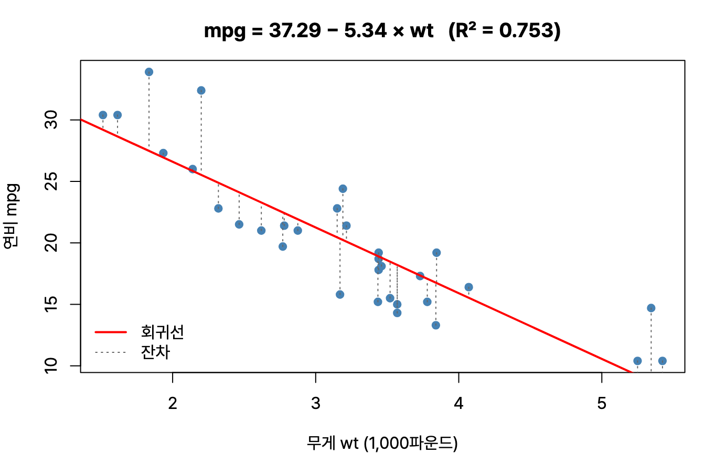
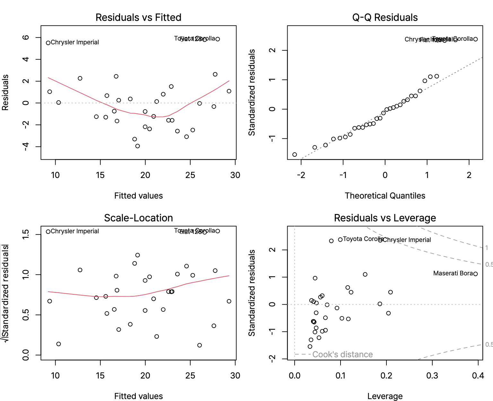



통계분석 네 번째, 회귀분석. `summary(lm(...))` 출력을 주고 회귀계수, 결정계수, F검정을 해석하라는 문제가 매회 나온다. 그래서 출력 한 장을 위에서부터 끝까지 읽어 내려가는 식으로 정리했다. R 4.6.0 실행 결과.

## 요약

- 회귀분석은 독립변수(설명변수)가 종속변수(반응변수)에 주는 영향을 식으로 나타낸다.
- 회귀계수는 잔차 제곱합을 가장 작게 하는 최소제곱법으로 구한다.
- 모형 전체는 F검정으로, 각 회귀계수는 t검정으로 유의성을 본다. 결정계수(R²)는 모형이 종속변수의 변동을 얼마나 설명하는지 보여 준다.
- 선형회귀는 선형성, 독립성, 등분산성, 비상관성, 정상성(정규성)을 가정한다.
- 독립변수끼리 강하게 상관되면 다중공선성이 생기고, VIF가 10보다 크면 문제로 본다.
- 변수 선택은 전진 선택, 후진 제거, 단계적 선택으로 하고 AIC나 BIC가 작은 모형을 고른다.

## 1. 회귀분석의 기본

### 단순 선형회귀

독립변수 하나로 종속변수를 설명하는 모형이다.

$$
Y_i = \beta_0 + \beta_1 X_i + \varepsilon_i
$$

β0는 절편, β1은 기울기(회귀계수), ε은 오차다. 실제 값과 예측값의 차이를 **잔차(residual)** 라고 하고, 잔차의 제곱합이 가장 작아지도록 계수를 정하는 방법을 **최소제곱법(OLS, Ordinary Least Squares)** 이라고 한다.


_`lm(mpg ~ wt, data = mtcars)`의 회귀선(빨간 선)과 잔차(점선). 최소제곱법은 점선 길이의 제곱합이 가장 작아지는 직선을 찾는다_

### 변동의 분해와 결정계수

| 변동 | 뜻 |
|---|---|
| SST(총 변동) | 실제 값이 평균에서 떨어진 정도 |
| SSR(회귀 변동) | 모형이 설명하는 변동 |
| SSE(잔차 변동) | 모형이 설명하지 못한 변동 |

SST = SSR + SSE이고, **결정계수**는 총 변동 가운데 모형이 설명하는 비율이다.

$$
R^2 = \frac{SSR}{SST} = 1 - \frac{SSE}{SST}
$$

R²는 0과 1 사이 값이고, 1에 가까울수록 모형이 데이터를 잘 설명한다. 단순 선형회귀에서 R²는 상관계수의 제곱과 같다. 독립변수를 추가하면 R²는 쓸모없는 변수라도 줄어들지 않기 때문에, 변수 개수를 고려한 **수정 결정계수(Adjusted R²)** 로 모형을 비교한다.

### 회귀분석의 가정

| 가정 | 뜻 | 확인 방법 |
|---|---|---|
| 선형성 | 독립변수와 종속변수가 직선 관계다 | 산점도 |
| 독립성 | 잔차끼리 서로 독립이다 | 더빈-왓슨(Durbin-Watson) 검정 |
| 등분산성 | 잔차의 분산이 독립변수 값과 관계없이 일정하다 | 잔차 그래프 |
| 비상관성 | 잔차와 독립변수가 서로 상관이 없다 | 잔차 그래프 |
| 정상성(정규성) | 잔차가 정규분포를 따른다 | Q-Q 플롯, 샤피로-윌크(Shapiro-Wilk) 검정 |

## 2. R로 읽는 회귀분석 출력

`mtcars` 데이터에서 차의 무게(wt, 1,000파운드 단위)와 마력(hp)으로 연비(mpg)를 설명하는 다중 회귀모형을 만든다.

```r
fit2 <- lm(mpg ~ wt + hp, data = mtcars)
summary(fit2)
```

```text
Call:
lm(formula = mpg ~ wt + hp, data = mtcars)

Residuals:
   Min     1Q Median     3Q    Max 
-3.941 -1.600 -0.182  1.050  5.854 

Coefficients:
            Estimate Std. Error t value Pr(>|t|)    
(Intercept) 37.22727    1.59879  23.285  < 2e-16 ***
wt          -3.87783    0.63273  -6.129 1.12e-06 ***
hp          -0.03177    0.00903  -3.519  0.00145 ** 
---
Signif. codes:  0 ‘***’ 0.001 ‘**’ 0.01 ‘*’ 0.05 ‘.’ 0.1 ‘ ’ 1

Residual standard error: 2.593 on 29 degrees of freedom
Multiple R-squared:  0.8268,	Adjusted R-squared:  0.8148 
F-statistic: 69.21 on 2 and 29 DF,  p-value: 9.109e-12
```

이 출력은 다음 순서로 읽는다.

1. **모형 전체(F검정):** 마지막 줄의 F-statistic 69.21, p-value 9.109e-12 < 0.05이므로 모형은 통계적으로 유의하다. 자유도 2는 독립변수 개수, 29는 n − 독립변수 개수 − 1 = 32 − 2 − 1이다.
2. **설명력:** R² = 0.8268이므로 연비 변동의 약 82.7%를 무게와 마력이 설명한다.
3. **회귀식:** mpg = 37.227 − 3.878 × wt − 0.032 × hp
4. **계수 해석:** 마력이 같을 때 무게가 1(1,000파운드) 늘면 연비는 평균 3.878 줄어든다. 무게가 같을 때 마력이 1 늘면 연비는 0.032 줄어든다.
5. **계수의 유의성(t검정):** wt와 hp 모두 p-value가 0.05보다 작아 유의하다. t value는 Estimate ÷ Std. Error로, −3.87783 ÷ 0.63273 = −6.129이다.

> **쉬운 설명**
>
> 회귀분석은 '무게가 늘면 연비가 얼마나 줄까?'를 숫자 하나(기울기)로 답해 준다. R² 0.83은 '연비가 차마다 다른 이유의 83%를 무게와 마력으로 설명할 수 있다'는 뜻이다. 나머지 17%는 모형에 넣지 않은 다른 이유다.

### 잔차의 정규성 확인

```r
shapiro.test(residuals(fit2))
```

```text
	Shapiro-Wilk normality test

data:  residuals(fit2)
W = 0.92792, p-value = 0.03427
```

샤피로-윌크 검정의 귀무가설은 '정규분포를 따른다'이다. p-value 0.034 < 0.05이므로 유의수준 5%에서 잔차가 정규분포를 따른다고 보기 어렵다. 실무에서는 Q-Q 플롯도 함께 보고, 변수 변환이나 다른 모형을 검토한다.


_`plot(fit2)`가 그리는 잔차 진단 그래프. 왼쪽 위는 선형성과 등분산성, 오른쪽 위 Q-Q 그림은 정규성, 왼쪽 아래는 등분산성, 오른쪽 아래는 영향력이 큰 관측값(쿡의 거리)을 본다. Q-Q 그림의 오른쪽 위 점들이 대각선에서 벗어난 것이 샤피로-윌크 검정 결과와 같은 신호다_

## 3. 다중공선성

**다중공선성(multicollinearity)** 은 독립변수끼리 강하게 상관되어 회귀계수 추정이 불안정해지는 문제다. 계수의 표준오차가 커지고, 부호가 상식과 반대로 나오기도 한다.

**분산팽창요인(VIF, Variance Inflation Factor)** 으로 진단한다. j번째 독립변수를 나머지 독립변수로 회귀했을 때의 결정계수를 Rj²라고 하면 다음과 같다.

$$
VIF_j = \frac{1}{1 - R_j^2}
$$

보통 **VIF가 10보다 크면** 다중공선성이 심하다고 본다. 아래는 이 식을 그대로 계산한 결과다.

```r
vif1 <- function(d) sapply(names(d), function(v) {
  r2 <- summary(lm(as.formula(paste(v, "~ .")), data = d))$r.squared
  1 / (1 - r2)
})
round(vif1(mtcars[, c("cyl", "disp", "hp", "wt")]), 2)
```

```text
  cyl  disp    hp    wt 
 6.74 10.37  3.41  4.85 
```

배기량(disp)의 VIF가 10을 넘는다. 배기량은 실린더 수, 무게와 겹치는 정보가 많기 때문이다. 해결 방법은 상관이 높은 변수를 빼거나, 주성분분석으로 변수를 합치거나, 릿지 회귀 같은 정규화 방법을 쓰는 것이다. `car` 패키지의 `vif()` 함수로도 같은 값을 구할 수 있다.

## 4. 변수 선택

변수가 많으면 해석이 어렵고 과적합 위험이 커진다. 꼭 필요한 변수만 고르는 방법은 다음과 같다.

| 방법 | 설명 |
|---|---|
| 전진 선택법(forward selection) | 변수가 없는 모형에서 시작해, 가장 도움이 되는 변수를 하나씩 추가한다 |
| 후진 제거법(backward elimination) | 모든 변수를 넣은 모형에서 시작해, 가장 도움이 안 되는 변수를 하나씩 뺀다 |
| 단계적 선택법(stepwise) | 추가와 제거를 번갈아 하며, 이미 넣은 변수도 다시 뺄 수 있다 |

모형 비교 기준으로는 **AIC(Akaike Information Criterion)** 와 **BIC(Bayesian Information Criterion)** 를 쓴다. 둘 다 작을수록 좋고, 변수가 늘어나면 벌점을 주어 너무 복잡한 모형을 막는다. BIC는 표본이 클 때 AIC보다 벌점이 커서 더 단순한 모형을 고르는 경향이 있다.

```r
best <- step(lm(mpg ~ ., data = mtcars), direction = "backward", trace = 0)
formula(best)
summary(best)$coefficients
round(c(AIC(lm(mpg ~ ., data = mtcars)), AIC(best)), 2)
```

```text
mpg ~ wt + qsec + am
             Estimate Std. Error   t value     Pr(>|t|)
(Intercept)  9.617781  6.9595930  1.381946 1.779152e-01
wt          -3.916504  0.7112016 -5.506882 6.952711e-06
qsec         1.225886  0.2886696  4.246676 2.161737e-04
am           2.935837  1.4109045  2.080819 4.671551e-02
[1] 163.71 154.12
```

10개 변수로 시작한 후진 제거법이 무게(wt), 400m 가속 시간(qsec), 변속기(am) 세 변수만 남겼고, AIC는 163.71에서 154.12로 줄었다.

## 5. 그 밖의 회귀 모형

| 모형 | 설명 |
|---|---|
| 다항 회귀 | 독립변수의 제곱, 세제곱 항을 넣어 곡선 관계를 표현한다 |
| 더미 변수 회귀 | 범주형 독립변수를 0과 1의 더미 변수로 바꿔 넣는다. 범주가 k개면 더미 변수는 k − 1개 |
| 릿지 회귀(Ridge) | 회귀계수 제곱합(L2)에 벌점을 준다. 계수를 0에 가깝게 줄이지만 0으로 만들지는 않는다 |
| 라쏘 회귀(Lasso) | 회귀계수 절댓값 합(L1)에 벌점을 준다. 일부 계수를 정확히 0으로 만들어 변수 선택 효과가 있다 |
| 엘라스틱넷(Elastic Net) | L1과 L2 벌점을 함께 쓴다 |
| 로지스틱 회귀 | 종속변수가 범주형(예: 구매/비구매)일 때 쓴다. 분류분석 글에서 다룬다 |

## 헷갈렸던 것들

- 모형 전체의 유의성은 F검정, 개별 회귀계수의 유의성은 t검정으로 본다.
- t value = Estimate ÷ Std. Error이다.
- 잔차 자유도는 n − (독립변수 개수) − 1이다.
- 독립변수를 추가하면 R²는 줄지 않는다. 변수 개수가 다른 모형은 수정 R²로 비교한다.
- 단순 선형회귀에서 R²는 상관계수의 제곱이다.
- VIF가 10보다 크면 다중공선성을 의심한다.
- AIC와 BIC는 **작을수록** 좋은 모형이다.
- 라쏘는 계수를 정확히 0으로 만들 수 있고, 릿지는 0에 가깝게만 줄인다.

## 용어 정리

| 용어 | 뜻 |
|---|---|
| 최소제곱법 | 잔차 제곱합을 최소로 하는 계수 추정 방법 |
| 결정계수(R²) | 모형이 설명하는 변동의 비율 |
| 수정 결정계수 | 변수 개수를 고려해 조정한 결정계수 |
| 다중공선성 | 독립변수끼리 강한 상관이 있는 문제 |
| VIF | 분산팽창요인. 10보다 크면 다중공선성 의심 |
| AIC, BIC | 모형의 적합도와 복잡도를 함께 고려한 선택 기준. 작을수록 좋다 |
| 라쏘 / 릿지 | L1 벌점 / L2 벌점 회귀 |

## 복습 문제

**1.** 회귀분석에서 모형 전체가 유의한지 확인하는 검정은?

① t검정 ② 카이제곱 검정 ③ F검정 ④ 샤피로-윌크 검정

**2.** 관측값 50개, 독립변수 4개인 다중 회귀모형의 잔차 자유도는?

① 45 ② 46 ③ 49 ④ 50

**3.** 회귀계수 추정값이 −2.4, 표준오차가 0.6일 때 t값은?

① −4 ② −0.25 ③ −1.44 ④ −1.8

**4.** 다중공선성에 대한 설명으로 옳지 않은 것은?

① 독립변수 사이에 강한 상관이 있을 때 생긴다 ② VIF가 10보다 크면 의심한다 ③ 회귀계수의 표준오차가 작아진다 ④ 상관이 높은 변수를 제거해 해결할 수 있다

**5.** 일부 회귀계수를 정확히 0으로 만들어 변수 선택 효과가 있는 방법은?

① 릿지 회귀 ② 라쏘 회귀 ③ 다항 회귀 ④ 최소제곱법

## 답과 풀이

1. ③ 모형 전체는 F검정, 개별 계수는 t검정이다.
2. ① 50 − 4 − 1 = 45이다.
3. ① −2.4 ÷ 0.6 = −4이다.
4. ③ 다중공선성이 있으면 표준오차가 **커져** 계수가 불안정해진다.
5. ② 라쏘의 L1 벌점은 계수를 0으로 만들 수 있다.

## 참고 자료

- 한국데이터산업진흥원 데이터자격검정, ADsP 출제기준: <https://www.dataq.or.kr>
- R 문서, lm: <https://stat.ethz.ch/R-manual/R-devel/library/stats/html/lm.html>
- R 문서, step: <https://stat.ethz.ch/R-manual/R-devel/library/stats/html/step.html>
