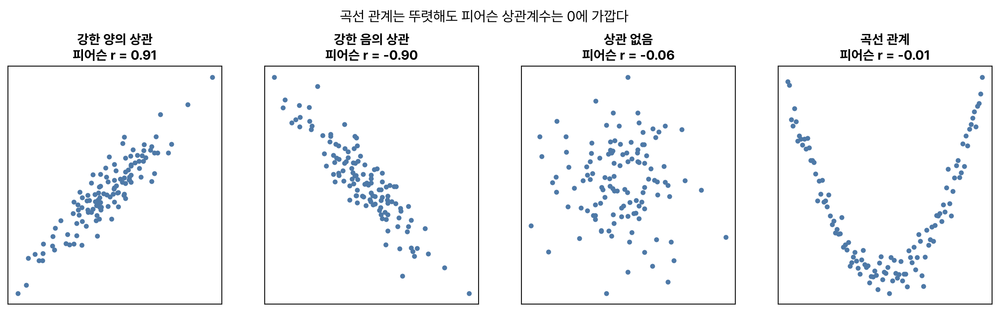
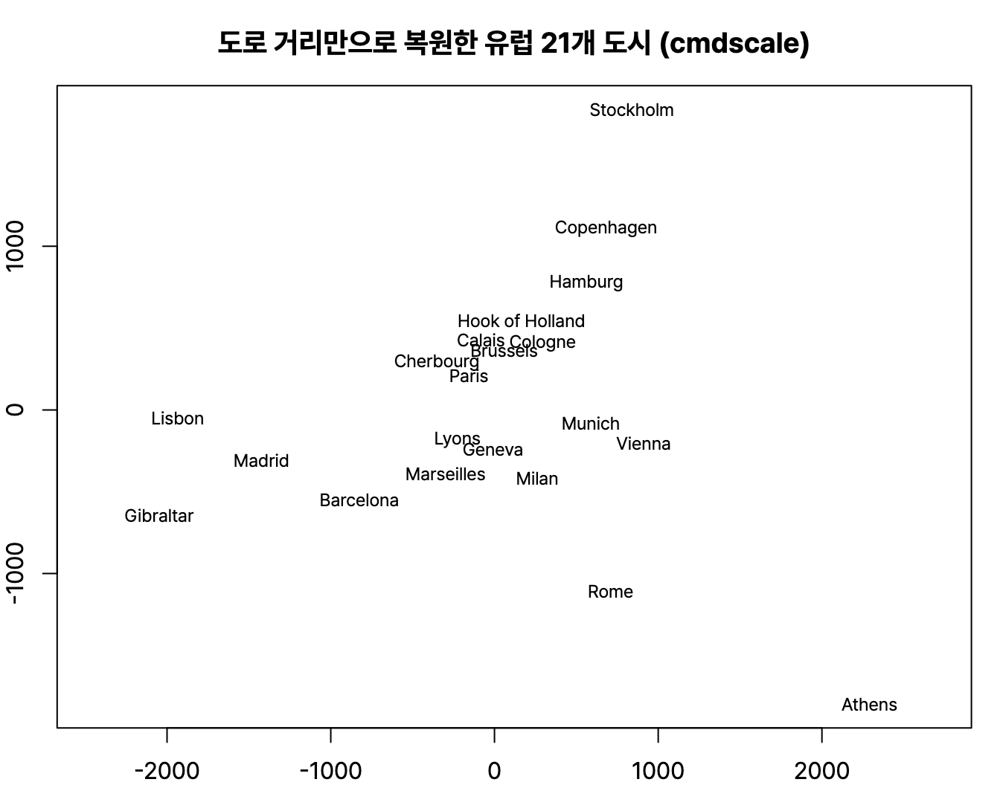
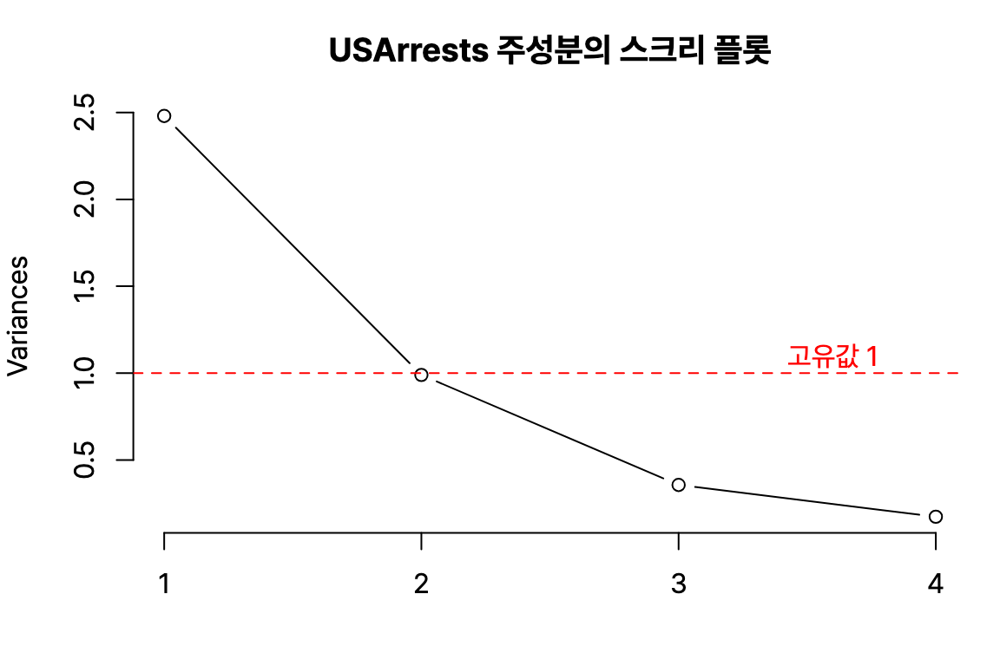
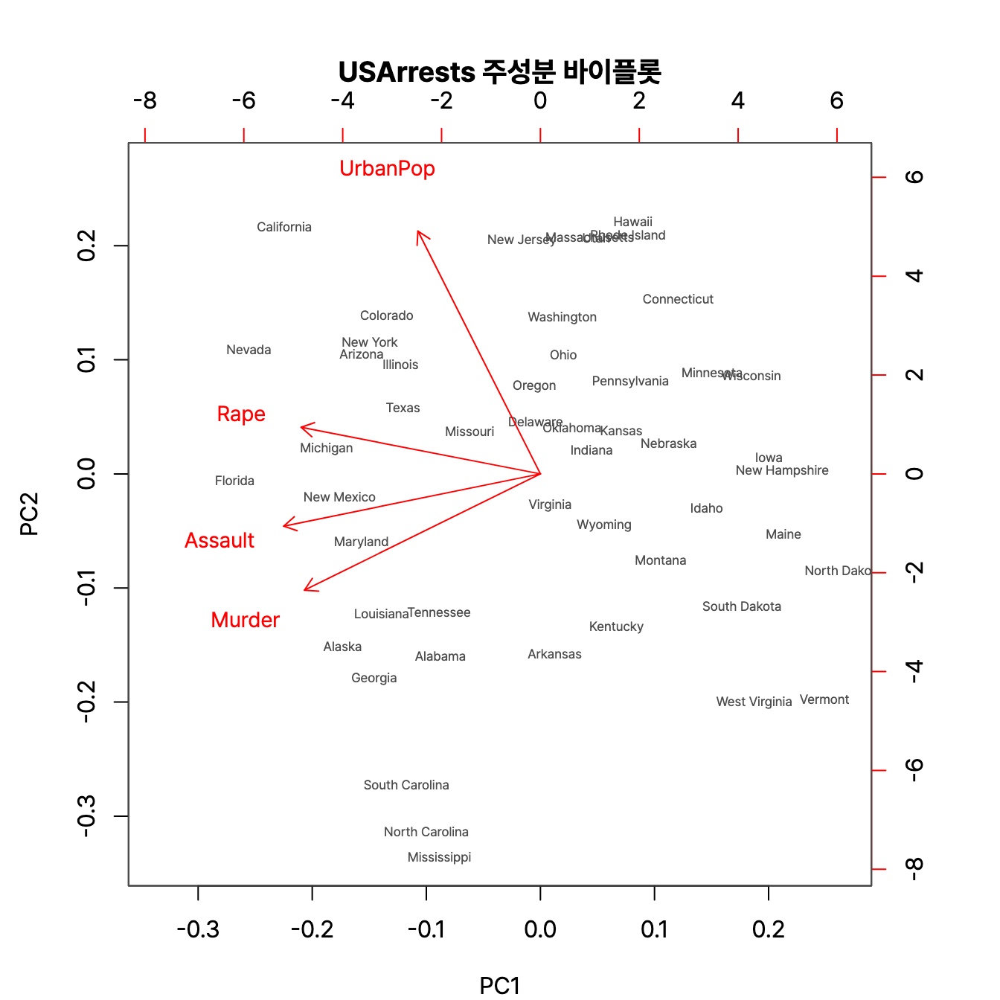

다변량 분석 쪽의 상관분석, 다차원척도법(MDS), 주성분분석(PCA)이다. PCA는 `summary(prcomp(...))` 출력을 보고 주성분을 몇 개 고를지 묻는 문제가 잘 나온다. R 4.6.0 실행 결과.

## 요약

- 상관분석은 두 변수가 함께 움직이는 정도를 −1부터 1 사이의 상관계수로 나타낸다. 수치형 자료는 피어슨, 순서형 자료는 스피어만 상관계수를 쓴다.
- 상관관계는 인과관계가 아니다.
- 다차원척도법은 개체 사이의 거리를 2차원 같은 낮은 차원의 지도에 점으로 나타내고, 스트레스 값으로 적합도를 본다.
- 주성분분석은 서로 상관된 여러 변수를 서로 상관없는 소수의 주성분으로 요약한다.
- 주성분 개수는 누적 기여율 80% 이상, 스크리 플롯의 꺾이는 지점, 고유값 1 이상 같은 기준으로 고른다.

## 1. 상관분석

### 상관계수의 종류

| 구분 | 피어슨 상관계수(Pearson) | 스피어만 순위상관계수(Spearman) |
|---|---|---|
| 자료 | 구간척도, 비율척도 | 순서척도(또는 수치를 순위로 바꾼 값) |
| 측정하는 관계 | 선형 관계 | 단조 관계(한쪽이 커지면 다른 쪽도 커지거나 작아지는 관계) |
| 분포 가정 | 정규성 가정(모수적) | 가정 없음(비모수적) |
| R 함수 | `cor(x, y)` | `cor(x, y, method = "spearman")` |

**켄달의 타우(Kendall's τ)** 도 순위 기반 상관계수다. 상관계수는 1에 가까우면 강한 양의 상관, −1에 가까우면 강한 음의 상관, 0에 가까우면 선형 관계가 거의 없다는 뜻이다.


_곡선 관계(오른쪽)는 뚜렷한 관계가 있는데도 피어슨 상관계수가 0에 가깝다. 상관계수 하나만 보지 말고 산점도를 함께 봐야 하는 이유다_

```r
cor(mtcars$mpg, mtcars$wt)
cor(mtcars$mpg, mtcars$wt, method = "spearman")
round(cor(mtcars[, c("mpg", "wt", "hp", "qsec")]), 2)
```

```text
[1] -0.8676594
[1] -0.886422
       mpg    wt    hp  qsec
mpg   1.00 -0.87 -0.78  0.42
wt   -0.87  1.00  0.66 -0.17
hp   -0.78  0.66  1.00 -0.71
qsec  0.42 -0.17 -0.71  1.00
```

차가 무거울수록 연비가 낮아지는 강한 음의 상관(−0.87)이 있다. 상관행렬의 대각선은 자기 자신과의 상관이라 항상 1이다.

### 상관계수 검정

`cor.test()`는 '모상관계수가 0이다'를 귀무가설로 검정한다.

```r
cor.test(mtcars$mpg, mtcars$wt)
```

```text
	Pearson's product-moment correlation

data:  mtcars$mpg and mtcars$wt
t = -9.559, df = 30, p-value = 1.294e-10
alternative hypothesis: true correlation is not equal to 0
95 percent confidence interval:
 -0.9338264 -0.7440872
sample estimates:
       cor 
-0.8676594 
```

p-value가 매우 작으므로 무게와 연비 사이에 유의한 상관이 있다. 자유도는 n − 2 = 30이다. 이 t값(−9.559)은 단순 회귀 `lm(mpg ~ wt)`의 기울기 t값과 같다. 단순 회귀의 기울기 검정과 피어슨 상관계수 검정은 같은 검정이기 때문이다.

> **쉬운 설명**
>
> 여름에 아이스크림 판매량과 물놀이 사고 건수는 함께 늘어난다. 상관계수는 높지만 아이스크림이 사고를 일으키지는 않는다. 둘 다 '더위'라는 다른 원인 때문에 함께 움직였을 뿐이다. 그래서 상관은 인과가 아니라고 말한다.

## 2. 다차원척도법

**다차원척도법(MDS, Multi-Dimensional Scaling)** 은 개체 사이의 거리나 비유사성을 보고, 그 관계를 최대한 유지하면서 2차원이나 3차원 공간에 점으로 배치하는 방법이다. 개체끼리 비슷한 정도를 눈으로 볼 수 있는 지도를 만들어 준다.

| 종류 | 자료 | R 함수 |
|---|---|---|
| 계량적 MDS(metric MDS) | 구간척도, 비율척도로 잰 거리 | `cmdscale()` |
| 비계량적 MDS(non-metric MDS) | 순서척도(순위만 의미 있는 비유사성) | `MASS::isoMDS()`, `MASS::sammon()` |

`eurodist`는 유럽 21개 도시 사이의 도로 거리(km)이다. 이 거리표만 가지고 도시의 2차원 좌표를 복원해 본다.

```r
loc <- cmdscale(eurodist, k = 2)
round(head(loc, 5), 1)
```

```text
            [,1]   [,2]
Athens    2290.3 1798.8
Barcelona -825.4  546.8
Brussels    59.2 -367.1
Calais     -82.8 -429.9
Cherbourg -352.5 -290.9
```

좌표를 산점도로 그리면 실제 유럽 지도와 비슷한 배치가 나온다. 방향(위아래, 좌우)은 뒤집혀 나올 수 있다. MDS는 거리 관계만 보존하기 때문이다.


_`plot(loc[, 1], -loc[, 2])`로 그린 배치. 북쪽이 위로 오도록 두 번째 좌표의 부호를 바꿨다. 거리표만 줬는데도 아테네는 남동쪽, 스톡홀름은 북쪽에 놓인다_

### 스트레스 값

**스트레스(stress)** 는 원래 거리와 지도 위 거리가 얼마나 어긋나는지 나타내는 적합도 지표다. **0에 가까울수록** 원래 거리를 잘 보존한 거다. 크러스컬(Kruskal, 1964)이 제시한 기준은 다음과 같다. 수험서마다 구간 표현이 조금씩 다를 수 있지만, 작을수록 좋다는 원칙은 같다.

| 스트레스 | 적합도 |
|---|---|
| 0 | 완벽(perfect) |
| 0.025 | 매우 좋음(excellent) |
| 0.05 | 좋음(good) |
| 0.10 | 보통(fair) |
| 0.20 | 나쁨(poor) |

```r
library(MASS)
iso <- isoMDS(eurodist, trace = FALSE)
round(iso$stress, 2)
```

```text
[1] 7.51
```

`isoMDS()`는 스트레스를 백분율로 돌려준다. 7.51%, 즉 0.075이므로 '좋음'과 '보통' 사이다.

## 3. 주성분분석

**주성분분석(PCA, Principal Component Analysis)** 은 서로 상관된 여러 변수의 정보를, 서로 상관이 없는 몇 개의 **주성분(principal component)** 으로 요약하는 차원 축소 방법이다. 주성분은 원래 변수들의 선형결합이다.

- 첫 번째 주성분(PC1)은 데이터의 분산을 가장 많이 설명하는 방향이다.
- 두 번째 주성분(PC2)은 PC1과 직교(상관 0)하면서 남은 분산을 가장 많이 설명하는 방향이다.
- 변수의 단위가 다르면 분산이 큰 변수가 주성분을 좌우하므로, 보통 **표준화**(`scale. = TRUE`)한 뒤 분석한다.

`USArrests`는 미국 50개 주의 인구 10만 명당 살인(Murder), 폭행(Assault), 강간(Rape) 체포 건수와 도시 인구 비율(UrbanPop)이다.

```r
pca <- prcomp(USArrests, scale. = TRUE)
summary(pca)
```

```text
Importance of components:
                          PC1    PC2     PC3     PC4
Standard deviation     1.5749 0.9949 0.59713 0.41645
Proportion of Variance 0.6201 0.2474 0.08914 0.04336
Cumulative Proportion  0.6201 0.8675 0.95664 1.00000
```

| 행 | 뜻 |
|---|---|
| Standard deviation | 각 주성분의 표준편차. 제곱하면 고유값(eigenvalue)이다 |
| Proportion of Variance | 각 주성분이 설명하는 분산의 비율(기여율) |
| Cumulative Proportion | 누적 기여율 |

PC1이 62.0%, PC2까지 86.75%를 설명한다. 변수 4개를 주성분 2개로 줄여도 정보의 약 87%를 유지하는 셈이다.

### 주성분 개수 고르기

| 기준 | 방법 | USArrests 결과 |
|---|---|---|
| 누적 기여율 | 누적 기여율이 보통 80% 이상이 되는 지점까지 | PC2에서 86.75% → 2개 |
| 스크리 플롯(scree plot) | 고유값을 그래프로 그려 기울기가 완만해지는(팔꿈치처럼 꺾이는) 지점 직전까지 | `screeplot(pca)`로 확인 |
| 카이저 기준 | 표준화한 자료에서 고유값이 1 이상인 주성분까지 | 아래 참고 |

```r
round(pca$sdev^2, 3)   # 고유값
```

```text
[1] 2.480 0.990 0.357 0.173
```

고유값이 1 이상인 것은 PC1뿐이지만, PC2도 0.99로 1에 거의 가깝다. 기준마다 결과가 조금씩 다를 수 있으니 여러 기준을 함께 보고 해석 가능성까지 고려해 정한다.


_`screeplot(pca, type = "lines")`. PC2 이후 기울기가 완만해지고, 빨간 점선(고유값 1)에 PC2가 거의 걸쳐 있다_

### 주성분 해석: 적재값

```r
round(pca$rotation, 3)
```

```text
            PC1    PC2    PC3    PC4
Murder   -0.536 -0.418  0.341  0.649
Assault  -0.583 -0.188  0.268 -0.743
UrbanPop -0.278  0.873  0.378  0.134
Rape     -0.543  0.167 -0.818  0.089
```

각 숫자는 주성분을 만드는 데 원래 변수가 쓰인 가중치(적재값, loading)이다. PC1은 살인, 폭행, 강간에 비슷한 크기의 가중치가 있어 '전반적인 범죄 수준'으로, PC2는 UrbanPop의 가중치가 0.873으로 커서 '도시화 정도'로 해석할 수 있다. 주성분의 부호는 분석 도구에 따라 통째로 뒤집혀 나올 수 있고, 해석에는 영향이 없다.

`biplot(pca)`를 쓰면 각 주(점)와 변수(화살표)를 PC1, PC2 평면에 함께 그려 볼 수 있다.


_`biplot(pca)`. 범죄 변수 세 개는 PC1 방향으로 나란히, UrbanPop은 PC2 방향으로 뻗어 있다. 같은 방향의 화살표는 서로 상관이 높다_

> **쉬운 설명**
>
> 학생의 국어, 영어, 수학, 과학 점수 네 개를 '문과 실력'과 '이과 실력' 두 개로 요약한다고 생각하면 쉽다. 네 과목 점수를 다 외우지 않아도 두 숫자로 학생을 꽤 잘 설명할 수 있다. 주성분분석은 이 요약을 데이터가 가장 넓게 퍼진 방향을 찾아 자동으로 해 준다.

### 주성분분석과 요인분석

| 구분 | 주성분분석 | 요인분석 |
|---|---|---|
| 목적 | 분산을 최대한 보존하며 변수 수를 줄인다 | 변수들 뒤에 숨은 공통 요인(잠재 변수)을 찾는다 |
| 결과의 순서 | 주성분에 중요도 순서가 있다(PC1이 가장 중요) | 요인 사이에 순서가 없다 |
| 결과 | 원래 변수의 선형결합 | 잠재 요인과 그 적재값 |

## 헷갈렸던 것들

- 피어슨 상관계수는 선형 관계만 잰다. 상관계수가 0이어도 곡선 관계는 있을 수 있다.
- 순서척도 자료에는 스피어만 상관계수를 쓴다.
- MDS의 스트레스는 **작을수록** 좋다. 순서척도 자료에는 비계량적 MDS를 쓴다.
- 주성분끼리는 서로 상관이 없다(직교).
- 단위가 다른 변수로 주성분분석을 할 때는 표준화(상관행렬 사용)를 한다.
- `summary(prcomp())`의 Standard deviation을 제곱하면 고유값이다. 누적 기여율 80% 이상이 흔한 선택 기준이다.

## 용어 정리

| 용어 | 뜻 |
|---|---|
| 피어슨 상관계수 | 두 수치형 변수의 선형 관계 강도 |
| 스피어만 상관계수 | 순위를 이용한 상관계수 |
| 다차원척도법 | 개체 간 거리를 저차원 지도로 나타내는 방법 |
| 스트레스 | MDS의 적합도. 0에 가까울수록 좋다 |
| 주성분 | 원래 변수들의 선형결합으로 만든 서로 상관없는 새 변수 |
| 고유값 | 주성분이 설명하는 분산의 크기 |
| 기여율 / 누적 기여율 | 주성분 하나가 설명하는 분산 비율 / 그 누적 합 |
| 스크리 플롯 | 고유값을 순서대로 그린 그래프 |

## 복습 문제

**1.** 고객 만족도 순위와 재구매 의향 순위의 상관을 볼 때 알맞은 방법은?

① 피어슨 상관계수 ② 분산분석 ③ 스피어만 상관계수 ④ 주성분분석

**2.** 다차원척도법에 대한 설명으로 옳지 않은 것은?

① 개체 간 거리를 저차원 공간에 나타낸다 ② 순서척도 자료에는 비계량적 MDS를 쓴다 ③ R의 `cmdscale()`은 계량적 MDS 함수다 ④ 스트레스 값이 클수록 적합도가 좋다

**3.** 다음 출력에서 누적 기여율 80% 기준으로 고를 주성분 개수는?

```text
                          PC1    PC2     PC3     PC4
Proportion of Variance 0.5500 0.2000 0.1500 0.1000
Cumulative Proportion  0.5500 0.7500 0.9000 1.0000
```

① 1개 ② 2개 ③ 3개 ④ 4개

**4.** 주성분분석에 대한 설명으로 옳은 것은?

① 주성분끼리는 강한 상관이 있다 ② 두 번째 주성분이 분산을 가장 많이 설명한다 ③ 단위가 다른 변수들은 표준화한 뒤 분석하는 것이 좋다 ④ 주성분 개수는 원래 변수 개수보다 많아질 수 있다

## 답과 풀이

1. ③ 순위 자료는 스피어만 순위상관계수를 쓴다.
2. ④ 스트레스는 0에 가까울수록 좋다.
3. ③ PC2까지 75%로 80%에 못 미치고, PC3에서 90%가 되므로 3개다.
4. ③ 주성분끼리는 상관이 없고, PC1이 분산을 가장 많이 설명하며, 주성분은 원래 변수 개수를 넘지 않는다.

## 참고 자료

- 한국데이터산업진흥원 데이터자격검정, ADsP 출제기준: <https://www.dataq.or.kr>
- Kruskal, J. B., 'Multidimensional scaling by optimizing goodness of fit to a nonmetric hypothesis', Psychometrika, 1964
- R 문서, prcomp: <https://stat.ethz.ch/R-manual/R-devel/library/stats/html/prcomp.html>
