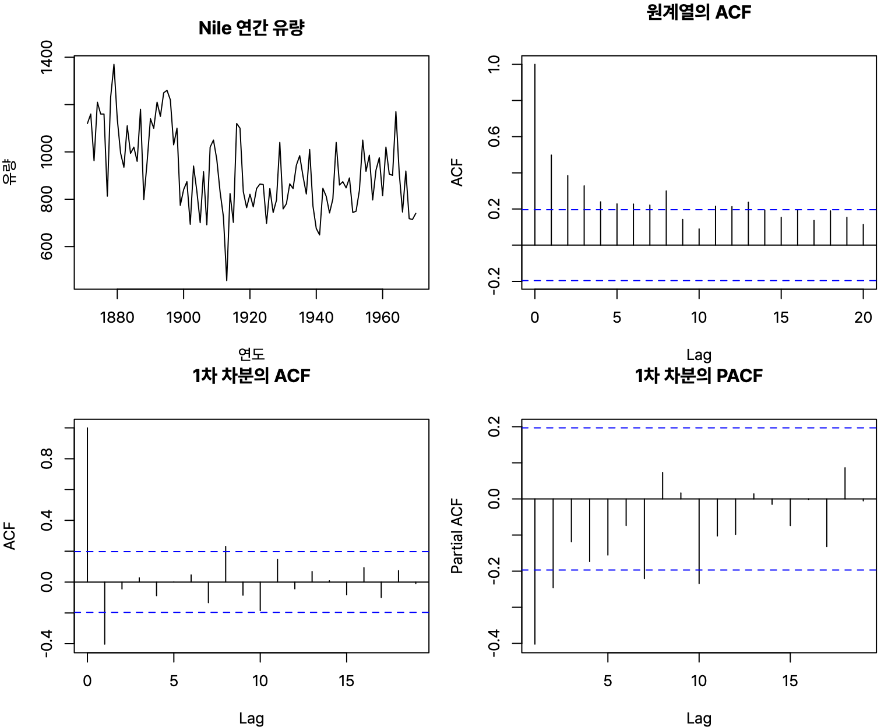
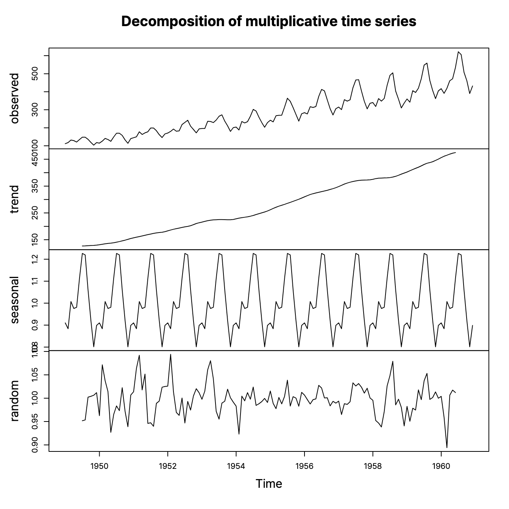



통계분석 마지막, 시계열 예측. 정상성 조건, ACF와 PACF로 모형 고르기, ARIMA(p, d, q)에서 각 문자가 뜻하는 것 정도가 자주 나온다. R 4.6.0 실행 결과.

## 요약

- 시계열 분석은 대부분 정상 시계열을 전제로 한다. 정상 시계열은 평균과 분산이 일정하고, 공분산이 시점이 아니라 시차에만 달려 있다.
- 평균이 일정하지 않으면 차분을, 분산이 일정하지 않으면 로그 같은 변환을 해서 정상 시계열로 만든다.
- AR 모형은 과거 값으로, MA 모형은 과거 오차로 현재 값을 설명한다. ARIMA(p, d, q)는 d번 차분한 뒤 ARMA(p, q)를 적용한 모형이다.
- AR(p)는 PACF가 p 시차 뒤에 끊기고, MA(q)는 ACF가 q 시차 뒤에 끊긴다.
- 분해 시계열은 시계열을 추세, 계절, 순환, 불규칙 요인으로 나눈다.


flowchart TB
  A["시계열 그래프 보기"] --> B{"정상성?"}
  B -->|"평균이 변함"| C["차분"]
  B -->|"분산이 변함"| D["로그 변환"]
  C --> B
  D --> B
  B -->|"정상"| E["ACF · PACF로<br>p, q 정하기"]
  E --> F["ARIMA 적합<br>AIC로 비교"]
  F --> G["잔차가 백색잡음인지 확인<br>예측"]


## 1. 정상성

**시계열(time series)** 은 시간 순서대로 관측한 자료다. 주가, 월별 매출, 일별 기온이 예다.

### 정상 시계열의 조건

| 조건 | 뜻 |
|---|---|
| 평균이 일정하다 | 모든 시점에서 평균이 같다. 추세가 없다 |
| 분산이 일정하다 | 분산이 시점에 따라 변하지 않는다 |
| 공분산이 시차에만 의존한다 | 두 시점의 공분산은 두 시점이 얼마나 떨어져 있는지(시차)에만 달려 있고, 언제인지(시점)와는 관계없다 |

### 비정상 시계열을 정상으로 바꾸기

| 문제 | 처리 |
|---|---|
| 평균이 일정하지 않다(추세가 있다) | 차분(differencing): 현재 값에서 바로 앞 값을 뺀다 |
| 계절성이 있다 | 계절 차분: 현재 값에서 1주기 전(예: 12개월 전) 값을 뺀다 |
| 분산이 일정하지 않다 | 변환(transformation): 로그, 제곱근 등 |

**백색잡음(white noise)** 은 평균 0, 분산이 일정하고 자기상관이 없는 순수한 무작위 과정이다. 잘 맞춘 시계열 모형의 잔차는 백색잡음이어야 한다.

> **쉬운 설명**
>
> 키가 매년 자라는 아이의 키 기록은 평균이 계속 올라가서 정상이 아니다. 그런데 '작년보다 몇 cm 컸나'로 바꾸면(차분) 매년 비슷한 값이 반복돼서 다루기 쉬워진다. 정상 시계열은 '언제 보든 비슷한 성격을 가진 시계열'이다.

## 2. 시계열 모형

### 자기회귀 모형 AR(p)

현재 값을 과거 p개 시점의 값으로 설명한다.

$$
Z_t = \phi_1 Z_{t-1} + \phi_2 Z_{t-2} + \cdots + \phi_p Z_{t-p} + a_t
$$

a_t는 백색잡음이다. 어제 기온이 높으면 오늘도 높은 경향처럼, 자기 자신의 과거와 닮는 현상을 표현한다.

### 이동평균 모형 MA(q)

현재 값을 과거 q개 시점의 오차(백색잡음)로 설명한다.

$$
Z_t = a_t - \theta_1 a_{t-1} - \theta_2 a_{t-2} - \cdots - \theta_q a_{t-q}
$$

MA 모형은 항상 정상성을 만족한다.

### ACF와 PACF로 모형 고르기

**자기상관함수(ACF)** 는 시차 k만큼 떨어진 값끼리의 상관이고, **부분자기상관함수(PACF)** 는 그 사이 시점들의 영향을 뺀 순수한 상관이다.

| 모형 | ACF | PACF |
|---|---|---|
| AR(p) | 지수적으로 줄거나 사인 곡선처럼 줄어든다 | p+1 시차부터 0으로 끊긴다(절단) |
| MA(q) | q+1 시차부터 0으로 끊긴다(절단) | 지수적으로 줄거나 사인 곡선처럼 줄어든다 |
| ARMA(p, q) | 점차 줄어든다 | 점차 줄어든다 |

### ARIMA(p, d, q)

**ARIMA(AutoRegressive Integrated Moving Average)** 는 비정상 시계열을 d번 차분해 정상으로 만든 뒤 ARMA(p, q)를 적용하는 모형이다.

| 표기 | 같은 모형 |
|---|---|
| ARIMA(p, 0, q) | ARMA(p, q) |
| ARIMA(p, 0, 0) | AR(p) |
| ARIMA(0, 0, q) | MA(q) |
| ARIMA(0, d, q) | IMA(d, q) |
| ARIMA(p, d, 0) | ARI(p, d) |

예를 들어 ARIMA(0, 1, 1)은 한 번 차분한 뒤 MA(1)을 적용한 IMA(1, 1) 모형이다.

## 3. R로 해 보는 ARIMA

`Nile`은 1871년부터 1970년까지 나일강의 연간 유량이다.

```r
Nile[1:10]
round(acf(Nile, lag.max = 6, plot = FALSE)$acf[2:7], 3)
```

```text
 [1] 1120 1160  963 1210 1160 1160  813 1230 1370 1140
[1] 0.498 0.385 0.328 0.239 0.228 0.227
```

원래 시계열의 ACF는 0.498, 0.385, 0.328…로 천천히 줄어든다. 이렇게 천천히 줄어드는 ACF는 비정상 시계열의 신호라 한 번 차분해 본다.

```r
round(acf(diff(Nile), lag.max = 6, plot = FALSE)$acf[2:7], 3)
round(pacf(diff(Nile), lag.max = 6, plot = FALSE)$acf[1:6], 3)
```

```text
[1] -0.402 -0.044  0.027 -0.088  0.001  0.047
[1] -0.402 -0.246 -0.119 -0.173 -0.155 -0.074
```

차분한 시계열의 ACF는 시차 1에서만 크고(−0.402) 시차 2부터 0 근처로 끊기며, PACF는 천천히 줄어든다. MA(1)의 모양이므로 ARIMA(0, 1, 1)을 후보로 잡는다.


_파란 점선은 자기상관이 0인지 판단하는 기준선이다. 원계열의 ACF는 천천히 줄고, 1차 차분의 ACF는 시차 1 뒤에 기준선 안으로 들어온다(MA(1)의 모양)_

```r
fit <- arima(Nile, order = c(0, 1, 1)); fit
```

```text
Call:
arima(x = Nile, order = c(0, 1, 1))

Coefficients:
          ma1
      -0.7329
s.e.   0.1143

sigma^2 estimated as 20600:  log likelihood = -632.55,  aic = 1269.09
```

`forecast` 패키지의 `auto.arima()`는 여러 후보 가운데 AIC 같은 기준이 가장 작은 모형을 자동으로 고른다.

```r
library(forecast)
af <- auto.arima(Nile); af
forecast(af, h = 3)
```

```text
Series: Nile 
ARIMA(1,1,1) 

Coefficients:
         ar1      ma1
      0.2544  -0.8741
s.e.  0.1194   0.0605

sigma^2 = 20177:  log likelihood = -630.63
AIC=1267.25   AICc=1267.51   BIC=1275.04
     Point Forecast    Lo 80     Hi 80    Lo 95    Hi 95
1971       816.1813 634.1427  998.2199 537.7773 1094.585
1972       835.5596 640.8057 1030.3136 537.7091 1133.410
1973       840.4889 641.5646 1039.4132 536.2604 1144.717
```

`auto.arima()`는 AIC가 1267.25로 조금 더 작은 ARIMA(1, 1, 1)을 골랐다. 예측 결과의 Lo/Hi 80, 95는 80%, 95% 예측구간이고, 먼 미래일수록 구간이 넓어진다.

## 4. 분해 시계열과 평활법

### 분해 시계열

**분해 시계열(decomposition)** 은 시계열을 영향을 주는 요인별로 나눠 본다.

| 요인 | 뜻 | 예 |
|---|---|---|
| 추세 요인(trend) | 장기적으로 오르거나 내리는 경향 | 인구 증가에 따른 소비 증가 |
| 계절 요인(seasonal) | 요일, 월, 분기처럼 고정된 주기로 반복되는 변동 | 여름마다 늘어나는 에어컨 판매 |
| 순환 요인(cyclical) | 고정되지 않은 주기(보통 몇 년)로 반복되는 변동 | 경기 순환 |
| 불규칙 요인(irregular) | 위 요인으로 설명되지 않는 무작위 변동 | 갑작스러운 사건 |

요인을 더해 표현하면 **가법 모형**(Z = T + S + C + I), 곱해 표현하면 **승법 모형**(Z = T × S × C × I)이다. 계절 변동의 크기가 추세와 함께 커지면 승법 모형이 알맞다.

```r
d <- decompose(AirPassengers, type = "multiplicative")
round(d$figure, 3)   # 1월부터 12월까지 계절 지수
```

```text
 [1] 0.910 0.884 1.007 0.976 0.981 1.113 1.227 1.220 1.060 0.922 0.801 0.899
```

`AirPassengers`는 1949~1960년의 월별 항공 승객 수. 7월의 계절 지수 1.227은 7월 승객이 추세보다 약 22.7% 많다는 뜻이고, 11월은 0.801로 약 20% 적다.


_`plot(decompose(AirPassengers, type = "multiplicative"))`. 위에서부터 원계열, 추세, 계절, 불규칙 요인이다_

### 평활법

| 방법 | 설명 |
|---|---|
| 이동평균법(moving average) | 일정 기간의 평균으로 불규칙한 변동을 없애 추세를 본다. 기간 안의 값에 같은 가중치를 준다 |
| 지수평활법(exponential smoothing) | 모든 과거 값을 쓰되, 최근 값에 더 큰 가중치를 주고 과거로 갈수록 가중치를 지수적으로 줄인다 |

> **쉬운 설명**
>
> 아이스크림 가게 매출을 보면 해마다 손님이 늘고(추세), 여름마다 크게 뛰고(계절), 몇 년에 한 번 경기가 나빠지면 줄고(순환), 가끔 비가 많이 와서 확 줄기도(불규칙) 한다. 분해 시계열은 이 네 가지를 따로 떼어 보는 방법이다.

## 헷갈렸던 것들

- 정상성 조건은 평균 일정, 분산 일정, 공분산이 **시차에만** 의존이다. '시점에 의존'은 틀린 말이다.
- 평균이 변하면 **차분**, 분산이 변하면 **변환**이다.
- AR(p)는 **PACF**가 절단되고, MA(q)는 **ACF**가 절단된다. 거꾸로 짝지은 보기가 자주 나온다.
- ARIMA(p, d, q)의 d는 차분 횟수다. d = 0이면 ARMA(p, q)이다.
- 지수평활법은 최근 값에 더 큰 가중치를 준다.
- 순환 요인은 주기가 고정되지 않은 변동이고, 계절 요인은 고정된 주기의 변동이다.

## 용어 정리

| 용어 | 뜻 |
|---|---|
| 정상성 | 평균, 분산이 일정하고 공분산이 시차에만 의존하는 성질 |
| 차분 | 현재 값에서 이전 값을 빼는 것 |
| 백색잡음 | 평균 0, 분산 일정, 자기상관이 없는 과정 |
| ACF / PACF | 자기상관함수 / 부분자기상관함수 |
| AR / MA | 과거 값으로 설명 / 과거 오차로 설명 |
| ARIMA(p, d, q) | d번 차분 후 ARMA(p, q) |
| 분해 시계열 | 추세, 계절, 순환, 불규칙 요인으로 나누는 방법 |
| 지수평활법 | 최근 값에 큰 가중치를 주는 평활법 |

## 복습 문제

**1.** 정상 시계열의 조건이 아닌 것은?

① 평균이 일정하다 ② 분산이 시점과 관계없이 일정하다 ③ 공분산이 시점에 따라 달라진다 ④ 공분산이 시차에만 의존한다

**2.** ACF는 점차 줄어들고 PACF가 시차 2 이후에 0으로 끊기는 시계열에 알맞은 모형은?

① AR(2) ② MA(2) ③ ARMA(2, 2) ④ ARIMA(0, 2, 0)

**3.** ARIMA(0, 1, 2)와 같은 모형은?

① AR(2) ② ARMA(1, 2) ③ IMA(1, 2) ④ ARI(1, 2)

**4.** 분산이 시간에 따라 커지는 시계열을 정상 시계열로 바꾸는 방법으로 알맞은 것은?

① 차분 ② 로그 변환 ③ 이동평균 ④ 계절 지수 계산

**5.** 경기 변동처럼 주기가 일정하지 않은 장기 변동은 어떤 요인인가?

① 순환 요인 ② 추세 요인 ③ 계절 요인 ④ 불규칙 요인

## 답과 풀이

1. ③ 공분산은 시점이 아니라 시차에만 의존해야 한다.
2. ① PACF가 p 시차 뒤에 끊기는 것은 AR(p)의 특징이다.
3. ③ 한 번 차분한 뒤 MA(2)를 적용한 IMA(1, 2)이다.
4. ② 분산이 일정하지 않으면 로그 같은 변환을 한다. 차분은 평균이 변할 때 쓴다.
5. ① 주기가 고정되지 않은 반복 변동은 순환 요인이다.

## 참고 자료

- 한국데이터산업진흥원 데이터자격검정, ADsP 출제기준: <https://www.dataq.or.kr>
- Hyndman, R. J., Athanasopoulos, G., 'Forecasting: Principles and Practice' 3판: <https://otexts.com/fpp3/>
