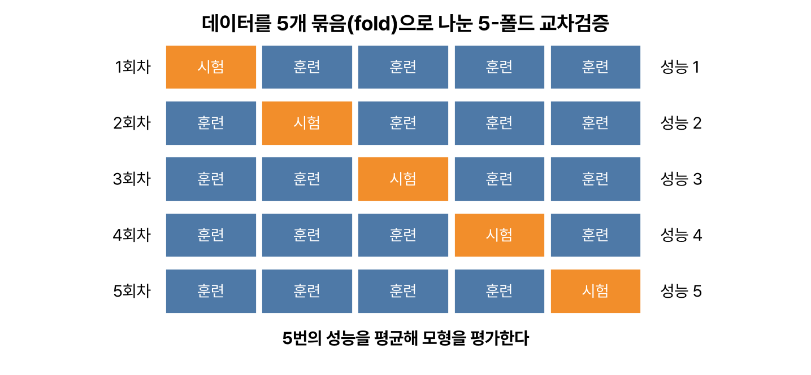
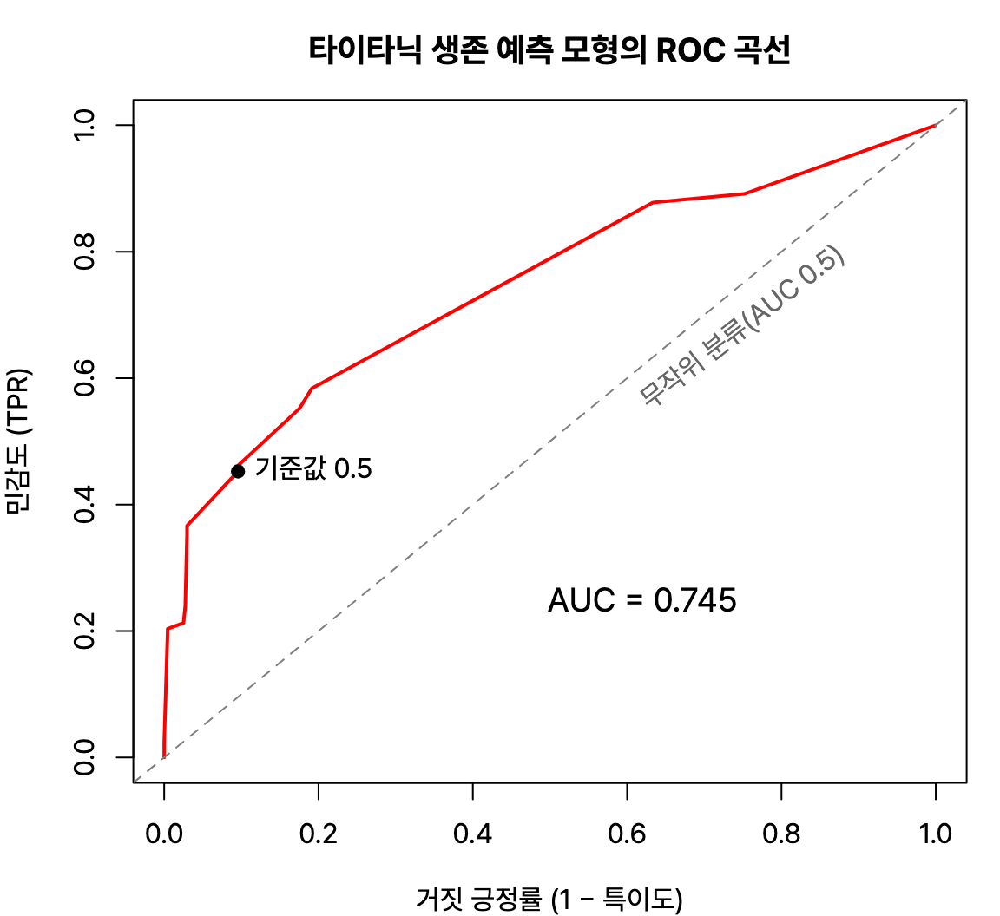



3과목 '정형 데이터 마이닝'의 앞부분인 데이터 마이닝의 정의와 추진 단계, 데이터 분할과 검증 방법, 분류 모형 평가 지표를 정리했다. 혼동행렬에서 민감도, 특이도, 정밀도를 계산하는 문제는 거의 빠지지 않아서 계산 예제를 따로 넣었다. R 4.6.0 실행 결과.

## 요약

- 데이터 마이닝은 대용량 데이터에서 숨은 패턴과 규칙을 찾아 의사결정에 쓰는 과정이다.
- 정답(목표 변수)이 있으면 지도 학습(분류, 예측), 없으면 비지도 학습(군집, 연관규칙)이다.
- 데이터는 훈련용, 검증용, 시험용으로 나누고, 홀드아웃, k-폴드 교차검증, 부트스트랩으로 모형을 검증한다.
- 분류 모형은 혼동행렬에서 계산한 정확도, 민감도, 특이도, 정밀도, F1 점수로 평가하고, ROC 곡선과 AUC로 종합 성능을 본다.
- 훈련 데이터에만 지나치게 맞춘 상태를 과적합이라고 한다.

## 1. 데이터 마이닝의 개요

### 정의와 종류

**데이터 마이닝(data mining)** 은 대용량 데이터에서 의미 있는 패턴, 관계, 규칙을 찾아 모형으로 만들고, 이를 의사결정에 활용하는 과정이다. 통계 분석이 주로 가설을 세우고 검정한다면, 데이터 마이닝은 데이터에서 패턴을 찾아내는 쪽에 가깝다.

| 구분 | 지도 학습(Supervised Learning) | 비지도 학습(Unsupervised Learning) |
|---|---|---|
| 목표 변수 | 있다 | 없다 |
| 목적 | 정답을 예측한다 | 데이터 안의 구조를 찾는다 |
| 기법 | 의사결정나무, 로지스틱 회귀, 인공신경망, 회귀분석, 앙상블, SVM | 군집분석, 연관분석, SOM, 주성분분석 |

데이터 마이닝이 하는 일을 기능별로 나누면 다음과 같다.

| 기능 | 설명 | 예 |
|---|---|---|
| 분류(classification) | 범주를 예측한다 | 대출 신청자의 연체 여부 |
| 추정(estimation) | 연속형 값을 추정한다 | 고객의 소득 |
| 예측(prediction) | 미래의 값이나 행동을 예측한다 | 다음 달 이탈할 고객 |
| 연관 분석(association) | 함께 일어나는 항목을 찾는다 | 장바구니 분석 |
| 군집(clustering) | 비슷한 대상끼리 묶는다 | 고객 세분화 |
| 기술(description) | 데이터가 가진 특징을 설명한다 | 고객 특성 요약 |

### 데이터 마이닝 추진 단계


flowchart LR
  A["목적 설정"] --> B["데이터 준비"] --> C["데이터 가공"] --> D["기법 적용"] --> E["검증"]


| 단계 | 하는 일 |
|---|---|
| 목적 설정 | 무엇을 왜 분석하는지 정하고, 이해관계자와 공유한다 |
| 데이터 준비 | 필요한 데이터를 모으고 정제한다. 데이터 정제를 통해 품질을 보장한다 |
| 데이터 가공 | 목표 변수를 정의하고, 기법에 맞게 데이터 형식을 바꾼다 |
| 기법 적용 | 목적에 맞는 데이터 마이닝 기법을 적용해 정보를 추출한다 |
| 검증 | 결과를 검증하고 업무에 적용해 기대 효과를 확인한다 |

## 2. 데이터 분할과 검증

모형은 처음 보는 데이터에서도 잘 맞아야 한다. 그래서 데이터를 나눠 일부로 학습하고 나머지로 평가한다.

| 데이터 | 역할 |
|---|---|
| 훈련용(training) | 모형을 학습시킨다. 보통 전체의 50% 정도 |
| 검증용(validation) | 학습 중 모형을 비교하고 하이퍼파라미터를 고른다. 30% 정도 |
| 시험용(test) | 최종 모형의 성능을 마지막에 한 번 평가한다. 20% 정도 |

| 검증 방법 | 설명 |
|---|---|
| 홀드아웃(hold-out) | 데이터를 무작위로 훈련용과 시험용(예: 70 : 30)으로 한 번 나눈다. 간단하지만 어떻게 나뉘느냐에 따라 결과가 달라진다 |
| k-폴드 교차검증(k-fold cross validation) | 데이터를 k개로 나누고, 그중 하나를 시험용으로, 나머지 k − 1개를 훈련용으로 쓰는 일을 k번 반복해 평균을 낸다 |
| LOOCV(Leave-One-Out) | k를 데이터 개수 n으로 둔 교차검증. 한 개씩 빼 가며 n번 반복한다 |
| 부트스트랩(bootstrap) | 데이터에서 같은 크기만큼 복원추출로 훈련 데이터를 만든다. 한 번도 뽑히지 않은 데이터(약 36.8%)로 평가한다 |


_5-폴드 교차검증. 모든 데이터가 한 번씩 시험용으로 쓰인다_

데이터가 n개일 때 어떤 데이터가 n번의 복원추출에서 한 번도 뽑히지 않을 확률은 다음과 같다. 그래서 훈련 데이터에는 원래 데이터의 약 63.2%가 들어간다.

$$
\left(1 - \frac{1}{n}\right)^n \approx e^{-1} \approx 0.368
$$

목표 변수의 범주 비율이 크게 다른 **불균형 데이터**(예: 사기 거래가 1%)는 소수 범주를 늘리는 **오버샘플링(over-sampling)** 이나 다수 범주를 줄이는 **언더샘플링(under-sampling)** 으로 균형을 맞춘다.

> **쉬운 설명**
>
> 시험공부를 할 때 문제집(훈련용)으로 공부하고, 모의고사(검증용)로 실력을 점검하고, 진짜 시험(시험용)으로 최종 점수를 받는 것과 같다. 교차검증은 문제집을 다섯 묶음으로 나눠, 네 묶음으로 공부하고 한 묶음으로 시험 보기를 다섯 번 돌아가며 하는 방식이다.

## 3. 분류 모형의 평가

### 혼동행렬

**혼동행렬(confusion matrix)** 은 실제 범주와 예측 범주를 교차해 맞힌 것과 틀린 것을 보여 준다.

| | 실제 Positive | 실제 Negative |
|---|---|---|
| 예측 Positive | TP(True Positive) | FP(False Positive) |
| 예측 Negative | FN(False Negative) | TN(True Negative) |

| 지표 | 식 | 뜻 |
|---|---|---|
| 정확도(Accuracy) | (TP + TN) / 전체 | 전체에서 맞힌 비율 |
| 오분류율(Error rate) | (FP + FN) / 전체 | 1 − 정확도 |
| 민감도(Sensitivity), 재현율(Recall), TPR | TP / (TP + FN) | 실제 Positive를 Positive로 맞힌 비율 |
| 특이도(Specificity), TNR | TN / (TN + FP) | 실제 Negative를 Negative로 맞힌 비율 |
| 정밀도(Precision) | TP / (TP + FP) | Positive라고 예측한 것 중 실제 Positive 비율 |
| 거짓 긍정률(FPR) | FP / (TN + FP) | 1 − 특이도 |
| F1 점수 | 2 × 정밀도 × 재현율 / (정밀도 + 재현율) | 정밀도와 재현율의 조화평균 |

> **쉬운 설명**
>
> 화재경보기를 생각하면 쉽다. 진짜 불이 났을 때 울리는 비율이 민감도(재현율), 불이 안 났을 때 조용한 비율이 특이도, 경보가 울렸을 때 진짜 불인 비율이 정밀도다. 민감도를 높이려고 경보기를 예민하게 만들면 요리 연기에도 울려서 정밀도가 떨어진다. 그래서 둘을 함께 보는 F1 점수를 쓴다.

### R로 해 보는 평가: 타이타닉 생존 예측

타이타닉 승객 2,201명의 등급, 성별, 나이로 생존 여부를 예측하는 로지스틱 회귀모형을 만들고(모형 자체는 다음 글에서 설명한다), 시험용 데이터 660명으로 평가한다. 생존(Yes)을 Positive로 둔다.

```r
ti <- as.data.frame(Titanic)
ti <- ti[rep(seq_len(nrow(ti)), ti$Freq), 1:4]; rownames(ti) <- NULL
set.seed(42); idx <- sample(nrow(ti), round(0.7 * nrow(ti)))
tr <- ti[idx, ]; te <- ti[-idx, ]          # 홀드아웃 70 : 30
lg <- glm(Survived ~ Class + Sex + Age, data = tr, family = binomial)
pr <- predict(lg, te, type = "response")    # 생존 확률
pc <- ifelse(pr > 0.5, "Yes", "No")         # 기준값 0.5로 분류
cm <- table(Predicted = pc, Actual = te$Survived); cm
```

```text
         Actual
Predicted  No Yes
      No  397 121
      Yes  42 100
```

TP = 100, TN = 397, FP = 42, FN = 121이다.

```r
TP <- cm["Yes","Yes"]; TN <- cm["No","No"]; FP <- cm["Yes","No"]; FN <- cm["No","Yes"]
round(c(accuracy = (TP+TN)/sum(cm), sensitivity = TP/(TP+FN),
        specificity = TN/(TN+FP), precision = TP/(TP+FP)), 3)
```

```text
   accuracy sensitivity specificity   precision 
      0.753       0.452       0.904       0.704 
```

정확도는 75.3%지만 민감도는 45.2%에 그친다. 실제 생존자 221명 가운데 절반 넘게 사망으로 잘못 예측했다. 사망자가 더 많은 데이터라 정확도만 보면 성능을 과대평가할 수 있다는 점을 보여 준다.

### ROC 곡선과 AUC

분류 기준값(위의 0.5)을 바꾸면 민감도와 특이도가 함께 바뀐다. **ROC 곡선(Receiver Operating Characteristic curve)** 은 기준값을 0부터 1까지 바꾸며 x축에 **거짓 긍정률(1 − 특이도)**, y축에 **민감도**를 그린 곡선이다. 곡선이 왼쪽 위 모서리에 가까울수록 좋은 모형이다.

**AUC(Area Under the Curve)** 는 ROC 곡선 아래 면적으로 0.5(무작위로 찍기)부터 1(완벽)까지의 값을 가진다.

```r
library(ROCR)
pp <- prediction(pr, te$Survived)
round(performance(pp, "auc")@y.values[[1]], 3)
```

```text
[1] 0.745
```

`plot(performance(pp, "tpr", "fpr"))`로 ROC 곡선을 그릴 수 있다.


_검은 점은 기준값 0.5일 때(거짓 긍정률 0.096, 민감도 0.452)다. 기준값을 낮추면 곡선을 따라 오른쪽 위로 이동해 민감도는 오르고 특이도는 떨어진다_

### 이익도표와 향상도

**이익도표(gain chart)** 와 **향상도 곡선(lift curve)** 은 예측 확률이 높은 순서로 데이터를 정렬해 10개 구간(decile)으로 나누고, 각 구간에서 실제 Positive가 얼마나 많은지 본다.

$$
\text{향상도(Lift)} = \frac{\text{구간의 반응률}}{\text{전체 반응률}}
$$

좋은 모형은 상위 구간의 향상도가 크고, 아래 구간으로 갈수록 빠르게 줄어든다. 마케팅에서 '상위 10% 고객에게만 쿠폰을 보내면 무작위로 보낼 때보다 몇 배 반응하는가'를 볼 때 쓴다.

### 과적합과 과소적합

| 구분 | 상태 | 증상 |
|---|---|---|
| 과적합(overfitting) | 훈련 데이터의 잡음까지 외워 버린 상태 | 훈련 데이터에서는 성능이 매우 좋은데 시험 데이터에서는 나쁘다 |
| 과소적합(underfitting) | 모형이 너무 단순해 패턴을 못 잡은 상태 | 훈련 데이터에서도 성능이 나쁘다 |

과적합을 막으려면 데이터를 늘리거나, 모형을 단순하게 하거나(가지치기, 변수 줄이기), 정규화나 교차검증을 쓴다.

## 헷갈렸던 것들

- 민감도 = 재현율 = TPR = TP / (TP + FN)이다. 분모가 '실제 Positive'이다.
- 정밀도 = TP / (TP + FP)이다. 분모가 '예측 Positive'이다.
- 특이도의 분모는 '실제 Negative'(TN + FP)이다.
- ROC 곡선의 x축은 1 − 특이도(FPR), y축은 민감도(TPR)이다. AUC가 0.5면 무작위 수준이다.
- 부트스트랩은 **복원추출**이고, 한 번도 뽑히지 않는 비율은 약 36.8%이다.
- 과적합은 훈련 성능은 좋고 시험 성능이 나쁜 상태다.

## 용어 정리

| 용어 | 뜻 |
|---|---|
| 홀드아웃 | 데이터를 훈련용과 시험용으로 한 번 나누는 검증 |
| k-폴드 교차검증 | k개로 나눠 돌아가며 시험용으로 쓰는 검증 |
| 부트스트랩 | 복원추출로 훈련 데이터를 만드는 방법 |
| 혼동행렬 | 실제와 예측의 교차표 |
| 민감도 / 특이도 | 실제 Positive를 맞힌 비율 / 실제 Negative를 맞힌 비율 |
| 정밀도 | Positive 예측 중 실제 Positive의 비율 |
| ROC, AUC | 기준값별 민감도와 FPR의 곡선, 그 아래 면적 |
| 향상도 | 구간 반응률 ÷ 전체 반응률 |

## 복습 문제

다음 혼동행렬을 보고 1~3번에 답해 보자.

| | 실제 Positive | 실제 Negative |
|---|---|---|
| 예측 Positive | 40 | 10 |
| 예측 Negative | 20 | 30 |

**1.** 정확도는?

① 0.6 ② 0.7 ③ 0.75 ④ 0.8

**2.** 민감도(재현율)는?

① 0.75 ② 0.8 ③ 0.6 ④ 0.67

**3.** 정밀도는?

① 0.67 ② 0.75 ③ 0.6 ④ 0.8

**4.** ROC 곡선에 대한 설명으로 옳지 않은 것은?

① x축은 1 − 특이도다 ② y축은 민감도다 ③ AUC가 1에 가까울수록 좋다 ④ AUC가 0.5면 완벽한 모형이다

**5.** 부트스트랩에 대한 설명으로 옳은 것은?

① 비복원추출을 쓴다 ② 데이터를 k개로 나눠 반복한다 ③ 데이터가 많을 때만 쓸 수 있다 ④ 한 번도 선택되지 않는 데이터의 비율은 약 36.8%다

## 답과 풀이

1. ② (40 + 30) / 100 = 0.7이다.
2. ④ 40 / (40 + 20) = 0.667이다.
3. ④ 40 / (40 + 10) = 0.8이다.
4. ④ AUC 0.5는 무작위로 찍는 수준이다.
5. ④ 부트스트랩은 복원추출이고, 뽑히지 않는 비율은 약 e⁻¹ ≈ 0.368이다. 데이터가 적을 때 특히 유용하다.

## 참고 자료

- 한국데이터산업진흥원 데이터자격검정, ADsP 출제기준: <https://www.dataq.or.kr>
- ROCR 패키지 문서: <https://cran.r-project.org/package=ROCR>
