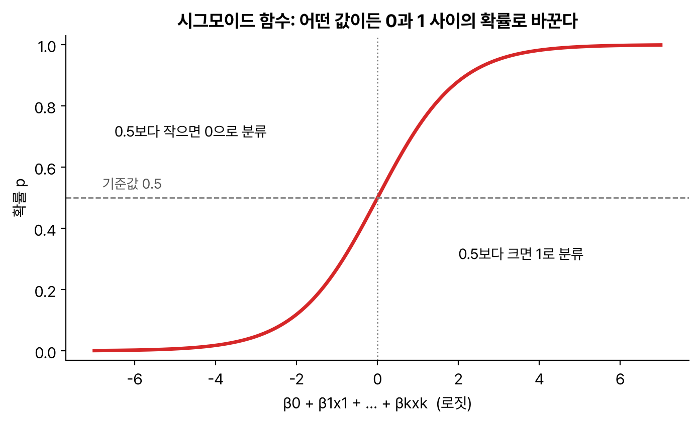
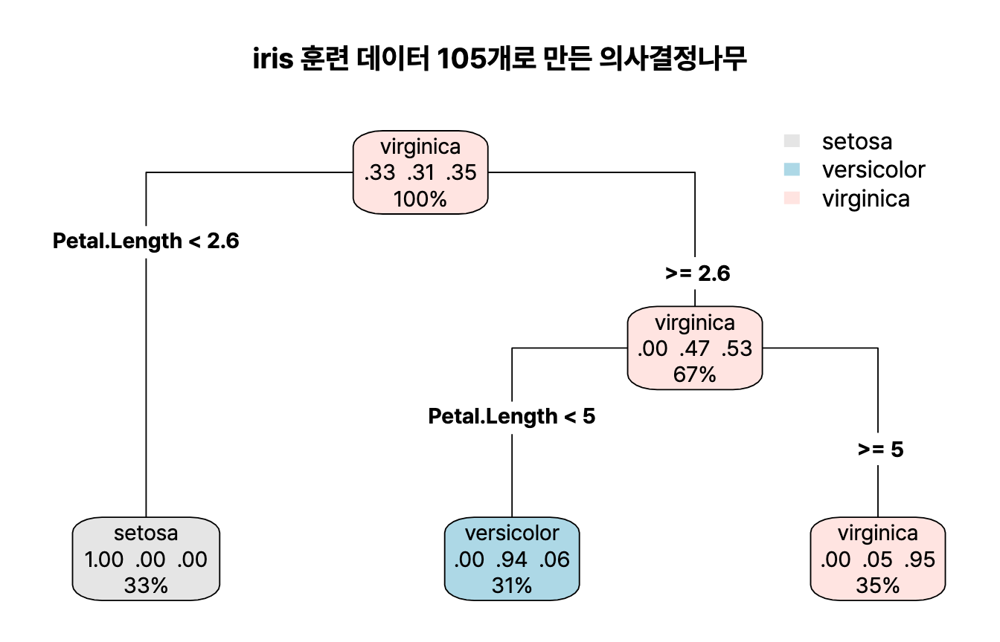



분류분석은 두 편으로 나눴고, 이 글은 로지스틱 회귀와 의사결정나무다. 오즈비 해석과 지니 지수 계산이 단골 계산 문제라 계산 과정을 풀어서 적었다. R 4.6.0 실행 결과.

## 요약

- 로지스틱 회귀는 종속변수가 범주형(예: 생존/사망)일 때, 어떤 범주에 속할 확률을 시그모이드 함수로 예측한다.
- 회귀계수 β를 지수로 바꾼 exp(β)는 오즈비이고, 설명변수가 1 늘 때 오즈가 몇 배가 되는지를 뜻한다.
- 의사결정나무는 질문을 이어 가며 데이터를 나눠 분류하고, 불순도(지니 지수, 엔트로피)가 가장 많이 줄어드는 질문을 고른다.
- 대표 알고리즘은 CART(지니 지수, 이진 분리), C4.5/C5.0(엔트로피), CHAID(카이제곱 통계량)이다.
- 나무가 너무 깊으면 과적합되므로 정지 규칙과 가지치기로 크기를 조절한다.

## 1. 로지스틱 회귀

### 왜 로지스틱 회귀인가

종속변수가 0 또는 1일 때 선형회귀를 쓰면 예측값이 0보다 작거나 1보다 커질 수 있다. **로지스틱 회귀(logistic regression)** 는 예측값을 항상 0과 1 사이의 확률로 만들어 준다.

| 개념 | 식 | 뜻 |
|---|---|---|
| 오즈(odds) | p / (1 − p) | 성공 확률이 실패 확률의 몇 배인가 |
| 로짓(logit) | log(p / (1 − p)) | 오즈에 로그를 씌운 값. −∞부터 ∞까지 |
| 오즈비(odds ratio) | exp(β) | 설명변수가 1 늘 때 오즈가 몇 배가 되는가 |

로지스틱 회귀는 로짓을 설명변수의 선형식으로 놓는다.

$$
\log\frac{p}{1-p} = \beta_0 + \beta_1 x_1 + \cdots + \beta_k x_k
$$

이를 p에 대해 풀면 **시그모이드(sigmoid) 함수**가 된다.

$$
p = \frac{1}{1 + e^{-(\beta_0 + \beta_1 x_1 + \cdots + \beta_k x_k)}}
$$

계수는 최소제곱법이 아니라 **최대가능도 추정법(MLE, Maximum Likelihood Estimation)** 으로 구한다. 예측 확률이 기준값(보통 0.5)보다 크면 1, 작으면 0으로 분류한다.


_시그모이드 함수. 로짓이 0일 때 확률이 0.5다_

> **쉬운 설명**
>
> 오즈는 '이길 확률 대 질 확률'이다. 이길 확률이 80%면 오즈는 0.8 / 0.2 = 4로, '4 대 1로 유리하다'는 뜻이다. 오즈비 12.9는 '다른 조건이 같다면 이쪽이 이길 오즈가 12.9배'라는 뜻이다.

### R로 읽는 로지스틱 회귀 출력

앞 글에서 만든 타이타닉 훈련 데이터(1,541명)로 생존 여부를 예측한다.

```r
lg <- glm(Survived ~ Class + Sex + Age, data = tr, family = binomial)
summary(lg)
```

```text
Call:
glm(formula = Survived ~ Class + Sex + Age, family = binomial, 
    data = tr)

Coefficients:
            Estimate Std. Error z value Pr(>|z|)    
(Intercept)   0.6612     0.3359   1.968 0.049026 *  
Class2nd     -0.9953     0.2398  -4.151 3.31e-05 ***
Class3rd     -1.7590     0.2091  -8.414  < 2e-16 ***
ClassCrew    -0.8564     0.1921  -4.458 8.29e-06 ***
SexFemale     2.5603     0.1707  15.000  < 2e-16 ***
AgeAdult     -1.1106     0.2999  -3.703 0.000213 ***
---
Signif. codes:  0 ‘***’ 0.001 ‘**’ 0.01 ‘*’ 0.05 ‘.’ 0.1 ‘ ’ 1

(Dispersion parameter for binomial family taken to be 1)

    Null deviance: 1927.3  on 1540  degrees of freedom
Residual deviance: 1506.0  on 1535  degrees of freedom
AIC: 1518

Number of Fisher Scoring iterations: 4
```

```r
round(exp(coef(lg)), 3)
```

```text
(Intercept)    Class2nd    Class3rd   ClassCrew   SexFemale    AgeAdult 
      1.937       0.370       0.172       0.425      12.940       0.329 
```

| 항목 | 해석 |
|---|---|
| `family = binomial` | 종속변수가 이항(두 범주)이라 로지스틱 회귀를 쓴다 |
| z value, Pr(>\|z\|) | 각 계수가 0인지 보는 왈드(Wald) 검정. 모든 변수가 유의하다 |
| SexFemale 2.5603 | 기준 범주는 남성(Male). 등급과 나이가 같다면 여성의 생존 오즈는 남성의 exp(2.5603) ≈ 12.94배 |
| Class3rd −1.7590 | 기준 범주는 1등석. 3등석의 생존 오즈는 1등석의 0.172배로, 약 83% 낮다 |
| AgeAdult −1.1106 | 성인의 생존 오즈는 어린이의 0.329배 |
| Null / Residual deviance | 설명변수가 없는 모형의 이탈도 1927.3이 설명변수 5개를 넣자 1506.0으로 줄었다. 이 차이(421.3, 자유도 5)를 카이제곱 검정하면 모형 전체의 유의성을 볼 수 있다 |

계수가 양수면 오즈비가 1보다 커서 확률을 높이고, 음수면 1보다 작아 확률을 낮춘다.

## 2. 의사결정나무

**의사결정나무(decision tree)** 는 '성별이 여성인가?' 같은 질문으로 데이터를 계속 나눠, 나무 모양의 규칙으로 분류하거나 예측하는 모형이다. 목표 변수가 범주형이면 **분류나무**, 연속형이면 **회귀나무**이다.


flowchart TB
  R(["뿌리 마디<br>Petal.Length < 2.6 ?"]) -->|"예"| S["끝마디: setosa"]
  R -->|"아니오"| M(["중간 마디<br>Petal.Length < 4.95 ?"])
  M -->|"예"| VE["끝마디: versicolor"]
  M -->|"아니오"| VI["끝마디: virginica"]


| 구성 요소 | 뜻 |
|---|---|
| 뿌리 마디(root node) | 맨 위의 시작 마디. 전체 데이터 |
| 중간 마디(internal node) | 중간에 있는 마디 |
| 끝마디(terminal node, leaf) | 더 나뉘지 않는 맨 아래 마디. 끝마디 수가 곧 규칙 수 |
| 부모 마디 / 자식 마디 | 나뉘기 전 마디 / 나뉜 뒤 마디 |
| 가지(branch) | 마디를 잇는 선 |
| 깊이(depth) | 뿌리에서 끝마디까지의 마디 층 수 |

### 분리 기준: 불순도

좋은 질문은 나눈 뒤의 마디들이 최대한 한 범주로 모이게 한다. 섞여 있는 정도를 **불순도(impurity)** 라고 하고, 불순도가 가장 많이 줄어드는 변수와 값을 골라 나눈다.

| 목표 변수 | 분리 기준 | 좋은 분리 |
|---|---|---|
| 이산형 | 카이제곱 통계량의 p-value | p-value가 가장 작은 분리 |
| | 지니 지수(Gini index) | 지니 지수가 가장 많이 줄어드는 분리 |
| | 엔트로피 지수(Entropy) | 엔트로피가 가장 작아지는(정보 이득이 가장 큰) 분리 |
| 연속형 | 분산분석의 F통계량 | p-value가 가장 작은 분리 |
| | 분산 감소량 | 분산이 가장 많이 줄어드는 분리 |

범주 i의 비율을 pᵢ라고 하면 지니 지수와 엔트로피는 다음과 같다. 둘 다 한 범주만 있으면 0(순수)이다.

$$
\text{Gini} = 1 - \sum_{i} p_i^2 \qquad \text{Entropy} = -\sum_{i} p_i \log_2 p_i
$$

예를 들어 마디에 A가 6개, B가 4개 있으면 다음과 같다.

- 지니 지수 = 1 − (0.6² + 0.4²) = 1 − 0.52 = **0.48**
- 엔트로피 = −(0.6 × log₂0.6 + 0.4 × log₂0.4) ≈ 0.442 + 0.529 = **0.971**

### 대표 알고리즘

| 알고리즘 | 이산형 목표 변수 | 연속형 목표 변수 | 분리 방식 |
|---|---|---|---|
| CART(Classification And Regression Trees) | 지니 지수 | 분산 감소량 | 이진 분리(가지 2개) |
| C4.5, C5.0 | 엔트로피 지수 | | 다지 분리 가능 |
| CHAID(CHi-squared Automatic Interaction Detection) | 카이제곱 통계량 | ANOVA F통계량 | 다지 분리 가능 |

### 정지 규칙과 가지치기

- **정지 규칙(stopping rule):** 더 나눠도 불순도가 줄지 않거나, 마디의 데이터 수가 최소 기준보다 적거나, 깊이가 한계에 이르면 분리를 멈춘다.
- **가지치기(pruning):** 다 자란 나무에서 성능에 도움이 안 되는 가지를 잘라 과적합을 막는다. 검증 데이터의 오분류율이나 교차검증 오차를 기준으로 한다.

### R로 만드는 의사결정나무

`iris` 150개 가운데 105개로 학습하고 45개로 평가한다.

```r
library(rpart)
set.seed(1); it <- sample(150, 105); itr <- iris[it, ]; ite <- iris[-it, ]
t2 <- rpart(Species ~ ., data = itr, method = "class")
print(t2)
```

```text
n= 105 

node), split, n, loss, yval, (yprob)
      * denotes terminal node

1) root 105 68 virginica (0.33333333 0.31428571 0.35238095)  
  2) Petal.Length< 2.6 35  0 setosa (1.00000000 0.00000000 0.00000000) *
  3) Petal.Length>=2.6 70 33 virginica (0.00000000 0.47142857 0.52857143)  
    6) Petal.Length< 4.95 33  2 versicolor (0.00000000 0.93939394 0.06060606) *
    7) Petal.Length>=4.95 37  2 virginica (0.00000000 0.05405405 0.94594595) *
```

각 줄은 '마디 번호) 분리 조건, 데이터 수, 잘못 분류된 수, 예측 범주, (범주별 비율)'이다. 별표(*)가 끝마디다. 꽃잎 길이(Petal.Length)가 2.6보다 짧으면 모두 setosa이고, 4.95를 기준으로 versicolor와 virginica가 나뉜다.


_`rpart.plot::rpart.plot(t2)`로 그린 같은 나무. 상자 안의 숫자는 범주별 비율과 전체 중 비율이다. 그림에서는 4.95가 반올림되어 5로 표시된다_

```r
printcp(t2)
```

```text
Classification tree:
rpart(formula = Species ~ ., data = itr, method = "class")

Variables actually used in tree construction:
[1] Petal.Length

Root node error: 68/105 = 0.64762

n= 105 

       CP nsplit rel error  xerror     xstd
1 0.51471      0  1.000000 1.35294 0.049632
2 0.42647      1  0.485294 0.61765 0.073823
3 0.01000      2  0.058824 0.13235 0.042185
```

`printcp()`는 가지치기를 위한 표다. CP는 복잡도 매개변수, nsplit은 분리 횟수, xerror는 교차검증 오차다. 보통 xerror가 가장 작은 행의 CP로 `prune(t2, cp = ...)`를 실행해 가지를 친다. 여기서는 분리 2번(CP 0.01)일 때 xerror가 가장 작아 지금 나무를 그대로 쓴다.

```r
table(Predicted = predict(t2, ite, type = "class"), Actual = ite$Species)
```

```text
            Actual
Predicted    setosa versicolor virginica
  setosa         15          0         0
  versicolor      0         17         4
  virginica       0          0         9
```

시험용 45개 가운데 41개를 맞혀 정확도는 약 91.1%이다.

`party` 패키지의 `ctree()`는 통계적 검정(p-value)으로 분리를 정하는 **조건부 추론 나무**라서 따로 가지치기를 하지 않아도 된다.

```r
library(party)
ct <- ctree(Species ~ ., data = iris); print(ct)
```

```text
	 Conditional inference tree with 4 terminal nodes

Response:  Species 
Inputs:  Sepal.Length, Sepal.Width, Petal.Length, Petal.Width 
Number of observations:  150 

1) Petal.Length <= 1.9; criterion = 1, statistic = 140.264
  2)*  weights = 50 
1) Petal.Length > 1.9
  3) Petal.Width <= 1.7; criterion = 1, statistic = 67.894
    4) Petal.Length <= 4.8; criterion = 0.999, statistic = 13.865
      5)*  weights = 46 
    4) Petal.Length > 4.8
      6)*  weights = 8 
  3) Petal.Width > 1.7
    7)*  weights = 46 
```

criterion은 1 − p-value이고, weights는 끝마디에 들어간 데이터 수.

### 의사결정나무의 장단점

| 장점 | 단점 |
|---|---|
| 규칙으로 표현되어 해석하기 쉽다 | 분류 경계선 근처의 데이터는 오차가 크다 |
| 선형성, 정규성, 등분산성 같은 가정이 필요 없는 비모수적 모형이다 | 연속형 변수를 구간으로 나눠 다루므로 경계에서 예측이 끊긴다(비연속성) |
| 수치형과 범주형 변수를 모두 다룬다 | 데이터가 조금만 바뀌어도 나무 모양이 크게 바뀐다(비안정성) |
| 중요한 변수를 자동으로 고르고, 이상값에 덜 민감하다 | 과적합되기 쉬워 가지치기가 필요하다 |

> **쉬운 설명**
>
> 의사결정나무는 '스무고개'와 같다. '꽃잎이 2.6cm보다 짧아?' '응' → setosa. '아니' → '그럼 4.95cm보다 짧아?'처럼, 답을 가장 빨리 좁히는 질문부터 한다. 지니 지수는 '아직 얼마나 섞여 있나'를 재는 점수다. 한 종류만 남으면 0이다.

## 헷갈렸던 것들

- 로지스틱 회귀의 계수는 최대가능도 추정법으로 구하고, `glm(..., family = binomial)`로 만든다.
- exp(β)는 확률비가 아니라 **오즈비**이다. '확률이 12.9배'라고 해석하면 틀린다.
- 회귀계수가 음수면 오즈비는 1보다 작다.
- CART는 지니 지수와 이진 분리, C4.5/C5.0은 엔트로피, CHAID는 카이제곱 통계량이다.
- 카이제곱 통계량과 F통계량 기준은 p-value가 **작은** 분리를 고른다.
- 지니 지수와 엔트로피는 한 범주만 있을 때 0(가장 순수)이다.
- 의사결정나무는 비모수적 모형이고, 비안정성이 단점이다.

## 용어 정리

| 용어 | 뜻 |
|---|---|
| 오즈 / 로짓 | p / (1 − p) / 오즈의 로그 |
| 오즈비 | exp(β). 설명변수가 1 늘 때 오즈의 배수 |
| 시그모이드 함수 | 실수 값을 0과 1 사이로 바꾸는 S자 함수 |
| 최대가능도 추정법 | 관측 데이터가 나올 가능성을 최대로 하는 모수 추정법 |
| 불순도 | 한 마디 안에 범주가 섞인 정도 |
| 지니 지수, 엔트로피 | 불순도 지표 |
| 가지치기 | 과적합을 막기 위해 불필요한 가지를 자르는 것 |

## 복습 문제

**1.** 로지스틱 회귀에서 어떤 변수의 계수가 0.7일 때 해석으로 옳은 것은? (exp(0.7) ≈ 2.01)

① 그 변수가 1 늘면 확률이 0.7 늘어난다 ② 그 변수가 1 늘면 확률이 약 2.01배가 된다 ③ 그 변수가 1 늘면 오즈가 약 2.01배가 된다 ④ 그 변수는 종속변수와 관계가 없다

**2.** 어떤 마디에 범주 A가 8개, B가 2개 있을 때 지니 지수는?

① 0.16 ② 0.32 ③ 0.68 ④ 0.8

**3.** CART 알고리즘이 이산형 목표 변수에 쓰는 분리 기준은?

① 엔트로피 지수 ② 지니 지수 ③ 카이제곱 통계량 ④ F통계량

**4.** 의사결정나무의 특징으로 옳지 않은 것은?

① 해석이 쉽다 ② 데이터가 조금 바뀌어도 모양이 크게 달라질 수 있다 ③ 선형성과 정규성을 가정해야 한다 ④ 가지치기로 과적합을 줄인다

## 답과 풀이

1. ③ exp(β)는 오즈비다. 확률 자체가 2배가 되는 것은 아니다.
2. ② 1 − (0.8² + 0.2²) = 1 − 0.68 = 0.32이다.
3. ② CART는 이산형에 지니 지수, 연속형에 분산 감소량을 쓴다.
4. ③ 의사결정나무는 분포 가정이 필요 없는 비모수적 모형이다.

## 참고 자료

- 한국데이터산업진흥원 데이터자격검정, ADsP 출제기준: <https://www.dataq.or.kr>
- rpart 패키지 문서: <https://cran.r-project.org/package=rpart>
- party 패키지 문서: <https://cran.r-project.org/package=party>
