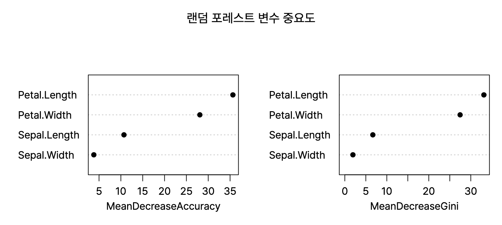
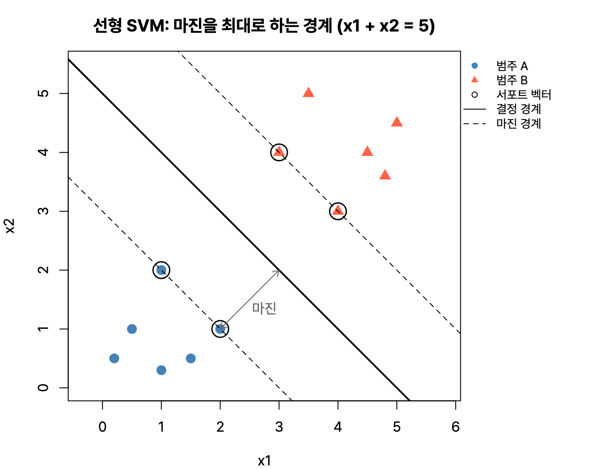



분류분석의 나머지인 앙상블(배깅, 부스팅, 랜덤 포레스트), 인공신경망, 나이브 베이즈, k-최근접 이웃, 서포트 벡터 머신이다. 배깅과 부스팅의 차이, 활성화 함수 종류가 자주 나온다. 예제는 앞 글과 똑같이 `iris` 훈련 데이터 105개, 시험 데이터 45개로 맞춰서 모델끼리 비교할 수 있게 했다. R 4.6.0 실행 결과.

## 요약

- 앙상블은 여러 모형의 예측을 합쳐 하나보다 나은 예측을 만든다. 배깅은 부트스트랩 표본으로 만든 모형을 투표로, 부스팅은 앞 모형이 틀린 데이터에 가중치를 주며 차례로 합친다.
- 랜덤 포레스트는 배깅에 변수의 무작위 선택을 더해 나무끼리의 상관을 줄인다.
- 인공신경망은 입력층, 은닉층, 출력층의 노드를 가중치로 연결하고, 오차 역전파로 가중치를 학습한다.
- 나이브 베이즈는 설명변수끼리 서로 독립이라고 가정하고 베이즈 정리로 분류한다.
- k-NN은 가장 가까운 k개 이웃의 다수결로, SVM은 두 범주 사이의 여백(마진)을 가장 넓게 하는 경계로 분류한다.

## 1. 앙상블

**앙상블(ensemble)** 은 여러 개의 모형을 만들어 그 결과를 합치는 방법이다. 하나의 모형은 데이터가 조금만 바뀌어도 결과가 흔들릴 수 있는데, 여러 모형을 합치면 예측이 안정되고 정확해진다.


flowchart TB
  subgraph BAG["배깅: 나란히 만들고 투표"]
    direction TB
    D1["원래 데이터"] --> B1["부트스트랩 표본 1"] --> M1["모형 1"]
    D1 --> B2["부트스트랩 표본 2"] --> M2["모형 2"]
    D1 --> B3["부트스트랩 표본 3"] --> M3["모형 3"]
    M1 --> V["투표 / 평균"]
    M2 --> V
    M3 --> V
  end
  subgraph BOO["부스팅: 차례로 만들며 보완"]
    direction TB
    N1["모형 1"] -->|"틀린 데이터에<br>가중치"| N2["모형 2"] -->|"틀린 데이터에<br>가중치"| N3["모형 3"] --> W["가중 결합"]
  end


| 방법 | 원리 | 주로 줄이는 것 | 예 |
|---|---|---|---|
| 배깅(Bagging, Bootstrap AGGregatING) | 부트스트랩 표본 여러 개로 모형을 각각 만들고, 분류는 다수결 투표(voting), 회귀는 평균으로 합친다. 모형들을 동시에(병렬로) 만들 수 있다 | 분산 | 배깅 나무 |
| 부스팅(Boosting) | 약한 모형을 차례로 만들며, 앞 모형이 잘못 분류한 데이터에 더 큰 가중치를 준다. 순차적으로 만든다 | 편향 | AdaBoost, GBM, XGBoost, LightGBM |
| 랜덤 포레스트(Random Forest) | 배깅에 더해, 나무의 각 분리마다 설명변수의 일부만 무작위로 골라 후보로 쓴다. 나무끼리의 상관이 줄어 예측이 더 안정된다 | 분산 | randomForest |

배깅에서 각 부트스트랩 표본에 뽑히지 않은 데이터(약 36.8%)를 **OOB(Out-Of-Bag)** 데이터라고 하고, 이것으로 따로 시험 데이터를 떼지 않고도 오차를 추정할 수 있다.

```r
library(randomForest)
set.seed(1)
rf <- randomForest(Species ~ ., data = itr, ntree = 500, importance = TRUE); rf
```

```text
Call:
 randomForest(formula = Species ~ ., data = itr, ntree = 500,      importance = TRUE) 
               Type of random forest: classification
                     Number of trees: 500
No. of variables tried at each split: 2

        OOB estimate of  error rate: 5.71%
Confusion matrix:
           setosa versicolor virginica class.error
setosa         35          0         0  0.00000000
versicolor      0         30         3  0.09090909
virginica       0          3        34  0.08108108
```

나무 500그루를 만들었고, 각 분리에서 변수 4개 가운데 2개를 무작위로 골라 후보로 썼다. 분류 문제의 기본값은 변수 개수의 제곱근(√4 = 2)이다. OOB 오차율은 5.71%이다.

```r
round(importance(rf)[, c("MeanDecreaseAccuracy", "MeanDecreaseGini")], 2)
```

```text
             MeanDecreaseAccuracy MeanDecreaseGini
Sepal.Length                10.71             6.67
Sepal.Width                  3.81             1.93
Petal.Length                35.65            33.12
Petal.Width                 28.08            27.46
```

**변수 중요도**는 그 변수를 섞어 버렸을 때 정확도가 얼마나 떨어지는지(MeanDecreaseAccuracy), 그 변수로 나눌 때 지니 지수가 얼마나 줄었는지(MeanDecreaseGini)로 본다. 꽃잎 길이와 너비가 가장 중요하다. 시험 데이터 45개에서는 43개를 맞혔다.


_`varImpPlot(rf)`. 두 기준 모두 꽃잎 길이와 너비가 위에 있다_

> **쉬운 설명**
>
> 배깅은 퀴즈 정답을 반 친구 여러 명에게 각자 풀게 한 뒤 다수결로 고르는 것, 부스팅은 첫 친구가 틀린 문제를 다음 친구가 집중해서 풀고, 그 친구가 또 틀린 문제를 다음 친구가 푸는 식으로 이어 달리는 것이다. 랜덤 포레스트는 친구마다 일부 과목 교과서만 보고 풀게 해서, 다들 똑같은 실수를 하지 않게 만든 배깅이다.

## 2. 인공신경망

**인공신경망(ANN, Artificial Neural Network)** 은 사람 뇌의 신경세포(뉴런)를 흉내 낸 모형이다. 입력값에 가중치를 곱해 더하고, 활성화 함수를 거쳐 다음 층으로 보낸다.


flowchart LR
  x1(("x1")) --> h1(("h1"))
  x1 --> h2(("h2"))
  x2(("x2")) --> h1
  x2 --> h2
  x3(("x3")) --> h1
  x3 --> h2
  h1 --> y(("y"))
  h2 --> y
  subgraph 입력층
    x1
    x2
    x3
  end
  subgraph 은닉층
    h1
    h2
  end
  subgraph 출력층
    y
  end


| 구성 | 뜻 |
|---|---|
| 입력층(input layer) | 설명변수가 들어오는 층. 노드 수 = 설명변수 수 |
| 은닉층(hidden layer) | 입력과 출력 사이의 층. 층 수와 노드 수는 분석가가 정한다 |
| 출력층(output layer) | 예측 결과를 내는 층. 분류 문제면 노드 수 = 범주 수 |
| 가중치(weight), 편향(bias) | 학습으로 정해지는 값 |
| 활성화 함수(activation function) | 가중합을 출력값으로 바꾸는 함수 |

### 활성화 함수

| 함수 | 출력 | 특징 |
|---|---|---|
| 계단 함수(step) | 0 또는 1 | 초기 퍼셉트론에서 쓴 함수 |
| 부호 함수(sign) | −1 또는 1 | |
| 시그모이드(sigmoid) | 0 ~ 1 | 로지스틱 회귀와 같은 S자 곡선 |
| 소프트맥스(softmax) | 0 ~ 1, 합이 1 | 다범주 분류의 출력층에서 범주별 확률을 낸다 |
| tanh | −1 ~ 1 | 시그모이드를 가운데로 옮긴 모양 |
| ReLU | 0 이상 | 입력이 0보다 작으면 0, 크면 그대로. 기울기 소실 문제를 줄인다 |

### 학습과 주의할 점

- **오차 역전파(back propagation):** 출력층의 오차를 거꾸로 전달하며 각 가중치를 조금씩 고친다.
- **기울기 소실(vanishing gradient):** 층이 깊어지면 앞쪽 층까지 오차가 거의 전달되지 않는 문제다. 시그모이드를 쓸 때 심하고, ReLU로 줄일 수 있다.
- **단층 퍼셉트론의 한계:** 은닉층이 없는 단층 퍼셉트론은 직선 하나로 나눌 수 없는 XOR 문제를 풀지 못한다. 은닉층을 두면(다층 퍼셉트론) 풀 수 있다.
- 은닉 노드가 너무 많으면 과적합, 너무 적으면 과소적합이 생긴다. 가중치의 초깃값에 따라 결과가 달라질 수 있다.
- 결과를 사람이 해석하기 어렵다는 것이 단점이다(블랙박스).

```r
library(nnet)
set.seed(1)
nn <- nnet(Species ~ ., data = itr, size = 2, decay = 5e-4, maxit = 200, trace = FALSE); nn
```

```text
a 4-2-3 network with 19 weights
inputs: Sepal.Length Sepal.Width Petal.Length Petal.Width 
output(s): Species 
options were - softmax modelling  decay=5e-04
```

입력 노드 4개, 은닉 노드 2개, 출력 노드 3개인 신경망이다. 가중치 개수는 (4 + 1) × 2 + (2 + 1) × 3 = 10 + 9 = **19개**이다. 각 층의 '+1'은 편향이다. 범주가 셋이라 출력층에 소프트맥스를 썼고, `decay`는 과적합을 막는 가중치 감쇠 값이다. 시험 데이터 45개에서는 43개를 맞혔다.

## 3. 나이브 베이즈

**나이브 베이즈(Naive Bayes)** 는 베이즈 정리로 각 범주에 속할 확률을 계산하고 가장 큰 범주로 분류한다. 설명변수끼리 **서로 독립**이라고 '순진하게(naive)' 가정해서 계산을 아주 단순하게 만든다.

$$
P(C \mid x_1, \ldots, x_k) \propto P(C)\prod_{i=1}^{k} P(x_i \mid C)
$$

P(C)는 범주의 사전확률이고, 각 변수의 조건부 확률을 곱해 사후확률을 구한다. 스팸 메일 분류처럼 변수가 아주 많은 문서 분류에서 빠르고 잘 작동한다.

```r
library(e1071)
nb <- naiveBayes(Species ~ ., data = itr); nb$apriori
table(Predicted = predict(nb, ite), Actual = ite$Species)
```

```text
Y
    setosa versicolor  virginica 
        35         33         37 
            Actual
Predicted    setosa versicolor virginica
  setosa         15          0         0
  versicolor      0         17         1
  virginica       0          0        12
```

`apriori`는 훈련 데이터의 범주별 개수로, 사전확률의 바탕이 된다. 45개 가운데 44개를 맞혔다.

## 4. k-최근접 이웃

**k-최근접 이웃(k-NN, k-Nearest Neighbors)** 은 새 데이터와 가장 가까운 훈련 데이터 k개를 찾아, 그 이웃들의 다수결로 범주를 정한다.

- 거리는 보통 유클리드 거리를 쓰므로, 단위가 다른 변수는 먼저 **표준화**해야 한다.
- k가 작으면 잡음에 민감해 과적합되기 쉽고, k가 크면 경계가 지나치게 뭉개진다. 동점을 피하려고 k를 홀수로 고르기도 한다.
- 미리 모형을 만들지 않고 예측할 때마다 거리를 계산해서 **게으른 학습(lazy learning)** 이라고 부른다.

```r
library(class)
sc <- scale(itr[, 1:4])   # 훈련 데이터의 평균과 표준편차로 표준화
kp <- knn(train = sc,
          test = scale(ite[, 1:4], center = attr(sc, "scaled:center"), scale = attr(sc, "scaled:scale")),
          cl = itr$Species, k = 5)
table(Predicted = kp, Actual = ite$Species)
```

```text
            Actual
Predicted    setosa versicolor virginica
  setosa         15          0         0
  versicolor      0         16         2
  virginica       0          1        11
```

시험 데이터도 훈련 데이터의 평균과 표준편차로 표준화해야 기준이 같아진다. 45개 가운데 42개를 맞혔다.

## 5. 서포트 벡터 머신

**서포트 벡터 머신(SVM, Support Vector Machine)** 은 두 범주를 나누는 경계(초평면, hyperplane) 가운데, 가장 가까운 데이터까지의 거리인 **마진(margin)** 이 가장 넓은 경계를 찾는다. 경계에 가장 가까이 있어 경계를 결정하는 데이터를 **서포트 벡터(support vector)** 라고 한다.

- 직선으로 나눌 수 없는 데이터는 **커널 트릭(kernel trick)** 으로 더 높은 차원에 옮겨 나눈다. 선형, 다항, 방사 기저 함수(RBF, radial), 시그모이드 커널이 있다.
- 약간의 오분류를 허용하는 정도는 cost(C) 값으로 조절한다. C가 크면 오분류를 엄격히 막아 마진이 좁아지고 과적합되기 쉽다.
- 예측 성능이 좋지만, 데이터가 많으면 학습이 느리고 결과를 해석하기 어렵다.


_`e1071::svm(kernel = "linear")`로 찾은 경계 x1 + x2 = 5. 점선 위에 놓인 네 점(동그라미)이 서포트 벡터이고, 이 점들만 경계를 결정한다_

```r
sv <- svm(Species ~ ., data = itr); sv
```

```text
Call:
svm(formula = Species ~ ., data = itr)


Parameters:
   SVM-Type:  C-classification 
 SVM-Kernel:  radial 
       cost:  1 

Number of Support Vectors:  44
```

기본 커널은 방사 기저 함수(radial)이고, 105개 가운데 44개가 서포트 벡터로 쓰였다. 시험 데이터 45개 가운데 44개를 맞혔다.

> **쉬운 설명**
>
> k-NN은 '이사 온 집 주변 다섯 집이 모두 고양이를 키우면 우리 집도 고양이를 키울 것'이라고 추측하는 방법이다. SVM은 운동장에서 두 반 학생들 사이에 줄을 그을 때, 양쪽 학생과 최대한 멀리 떨어지게 긋는 방법이다. 그 줄에 가장 가까이 서 있는 학생들이 서포트 벡터다.

## 모형별 시험 데이터 결과 비교

| 모형 | 맞힌 수 / 45 | 정확도 |
|---|---|---|
| 의사결정나무(rpart, 앞 글) | 41 | 91.1% |
| 랜덤 포레스트 | 43 | 95.6% |
| 인공신경망(은닉 노드 2개) | 43 | 95.6% |
| 나이브 베이즈 | 44 | 97.8% |
| k-NN(k = 5) | 42 | 93.3% |
| SVM(radial) | 44 | 97.8% |

시험 데이터가 45개뿐이라 한두 개 차이는 우연일 수 있다. 실제로는 교차검증으로 여러 번 비교해야 한다.

## 헷갈렸던 것들

- 배깅은 **병렬**로 만들고 투표하며 분산을 줄이고, 부스팅은 **순차**적으로 만들며 틀린 데이터에 가중치를 준다.
- 랜덤 포레스트는 배깅에 **변수의 무작위 선택**을 더한 방법이다.
- 소프트맥스는 다범주 분류의 출력층에서 쓰고, 출력의 합이 1이다.
- 단층 퍼셉트론은 XOR 문제를 풀 수 없다.
- 은닉층과 은닉 노드 수는 자동으로 정해지지 않고, 분석가가 정한다.
- 나이브 베이즈는 설명변수끼리 **독립**이라고 가정한다.
- k-NN은 거리를 쓰므로 표준화가 필요하고, 게으른 학습이다.
- SVM은 마진을 **최대화**하는 경계를 찾는다.

## 용어 정리

| 용어 | 뜻 |
|---|---|
| 앙상블 | 여러 모형의 결과를 합치는 방법 |
| 배깅 / 부스팅 | 부트스트랩 모형의 투표 / 오분류 가중치를 준 순차 결합 |
| OOB | 부트스트랩 표본에 뽑히지 않은 데이터 |
| 랜덤 포레스트 | 변수를 무작위로 골라 만든 나무들의 배깅 |
| 활성화 함수 | 신경망에서 가중합을 출력으로 바꾸는 함수 |
| 오차 역전파 | 출력 오차를 거꾸로 전달해 가중치를 고치는 학습 방법 |
| 기울기 소실 | 층이 깊어지면 앞 층의 학습이 거의 안 되는 문제 |
| 서포트 벡터 / 마진 | 경계에 가장 가까운 데이터 / 경계와 그 데이터 사이의 거리 |

## 복습 문제

**1.** 배깅에 대한 설명으로 옳지 않은 것은?

① 부트스트랩 표본으로 여러 모형을 만든다 ② 앞 모형이 틀린 데이터에 가중치를 주며 순차적으로 학습한다 ③ 분류 문제에서는 다수결 투표로 결합한다 ④ 모형의 분산을 줄이는 효과가 있다

**2.** 랜덤 포레스트가 일반 배깅과 다른 점은?

① 각 분리에서 설명변수의 일부만 무작위로 후보로 쓴다 ② 부트스트랩 표본을 쓰지 않는다 ③ 나무를 하나만 만든다 ④ 오분류 데이터에 가중치를 준다

**3.** 입력 노드 3개, 은닉 노드 4개, 출력 노드 1개인 신경망의 가중치 개수는? (편향 포함)

① 12 ② 16 ③ 21 ④ 24

**4.** 다범주 분류 신경망의 출력층에서 범주별 확률을 내는 활성화 함수는?

① 소프트맥스 ② 계단 함수 ③ ReLU ④ 부호 함수

**5.** 다음 중 설명변수끼리 서로 독립이라고 가정하는 분류 기법은?

① k-NN ② 나이브 베이즈 ③ SVM ④ 랜덤 포레스트

## 답과 풀이

1. ② 순차적으로 가중치를 주는 것은 부스팅이다.
2. ① 변수를 무작위로 골라 나무끼리의 상관을 줄인다.
3. ③ (3 + 1) × 4 + (4 + 1) × 1 = 16 + 5 = 21이다.
4. ① 소프트맥스는 범주별 확률을 내고 합이 1이다.
5. ② 나이브 베이즈의 '나이브'가 바로 독립 가정이다.

## 참고 자료

- 한국데이터산업진흥원 데이터자격검정, ADsP 출제기준: <https://www.dataq.or.kr>
- Breiman, L., 'Random Forests', Machine Learning, 2001
- e1071 패키지 문서: <https://cran.r-project.org/package=e1071>
