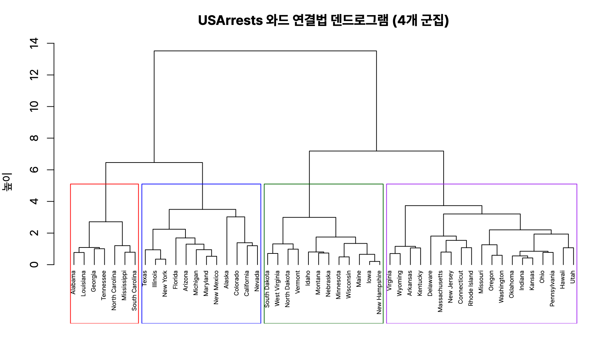
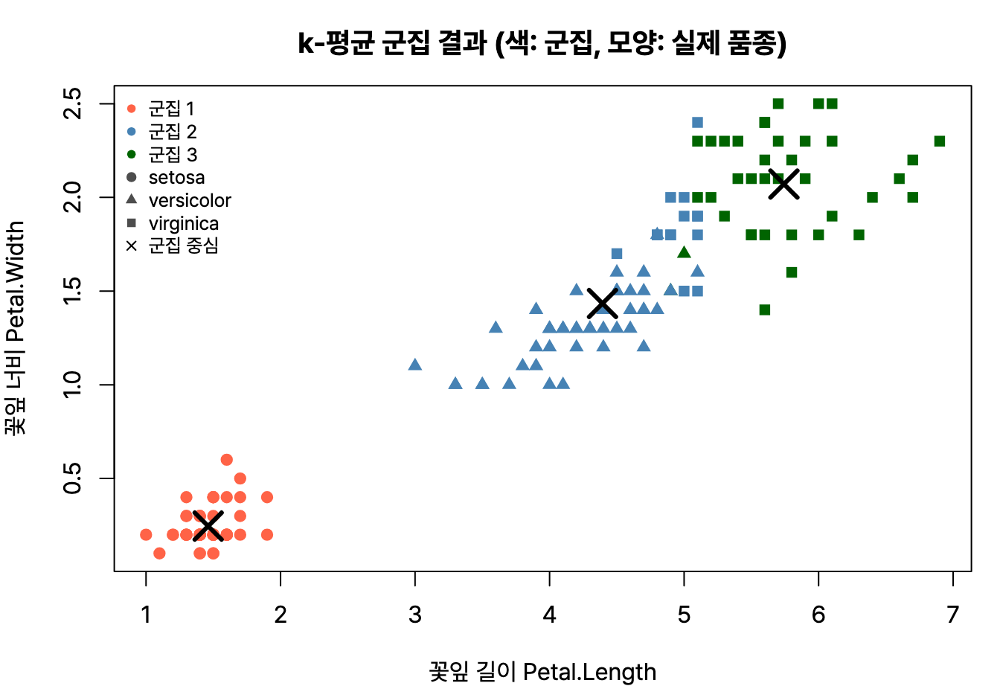
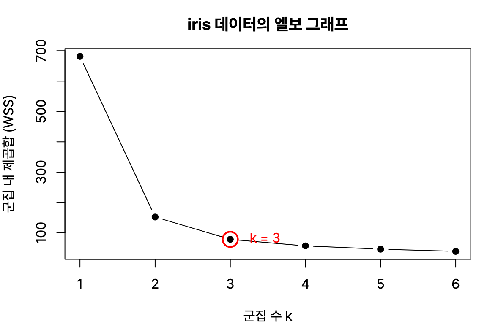



정형 데이터 마이닝 네 번째, 군집분석. 거리 계산, 연결법마다 달라지는 병합 거리, k-평균의 절차와 단점이 자주 나온다. R 4.6.0 실행 결과.

## 요약

- 군집분석은 목표 변수 없이, 비슷한 개체끼리 같은 군집으로 묶는 비지도 학습이다.
- 비슷한 정도는 거리로 잰다. 연속형 변수는 유클리드, 맨해튼, 마할라노비스 거리 등을, 범주형 변수는 자카드 계수 등을 쓴다.
- 계층적 군집은 가까운 것부터 하나씩 합쳐 덴드로그램을 만들고, 군집 사이 거리를 재는 방법(연결법)에 따라 결과가 달라진다.
- k-평균 군집은 군집 수 k를 먼저 정하고, 중심 계산과 재배정을 반복한다.
- 혼합 분포 군집은 EM 알고리즘으로, SOM은 경쟁 학습으로 군집을 만든다.

## 1. 거리

### 연속형 변수의 거리

두 개체 x = (x₁, …, xₚ)와 y = (y₁, …, yₚ) 사이의 거리다.

| 거리 | 정의 | 특징 |
|---|---|---|
| 유클리드(Euclidean) | 차이 제곱합의 제곱근 | 가장 흔한 직선거리 |
| 맨해튼(Manhattan, 시가 거리) | 차이 절댓값의 합 | 바둑판 도로를 따라 걷는 거리 |
| 민코프스키(Minkowski) | 차이 절댓값의 m제곱 합의 m제곱근 | m = 1이면 맨해튼, m = 2면 유클리드 |
| 체비셰프(Chebyshev) | 차이 절댓값의 최댓값 | |
| 표준화 거리 | 각 변수를 표준편차로 나눈 뒤 유클리드 거리 | 단위의 영향을 없앤다 |
| 마할라노비스(Mahalanobis) | 변수의 분산과 공분산(상관) 까지 고려한 거리 | 변수끼리 상관이 있을 때 쓴다 |

$$
d_{\text{유클리드}} = \sqrt{\sum_{i=1}^{p}(x_i - y_i)^2} \qquad d_{\text{맨해튼}} = \sum_{i=1}^{p}\lvert x_i - y_i \rvert
$$

### 범주형 변수의 거리(유사도)

| 지표 | 설명 |
|---|---|
| 자카드 계수(Jaccard) | 두 집합의 교집합 크기 ÷ 합집합 크기. 1 − 자카드 계수가 자카드 거리 |
| 단순 일치 계수 | 전체 변수 가운데 값이 같은 변수의 비율 |
| 코사인 유사도 | 두 벡터가 이루는 각의 코사인. 문서 유사도에 많이 쓴다 |

### 예제

점 네 개 A(1, 1), B(2, 1), C(4, 3), D(5, 4)의 거리를 구해 본다.

```r
x <- matrix(c(1, 1, 2, 1, 4, 3, 5, 4), ncol = 2, byrow = TRUE,
            dimnames = list(c("A","B","C","D"), c("x","y")))
dist(x)                         # 유클리드 거리
dist(x, method = "manhattan")   # 맨해튼 거리
```

```text
         A        B        C
B 1.000000                  
C 3.605551 2.828427         
D 5.000000 4.242641 1.414214
  A B C
B 1    
C 5 4  
D 7 6 2
```

A와 D의 유클리드 거리는 √((5 − 1)² + (4 − 1)²) = √25 = 5이고, 맨해튼 거리는 4 + 3 = 7이다.

## 2. 계층적 군집

**계층적 군집(hierarchical clustering)** 은 가장 가까운 개체나 군집을 하나씩 합쳐 가는 **병합적(응집형) 방법**과, 전체를 하나씩 나눠 가는 **분할적 방법**이 있다. 보통 병합적 방법을 쓴다. 결과는 나무 모양의 **덴드로그램(dendrogram)** 으로 그리고, 원하는 높이에서 잘라 군집 수를 정한다.

### 연결법

두 군집 사이의 거리를 어떻게 정하느냐에 따라 결과가 달라진다.

| 연결법 | 군집 사이 거리 | 특징 |
|---|---|---|
| 최단 연결법(single) | 두 군집에서 가장 가까운 개체끼리의 거리 | 길게 늘어진 사슬 모양 군집이 생기기 쉽다 |
| 최장 연결법(complete) | 두 군집에서 가장 먼 개체끼리의 거리 | 둥글고 크기가 비슷한 군집이 생긴다 |
| 평균 연결법(average) | 모든 개체 쌍 거리의 평균 | 이상값에 덜 민감하다 |
| 중심 연결법(centroid) | 두 군집 중심 사이의 거리 | 합친 뒤 새 중심은 가중평균으로 구한다 |
| 와드 연결법(Ward) | 합쳤을 때 군집 내 오차제곱합이 가장 적게 늘어나는 두 군집을 합친다 | 크기가 비슷한 군집을 만든다. 거리 대신 오차제곱합을 쓴다 |

```r
hc <- hclust(dist(x), method = "single");   hc$merge; hc$height
hc2 <- hclust(dist(x), method = "complete"); hc2$height
```

```text
     [,1] [,2]
[1,]   -1   -2
[2,]   -3   -4
[3,]    1    2
[1] 1.000000 1.414214 2.828427
[1] 1.000000 1.414214 5.000000
```

`merge`의 음수는 개체 번호, 양수는 앞 단계에서 만든 군집 번호다. 먼저 A와 B(거리 1), 다음 C와 D(거리 1.414)가 합쳐지고, 마지막에 두 군집이 합쳐진다. 마지막 병합 거리는 연결법마다 다르다. 최단 연결법은 가장 가까운 B와 C의 거리 2.828을, 최장 연결법은 가장 먼 A와 D의 거리 5를 쓴다.

```r
us <- scale(USArrests)                         # 단위가 달라 표준화
hw <- hclust(dist(us), method = "ward.D2")     # plot(hw)로 덴드로그램
table(cutree(hw, k = 4))                       # 4개 군집으로 자르기
```

```text
 1  2  3  4 
 7 12 19 12 
```

미국 50개 주를 범죄율과 도시화 정도로 묶어 7, 12, 19, 12개 주로 이뤄진 네 군집을 얻었다.


_`plot(hw)`와 `rect.hclust(hw, k = 4)`. 네 개의 상자가 4개 군집이고, 세로축 높이는 군집이 합쳐질 때의 거리다_

## 3. k-평균 군집

**k-평균 군집(k-means clustering)** 은 대표적인 **비계층적(분할적) 군집** 방법이다.


flowchart LR
  A["1. 군집 수 k 정하기"] --> B["2. 초기 중심 k개<br>무작위 선택"]
  B --> C["3. 각 개체를 가장 가까운<br>중심의 군집에 배정"]
  C --> D["4. 군집별 평균으로<br>중심 다시 계산"]
  D -->|"중심이 바뀌면 반복"| C
  D -->|"변화 없음"| E["끝"]


| 장점 | 단점 |
|---|---|
| 원리가 단순하고 계산이 빨라 대용량 데이터에 쓸 수 있다 | 군집 수 k를 미리 정해야 한다 |
| 한 번 배정된 개체도 다른 군집으로 옮겨 갈 수 있다 | 초기 중심에 따라 결과가 달라진다 |
| | 평균을 쓰므로 이상값에 민감하다. 대신 중앙값 개체를 쓰는 k-medoids(PAM)를 쓸 수 있다 |
| | 볼록하지 않은(예: 초승달 모양) 군집은 잘 찾지 못한다 |

```r
set.seed(123)
km <- kmeans(iris[, 1:4], centers = 3, nstart = 25)   # 초기값을 25번 바꿔 가장 좋은 결과
km$size; round(km$centers, 2)
table(Cluster = km$cluster, Species = iris$Species)
```

```text
[1] 50 62 38
  Sepal.Length Sepal.Width Petal.Length Petal.Width
1         5.01        3.43         1.46        0.25
2         5.90        2.75         4.39        1.43
3         6.85        3.07         5.74        2.07
       Species
Cluster setosa versicolor virginica
      1     50          0         0
      2      0         48        14
      3      0          2        36
```

정답(Species)을 쓰지 않았는데도 군집 1은 setosa 50개와 정확히 일치한다. versicolor와 virginica는 일부 섞였다. `nstart`는 초기 중심 문제를 줄이려고 여러 번 시작해 보는 옵션이다.


_꽃잎 길이와 너비로 본 k-평균 결과. setosa(빨강)는 깔끔하게 떨어져 있고, 겹친 부분에서 versicolor와 virginica 일부가 섞였다_

### 군집 수 정하기

**엘보 방법(elbow method):** k를 늘려 가며 군집 내 제곱합(WSS)을 그리고, 감소 폭이 갑자기 줄어드는 '팔꿈치' 지점을 고른다.

```r
set.seed(123)
round(sapply(1:6, function(k) kmeans(iris[, 1:4], k, nstart = 25)$tot.withinss), 1)
```

```text
[1] 681.4 152.3  78.9  57.2  46.4  39.0
```

k = 1에서 2로 갈 때 크게 줄고, 3 이후에는 감소 폭이 작아져서 k = 2나 3이 적당해 보인다.


_엘보 그래프. k = 3 이후로는 군집을 늘려도 WSS가 크게 줄지 않는다_

**실루엣 계수(silhouette coefficient):** 같은 군집의 개체끼리 얼마나 가깝고 다른 군집과 얼마나 먼지를 −1부터 1 사이로 나타낸다. 1에 가까울수록 잘 묶인 것이고, 0에 가까우면 군집 경계에 있다는 뜻이다.

```r
library(cluster)
sil <- silhouette(km$cluster, dist(iris[, 1:4]))
round(summary(sil)$avg.width, 3)
```

```text
[1] 0.553
```

> **쉬운 설명**
>
> 운동장에 흩어진 학생들을 세 모둠으로 나눈다고 해 보자. k-평균은 먼저 모둠장 세 명을 아무나 정하고, 학생들이 가장 가까운 모둠장에게 모이게 한다. 그다음 각 모둠의 한가운데에 모둠장이 다시 서고, 학생들이 또 가장 가까운 모둠장에게 간다. 아무도 자리를 옮기지 않을 때까지 반복한다. 계층적 군집은 가장 가까운 두 명이 짝이 되고, 짝끼리 다시 모둠이 되는 식으로 점점 큰 모둠을 만들어 간다.

## 4. 혼합 분포 군집

**혼합 분포 군집(mixture distribution clustering)** 은 데이터가 여러 개의 확률분포(주로 정규분포)가 섞여서 나왔다고 보고, 각 분포의 모수(평균, 분산, 섞인 비율)를 추정해 군집을 만든다. 모수는 **EM(Expectation-Maximization) 알고리즘**으로 추정한다.

| 단계 | 하는 일 |
|---|---|
| E 단계(Expectation) | 현재 모수로 각 개체가 각 군집에 속할 확률(잠재 변수의 기댓값)을 계산한다 |
| M 단계(Maximization) | 그 확률을 가중치로 써서 가능도가 최대가 되도록 모수를 다시 추정한다 |

두 단계를 결과가 거의 바뀌지 않을 때까지 반복한다. k-평균이 각 개체를 한 군집에만 넣는 것과 달리, 혼합 분포 군집은 개체마다 각 군집에 속할 **확률**을 준다. 군집 크기가 너무 작으면 추정이 어렵고, 이상값에 민감하다는 단점이 있다.

## 5. 자기조직화 지도(SOM)

**SOM(Self-Organizing Map)** 은 코호넨(Kohonen)이 만든 비지도 신경망이다. 고차원 데이터를 2차원 격자 위에 배치해 군집과 시각화를 함께 한다.

| 특징 | 설명 |
|---|---|
| 구조 | 입력층과 경쟁층(2차원 격자)의 두 층으로 이뤄진다 |
| 경쟁 학습 | 입력과 가장 가까운 경쟁층 노드(승자)와 그 이웃만 가중치를 조정한다(승자 독점) |
| 위치 보존 | 입력 공간에서 가까운 데이터는 지도에서도 가깝게 놓인다 |
| 속도 | 오차 역전파 없이 한 번의 전방 패스로 학습해 빠르다 |

## 6. 밀도 기반 군집(DBSCAN)

**DBSCAN**은 데이터가 빽빽하게 모인 영역을 군집으로 본다. 반경(eps) 안에 최소 개수(minPts) 이상의 점이 있으면 같은 군집으로 이어 간다. 군집 수를 미리 정하지 않아도 되고, 모양이 불규칙한 군집도 찾으며, 어느 군집에도 속하지 않는 점을 잡음(이상값)으로 구분한다.

## 헷갈렸던 것들

- 마할라노비스 거리는 변수 사이의 **상관(공분산)** 까지 고려한다. 표준화 거리는 분산만 고려한다.
- 민코프스키 거리에서 m = 1은 맨해튼, m = 2는 유클리드다.
- 최단 연결법은 가장 가까운 거리, 최장 연결법은 가장 먼 거리를 쓴다. 와드 연결법은 거리 대신 **군집 내 오차제곱합**의 증가량을 본다.
- k-평균은 k를 미리 정해야 하고, 이상값과 초기값에 민감하다. 한 번 배정된 개체도 다른 군집으로 옮겨 갈 수 있다.
- 계층적 군집에서는 한 번 합쳐진 개체가 다시 다른 군집으로 옮겨 가지 않는다.
- EM 알고리즘은 E 단계(소속 확률 계산)와 M 단계(모수 추정)를 반복한다.
- SOM은 역전파를 쓰지 않고 경쟁 학습을 한다.

## 용어 정리

| 용어 | 뜻 |
|---|---|
| 군집분석 | 비슷한 개체끼리 묶는 비지도 학습 |
| 마할라노비스 거리 | 분산과 공분산을 고려한 거리 |
| 덴드로그램 | 계층적 군집의 병합 과정을 그린 나무 그림 |
| 와드 연결법 | 오차제곱합 증가가 가장 작은 군집끼리 합치는 방법 |
| 엘보 방법 | 군집 내 제곱합의 감소가 꺾이는 지점으로 k를 고르는 방법 |
| 실루엣 계수 | 군집이 잘 나뉘었는지 보는 −1~1 지표 |
| EM 알고리즘 | 소속 확률 계산(E)과 모수 추정(M)을 반복하는 방법 |
| SOM | 경쟁 학습으로 고차원 데이터를 2차원 지도에 배치하는 신경망 |

## 복습 문제

**1.** 두 점 (2, 3)과 (5, 7) 사이의 맨해튼 거리는?

① 5 ② 7 ③ 12 ④ 25

**2.** 두 군집에서 가장 먼 개체 사이의 거리를 군집 간 거리로 쓰는 방법은?

① 최단 연결법 ② 평균 연결법 ③ 와드 연결법 ④ 최장 연결법

**3.** k-평균 군집에 대한 설명으로 옳지 않은 것은?

① 군집 수를 미리 정해야 한다 ② 초기 중심에 따라 결과가 달라질 수 있다 ③ 한 번 배정된 개체도 다른 군집으로 옮겨 갈 수 있다 ④ 이상값에 강하다

**4.** 변수 사이의 상관관계를 고려하는 거리는?

① 마할라노비스 거리 ② 유클리드 거리 ③ 맨해튼 거리 ④ 체비셰프 거리

**5.** SOM에 대한 설명으로 옳지 않은 것은?

① 비지도 학습이다 ② 입력층과 경쟁층으로 이뤄진다 ③ 입력 공간의 위치 관계를 지도에서도 유지한다 ④ 오차 역전파로 학습한다

## 답과 풀이

1. ② |5 − 2| + |7 − 3| = 3 + 4 = 7이다. 유클리드 거리는 5이다.
2. ④ 최장 연결법이다.
3. ④ 평균을 쓰기 때문에 이상값에 민감하다.
4. ① 마할라노비스 거리는 공분산 행렬을 쓴다.
5. ④ SOM은 역전파 없이 경쟁 학습을 한다.

## 참고 자료

- 한국데이터산업진흥원 데이터자격검정, ADsP 출제기준: <https://www.dataq.or.kr>
- R 문서, hclust: <https://stat.ethz.ch/R-manual/R-devel/library/stats/html/hclust.html>
- R 문서, kmeans: <https://stat.ethz.ch/R-manual/R-devel/library/stats/html/kmeans.html>
