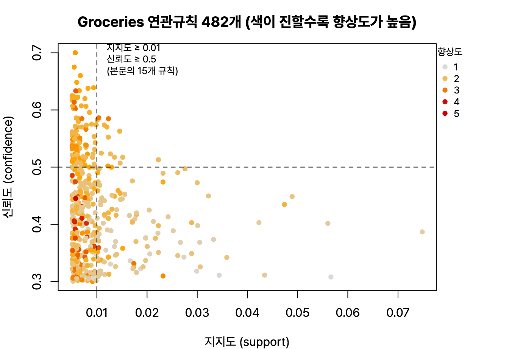

정형 데이터 마이닝 마지막, 연관분석. 거래 데이터로 지지도, 신뢰도, 향상도를 계산하는 문제가 거의 매회 나와서 계산 위주로 정리했다. R 4.6.0 실행 결과. ADsP 정리는 이 글로 끝.

## 요약

- 연관분석은 'A를 사면 B도 산다' 같은 규칙을 찾는 비지도 학습이다. 장바구니 분석이라고도 한다.
- 규칙은 지지도(얼마나 자주), 신뢰도(A를 샀을 때 B를 살 확률), 향상도(A가 B 구매를 얼마나 끌어올리는가)로 평가한다.
- 향상도가 1보다 크면 양의 관계, 1이면 독립, 1보다 작으면 음의 관계다.
- Apriori 알고리즘은 최소 지지도를 넘는 빈발 항목집합만 키워 가며 규칙을 찾고, FP-Growth는 후보를 만들지 않고 FP-Tree로 더 빠르게 찾는다.
- 시간 순서까지 고려하면 순차 패턴 분석이다.

## 1. 연관규칙과 평가 지표

**연관규칙(association rule)** 은 '조건(A) → 결과(B)' 꼴의 규칙이다. 앞쪽을 조건절(LHS, Left Hand Side), 뒤쪽을 결과절(RHS)이라고 한다.

| 지표 | 식 | 뜻 |
|---|---|---|
| 지지도(support) | P(A ∩ B) = A와 B를 함께 포함한 거래 수 ÷ 전체 거래 수 | 규칙이 얼마나 자주 나타나는가 |
| 신뢰도(confidence) | P(B \| A) = P(A ∩ B) ÷ P(A) | A를 산 거래 가운데 B도 산 비율 |
| 향상도(lift) | P(B \| A) ÷ P(B) = P(A ∩ B) ÷ (P(A) × P(B)) | A를 샀다는 사실이 B를 살 확률을 몇 배로 높이는가 |

| 향상도 | 해석 | 예 |
|---|---|---|
| 1보다 크다 | 양의 상관. A가 B 구매를 끌어올린다 | 보완재(라면과 계란) |
| 1이다 | 서로 독립 | 관계없는 상품 |
| 1보다 작다 | 음의 상관. A를 사면 B를 덜 산다 | 대체재(콜라와 사이다) |

신뢰도는 방향이 있어서 A → B와 B → A의 값이 다를 수 있지만, 지지도와 향상도는 방향과 관계없이 같다.

### 계산 예제

| 거래 | 품목 |
|---|---|
| 1 | 우유, 빵, 계란 |
| 2 | 우유, 빵 |
| 3 | 우유, 기저귀 |
| 4 | 빵, 계란 |
| 5 | 우유, 빵, 기저귀 |

우유는 4번(1, 2, 3, 5), 빵은 4번(1, 2, 4, 5), 계란은 2번(1, 4) 나온다.

**규칙 '우유 → 빵'**

- 지지도 = 우유와 빵을 함께 산 거래(1, 2, 5) 3건 ÷ 5 = **0.6**
- 신뢰도 = 0.6 ÷ P(우유) 0.8 = **0.75**
- 향상도 = 0.75 ÷ P(빵) 0.8 = **0.9375**

신뢰도가 75%로 높아 보여도, 원래 빵은 80%의 거래에서 팔리므로 우유를 샀다고 빵을 더 사는 것은 아니다. 향상도가 1보다 작다.

**규칙 '계란 → 빵'**

- 지지도 = 계란과 빵을 함께 산 거래(1, 4) 2건 ÷ 5 = **0.4**
- 신뢰도 = 0.4 ÷ P(계란) 0.4 = **1.0**
- 향상도 = 1.0 ÷ 0.8 = **1.25**

계란을 산 사람은 모두 빵을 샀고, 향상도가 1보다 커서 의미 있는 규칙이다.

> **쉬운 설명**
>
> 지지도는 '이 조합이 전체 영수증에서 얼마나 흔한가', 신뢰도는 '계란을 산 영수증 가운데 빵도 있는 비율', 향상도는 '계란을 샀다는 사실이 빵을 살 가능성을 원래보다 몇 배로 올리는가'이다. 빵은 어차피 거의 모든 사람이 사기 때문에, 신뢰도만 보면 무슨 상품을 넣어도 '빵도 산다'는 규칙이 그럴듯해 보인다. 그래서 향상도를 함께 봐야 한다.

## 2. 알고리즘

### Apriori

**Apriori 알고리즘**은 최소 지지도를 정하고, 그 이상인 **빈발 항목집합(frequent itemset)** 만 남기며 크기를 1개, 2개, 3개로 키워 간다.


flowchart LR
  A["최소 지지도 정하기"] --> B["항목 1개짜리 중<br>빈발 항목 찾기"]
  B --> C["빈발 항목끼리 조합해<br>후보 2개짜리 만들기"]
  C --> D["최소 지지도 미만<br>후보 제거"]
  D -->|"후보가 남으면 크기를 늘려 반복"| C
  D --> E["빈발 항목집합에서<br>신뢰도 기준으로 규칙 생성"]


핵심 원리는 '빈발 항목집합의 모든 부분집합도 빈발하다', 거꾸로 말하면 '빈발하지 않은 항목이 들어간 집합은 볼 필요가 없다'는 것이다. 덕분에 탐색할 조합을 크게 줄인다. 그래도 품목이 많으면 후보 집합이 많아지고 데이터베이스를 여러 번 읽어야 해서 느리다.

### FP-Growth

**FP-Growth**는 거래 데이터를 **FP-Tree(Frequent Pattern Tree)** 라는 압축된 나무 구조로 바꾼 뒤, 후보 집합을 만들지 않고 빈발 항목집합을 찾는다. 데이터베이스를 두 번만 읽으면 되어 Apriori보다 빠르고, 대용량 데이터에 유리하다.

## 3. R로 해 보는 장바구니 분석

`arules` 패키지의 `Groceries`는 한 식료품점의 한 달 치 거래 9,835건이다.

```r
library(arules)
data(Groceries); Groceries
```

```text
transactions in sparse format with
 9835 transactions (rows) and
 169 items (columns)
```

최소 지지도 1%, 최소 신뢰도 50%로 규칙을 찾고, 향상도가 높은 순서로 세 개를 본다.

```r
rules <- apriori(Groceries, parameter = list(support = 0.01, confidence = 0.5),
                 control = list(verbose = FALSE))
length(rules)
inspect(head(sort(rules, by = "lift"), 3))
```

```text
[1] 15
    lhs                                  rhs                support   
[1] {citrus fruit, root vegetables}   => {other vegetables} 0.01037112
[2] {tropical fruit, root vegetables} => {other vegetables} 0.01230300
[3] {root vegetables, rolls/buns}     => {other vegetables} 0.01220132
    confidence coverage   lift     count
[1] 0.5862069  0.01769192 3.029608 102  
[2] 0.5845411  0.02104728 3.020999 121  
[3] 0.5020921  0.02430097 2.594890 120  
```

첫 번째 규칙 '감귤류와 뿌리채소를 사면 다른 채소도 산다'를 읽어 본다.

- **support 0.0104:** 전체 거래의 약 1.04%(102건)에서 세 품목이 함께 나왔다.
- **coverage 0.0177:** 조건절(감귤류와 뿌리채소)이 나온 거래의 비율, 즉 P(A)이다. 신뢰도 = 0.01037 ÷ 0.01769 ≈ 0.586으로 맞아떨어진다.
- **confidence 0.586:** 감귤류와 뿌리채소를 산 거래의 58.6%가 다른 채소도 샀다.
- **lift 3.03:** 다른 채소를 살 확률이 평소(약 19.4%)보다 약 3배 높다.


_최소 지지도를 0.005, 최소 신뢰도를 0.3으로 낮추면 규칙이 482개로 늘어난다. 점선 오른쪽 위가 본문의 기준(지지도 0.01, 신뢰도 0.5)을 통과한 15개 규칙이다_

## 4. 연관분석의 특징

| 장점 | 단점 |
|---|---|
| 'A이면 B' 형태라 결과를 이해하기 쉽다 | 품목 수가 늘면 계산량이 기하급수적으로 늘어난다 |
| 목표 변수가 없어도 되는 비목적성 분석이라 탐색 단계에 유용하다 | 품목을 너무 잘게 나누면 의미 없는 규칙이 많아진다 |
| 거래 데이터를 그대로 쓸 수 있어 사용이 편하다 | 거래가 적은 품목은 최소 지지도를 넘지 못해 규칙에서 빠지기 쉽다 |
| 계산 원리가 간단하다 | |

품목이 너무 세분화되어 있으면 '채소', '과일'처럼 상위 범주로 묶어 분석한 뒤, 의미 있는 규칙이 나온 범주만 다시 자세히 본다.

**순차 패턴 분석(sequential pattern analysis)** 은 연관분석에 시간 순서를 더한 것이다. '노트북을 산 고객이 한 달 안에 마우스를 산다'처럼 구매 순서를 찾으려면 고객을 식별할 수 있는 정보와 구매 시점이 있어야 한다.

## 헷갈렸던 것들

- 지지도 = P(A ∩ B), 신뢰도 = P(A ∩ B) / P(A), 향상도 = 신뢰도 / P(B)이다.
- 향상도가 1이면 독립, 1보다 작으면 음의 관계(대체재)이다.
- 신뢰도는 규칙의 방향에 따라 달라지지만, 지지도와 향상도는 A → B와 B → A가 같다.
- Apriori는 최소 **지지도**로 빈발 항목집합을 고르고, 규칙은 최소 신뢰도로 걸러낸다.
- FP-Growth는 후보 집합을 만들지 않아 Apriori보다 빠르다.
- 연관분석은 목표 변수가 없는 비지도 학습이고, 시간 순서를 고려하면 순차 패턴 분석이다.

## 용어 정리

| 용어 | 뜻 |
|---|---|
| 연관규칙 | 'A → B' 형태의 규칙 |
| 지지도 | 전체 거래 중 A와 B를 함께 포함한 비율 |
| 신뢰도 | A를 포함한 거래 중 B도 포함한 비율 |
| 향상도 | 신뢰도 ÷ B의 지지도 |
| 빈발 항목집합 | 최소 지지도 이상인 항목집합 |
| Apriori | 빈발 항목집합을 단계적으로 키워 가는 알고리즘 |
| FP-Growth | FP-Tree로 후보 없이 빈발 항목집합을 찾는 알고리즘 |
| 순차 패턴 분석 | 시간 순서를 고려한 연관분석 |

## 복습 문제

다음 거래 데이터를 보고 1~3번에 답해 보자.

| 거래 | 품목 |
|---|---|
| 1 | A, B, C |
| 2 | A, C |
| 3 | A, D |
| 4 | B, C |
| 5 | A, B, C, D |

**1.** 규칙 'A → C'의 지지도는?

① 0.4 ② 0.6 ③ 0.75 ④ 0.8

**2.** 규칙 'A → C'의 신뢰도는?

① 0.6 ② 0.75 ③ 0.8 ④ 1.0

**3.** 규칙 'A → C'의 향상도는?

① 0.75 ② 0.9375 ③ 1.0 ④ 1.25

**4.** 향상도가 1보다 작은 규칙에 대한 해석으로 옳은 것은?

① A를 사면 B를 살 가능성이 오히려 낮아진다 ② 두 품목은 서로 독립이다 ③ 두 품목은 보완재다 ④ 신뢰도가 반드시 0이다

**5.** FP-Growth 알고리즘에 대한 설명으로 옳은 것은?

① 후보 항목집합을 단계마다 만든다 ② 데이터베이스를 여러 번 반복해서 읽어야 한다 ③ 시간 순서를 고려한다 ④ FP-Tree라는 나무 구조를 쓴다

## 답과 풀이

1. ② A와 C를 함께 포함한 거래는 1, 2, 5의 3건이라 3 ÷ 5 = 0.6이다.
2. ② A는 1, 2, 3, 5의 4건이므로 0.6 ÷ 0.8 = 0.75이다.
3. ② C는 1, 2, 4, 5의 4건이라 P(C) = 0.8이고, 0.75 ÷ 0.8 = 0.9375이다. 1보다 작아 음의 관계다.
4. ① 향상도가 1보다 작으면 음의 관계다.
5. ④ FP-Growth는 FP-Tree를 쓰고 후보를 만들지 않으며, 데이터베이스를 두 번만 읽는다.

## 참고 자료

- 한국데이터산업진흥원 데이터자격검정, ADsP 출제기준: <https://www.dataq.or.kr>
- arules 패키지 문서: <https://cran.r-project.org/package=arules>
- Agrawal, R., Srikant, R., 'Fast Algorithms for Mining Association Rules', VLDB, 1994
