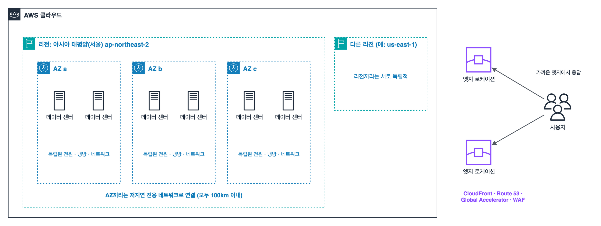
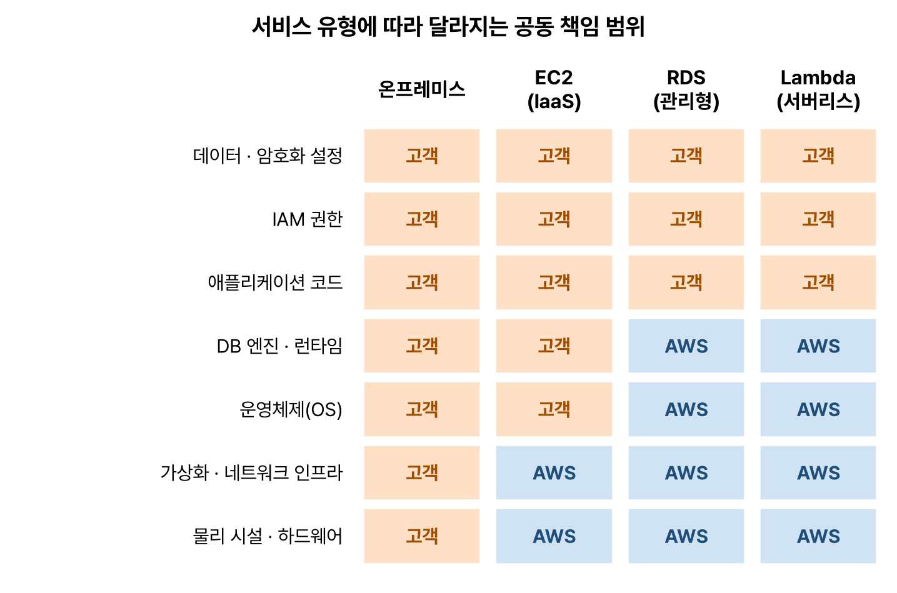

AWS SAA(Solutions Architect – Associate, SAA-C03) 공부 기록 첫 편. 도메인별로 들어가기 전에 리전과 가용 영역, 공동 책임 모델, Well-Architected처럼 모든 문제의 바탕이 되는 개념부터 정리했다. 시나리오형 문제를 읽는 요령도 같이 적어 두었다.

## 이 시리즈의 기준

| 도메인 | 비중 | 글 |
|---|---|---|
| 1. 보안 아키텍처 설계 | 30% | 안전한 접근, 안전한 워크로드, 데이터 보안 |
| 2. 복원력 있는 아키텍처 설계 | 26% | 느슨한 결합, 고가용성과 재해 복구 |
| 3. 고성능 아키텍처 설계 | 24% | 스토리지, 컴퓨팅, 데이터베이스, 네트워크, 데이터 수집 |
| 4. 비용 최적화 아키텍처 설계 | 20% | 스토리지, 컴퓨팅, 데이터베이스, 네트워크 비용 |

| 항목 | 내용 |
|---|---|
| 문항 | 65문항(채점 50문항 + 채점하지 않는 15문항). 어느 문항이 채점되지 않는지는 알려 주지 않는다 |
| 형식 | 객관식(정답 1개), 복수 응답(보기 5개 이상 중 정답 2개 이상) |
| 시간 | 130분 |
| 합격 | 100~1,000점 환산 점수 중 720점 이상. 틀린 답에 감점은 없다 |

## 요약

- 리전은 지리적으로 떨어진 AWS 거점이고, 리전 안에는 서로 격리된 가용 영역(AZ)이 여러 개 있다. 여러 AZ에 나눠 배치하는 것이 고가용성의 기본이다.
- 엣지 로케이션은 CloudFront, Route 53 같은 서비스가 사용자 가까이에서 응답하는 거점이다.
- 공동 책임 모델에서 AWS는 '클라우드 자체'의 보안을, 고객은 '클라우드 안'의 보안을 책임진다. 관리형 서비스일수록 AWS가 맡는 범위가 넓어진다.
- Well-Architected 프레임워크의 6가지 기둥 가운데 보안, 안정성, 성능 효율성, 비용 최적화가 시험의 네 도메인과 그대로 대응한다.
- 시나리오 문제는 '가장 비용 효율적', '운영 오버헤드 최소' 같은 핵심 조건을 먼저 찾는 것이 풀이의 시작이다.

## 1. 클라우드 컴퓨팅

**클라우드 컴퓨팅**은 서버, 스토리지, 데이터베이스 같은 IT 자원을 인터넷으로 필요할 때 빌려 쓰고, 쓴 만큼 돈을 내는 방식이다.

AWS가 말하는 클라우드의 여섯 가지 장점은 다음과 같다.

| 장점 | 뜻 |
|---|---|
| 고정 비용을 가변 비용으로 | 서버를 미리 사지 않고 쓴 만큼만 낸다 |
| 규모의 경제 | 수많은 고객이 함께 쓰므로 단가가 낮아진다 |
| 용량 추측 불필요 | 수요에 맞춰 늘리고 줄인다 |
| 속도와 민첩성 | 몇 분 만에 자원을 만들고 실험한다 |
| 데이터 센터 운영 비용 절감 | 하드웨어 관리 대신 서비스에 집중한다 |
| 몇 분 만에 전 세계로 | 여러 리전에 쉽게 배포한다 |

| 서비스 모델 | 고객이 관리하는 범위 | AWS 예 |
|---|---|---|
| IaaS(Infrastructure as a Service) | OS부터 위쪽 전부 | EC2, VPC, EBS |
| PaaS(Platform as a Service) | 애플리케이션과 데이터 | Elastic Beanstalk, RDS |
| SaaS(Software as a Service) | 사용과 설정만 | 웹 메일, 온라인 오피스처럼 완성된 소프트웨어 |

배포 방식은 모든 것을 클라우드에 두는 **클라우드 네이티브**, 온프레미스(자체 데이터 센터)와 클라우드를 함께 쓰는 **하이브리드**, 자체 데이터 센터만 쓰는 **온프레미스**로 나눈다.

## 2. AWS 글로벌 인프라

_리전 하나에는 서로 격리된 AZ가 여러 개 있고, 각 AZ는 데이터 센터 하나 이상으로 이루어진다. 엣지 로케이션은 리전과 별개로 사용자 가까이에 퍼져 있다_

| 구성 | 설명 | 예 |
|---|---|---|
| 리전(Region) | 지리적으로 떨어진 AWS 거점. 리전마다 서로 독립적이다 | 서울(ap-northeast-2), 버지니아 북부(us-east-1) |
| 가용 영역(AZ, Availability Zone) | 리전 안의 격리된 위치. 전원, 냉방, 네트워크가 독립된 데이터 센터 하나 이상으로 이루어진다. 리전마다 최소 3개이고, 서로 의미 있게 떨어져 있지만 모두 100km 이내에 있어 낮은 지연으로 연결된다 | ap-northeast-2a, 2b, 2c, 2d |
| 엣지 로케이션(PoP) | CloudFront, Route 53, Global Accelerator, AWS WAF가 사용자 가까이에서 응답하는 거점 | 전 세계 수백 곳 |
| 로컬 영역(Local Zones) | 대도시 가까이에 둔 리전의 확장. 한 자릿수 밀리초 지연이 필요한 작업용 | 게임, 영상 편집 |
| Wavelength 영역 | 5G 통신사 네트워크 안에 둔 AWS 자원 | 모바일 초저지연 앱 |
| Outposts | 고객 데이터 센터에 설치하는 AWS 하드웨어 | 데이터를 사내에 둬야 하는 하이브리드 |

### 리전 선택 기준

| 기준 | 질문 |
|---|---|
| 규정 준수(데이터 주권) | 데이터가 특정 국가나 지역 안에 있어야 하는가 |
| 지연 시간 | 사용자와 가까운가 |
| 서비스 가용성 | 필요한 서비스와 기능을 그 리전이 제공하는가 |
| 요금 | 리전마다 가격이 다르다 |

규정 준수가 걸려 있으면 다른 조건보다 먼저 따져야 한다.

### 서비스의 범위

| 범위 | 서비스 예 |
|---|---|
| 글로벌 | IAM, Route 53, CloudFront, AWS Organizations |
| 리전 | S3 버킷, DynamoDB 테이블, Lambda 함수, VPC, ELB(여러 AZ에 걸침) |
| AZ | EC2 인스턴스, EBS 볼륨, 서브넷 |

EBS 볼륨은 같은 AZ의 EC2 인스턴스에만 붙일 수 있고, 서브넷은 AZ 하나에 속한다. 이 차이가 고가용성 문제의 출발점이다. AZ 이름(ap-northeast-2a)은 계정마다 실제 위치와의 대응이 달라질 수 있어서, 여러 계정이 같은 AZ를 가리켜야 할 때는 AZ ID(apne2-az1)를 쓴다.

> **쉬운 설명**
>
> 리전은 '도시', AZ는 그 도시 안의 '서로 다른 동네에 있는 건물'이다. 한 건물에 불이 나도 다른 동네 건물은 멀쩡하니, 중요한 물건은 두 건물 이상에 나눠 둔다. 엣지 로케이션은 도시 곳곳의 '편의점'이라서, 자주 찾는 물건은 큰 창고(리전)까지 가지 않고 가까운 편의점에서 바로 받는다.

## 3. 공동 책임 모델

**공동 책임 모델(Shared Responsibility Model)** 은 보안과 규정 준수를 AWS와 고객이 나눠 맡는다는 원칙이다.

| 주체 | 책임 | 예 |
|---|---|---|
| AWS | 클라우드 자체의 보안(Security of the Cloud) | 데이터 센터 출입 통제, 하드웨어, 글로벌 네트워크, 가상화 계층, 관리형 서비스의 OS와 엔진 패치 |
| 고객 | 클라우드 안의 보안(Security in the Cloud) | 데이터와 암호화 설정, IAM 권한, EC2 게스트 OS 패치, 보안 그룹과 방화벽 설정, 애플리케이션 |

_서비스가 관리형일수록 AWS가 맡는 층(파란색)이 위로 올라온다. 데이터와 권한 설정은 어떤 서비스를 쓰든 고객 몫이다_

- **EC2(IaaS):** 게스트 OS 패치, 설치한 소프트웨어, 보안 그룹은 고객이 관리한다.
- **RDS(관리형):** OS와 DB 엔진 패치는 AWS가 하고, 고객은 유지 관리 기간을 정한다. DB 사용자 권한, 보안 그룹, 암호화를 켤지는 고객이 정한다.
- **Lambda, S3(서버리스):** 서버와 런타임은 AWS가 맡고, 고객은 코드, 데이터, 접근 권한(IAM, 버킷 정책)을 맡는다.

> **쉬운 설명**
>
> 아파트에 사는 것과 같다. 건물 뼈대, 엘리베이터, 공동 현관(물리 보안)은 관리사무소(AWS)가 책임지고, 우리 집 현관문을 잠그는 것과 집 안 물건(데이터)은 내가 책임진다. 원룸형 오피스텔(관리형 서비스)에 살면 가구와 가전 관리까지 관리사무소가 해 주지만, 문단속은 여전히 내 몫이다.

## 4. AWS Well-Architected 프레임워크

AWS가 정리한 좋은 아키텍처의 기준이다. 6가지 기둥(pillar)으로 이루어진다.

| 기둥 | 핵심 질문 | 대표 원칙 | 시험 도메인 |
|---|---|---|---|
| 운영 우수성(Operational Excellence) | 시스템을 잘 운영하고 개선하는가 | 운영을 코드로 수행, 작고 되돌릴 수 있는 변경, 실패에서 배우기 | |
| 보안(Security) | 데이터와 시스템을 보호하는가 | 강력한 자격 증명 기반, 모든 계층에 보안 적용, 추적성, 전송 중·저장 데이터 보호 | 도메인 1 |
| 안정성(Reliability) | 장애에서 복구하고 수요에 맞춰 확장하는가 | 자동 복구, 복구 절차 테스트, 수평 확장, 용량 추측 중단 | 도메인 2 |
| 성능 효율성(Performance Efficiency) | 자원을 효율적으로 쓰는가 | 서버리스 사용, 몇 분 만에 전 세계 배포, 최신 기술 활용 | 도메인 3 |
| 비용 최적화(Cost Optimization) | 불필요한 비용을 없앴는가 | 소비 모델 채택, 지출 측정과 귀속, 차별화되지 않는 작업에 돈 쓰지 않기 | 도메인 4 |
| 지속 가능성(Sustainability) | 환경 영향을 줄이는가 | 필요한 만큼만 쓰기, 활용률 높이기, 관리형 서비스 쓰기 | |

## 5. 시나리오 문제 읽는 법

SAA 문제는 대부분 '한 회사가 ~하려고 한다. 어떤 해결책이 요구 사항을 충족하는가?' 형식이다. 보기 네 개가 모두 '동작은 하는' 경우가 많아서, 문제의 마지막 조건이 정답을 가른다.

| 문제의 조건 | 정답이 될 가능성이 큰 쪽 |
|---|---|
| 운영 오버헤드(관리 부담)가 가장 적은 | 관리형, 서버리스 서비스(Lambda, Fargate, DynamoDB, Aurora Serverless) |
| 가장 비용 효율적인 | 요구 사항을 만족하는 가장 저렴한 조합. 과한 성능이나 불필요한 다중화는 오답 |
| 고가용성, 내결함성 | 여러 AZ(필요하면 여러 리전)에 분산, 단일 장애점 제거 |
| 가장 짧은 지연 시간 | 캐시, 엣지(CloudFront), 사용자와 가까운 리전 |
| 애플리케이션 변경을 최소화 | 기존 프로토콜·엔진과 호환되는 서비스(RDS for MySQL, Amazon MQ, EFS) |
| 가장 안전한 | 최소 권한, 임시 자격 증명(역할), 프라이빗 연결, 암호화 |


flowchart LR
  A["문제 끝의 조건 찾기 비용? 운영 부담? 가용성?"] --> B["요구 사항을 못 맞추는 보기 지우기"]
  B --> C["남은 보기 중 조건을 가장 잘 맞추는 것"]


## 헷갈렸던 것들

- 리전 선택에서 규정 준수(데이터 위치)는 지연 시간이나 요금보다 우선한다.
- AZ는 데이터 센터 '하나'가 아니라 데이터 센터 '하나 이상'으로 이루어진다.
- EBS 볼륨과 서브넷은 AZ 범위, VPC와 S3는 리전 범위, IAM은 글로벌 서비스다.
- EC2의 게스트 OS 패치는 고객 책임, RDS의 OS와 엔진 패치는 AWS 책임이다. 데이터 암호화 설정과 IAM은 언제나 고객 책임이다.
- Well-Architected의 기둥은 6개다. '지속 가능성'이 2021년에 추가되었다.
- 동작은 하지만 운영 부담이 큰 보기(EC2에 직접 설치, 직접 만든 스크립트)는 '운영 오버헤드 최소' 문제에서 오답이다.

## 용어 정리

| 용어 | 뜻 |
|---|---|
| 리전 | 지리적으로 분리된 AWS 거점 |
| 가용 영역(AZ) | 리전 안의 격리된 데이터 센터 묶음 |
| 엣지 로케이션 | CloudFront, Route 53이 응답하는 사용자 가까운 거점 |
| 공동 책임 모델 | 클라우드 자체는 AWS가, 클라우드 안은 고객이 책임진다는 원칙 |
| Well-Architected 프레임워크 | 6개 기둥으로 된 AWS 아키텍처 모범 사례 |
| 관리형 서비스 | 서버와 소프트웨어 운영을 AWS가 맡는 서비스 |

## 복습 문제

**1.** A financial services company is subject to a regulation that requires customer data to be stored within the country. Which factor should the company consider FIRST when it selects an AWS Region?

- A. Pricing in each Region
- B. Compliance with data residency requirements
- C. Latency to users
- D. How quickly new services launch in the Region

**2.** A company ran MySQL on Amazon EC2 instances that it managed itself. The company then migrated the database to Amazon RDS for MySQL. After the migration, which task is the company no longer responsible for?

- A. Applying security patches to the database engine and the operating system
- B. Managing database user accounts and permissions
- C. Configuring security group rules
- D. Deciding whether to encrypt data at rest

**3.** A website runs on a single web server. The website must stay available even if a power outage affects the Availability Zone that hosts the server. What is the MOST basic design that meets this requirement?

- A. Change to a larger instance type.
- B. Add another instance in the same Availability Zone.
- C. Distribute instances across two or more Availability Zones.
- D. Attach an additional EBS volume to the instance.

**4.** Which pillar of the AWS Well-Architected Framework includes the principle "use only the resources you need and maximize utilization to reduce environmental impact"?

- A. Sustainability
- B. Operational excellence
- C. Performance efficiency
- D. Cost optimization

**5.** A question asks for the solution with the LEAST operational overhead. Which choice is usually the MOST appropriate?

- A. Use AWS managed or serverless services.
- B. Install open source software on Amazon EC2 instances.
- C. Run custom scripts on a cron schedule.
- D. Buy additional on-premises servers.

## 답과 풀이

1. **B** 규제가 있으면 데이터 위치(규정 준수)를 먼저 만족해야 한다. 나머지 기준은 그다음이다.
2. **A** RDS는 OS와 DB 엔진 패치를 AWS가 맡는다. 사용자 권한, 보안 그룹, 암호화 여부는 여전히 고객이 정한다.
3. **C** AZ 장애에 대비하려면 서로 다른 AZ에 나눠 배치해야 한다. 같은 AZ의 두 대는 함께 멈출 수 있다.
4. **A** 지속 가능성 기둥의 원칙이다.
5. **A** 관리형·서버리스 서비스는 패치, 확장, 가용성을 AWS가 맡아 운영 부담이 가장 적다.

## 참고 자료

- AWS Certified Solutions Architect – Associate(SAA-C03) 시험 가이드: <https://docs.aws.amazon.com/aws-certification/latest/solutions-architect-associate-03/solutions-architect-associate-03.html>
- AWS 글로벌 인프라: <https://aws.amazon.com/about-aws/global-infrastructure/regions_az/>
- AWS 공동 책임 모델: <https://aws.amazon.com/compliance/shared-responsibility-model/>
- AWS Well-Architected 프레임워크: <https://docs.aws.amazon.com/wellarchitected/latest/framework/welcome.html>
