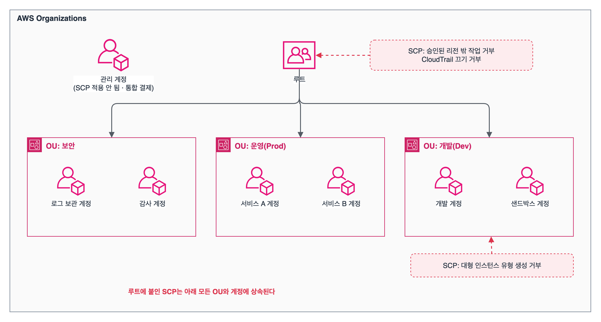

SAA 도메인 1, 보안 아키텍처 설계(30%) 첫 번째. 과제 1.1 'AWS 리소스에 대한 안전한 접근 설계' 범위다. 사람, 애플리케이션, 다른 계정이 어떤 자격 증명으로 접근하는지, 계정이 여러 개일 때 권한을 한곳에서 어떻게 막는지가 중심이다.

## 요약

- 루트 사용자는 MFA로 잠가 두고 일상 업무에 쓰지 않는다. 사람과 애플리케이션에는 필요한 최소 권한만 준다.
- IAM의 주체는 사용자, 그룹, 역할이고, 권한은 JSON 정책으로 정의한다. 애플리케이션과 다른 계정에는 장기 액세스 키 대신 **역할**로 임시 자격 증명을 준다.
- 정책 평가는 '명시적 거부가 항상 이긴다', '허용이 없으면 거부된다' 두 원칙으로 시작한다.
- 계정이 여러 개면 AWS Organizations로 묶고, 서비스 제어 정책(SCP)으로 계정 전체의 최대 권한에 울타리를 친다. SCP는 권한을 주지 않고 제한만 한다.
- 직원 수백 명이 여러 계정에 로그인해야 하면 IAM Identity Center로 회사 ID 공급자(IdP)와 연결한다.

## 1. 루트 사용자와 IAM

### 루트 사용자

계정을 만들 때 쓴 이메일과 비밀번호로 로그인하는 사용자다. 계정의 모든 권한을 가지며 권한을 줄일 수 없다.

| 해야 할 일 | 하지 말아야 할 일 |
|---|---|
| 강력한 비밀번호와 MFA 설정 | 루트 사용자 액세스 키 만들기 |
| 루트만 할 수 있는 작업에만 사용 | 일상 관리 작업에 루트 사용 |

루트만 할 수 있는 작업의 예로는 계정 해지, AWS Support 플랜 변경, 루트 사용자 자격 증명 변경, S3 버킷의 MFA Delete 설정이 있다.

### IAM의 구성 요소

**IAM(Identity and Access Management)** 은 AWS 리소스에 누가 접근할 수 있는지 관리하는 **글로벌** 서비스다. 따로 요금이 없다.

| 구성 요소 | 설명 | 자격 증명 |
|---|---|---|
| 사용자(User) | 사람이나 애플리케이션을 나타내는 개체 | 장기 자격 증명(콘솔 비밀번호, 액세스 키) |
| 그룹(Group) | 사용자의 묶음. 그룹에 붙인 정책이 모든 구성원에게 적용된다. 그룹 안에 그룹을 넣을 수 없고, 정책의 Principal이 될 수 없다 | 없음 |
| 역할(Role) | 필요할 때 맡는(assume) 권한 묶음. 특정 사람에게 묶이지 않는다 | 임시 자격 증명(STS가 발급) |
| 정책(Policy) | 권한을 정의한 JSON 문서 | |

### IAM 모범 사례

- **최소 권한:** 업무에 꼭 필요한 권한만 준다. IAM Access Analyzer로 CloudTrail 기록을 바탕으로 최소 권한 정책을 만들거나, 마지막 사용 시간(last accessed)을 보고 안 쓰는 권한을 지운다.
- **임시 자격 증명:** 사람은 IAM Identity Center나 페더레이션으로, 애플리케이션은 역할로 접근하게 한다. 장기 액세스 키는 꼭 필요할 때만 쓰고 주기적으로 교체한다.
- **MFA:** 루트와 권한이 큰 사용자에게 MFA를 요구한다.
- **조건 사용:** 정책의 Condition으로 IP, 리전, MFA 여부, 조직 소속 같은 조건을 건다.

## 2. 정책

### 정책의 종류

| 종류 | 붙는 곳 | 특징 |
|---|---|---|
| 자격 증명 기반 정책 | 사용자, 그룹, 역할 | AWS 관리형(AWS가 만든 공용 정책), 고객 관리형(재사용 가능), 인라인(한 개체에만 붙는 정책)이 있다 |
| 리소스 기반 정책 | 리소스(S3 버킷, SQS 큐, SNS 주제, KMS 키, Lambda 함수 등) | 누가 이 리소스에 접근할 수 있는지 Principal로 지정한다. 다른 계정에 권한을 줄 때 쓴다 |
| 권한 경계(Permissions boundary) | 사용자, 역할 | 자격 증명 기반 정책이 줄 수 있는 최대 권한을 정한다. 권한을 주지는 않는다 |
| SCP / RCP | Organizations의 루트, OU, 계정 | 계정 안의 주체(SCP)나 리소스(RCP)가 가질 수 있는 최대 권한을 정한다. 권한을 주지는 않는다 |
| 세션 정책 | 역할을 맡을 때 전달 | 그 세션의 권한을 더 줄인다 |
| ACL | S3 버킷·객체 등 | 예전 방식. S3는 기본으로 ACL을 끄고(버킷 소유자 강제) 정책을 쓰도록 권장한다 |

### 정책 문서의 구조

```json
{
  "Version": "2012-10-17",
  "Statement": [
    {
      "Sid": "ReadReportsOnlyFromOffice",
      "Effect": "Allow",
      "Action": ["s3:GetObject", "s3:ListBucket"],
      "Resource": ["arn:aws:s3:::example-reports", "arn:aws:s3:::example-reports/*"],
      "Condition": { "IpAddress": { "aws:SourceIp": "203.0.113.0/24" } }
    }
  ]
}
```

| 요소 | 뜻 |
|---|---|
| Effect | Allow 또는 Deny |
| Action | 허용하거나 거부할 API 작업(`s3:GetObject`) |
| Resource | 대상 리소스의 ARN. `ListBucket`은 버킷 ARN, `GetObject`는 객체 ARN(`/*`)에 적용된다 |
| Condition | 조건(IP, MFA, 리전, 태그 등) |
| Principal | 권한을 받는 주체. 리소스 기반 정책에만 쓴다 |

자주 나오는 조건 키는 다음과 같다.

| 조건 키 | 쓰임 |
|---|---|
| aws:MultiFactorAuthPresent | MFA로 로그인한 경우에만 허용 |
| aws:SourceIp | 특정 IP 대역에서만 허용 |
| aws:RequestedRegion | 특정 리전에서만 작업 허용 |
| aws:PrincipalOrgID | 우리 조직(Organizations)에 속한 계정의 주체만 허용 |
| aws:SecureTransport | HTTPS 요청만 허용(false면 거부) |

### 정책 평가 논리


flowchart TB
  A["요청"] --> B{"어딘가에<br>명시적 Deny?"}
  B -->|"예"| D1["거부"]
  B -->|"아니오"| C{"SCP · RCP가<br>허용?"}
  C -->|"아니오"| D2["거부(묵시적)"]
  C -->|"예"| E{"자격 증명 기반 또는<br>리소스 기반 정책이 Allow?"}
  E -->|"아니오"| D3["거부(묵시적)"]
  E -->|"예"| F{"권한 경계 · 세션 정책이<br>있다면 그 안에 있는가?"}
  F -->|"아니오"| D4["거부(묵시적)"]
  F -->|"예"| G["허용"]


(같은 계정 안의 요청을 단순화한 그림이다. 다른 계정 간 요청은 양쪽 계정 모두에서 허용되어야 한다.)

- 기본값은 **묵시적 거부**이다. 어디에도 Allow가 없으면 거부된다.
- **명시적 Deny는 어떤 Allow보다 우선**한다.
- SCP, 권한 경계, 세션 정책은 '울타리'라서, 울타리 안에 있으면서 동시에 자격 증명·리소스 정책이 허용해야 최종 허용된다.

> **쉬운 설명**
>
> 회사 출입을 생각하면 쉽다. 기본적으로 모든 문은 잠겨 있다(묵시적 거부). 출입증(Allow)이 있어야 열리는데, 보안팀의 '출입 금지' 표시(명시적 Deny)가 붙은 문은 출입증이 있어도 못 들어간다. SCP는 '이 층 전체에서는 서버실 출입 금지'처럼 층 단위로 거는 상한선이라서, 그 층의 누구에게 출입증을 줘도 서버실은 열리지 않는다.

## 3. 역할과 임시 자격 증명

### 역할의 두 정책

| 정책 | 질문 |
|---|---|
| 신뢰 정책(Trust policy) | 누가 이 역할을 맡을 수 있는가(EC2 서비스, 다른 계정, IdP 사용자 등) |
| 권한 정책(Permissions policy) | 역할을 맡으면 무엇을 할 수 있는가 |

역할을 맡으면 **AWS STS(Security Token Service)** 가 액세스 키, 비밀 키, 세션 토큰으로 된 임시 자격 증명을 준다. 기본 1시간이고, 역할 설정에 따라 최대 12시간까지 늘릴 수 있다. 만료되면 다시 받아야 하므로 유출돼도 피해가 제한된다.

| 상황 | 방법 |
|---|---|
| EC2의 애플리케이션이 S3에 접근 | 역할을 인스턴스 프로파일로 EC2에 연결. 코드에 키를 넣지 않는다 |
| Lambda 함수가 DynamoDB에 쓰기 | Lambda 실행 역할 |
| ECS 작업이 SQS 읽기 | ECS 작업 역할(task role) |
| 다른 AWS 계정에 접근 | 대상 계정에 역할을 만들고, 신뢰 정책에 출발 계정을 지정 |
| 외부 업체(서드 파티)에 접근 허용 | 다른 계정 역할 + 외부 ID(External ID) 조건. 다른 고객이 우리 역할을 맡게 속이는 '혼동된 대리인' 문제를 막는다 |
| 회사 직원이 회사 계정으로 로그인 | SAML 2.0이나 OIDC 페더레이션, 또는 IAM Identity Center |
| 모바일 앱 사용자가 S3에 업로드 | Amazon Cognito 자격 증명 풀(다음 글) |

### 다른 계정 접근


sequenceDiagram
  participant U as 계정 A의 개발자
  participant STS as AWS STS
  participant R as 계정 B의 역할
  participant S3 as 계정 B의 S3 버킷
  U->>STS: AssumeRole(계정 B 역할 ARN)
  STS->>R: 신뢰 정책에 계정 A가 있는가?
  STS-->>U: 임시 자격 증명
  U->>S3: 임시 자격 증명으로 요청
  S3-->>U: 역할의 권한 정책 범위에서 응답


다른 계정에 접근하는 방법은 두 가지다.

| 방법 | 특징 |
|---|---|
| 역할 맡기(AssumeRole) | 역할을 맡는 동안 원래 권한은 쓰지 않고 역할의 권한만 쓴다 |
| 리소스 기반 정책 | S3 버킷 정책 등에 다른 계정 주체를 Principal로 지정. 주체는 자기 권한을 그대로 가진 채 리소스에 접근한다. 계정 A의 자격 증명 정책도 해당 작업을 허용해야 한다 |

> **쉬운 설명**
>
> 역할은 '방문증'이다. 직원증(장기 자격 증명)을 매번 복사해 주는 대신, 필요할 때 안내 데스크(STS)에서 한 시간짜리 방문증을 받아 쓴다. 방문증을 잃어버려도 곧 만료되니 안전하고, 누가 방문증을 받을 수 있는지는 신뢰 정책이라는 명단으로 정해 둔다.

## 4. 여러 계정 관리

### AWS Organizations

여러 AWS 계정을 하나의 조직으로 묶어 관리한다.


_관리 계정이 조직을 만들고, 멤버 계정을 OU로 묶어 OU 단위로 SCP를 붙인다. OU에 붙인 SCP는 그 아래 모든 계정에 상속된다_

| 기능 | 설명 |
|---|---|
| 관리 계정과 멤버 계정 | 조직을 만든 관리 계정이 멤버 계정을 초대하거나 새로 만든다 |
| OU(조직 단위) | 계정을 묶는 폴더. OU 안에 OU를 둘 수 있다 |
| 통합 결제 | 청구서를 하나로 받고, 사용량을 합쳐 볼륨 할인을 받는다. 예약 인스턴스와 Savings Plans 할인도 계정끼리 나눠 쓴다 |
| SCP(서비스 제어 정책) | 멤버 계정의 IAM 사용자와 역할(멤버 계정의 루트 사용자 포함)이 가질 수 있는 최대 권한 |
| RCP(리소스 제어 정책) | 멤버 계정 리소스에 대해 가능한 최대 권한. 조직 밖 주체의 접근을 막는 데 쓴다 |
| 태그 정책, 백업 정책 | 태그 규칙과 백업 계획을 조직 전체에 적용 |

SCP의 특징은 시험에 자주 나온다.

- SCP는 **권한을 주지 않는다.** 계정 안에서 IAM 정책으로 허용해야 실제 권한이 생긴다.
- **관리 계정에는 적용되지 않는다.** 그래서 관리 계정에는 워크로드를 두지 않는 것이 좋다.
- 기본으로 `FullAWSAccess` SCP가 붙어 있어 아무것도 막지 않는다. 거부 목록 방식(필요한 것만 Deny)이 흔하다.
- 예: '특정 리전 밖에서 작업 금지', 'CloudTrail 끄기 금지', '루트 사용자 사용 금지'를 조직 전체에 강제한다.

```json
{
  "Version": "2012-10-17",
  "Statement": [
    {
      "Sid": "DenyStopCloudTrail",
      "Effect": "Deny",
      "Action": ["cloudtrail:StopLogging", "cloudtrail:DeleteTrail"],
      "Resource": "*"
    }
  ]
}
```

### AWS Control Tower

여러 계정 환경(**랜딩 존**)을 모범 사례대로 자동으로 꾸려 준다. Organizations 위에서 동작한다.

| 기능 | 설명 |
|---|---|
| 랜딩 존 | 로그 보관 계정, 감사 계정 등 기본 계정 구조를 자동으로 만든다 |
| 컨트롤(가드레일) | 예방형(SCP·RCP로 막기), 탐지형(AWS Config 규칙으로 위반 찾기), 사전형(CloudFormation 훅으로 배포 전 검사) |
| Account Factory | 표준 설정이 적용된 새 계정을 찍어 낸다 |

### IAM Identity Center

직원(워크포스)이 **여러 계정과 비즈니스 앱에 한 번의 로그인(SSO)** 으로 접근하게 해 준다. 예전 이름은 AWS Single Sign-On이다.

- ID 소스로 Identity Center 자체 디렉터리, Microsoft Entra ID나 Okta 같은 외부 IdP(SAML 2.0, SCIM 자동 동기화), Active Directory를 쓸 수 있다.
- **권한 세트(permission set)** 를 만들어 '누가, 어느 계정에, 어떤 권한으로'를 한곳에서 지정한다. 실제로는 각 계정에 역할이 만들어지고 직원은 임시 자격 증명을 받는다.

### AWS Directory Service

| 종류 | 설명 | 쓰는 때 |
|---|---|---|
| AWS Managed Microsoft AD | AWS가 운영하는 실제 Microsoft AD. 온프레미스 AD와 신뢰 관계를 맺을 수 있다 | AD가 필요한 앱(SQL Server, Windows 워크로드)을 AWS에서 운영 |
| AD Connector | 온프레미스 AD로 요청을 전달하는 프록시. 디렉터리 데이터를 AWS에 저장하지 않는다 | 기존 온프레미스 AD 계정으로 AWS에 로그인 |
| Simple AD | Samba 기반의 작은 AD 호환 디렉터리 | 기능이 단순한 소규모 환경 |

> **쉬운 설명**
>
> Organizations는 '회사 본사와 지점' 구조다. 본사(관리 계정)가 지점(멤버 계정)을 부서(OU)별로 묶고, '영업 지점은 금고 열기 금지' 같은 지점 공통 규칙(SCP)을 내려보낸다. 지점장이 아무리 높은 권한을 줘도 본사 규칙을 넘을 수는 없다. IAM Identity Center는 '사원증 하나로 모든 지점 출입' 시스템이다.

## 헷갈렸던 것들

- EC2, Lambda, ECS의 애플리케이션에는 **역할**을 쓴다. 액세스 키를 코드나 환경 변수에 넣는 보기는 오답이다.
- 명시적 Deny가 Allow보다 우선하고, 아무 정책도 없으면 묵시적 거부다.
- SCP는 권한을 주지 않고, 관리 계정에는 적용되지 않는다. 멤버 계정의 루트 사용자에게는 적용된다.
- 권한 경계도 권한을 주지 않는다. '개발자가 만든 역할이 개발자 자신보다 큰 권한을 갖지 못하게' 할 때 쓴다.
- 그룹은 다른 그룹을 포함할 수 없고, 정책의 Principal이 될 수 없다.
- 외부 업체에 계정 접근을 줄 때는 역할 + 외부 ID이다. 업체에 IAM 사용자와 액세스 키를 만들어 주는 보기는 오답이다.
- 여러 계정에 SSO가 필요하면 IAM Identity Center이다. 계정마다 IAM 사용자를 만드는 보기는 운영 부담이 커서 오답이다.
- 조직 안의 계정만 버킷에 접근하게 하려면 버킷 정책에 `aws:PrincipalOrgID` 조건을 쓴다.

## 용어 정리

| 용어 | 뜻 |
|---|---|
| IAM 역할 | 맡는 동안 임시 자격 증명을 받는 권한 묶음 |
| 신뢰 정책 | 누가 역할을 맡을 수 있는지 정한 정책 |
| AWS STS | 임시 자격 증명을 발급하는 서비스 |
| 인스턴스 프로파일 | EC2에 역할을 전달하는 그릇 |
| 권한 경계 | 사용자·역할이 가질 수 있는 최대 권한 |
| SCP | Organizations에서 계정의 최대 권한을 제한하는 정책 |
| 외부 ID | 서드 파티가 역할을 맡을 때 요구하는 비밀 값. 혼동된 대리인 문제를 막는다 |
| IAM Identity Center | 여러 계정과 앱에 대한 직원 SSO 서비스 |

## 복습 문제

**1.** An application that runs on Amazon EC2 instances needs to read objects from an Amazon S3 bucket. Which solution is the MOST secure?

- A. Store an IAM user's access keys in the application's configuration file.
- B. Attach an IAM role that has S3 read permissions to the EC2 instances through an instance profile.
- C. Pass the root user's access keys to the application as environment variables.
- D. Make the bucket public.

**2.** A company uses AWS Organizations to manage 40 accounts. The company must prevent the administrators of every account from turning off AWS CloudTrail logging. Which solution meets this requirement?

- A. Do not grant CloudTrail permissions to the IAM administrators in each account.
- B. Use an Amazon CloudWatch alarm to detect when logging stops and send an email.
- C. Set a permissions boundary in each account.
- D. Attach an SCP to the root OU that denies cloudtrail:StopLogging and cloudtrail:DeleteTrail.

**3.** An IAM user in a member account has the AdministratorAccess policy attached. The account's OU has an SCP that denies all actions in every Region except ap-northeast-2. What happens when the user tries to launch an EC2 instance in us-east-1?

- A. The launch succeeds because the user has AdministratorAccess.
- B. The launch succeeds if the root user approves it.
- C. The launch fails because the SCP denies it.
- D. The launch fails only for users that were created in the management account.

**4.** An external security auditing firm needs read-only access to review the configuration of a company's AWS account. Which solution is the MOST secure?

- A. Create an IAM user for the firm and email the access keys.
- B. Share the root user password and change it after the audit.
- C. Add the firm's employees to the administrators group.
- D. Create a read-only IAM role that trusts the firm's AWS account and requires an external ID condition.

**5.** A company has 500 employees who sign in with Microsoft Entra ID. The employees need access to 20 AWS accounts with different permissions in each account. Which solution meets these requirements with the LEAST operational overhead?

- A. Create 500 IAM users in each of the 20 accounts.
- B. Create IAM users in one account and share access keys with the other accounts.
- C. Create a separate root user for each employee.
- D. Connect IAM Identity Center to Entra ID and assign permission sets for each account.

## 답과 풀이

1. **B** 역할을 쓰면 키를 저장하지 않고 자동으로 교체되는 임시 자격 증명을 쓴다.
2. **D** SCP는 계정의 관리자를 포함해 멤버 계정 전체의 최대 권한을 제한한다. A는 계정 관리자가 스스로 권한을 되살릴 수 있다.
3. **C** SCP의 명시적 거부는 계정 안의 어떤 Allow보다 우선한다.
4. **D** 서드 파티 접근은 다른 계정 역할과 외부 ID가 정석이다. 장기 액세스 키를 넘겨주는 방식은 피한다.
5. **D** IAM Identity Center는 외부 IdP와 연결해 여러 계정의 권한을 한곳에서 관리한다.

## 참고 자료

- IAM 사용 설명서, IAM의 보안 모범 사례: <https://docs.aws.amazon.com/IAM/latest/UserGuide/best-practices.html>
- IAM 사용 설명서, 정책 평가 논리: <https://docs.aws.amazon.com/IAM/latest/UserGuide/reference_policies_evaluation-logic.html>
- AWS Organizations 사용 설명서, 서비스 제어 정책(SCP): <https://docs.aws.amazon.com/organizations/latest/userguide/orgs_manage_policies_scps.html>
- IAM Identity Center 사용 설명서: <https://docs.aws.amazon.com/singlesignon/latest/userguide/what-is.html>
