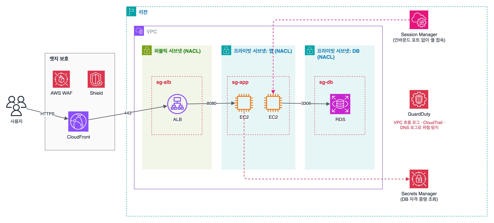

과제 1.2 '안전한 워크로드와 애플리케이션 설계'는 네트워크를 몇 겹으로 나눠 지키는 법, 공격을 막고 찾아내는 서비스, 앱 사용자 인증과 비밀번호 관리까지 서비스 이름이 한꺼번에 쏟아지는 파트다. 그래서 서비스마다 하는 일을 표로 갈라 두었다.

## 요약

- VPC 안에서는 서브넷 단위의 **네트워크 ACL(NACL)** 과 인스턴스 단위의 **보안 그룹**이 두 겹으로 트래픽을 거른다. 보안 그룹은 상태 저장(stateful)에 허용 규칙만, NACL은 상태 비저장(stateless)에 허용과 거부 규칙을 모두 가진다.
- 인터넷에 닿는 것은 로드 밸런서뿐이고, 애플리케이션과 DB는 프라이빗 서브넷에 둔다. 관리자 접속은 SSH 포트를 열지 않는 Session Manager가 정석이다.
- 웹 공격(SQL 인젝션, XSS, 과도한 요청)은 **AWS WAF**, DDoS는 **AWS Shield**가 막는다.
- 위협 탐지는 GuardDuty, 취약점 점검은 Inspector, S3의 개인정보 발견은 Macie, 결과 모아 보기는 Security Hub이다.
- 앱 사용자 로그인은 Cognito 사용자 풀, 앱 사용자에게 AWS 임시 자격 증명을 주는 것은 Cognito 자격 증명 풀이다. DB 비밀번호 자동 교체는 Secrets Manager가 맡는다.

_엣지(CloudFront + WAF + Shield), 서브넷(NACL), 인스턴스(보안 그룹)로 겹겹이 막는다. 화살표의 포트만 열려 있고, 보안 그룹은 IP 대신 앞 계층의 보안 그룹을 출발지로 지정한다_

## 1. VPC 네트워크 보안

### 퍼블릭 서브넷과 프라이빗 서브넷

| 서브넷 | 특징 | 두는 것 |
|---|---|---|
| 퍼블릭 서브넷 | 라우팅 테이블에 인터넷 게이트웨이(IGW)로 가는 경로가 있다 | 로드 밸런서, NAT 게이트웨이 |
| 프라이빗 서브넷 | 인터넷에서 직접 들어올 수 없다. 밖으로 나갈 때는 NAT 게이트웨이를 거친다 | 애플리케이션 서버, DB |

### 보안 그룹과 네트워크 ACL

| 구분 | 보안 그룹(Security Group) | 네트워크 ACL(NACL) |
|---|---|---|
| 적용 단위 | 인스턴스(정확히는 ENI, 네트워크 인터페이스) | 서브넷 |
| 상태 | 상태 저장(stateful): 허용된 요청의 응답은 규칙과 관계없이 자동 허용 | 상태 비저장(stateless): 응답 트래픽도 규칙으로 따로 허용해야 한다 |
| 규칙 | 허용만 가능 | 허용과 거부 모두 가능 |
| 평가 | 모든 규칙을 함께 평가 | 번호가 작은 규칙부터 차례로 평가하고, 처음 맞는 규칙에서 멈춘다 |
| 기본값 | 새 보안 그룹은 인바운드 모두 거부, 아웃바운드 모두 허용 | 기본 NACL은 모두 허용, 새로 만든 사용자 지정 NACL은 모두 거부 |
| 출발지 지정 | IP 대역 또는 다른 보안 그룹 | IP 대역만 |

NACL은 상태 비저장이라 응답이 돌아올 **임시 포트(ephemeral port, 보통 1024~65535)** 를 아웃바운드에 열어 줘야 한다. 특정 IP를 '차단'해야 한다면 보안 그룹으로는 안 되고 NACL의 Deny 규칙을 써야 한다.

| NACL 인바운드 규칙 예 | 프로토콜 | 포트 | 출발지 | 동작 |
|---|---|---|---|---|
| 90 | 모두 | 모두 | 198.51.100.0/24(공격 IP) | DENY |
| 100 | TCP | 443 | 0.0.0.0/0 | ALLOW |
| * | 모두 | 모두 | 0.0.0.0/0 | DENY |

규칙 90이 100보다 먼저 평가되므로 공격 IP는 443으로 들어와도 막힌다.

### 보안 그룹 연결(체이닝)

| 보안 그룹 | 인바운드 규칙 |
|---|---|
| ALB용(sg-alb) | 443, 출발지 0.0.0.0/0 (CloudFront만 받으려면 CloudFront 관리형 접두사 목록) |
| 앱용(sg-app) | 8080, 출발지 sg-alb |
| DB용(sg-db) | 3306, 출발지 sg-app |

IP 대신 보안 그룹을 출발지로 지정하면, 인스턴스가 늘거나 IP가 바뀌어도 규칙을 고치지 않아도 된다.

> **쉬운 설명**
>
> NACL은 아파트 단지 정문의 경비실이다. 들어오는 사람도 나가는 사람도 매번 명단(규칙)을 보고 확인하고, '이 사람은 출입 금지' 명단도 있다. 보안 그룹은 각 집의 현관문 도어락이라서, 내가 문을 열고 나간 손님(허용된 요청)이 돌아오는 것은 따로 확인하지 않는다. 대신 '출입 금지' 기능은 없고 '이 사람은 들어와도 됨'만 등록할 수 있다.

### 관리자 접속과 프라이빗 연결

| 방법 | 특징 |
|---|---|
| 배스천 호스트 | 퍼블릭 서브넷의 점프 서버로 SSH 접속. 22번 포트를 열고 키를 관리해야 한다 |
| Systems Manager Session Manager | 인바운드 포트를 하나도 열지 않고 IAM 권한으로 셸 접속. 세션 기록을 S3, CloudWatch Logs에 남긴다. SSM 에이전트와 역할이 필요하다 |
| VPC 엔드포인트 | 프라이빗 서브넷에서 인터넷을 거치지 않고 S3, DynamoDB(게이트웨이 엔드포인트)나 다른 AWS 서비스(인터페이스 엔드포인트)에 접근. 엔드포인트 정책으로 접근 범위를 제한한다 |
| VPC 흐름 로그 | ENI, 서브넷, VPC의 트래픽 기록(허용·거부)을 CloudWatch Logs나 S3에 저장 |

버킷 정책에 `aws:SourceVpce` 조건을 걸면 '특정 VPC 엔드포인트를 거친 요청만' 버킷에 접근하게 할 수 있다.

## 2. 엣지와 애플리케이션 보호

| 서비스 | 막는 것 | 붙이는 곳 |
|---|---|---|
| AWS WAF | 7계층(HTTP) 공격: SQL 인젝션, XSS, 특정 IP·국가, 요청 폭주(속도 기반 규칙), 봇. AWS와 파트너의 관리형 규칙을 쓸 수 있다 | CloudFront, ALB, API Gateway(REST), AppSync, Cognito 사용자 풀, App Runner 등. NLB에는 붙일 수 없다 |
| AWS Shield Standard | 3·4계층 DDoS(SYN 플러드, UDP 반사 공격) | 모든 고객에게 무료로 자동 적용 |
| AWS Shield Advanced | 더 정교한 DDoS 방어, 24시간 대응팀(SRT) 지원, 공격으로 늘어난 요금 보호, 실시간 공격 가시성 | EC2 탄력적 IP, ELB, CloudFront, Global Accelerator, Route 53. 유료(월 정액, 1년 약정) |
| AWS Firewall Manager | 조직 전체에 WAF, Shield Advanced, 보안 그룹, Network Firewall 정책을 한 번에 적용 | Organizations 필요 |
| AWS Network Firewall | VPC 트래픽의 상태 저장 검사, 침입 방지(IPS), 도메인 이름 기반 차단 | VPC의 방화벽 서브넷 |

S3에 있는 정적 콘텐츠는 버킷을 공개하지 않고 **CloudFront + OAC(Origin Access Control)** 로만 읽게 한다. 버킷 정책이 CloudFront 배포만 허용하도록 한다.

## 3. 위협 탐지와 규정 준수 서비스

| 서비스 | 하는 일 | 키워드 |
|---|---|---|
| GuardDuty | CloudTrail, VPC 흐름 로그, DNS 로그 등을 머신러닝으로 분석해 위협을 탐지한다. 흐름 로그를 따로 켜지 않아도 된다. S3, EKS, RDS, Lambda, 맬웨어 보호를 추가로 켤 수 있다 | 암호화폐 채굴, 비정상 API 호출, 악성 IP 통신 |
| Inspector | EC2, ECR 컨테이너 이미지, Lambda 함수의 소프트웨어 취약점(CVE)과 의도치 않은 네트워크 노출을 자동 점검 | 취약점 스캔 |
| Macie | S3에서 개인정보(PII), 금융 정보 같은 민감 데이터를 찾아낸다 | S3 민감 데이터 |
| Security Hub | 여러 보안 서비스의 결과를 모으고, 보안 표준(CIS, AWS 기본 보안 모범 사례) 준수 여부를 점검 | 한곳에서 보기 |
| Detective | 로그를 그래프로 엮어 보안 사건의 원인을 조사 | 근본 원인 분석 |
| AWS Config | 리소스 설정의 변경 이력을 기록하고, 규칙 위반(예: 암호화 안 된 EBS)을 찾아 자동 조치까지 연결 | 설정 준수, 변경 이력 |
| CloudTrail | 누가, 언제, 어디서 어떤 API를 호출했는지 기록. 관리 이벤트 90일 기록은 기본 제공이고, 오래 보관하려면 추적(trail)을 S3로 보낸다 | 감사 로그 |

> **쉬운 설명**
>
> CloudTrail은 '출입 기록부', Config는 '인테리어 변경 이력과 규정 점검표', GuardDuty는 '수상한 행동을 잡아내는 CCTV 관제', Inspector는 '정기 안전 점검', Macie는 '서류함 속 개인정보 탐지기', Security Hub는 이 모든 보고서를 모아 보는 '종합 상황판'이다.

## 4. 애플리케이션 사용자 인증

### Amazon Cognito

| 구분 | 사용자 풀(User pool) | 자격 증명 풀(Identity pool) |
|---|---|---|
| 역할 | 인증: 회원 가입, 로그인, MFA, 비밀번호 재설정 | 권한 부여: 로그인한(또는 게스트) 사용자에게 AWS 임시 자격 증명을 준다 |
| 결과물 | JWT 토큰(ID, 액세스, 갱신 토큰) | IAM 역할 기반 임시 자격 증명(STS) |
| 연동 | 소셜 로그인(Google, Apple 등), SAML, OIDC | 사용자 풀, 소셜, SAML, 개발자 인증 |
| 예 | 웹·모바일 앱 로그인 | 모바일 앱이 사용자별 폴더로 S3에 직접 업로드 |


sequenceDiagram
  participant App as 모바일 앱
  participant UP as Cognito 사용자 풀
  participant IP as Cognito 자격 증명 풀
  participant S3 as Amazon S3
  App->>UP: 로그인(아이디·비밀번호 또는 소셜)
  UP-->>App: JWT 토큰
  App->>IP: 토큰을 AWS 자격 증명으로 교환
  IP-->>App: IAM 역할의 임시 자격 증명
  App->>S3: 사용자 폴더에 업로드


API Gateway 앞에서 인증할 때는 IAM 권한 부여, Cognito 사용자 풀 권한 부여자, Lambda 권한 부여자(직접 만든 토큰 검사) 가운데 고른다. ALB도 Cognito나 OIDC IdP로 로그인을 처리할 수 있다.

## 5. 비밀 정보 관리

DB 비밀번호, API 키를 코드나 환경 변수에 직접 넣지 않고 안전한 저장소에서 꺼내 쓴다.

| 구분 | AWS Secrets Manager | SSM Parameter Store |
|---|---|---|
| 용도 | 비밀번호, API 키 같은 비밀 | 설정 값과 비밀(SecureString) |
| 자동 교체 | 기본 제공(RDS, Aurora, Redshift, DocumentDB는 바로 설정 가능. 그 밖은 Lambda로) | 기본 제공 기능 없음 |
| 암호화 | KMS로 항상 암호화 | SecureString 유형만 KMS로 암호화 |
| 다른 리전 복제 | 지원 | 지원하지 않음 |
| 요금 | 비밀당 월 요금 + API 호출 요금 | 표준 파라미터는 무료, 고급 파라미터는 유료 |

문제에 '자동으로 교체(rotate)'가 나오면 Secrets Manager, '설정 값을 계층 구조로 저장, 비용 최소'면 Parameter Store를 떠올리면 된다.

## 헷갈렸던 것들

- 특정 IP **차단**은 NACL이다. 보안 그룹에는 거부 규칙이 없다.
- NACL은 상태 비저장이라 응답용 임시 포트(1024~65535)를 따로 열어야 한다.
- DB 보안 그룹의 출발지는 IP 대역보다 앱 계층의 보안 그룹으로 지정하는 것이 정석이다.
- WAF는 NLB에 붙일 수 없다. NLB 앞의 7계층 공격 방어가 필요하면 ALB나 CloudFront를 둬야 한다.
- Shield Standard는 무료로 자동 적용되고, DDoS 대응팀 지원과 요금 보호가 필요하면 Shield Advanced이다.
- GuardDuty를 쓰려고 VPC 흐름 로그나 CloudTrail 추적을 따로 켤 필요는 없다.
- S3 민감 데이터 찾기는 Macie, EC2 취약점은 Inspector, 위협 탐지는 GuardDuty이다. 세 서비스를 바꿔 넣은 보기가 자주 나온다.
- 앱 사용자의 로그인은 Cognito **사용자 풀**, AWS 리소스 접근용 임시 자격 증명은 **자격 증명 풀**이다.
- 'SSH 포트를 열지 않고 접속, 세션 기록'은 Session Manager이다.

## 용어 정리

| 용어 | 뜻 |
|---|---|
| 보안 그룹 | 인스턴스 단위의 상태 저장 방화벽(허용 규칙만) |
| 네트워크 ACL | 서브넷 단위의 상태 비저장 방화벽(허용·거부) |
| 임시 포트 | 응답 트래픽이 돌아오는 1024~65535 범위의 포트 |
| AWS WAF | 7계층 웹 애플리케이션 방화벽 |
| AWS Shield | DDoS 방어 서비스(Standard 무료, Advanced 유료) |
| GuardDuty | 로그 기반 위협 탐지 서비스 |
| Cognito 사용자 풀 / 자격 증명 풀 | 앱 사용자 인증 / AWS 임시 자격 증명 발급 |
| Session Manager | 포트를 열지 않는 관리형 셸 접속 |

## 복습 문제

**1.** A web application behind an Application Load Balancer (ALB) is receiving SQL injection attacks. Which solution will block the attacks MOST quickly without changing the application code?

- A. Close port 3306 in the security group.
- B. Associate an AWS WAF web ACL with the ALB and apply the SQL injection managed rule group.
- C. Subscribe to AWS Shield Advanced.
- D. Turn on Amazon GuardDuty.

**2.** An Amazon RDS for MySQL database must accept connections only from the application servers. The number of application servers changes constantly because of Auto Scaling. Which configuration is MOST appropriate?

- A. In the DB security group, allow inbound port 3306 with the application servers' security group as the source.
- B. In the DB security group, allow inbound port 3306 from 0.0.0.0/0.
- C. Add each application server's IP address to the DB security group.
- D. Move the database to a public subnet.

**3.** A security team must block all traffic from a specific IP range (198.51.100.0/24) at the subnet level. Which solution meets this requirement?

- A. Add a deny rule to the security group.
- B. Remove the internet gateway route from the route table.
- C. Add an aws:SourceIp condition to an IAM policy.
- D. Add a network ACL rule that denies the range, with a lower rule number than the allow rules.

**4.** An operations team needs shell access to EC2 instances in private subnets. The team must not open any inbound ports or run a bastion host, and every session must be logged. Which solution meets these requirements?

- A. Assign public IP addresses and open port 22.
- B. Forward SSH through a NAT gateway.
- C. Open port 22 in the security group to the company's IP addresses only.
- D. Use AWS Systems Manager Session Manager and store the session logs in Amazon S3.

**5.** An application uses an Amazon RDS database password that must be rotated automatically every 30 days. The application must always retrieve the current password. Which solution has the LEAST operational overhead?

- A. Store the password in AWS Lambda environment variables and change it manually every month.
- B. Store the password in plaintext as an AWS Systems Manager Parameter Store standard parameter.
- C. Store the password in a text file in an S3 bucket.
- D. Store the password in AWS Secrets Manager and turn on automatic rotation.

**6.** Users of a mobile app sign in with their Google accounts. After sign-in, each user must upload photos directly to an S3 folder named after that user. Which solution meets these requirements?

- A. Use an Amazon Cognito user pool for sign-in, and use an identity pool to get temporary credentials for the upload.
- B. Create an IAM user for each app user.
- C. Make the bucket publicly writable.
- D. Embed IAM access keys in the app.

## 답과 풀이

1. **B** WAF의 관리형 규칙은 코드 변경 없이 SQL 인젝션 패턴을 막는다. Shield는 DDoS, GuardDuty는 탐지 서비스다.
2. **A** 보안 그룹을 출발지로 지정하면 인스턴스 수와 IP가 바뀌어도 규칙이 그대로 맞다.
3. **D** 거부 규칙은 NACL만 가능하고, 번호가 작은 규칙이 먼저 평가된다.
4. **D** Session Manager는 인바운드 포트 없이 IAM으로 접속을 통제하고 세션을 기록한다.
5. **D** Secrets Manager는 RDS 비밀번호 자동 교체를 기본으로 제공한다.
6. **A** 사용자 풀이 로그인을, 자격 증명 풀이 IAM 역할의 임시 자격 증명을 맡는다.

## 참고 자료

- Amazon VPC 사용 설명서, 보안 그룹과 네트워크 ACL 비교: <https://docs.aws.amazon.com/vpc/latest/userguide/infrastructure-security.html>
- AWS WAF, AWS Firewall Manager, AWS Shield 개발자 안내서: <https://docs.aws.amazon.com/waf/latest/developerguide/what-is-aws-waf.html>
- Amazon GuardDuty 사용 설명서: <https://docs.aws.amazon.com/guardduty/latest/ug/what-is-guardduty.html>
- Amazon Cognito 개발자 안내서: <https://docs.aws.amazon.com/cognito/latest/developerguide/what-is-amazon-cognito.html>
- AWS Secrets Manager 사용 설명서, 비밀 교체: <https://docs.aws.amazon.com/secretsmanager/latest/userguide/rotating-secrets.html>
