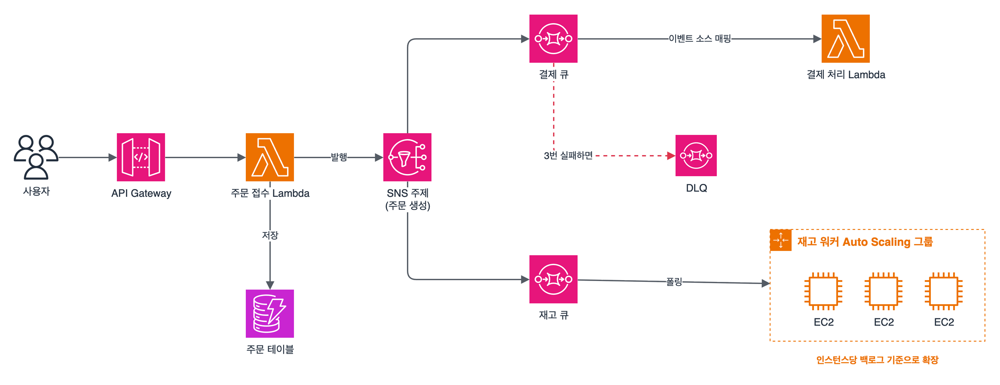
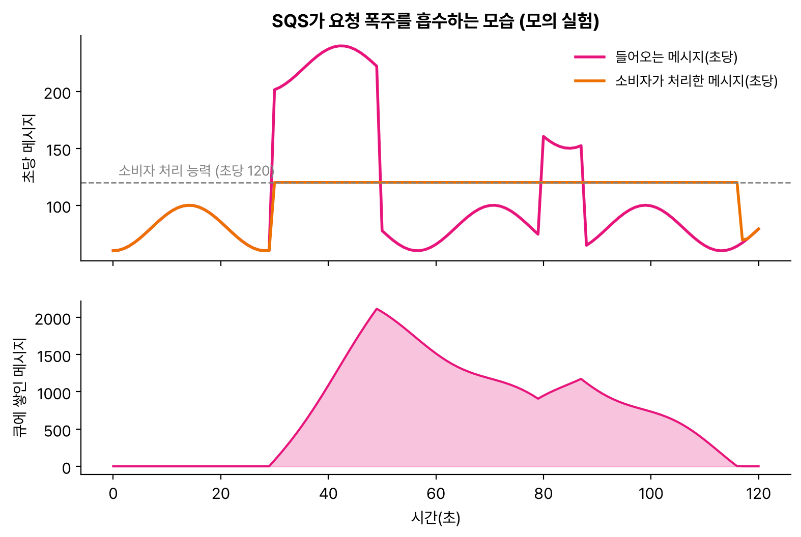

도메인 2 복원력 있는 아키텍처 설계(26%)로 넘어왔다. 과제 2.1 '확장 가능하고 느슨하게 결합된 아키텍처 설계'는 구성 요소끼리 서로 기다리지 않게 떼어 놓아서, 한쪽이 느려지거나 멈춰도 전체는 버티고 각자 따로 늘어나게 만드는 게 목표다.

## 요약

- **느슨한 결합**은 구성 요소 사이에 큐, 주제, 이벤트 버스를 둬서 서로의 상태를 몰라도 동작하게 하는 설계다.
- **SQS**는 메시지를 쌓아 두는 큐로, 갑작스러운 요청 폭주를 흡수하고 소비자가 자기 속도로 처리하게 한다. 순서와 정확히 한 번 처리가 필요하면 FIFO 큐를 쓴다.
- **SNS**는 하나의 메시지를 여러 구독자에게 밀어 보내는 발행/구독 서비스이고, SNS → 여러 SQS 큐 구조를 **팬아웃**이라고 한다.
- **EventBridge**는 이벤트 내용으로 규칙을 걸어 여러 대상으로 보내는 이벤트 버스이고, **Step Functions**는 여러 단계를 순서대로 엮는 워크플로다.
- 계산은 서버를 관리하지 않는 **Lambda**(최대 15분)와 **Fargate**(컨테이너)로, 상태는 서버 밖(ElastiCache, DynamoDB)에 둬서 수평 확장을 쉽게 한다.

## 1. 결합도와 확장

| 구분 | 강한 결합 | 느슨한 결합 |
|---|---|---|
| 호출 방식 | 동기 호출로 응답을 기다린다 | 큐나 이벤트로 넘기고 바로 다음 일을 한다 |
| 한쪽이 느려지면 | 앞쪽도 함께 느려지고 요청이 실패한다 | 메시지가 큐에 쌓였다가 나중에 처리된다 |
| 확장 | 모든 계층을 함께 늘려야 한다 | 계층마다 따로 늘린다 |

| 확장 방식 | 설명 |
|---|---|
| 수직 확장(scale up) | 더 큰 인스턴스로 바꾼다. 한계가 있고 바꾸는 동안 멈출 수 있다 |
| 수평 확장(scale out) | 같은 인스턴스를 여러 대로 늘린다. 클라우드에서 권장하는 방식 |

수평 확장을 하려면 서버가 **무상태(stateless)** 여야 한다. 로그인 세션 같은 상태는 서버 메모리가 아니라 ElastiCache나 DynamoDB에 두면, 어떤 서버가 요청을 받아도 같은 결과를 낼 수 있다.

_주문 접수 Lambda는 SNS에 이벤트 하나만 발행하고 끝난다. 결제, 재고 처리는 각자의 큐에서 자기 속도로 처리하고, 계속 실패하는 메시지는 배달 못 한 편지 큐(DLQ)로 빠진다_

## 2. Amazon SQS

**SQS(Simple Queue Service)** 는 완전 관리형 메시지 큐다. 생산자가 메시지를 넣고, 소비자가 꺼내서(pull) 처리한 뒤 지운다.

### 표준 큐와 FIFO 큐

| 구분 | 표준(Standard) 큐 | FIFO 큐 |
|---|---|---|
| 처리량 | 거의 무제한 | API 작업당 초당 300건, 배치(최대 10건)로 초당 3,000건. 높은 처리량 모드를 켜면 훨씬 높아진다 |
| 전달 | 최소 한 번(가끔 중복 전달) | 정확히 한 번 처리(중복 제거 ID나 내용 기반 중복 제거, 5분 간격) |
| 순서 | 최선 노력(순서가 바뀔 수 있다) | 메시지 그룹 ID 안에서 순서 보장 |
| 이름 | 자유 | `.fifo`로 끝나야 한다 |

표준 큐를 쓰면 같은 메시지가 두 번 올 수 있으니, 소비자를 **멱등(idempotent)** 하게, 즉 같은 메시지를 두 번 처리해도 결과가 같게 만들어야 한다.

### 주요 설정

| 설정 | 기본값과 범위 | 설명 |
|---|---|---|
| 가시성 제한 시간(Visibility timeout) | 기본 30초, 최대 12시간 | 소비자가 메시지를 받으면 이 시간 동안 다른 소비자에게 보이지 않는다. 처리 시간보다 짧으면 메시지가 다시 보여 중복 처리된다 |
| 메시지 보존 기간 | 기본 4일, 1분~14일 | 지나면 메시지가 사라진다 |
| 최대 메시지 크기 | 256KiB | 더 크면 본문을 S3에 두고 큐에는 위치만 넣는다(SQS 확장 클라이언트 라이브러리) |
| 긴 폴링(Long polling) | 최대 20초 대기 | 메시지가 올 때까지 기다렸다 응답해 빈 응답과 API 호출 비용을 줄인다 |
| 지연 큐(Delay queue) | 0초~15분 | 메시지를 넣은 뒤 일정 시간이 지나야 보이게 한다 |
| 배달 못 한 편지 큐(DLQ) | 최대 수신 횟수(maxReceiveCount) | 정해진 횟수만큼 처리에 실패한 메시지를 따로 옮겨 원인을 분석한다. FIFO 큐의 DLQ는 FIFO여야 한다 |

### 소비자 확장

- **EC2 Auto Scaling:** 큐에 쌓인 메시지 수(`ApproximateNumberOfMessagesVisible`)를 인스턴스 수로 나눈 '인스턴스당 백로그'를 목표 추적 지표로 써서 소비자를 늘리고 줄인다.
- **Lambda:** 이벤트 소스 매핑으로 SQS를 연결하면 Lambda가 큐를 폴링하고, 메시지가 많아지면 동시 실행 수를 자동으로 늘린다.

_들어오는 요청이 순간적으로 처리 능력을 넘으면 넘친 만큼 큐에 쌓이고(백로그), 요청이 줄어들면 소비자가 밀린 메시지를 처리해 백로그가 0으로 돌아온다. 큐가 없다면 넘친 요청은 실패했을 것이다_

> **쉬운 설명**
>
> SQS는 식당의 '주문서 꽂이'이다. 손님이 한꺼번에 몰려도 직원은 주문서를 꽂아 두기만 하면 되고, 주방(소비자)은 자기 속도로 하나씩 가져가 요리한다. 주방장이 주문서를 집으면 다른 주방장이 같은 주문을 집지 못하게 잠시 가려 두는 것이 가시성 제한 시간이고, 요리가 계속 실패하는 주문은 따로 빼 두는 바구니가 DLQ이다.

## 3. Amazon SNS와 팬아웃

**SNS(Simple Notification Service)** 는 주제(topic)에 발행한 메시지를 모든 구독자에게 **밀어 보내는(push)** 발행/구독 서비스다.

- **구독자:** SQS, Lambda, HTTP/HTTPS 엔드포인트, 이메일, SMS, 모바일 푸시, Data Firehose
- **팬아웃:** SNS 주제 하나에 여러 SQS 큐를 구독시키면, 메시지 하나가 각 큐로 복제되어 서비스마다 독립적으로 처리하고 재시도할 수 있다.
- **메시지 필터링:** 구독마다 필터 정책을 걸어 원하는 메시지만 받게 한다.
- **FIFO 주제:** 순서와 중복 제거가 필요하면 SNS FIFO 주제 → SQS FIFO 큐로 팬아웃한다.

## 4. 이벤트와 워크플로

### Amazon EventBridge

이벤트를 받아 **규칙(이벤트 패턴)** 에 맞는 것만 대상으로 보내는 서버리스 이벤트 버스다.

| 기능 | 설명 |
|---|---|
| 이벤트 소스 | AWS 서비스 이벤트(기본 이벤트 버스), 직접 만든 앱(사용자 지정 버스), Zendesk 같은 SaaS 파트너 |
| 규칙과 대상 | 이벤트 내용(필드 값)으로 걸러 Lambda, Step Functions, SQS, SNS, 다른 계정 버스, 외부 API로 보낸다 |
| EventBridge Scheduler | cron이나 rate 식, 한 번만 실행하는 일정으로 대상을 호출 |
| 아카이브와 재생 | 지난 이벤트를 보관했다가 다시 보낸다 |
| Pipes | 소스(SQS, Kinesis, DynamoDB Streams 등)에서 대상까지 필터와 가공을 끼운 일대일 연결 |

### AWS Step Functions

여러 단계를 상태 머신으로 엮어 순서, 분기, 병렬, 재시도, 오류 처리를 코드 없이 정의한다.

| 구분 | 표준(Standard) 워크플로 | 익스프레스(Express) 워크플로 |
|---|---|---|
| 최대 실행 시간 | 1년 | 5분 |
| 실행 의미 | 정확히 한 번 | 최소 한 번(비동기) |
| 쓰는 때 | 사람의 승인을 기다리는 주문 처리처럼 오래 걸리는 업무 | 초당 수많은 이벤트를 빠르게 처리하는 데이터 처리 |

### Amazon MQ

온프레미스에서 ActiveMQ나 RabbitMQ를 쓰는 애플리케이션을 **코드를 거의 바꾸지 않고** 옮길 때 쓰는 관리형 메시지 브로커다. JMS, AMQP, MQTT, OpenWire, STOMP 같은 표준 프로토콜을 지원한다. 새로 만드는 애플리케이션이라면 확장성이 더 좋은 SQS, SNS를 권장한다.

### 메시징 서비스 비교

| 서비스 | 모델 | 메시지 보관 | 소비 | 대표 쓰임 |
|---|---|---|---|---|
| SQS | 큐(pull) | 최대 14일 | 메시지 하나를 소비자 하나가 처리하고 지운다 | 작업 분산, 폭주 흡수 |
| SNS | 발행/구독(push) | 보관하지 않는다(재시도만) | 모든 구독자가 받는다 | 팬아웃, 알림 |
| EventBridge | 이벤트 버스(규칙 라우팅) | 아카이브 선택 | 규칙에 맞는 대상이 받는다 | AWS·SaaS 이벤트 연동, 일정 실행 |
| Kinesis Data Streams | 스트림 | 기본 24시간, 최대 365일 | 여러 소비자가 같은 데이터를 순서대로 읽고 다시 읽을 수 있다 | 실시간 분석, 순서 있는 대량 이벤트 |

## 5. 서버리스와 컨테이너 컴퓨팅

### AWS Lambda

| 항목 | 값 |
|---|---|
| 최대 실행 시간 | 15분 |
| 메모리 | 128MB~10,240MB. 메모리에 비례해 CPU도 늘어난다 |
| 임시 저장소(/tmp) | 512MB~10,240MB |
| 동시 실행 | 리전당 기본 1,000(늘릴 수 있다) |

| 기능 | 설명 |
|---|---|
| 예약된 동시성 | 함수 하나가 쓸 동시 실행 수를 확보하고 상한도 건다. 다른 함수가 동시성을 다 써도 이 함수는 실행된다 |
| 프로비저닝된 동시성 | 미리 초기화된 실행 환경을 준비해 콜드 스타트 지연을 없앤다 |
| 호출 방식 | 동기(API Gateway, ALB), 비동기(S3, SNS, EventBridge: 실패 시 두 번 재시도, 실패 대상이나 DLQ 지정), 이벤트 소스 매핑(SQS, Kinesis, DynamoDB Streams를 Lambda가 폴링) |
| VPC 연결 | 프라이빗 서브넷의 RDS 등에 접근할 수 있다. 인터넷에 나가려면 NAT 게이트웨이가 필요하다 |

15분이 넘는 작업은 Lambda에 맞지 않는다. ECS(Fargate), AWS Batch, Step Functions로 나누는 방식을 고른다.

### Amazon API Gateway

| 종류 | 특징 |
|---|---|
| REST API | API 키와 사용량 계획, 응답 캐시, 요청 검증, WAF 연동, 프라이빗 API 등 기능이 가장 많다 |
| HTTP API | 기능이 적은 대신 더 싸고 지연이 짧다. JWT 권한 부여자 지원 |
| WebSocket API | 채팅처럼 양방향 실시간 통신 |

계정·리전 단위 기본 스로틀링(초당 요청 수 제한)이 있어 백엔드를 폭주에서 보호하고, 사용량 계획으로 고객별 한도를 둘 수 있다.

### 컨테이너

| 서비스 | 설명 |
|---|---|
| Amazon ECS | AWS의 컨테이너 오케스트레이션 서비스 |
| Amazon EKS | 관리형 Kubernetes. 기존 Kubernetes 도구와 매니페스트를 그대로 쓸 때 |
| AWS Fargate | ECS, EKS에서 서버(EC2)를 관리하지 않고 컨테이너만 실행하는 서버리스 실행 방식 |
| Amazon ECR | 컨테이너 이미지 저장소 |

ECS나 EKS에서 EC2 시작 유형을 쓰면 인스턴스 패치와 용량을 직접 관리하고, Fargate를 쓰면 작업(task)마다 필요한 vCPU와 메모리만 지정한다.

> **쉬운 설명**
>
> SNS는 '단체 문자', EventBridge는 '조건별 자동 분류 우편함', Step Functions는 '업무 결재 순서표'이다. Lambda는 일이 생길 때만 불러서 쓰는 '단기 아르바이트'라서 15분이 넘는 일은 맡길 수 없고, Fargate는 서버 관리 없이 컨테이너만 맡기는 '파견 직원'이다.

## 헷갈렸던 것들

- 메시지가 **중복 처리**되면 먼저 가시성 제한 시간이 처리 시간보다 짧은지 의심해 보자.
- 순서 보장과 정확히 한 번 처리는 SQS **FIFO**이다. 표준 큐는 최소 한 번 전달이고 순서가 바뀔 수 있다.
- 메시지 하나를 여러 서비스가 각자 처리해야 하면 **SNS → 여러 SQS 팬아웃**이다. SQS 큐 하나를 여러 서비스가 함께 읽으면 메시지를 나눠 가질 뿐이다.
- 빈 응답과 API 비용을 줄이려면 **긴 폴링**이다.
- 256KiB보다 큰 메시지는 S3에 본문을 두고 SQS에는 위치만 넣는다(SQS 확장 클라이언트 라이브러리).
- 기존 JMS·AMQP 애플리케이션을 코드 변경 없이 옮기면 **Amazon MQ**이다.
- Lambda 실행 시간은 최대 15분이다. 더 긴 작업을 Lambda에 그대로 맡기는 보기는 오답이다.
- 콜드 스타트를 없애려면 **프로비저닝된 동시성**, 다른 함수 때문에 실행이 막히지 않게 하려면 **예약된 동시성**이다.
- 사람의 승인을 기다리는 긴 워크플로는 Step Functions **표준** 워크플로다.

## 용어 정리

| 용어 | 뜻 |
|---|---|
| 느슨한 결합 | 구성 요소가 서로 직접 기다리지 않게 떼어 놓는 설계 |
| 가시성 제한 시간 | 받아 간 메시지를 다른 소비자에게 숨기는 시간 |
| 배달 못 한 편지 큐(DLQ) | 반복 실패한 메시지를 모아 두는 큐 |
| 팬아웃 | SNS 메시지 하나를 여러 SQS 큐로 복제하는 구조 |
| 멱등성 | 같은 요청을 여러 번 처리해도 결과가 같은 성질 |
| 콜드 스타트 | Lambda 실행 환경을 새로 준비하느라 생기는 첫 호출 지연 |
| 무상태 | 요청 처리에 서버 내부 상태가 필요 없는 성질 |

## 복습 문제

**1.** The backend of an order processing system can handle 100 orders per second. During sales events, traffic briefly spikes to 1,000 orders per second, and orders are lost. Which solution will prevent order loss and scale the backend to match demand?

- A. Change the backend instances to the largest instance type.
- B. Place a Network Load Balancer in front of the backend.
- C. Store the order data in Amazon ElastiCache.
- D. Place an Amazon SQS queue between the web tier and the backend, and scale the backend Auto Scaling group based on the queue backlog per instance.

**2.** When an order is created, a payment service, an inventory service, and an email service must each process it independently. A failure in one service must not affect the others. Which architecture meets these requirements?

- A. All three services read from one shared SQS queue.
- B. The order service calls the three services synchronously, one after another.
- C. The three services poll the same DynamoDB table every second.
- D. Publish order events to an Amazon SNS topic, and subscribe a separate SQS queue for each service.

**3.** An SQS consumer takes about 2 minutes to process one message. The same message is often processed by multiple consumers. The queue uses the default visibility timeout. What should a solutions architect do?

- A. Increase the visibility timeout to longer than the processing time.
- B. Increase the message retention period to 14 days.
- C. Turn on long polling.
- D. Set a delivery delay of 15 minutes on the queue.

**4.** Bank transaction messages must be processed exactly once and in the order they arrive for each account. Which solution meets these requirements?

- A. An SQS FIFO queue that uses the account number as the message group ID
- B. An SQS standard queue
- C. An SNS standard topic
- D. Several SQS standard queues with different priorities

**5.** An on-premises application exchanges messages through Apache ActiveMQ by using JMS. The company wants to migrate the application to AWS with minimal code changes. Which service should the company use?

- A. Amazon SQS
- B. Amazon MQ
- C. Amazon SNS
- D. Amazon Kinesis Data Streams

**6.** Messages that repeatedly fail processing stay in the queue and slow down the processing of other messages. How can the company collect the failed messages separately for analysis?

- A. Reduce the message retention period to 1 minute.
- B. Change the standard queue to a FIFO queue.
- C. Reduce the number of consumers.
- D. Configure a dead-letter queue (DLQ) with a maximum receive count.

## 답과 풀이

1. **D** 큐가 폭주를 흡수해 유실을 막고, 백로그 기준 Auto Scaling으로 소비자를 수요에 맞게 늘린다.
2. **D** SNS 팬아웃으로 서비스마다 큐를 따로 두면 각자 독립적으로 처리하고 재시도한다. A는 메시지를 나눠 가질 뿐이다.
3. **A** 처리 중에 가시성 제한 시간(기본 30초)이 지나 메시지가 다시 보이기 때문이다.
4. **A** FIFO 큐는 메시지 그룹 안에서 순서를 지키고 정확히 한 번 처리한다.
5. **B** Amazon MQ는 JMS와 ActiveMQ 프로토콜을 그대로 지원한다.
6. **D** DLQ는 정해진 횟수 이상 실패한 메시지를 옮겨 둔다.

## 참고 자료

- Amazon SQS 개발자 안내서: <https://docs.aws.amazon.com/AWSSimpleQueueService/latest/SQSDeveloperGuide/welcome.html>
- Amazon SQS 개발자 안내서, 메시지 할당량: <https://docs.aws.amazon.com/AWSSimpleQueueService/latest/SQSDeveloperGuide/quotas-messages.html>
- Amazon SNS 개발자 안내서, SQS로 팬아웃: <https://docs.aws.amazon.com/sns/latest/dg/sns-sqs-as-subscriber.html>
- Amazon EventBridge 사용 설명서: <https://docs.aws.amazon.com/eventbridge/latest/userguide/eb-what-is.html>
- AWS Lambda 개발자 안내서, 할당량: <https://docs.aws.amazon.com/lambda/latest/dg/gettingstarted-limits.html>
