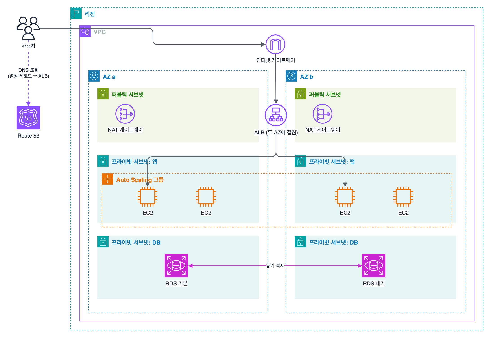
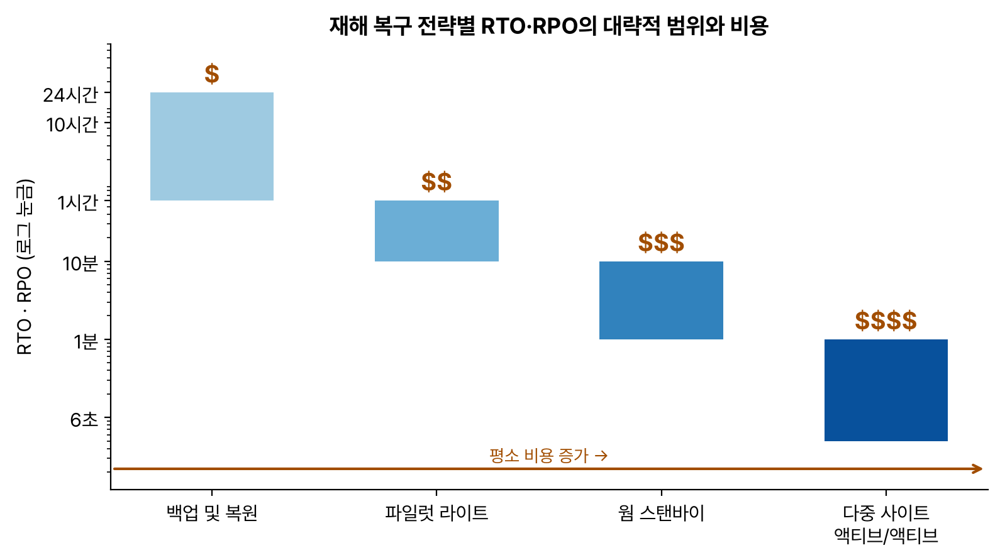

도메인 2 두 번째. 과제 2.2 '고가용성 또는 내결함성 아키텍처 설계'. 단일 장애점 없애기, 장애가 나면 자동으로 우회하기, 리전 전체가 멈추는 재해 대비까지 이어진다.

## 요약

- 기본은 **여러 AZ에 나눠 배치**하는 것이다. 로드 밸런서(ELB)가 트래픽을 나누고, Auto Scaling이 고장 난 인스턴스를 바꾸고, DB는 Multi-AZ로 대기 복제본을 둔다.
- ALB는 HTTP(7계층) 라우팅, NLB는 TCP·UDP(4계층) 초고성능과 고정 IP, GWLB는 방화벽 같은 가상 어플라이언스용이다.
- Auto Scaling은 목표 추적, 단계, 예약, 예측 정책으로 용량을 맞추고, **ELB 상태 확인**을 켜면 앱이 응답하지 않는 인스턴스도 교체한다.
- Route 53은 장애 조치, 지연 시간, 가중치, 지리적 위치 같은 라우팅 정책과 상태 확인으로 리전 수준의 우회를 맡는다.
- 재해 복구는 비용이 싼 순서로 백업 및 복원, 파일럿 라이트, 웜 스탠바이, 다중 사이트 액티브/액티브이고, RTO와 RPO가 짧을수록 비싸진다.

## 1. 가용성의 개념

| 용어 | 뜻 |
|---|---|
| 고가용성(HA) | 장애가 나도 짧은 중단 뒤 서비스가 이어지게 하는 것. 다중 AZ, 자동 장애 조치 |
| 내결함성(FT) | 구성 요소가 고장 나도 중단 없이 계속 동작하는 것. 더 많은 중복이 필요하다 |
| 재해 복구(DR) | 리전 장애 같은 큰 재해 뒤 정해진 시간 안에 복구하는 것 |
| 단일 장애점(SPOF) | 그 하나가 고장 나면 전체가 멈추는 구성 요소 |

| 가용성 | 1년 동안 허용되는 중단 시간 |
|---|---|
| 99.9% | 약 8.76시간 |
| 99.99% | 약 52.6분 |
| 99.999% | 약 5.3분 |

구성 요소를 **병렬**로 두면 가용성이 올라간다. 가용성이 99%인 인스턴스 두 대를 서로 다른 AZ에 두고 둘 중 하나만 살아 있으면 된다면, 둘이 동시에 멈출 확률은 0.01 × 0.01 = 0.0001이라 가용성은 99.99%가 된다(두 AZ의 장애가 서로 독립이라고 볼 때).

_Route 53이 ALB로 보내고, ALB는 두 AZ의 인스턴스로 나눠 보낸다. Auto Scaling 그룹이 AZ에 걸쳐 인스턴스 수를 유지하고, RDS는 다른 AZ에 동기 대기 복제본을 둔다. NAT 게이트웨이도 AZ마다 하나씩 둔다_

## 2. Elastic Load Balancing

### 로드 밸런서 종류

| 종류 | 계층 | 특징 | 쓰는 때 |
|---|---|---|---|
| ALB(Application) | 7계층 HTTP, HTTPS, gRPC | 경로(`/api/*`), 호스트(`shop.example.com`), 헤더, 쿼리 문자열로 라우팅. 대상은 EC2, IP, Lambda, 컨테이너. WAF 연동, Cognito·OIDC 로그인, 리디렉션 | 웹 애플리케이션, 마이크로서비스 |
| NLB(Network) | 4계층 TCP, UDP, TLS | 초당 수백만 요청, 매우 낮은 지연. AZ마다 고정 IP(탄력적 IP 지정 가능), 클라이언트 IP 보존, PrivateLink 서비스의 앞단 | 게임, IoT, 고정 IP가 필요한 경우 |
| GWLB(Gateway) | 3계층 | GENEVE 프로토콜(6081 포트)로 트래픽을 방화벽·IDS 같은 가상 어플라이언스에 투명하게 통과시킨다 | 서드 파티 보안 어플라이언스 |
| CLB(Classic) | 4·7계층 | 예전 세대. 새 설계에는 쓰지 않는다 | |

### 주요 기능

| 기능 | 설명 |
|---|---|
| 상태 확인 | 대상에 주기적으로 요청을 보내 정상인 대상에만 트래픽을 보낸다 |
| 교차 영역 로드 밸런싱 | AZ와 관계없이 모든 정상 대상에 고르게 나눈다. ALB는 기본으로 켜져 있고(대상 그룹 단위로 끌 수 있다), NLB와 GWLB는 기본으로 꺼져 있다 |
| 등록 취소 지연(연결 드레이닝) | 대상을 빼기 전에 진행 중인 요청을 마칠 시간을 준다. 기본 300초 |
| 고정 세션(Sticky session) | 같은 사용자를 같은 대상으로 보낸다. 세션을 외부 저장소에 두면 필요 없다 |
| TLS 종료 | ACM 인증서를 ELB에 붙여 암호화를 ELB에서 처리 |

## 3. EC2 Auto Scaling

**Auto Scaling 그룹**은 시작 템플릿으로 인스턴스를 만들고, 최소·원하는·최대 용량 사이에서 인스턴스 수를 유지한다. 여러 AZ의 서브넷을 지정하면 AZ에 고르게 나눠 배치한다.

| 정책 | 설명 | 예 |
|---|---|---|
| 목표 추적(Target tracking) | 지표를 목표값에 맞추도록 자동 조절. 가장 간단하고 권장되는 방식 | 평균 CPU 50%, 대상당 요청 수 1,000 |
| 단계(Step) | 경보 크기에 따라 단계별로 늘리고 줄인다 | CPU 70% 넘으면 +2, 90% 넘으면 +4 |
| 단순(Simple) | 경보가 울리면 정해진 수만큼 조정하고 쿨다운 동안 기다린다 | 예전 방식 |
| 예약(Scheduled) | 정해진 시간에 용량을 바꾼다 | 매일 오전 9시 최소 10대 |
| 예측(Predictive) | 과거 패턴을 머신러닝으로 분석해 미리 늘린다 | 매일 반복되는 출근 시간 트래픽 |

- **상태 확인 유형:** 기본은 EC2 상태 확인(하드웨어·OS 수준)이다. **ELB 상태 확인**을 켜면 애플리케이션이 응답하지 않는 인스턴스도 비정상으로 보고 교체한다.
- **쿨다운과 인스턴스 워밍업:** 조정 직후 새 인스턴스가 지표에 반영될 때까지 추가 조정을 기다린다. 단순 정책의 기본 쿨다운은 300초다.
- **수명 주기 후크:** 인스턴스가 시작되거나 종료될 때 잠시 멈추고 설정이나 로그 백업 같은 작업을 끼워 넣는다.
- **웜 풀:** 미리 초기화해 둔(정지 상태) 인스턴스를 두어 확장 속도를 높인다.

> **쉬운 설명**
>
> ELB는 식당 입구의 안내 직원이다. 손님을 빈 테이블(정상 인스턴스)로 나눠 안내하고, 문제가 생긴 테이블로는 보내지 않는다. Auto Scaling은 점장이라서, 손님이 몰리면 직원을 더 부르고 한가해지면 퇴근시키며, 쓰러진 직원이 있으면 새 직원으로 바꾼다.

## 4. Amazon Route 53

### 레코드

| 레코드 | 설명 |
|---|---|
| A / AAAA | 이름을 IPv4 / IPv6 주소로 |
| CNAME | 이름을 다른 이름으로. 영역 꼭대기(example.com 자체)에는 쓸 수 없다 |
| 별칭(Alias) | 이름을 AWS 리소스(ELB, CloudFront, S3 웹 사이트, API Gateway, 다른 Route 53 레코드 등)로. 영역 꼭대기에도 쓸 수 있고, AWS 리소스를 가리키는 별칭 조회는 요금이 없다 |

### 라우팅 정책

| 정책 | 동작 | 쓰는 때 |
|---|---|---|
| 단순(Simple) | 레코드 하나를 돌려준다. 상태 확인을 붙일 수 없다 | 리소스가 하나 |
| 가중치 기반(Weighted) | 비율대로 나눈다(예: 90:10) | 새 버전에 일부만 보내는 카나리 배포 |
| 지연 시간 기반(Latency) | 사용자에게 지연이 가장 짧은 리전으로 | 여러 리전에 배포된 글로벌 서비스 |
| 장애 조치(Failover) | 기본 리소스가 비정상이면 보조 리소스로 | 액티브-패시브 DR |
| 지리적 위치(Geolocation) | 사용자의 국가·대륙으로 결정 | 국가별 콘텐츠, 법적 제한. 맞는 위치가 없을 때의 기본 레코드를 둔다 |
| 지리 근접성(Geoproximity) | 리소스 위치와 바이어스 값으로 트래픽 영역을 넓히거나 좁힌다 | 트래픽을 특정 리전으로 더 끌어오기 |
| 다중 값 응답(Multivalue) | 정상인 레코드를 최대 8개까지 돌려준다 | 간단한 클라이언트 측 분산(ELB 대체는 아님) |
| IP 기반(IP-based) | 클라이언트 IP 대역(CIDR)으로 결정 | 특정 ISP 사용자 경로 최적화 |

**상태 확인**은 엔드포인트를 직접 점검하거나, 다른 상태 확인 여러 개를 묶거나(계산된 상태 확인), CloudWatch 경보 상태를 따르는 방식이 있다. 프라이빗 리소스처럼 Route 53이 직접 닿을 수 없는 대상은 CloudWatch 경보 기반 상태 확인을 쓴다.


flowchart LR
  U["사용자"] --> R53{"Route 53 장애 조치 레코드"}
  R53 -->|"기본: 상태 확인 정상"| P["서울 리전 ALB"]
  R53 -.->|"기본이 비정상이면"| S["도쿄 리전 ALB"]


## 5. 데이터베이스의 고가용성

| 방식 | 복제 | 장애 조치 | 읽기 확장 |
|---|---|---|---|
| RDS Multi-AZ(인스턴스 배포) | 다른 AZ의 대기 인스턴스로 동기 복제 | 자동. DNS 엔드포인트가 그대로라 앱을 바꾸지 않는다. 보통 1~2분 | 안 된다(대기 인스턴스는 읽을 수 없다) |
| RDS Multi-AZ DB 클러스터 | 다른 AZ의 읽기 가능한 대기 인스턴스 2개 | 자동, 더 빠르다 | 된다 |
| RDS 읽기 전용 복제본 | 비동기 복제(같은 리전 또는 다른 리전) | 수동 승격 | 된다 |
| Aurora | 3개 AZ에 데이터 6벌을 저장하는 공유 스토리지 | 자동으로 Aurora 복제본을 승격. 보통 1분 이내 | 최대 15개 복제본 |
| DynamoDB | 리전 안 여러 AZ에 자동 복제 | 자동 | |

Multi-AZ는 **가용성**을 위한 것이고, 읽기 성능을 높이는 것은 읽기 전용 복제본이라는 구분이 시험에 자주 나온다. 자세한 내용은 '고성능 데이터베이스' 편에서 다룬다.

## 6. 재해 복구(DR) 전략

| 용어 | 뜻 |
|---|---|
| RPO(Recovery Point Objective, 복구 시점 목표) | 잃어도 되는 데이터의 최대 시간. RPO 1시간이면 최근 1시간 데이터까지 잃을 수 있다 |
| RTO(Recovery Time Objective, 복구 시간 목표) | 서비스가 멈춰 있어도 되는 최대 시간 |

_왼쪽에서 오른쪽으로 갈수록 복구가 빨라지고 잃는 데이터가 줄지만, 평소에 켜 두는 자원이 늘어 비용이 커진다. 시간은 AWS 재해 복구 백서의 '시간 단위', '수십 분', '분 단위', '거의 실시간'을 대략 나타낸 범위다_

| 전략 | 평소 DR 리전의 상태 | 재해 때 할 일 | RTO·RPO |
|---|---|---|---|
| 백업 및 복원(Backup & Restore) | 백업과 스냅샷만 복사해 둔다 | 인프라를 새로 만들고(CloudFormation) 백업에서 복원 | 시간 단위 |
| 파일럿 라이트(Pilot Light) | 데이터는 계속 복제(DB 복제본 등), 애플리케이션 서버는 꺼져 있다 | 서버를 켜고 늘린 뒤 트래픽 전환 | 수십 분 |
| 웜 스탠바이(Warm Standby) | 축소된 전체 환경이 항상 실행 중 | 용량을 늘리고 트래픽 전환 | 분 단위 |
| 다중 사이트 액티브/액티브 | 두 리전이 모두 실제 트래픽을 처리 | Route 53이 나머지 리전으로 보낸다 | 거의 0 |

| 도움이 되는 서비스 | 하는 일 |
|---|---|
| AWS Backup | 백업 계획과 리전 간 복사 |
| AWS Elastic Disaster Recovery | 서버를 블록 수준으로 계속 복제해 몇 분 안에 다른 리전이나 AWS에서 복구 |
| Aurora Global Database | 다른 리전으로 보통 1초 미만의 지연으로 복제하고, 재해 때 보조 리전을 승격 |
| DynamoDB 글로벌 테이블 | 여러 리전에서 읽고 쓰는 다중 리전 액티브-액티브 테이블 |
| S3 리전 간 복제(CRR) | 다른 리전 버킷으로 객체 복제. 복제 시간 제어(RTC)를 켜면 대부분의 객체를 15분 안에 복제한다는 SLA를 준다 |
| Route 53 + ARC | 장애 조치 라우팅, Application Recovery Controller로 트래픽 전환을 통제 |
| CloudFormation | 인프라를 코드로 정의해 다른 리전에 빠르게 다시 만든다 |

> **쉬운 설명**
>
> 가게가 불에 탔을 때를 대비하는 방법이다. 장부 사본만 다른 곳에 보관하면 '백업 및 복원'(다시 차리는 데 오래 걸림), 다른 동네에 창고를 빌려 재료는 계속 채워 두면 '파일럿 라이트', 작은 분점을 열어 평소에도 조금씩 장사하면 '웜 스탠바이', 똑같은 크기의 두 번째 가게를 같이 운영하면 '액티브/액티브'이다. 뒤로 갈수록 빨리 다시 장사할 수 있지만 돈이 더 든다.

## 7. 모니터링과 자동 복구

| 서비스, 기능 | 설명 |
|---|---|
| CloudWatch 지표와 경보 | 기본 지표는 5분 간격(세부 모니터링은 1분). 메모리, 디스크 사용률은 CloudWatch 에이전트가 있어야 수집된다 |
| EC2 자동 복구 | 하드웨어 문제로 시스템 상태 확인이 실패하면 같은 인스턴스 ID, IP, EBS로 다른 호스트에서 복구 |
| AWS Health Dashboard | AWS 쪽 이벤트(예정된 유지 관리, 서비스 장애)가 내 리소스에 주는 영향 |
| AWS X-Ray | 분산 애플리케이션의 요청 흐름을 추적해 병목과 오류 지점을 찾는다 |
| Service Quotas | 서비스 한도를 미리 확인하고 늘린다. 장애 조치로 다른 리전에서 갑자기 늘릴 때 한도에 걸리지 않게 한다 |

## 헷갈렸던 것들

- 고가용성의 기본은 **두 개 이상의 AZ**이다. 같은 AZ에 인스턴스를 늘리는 보기는 AZ 장애를 막지 못한다.
- 앱은 멈췄는데 인스턴스는 살아 있어 교체되지 않으면, Auto Scaling 그룹에서 **ELB 상태 확인**을 켠다.
- 고정 IP가 필요하거나 TCP·UDP 초저지연이면 **NLB**, 경로·호스트 기반 라우팅이면 **ALB**이다.
- example.com(영역 꼭대기)을 ELB로 보내려면 CNAME이 아니라 **별칭 레코드**이다.
- 사용자를 가장 빠른 리전으로 보내면 지연 시간 기반, 국가별로 나누면 지리적 위치, 비율로 나누면 가중치 기반이다.
- RDS Multi-AZ의 대기 인스턴스는 읽기 트래픽을 받지 않는다. 읽기 확장은 읽기 전용 복제본(비동기)이다. Multi-AZ는 동기 복제라 장애 조치에서 데이터를 잃지 않는다.
- '데이터는 계속 복제하고 서버는 꺼 둔다'는 파일럿 라이트, '축소된 환경이 항상 실행'은 웜 스탠바이다.
- NAT 게이트웨이는 AZ 하나에 속하므로, 고가용성을 위해 AZ마다 하나씩 두고 각 AZ의 프라이빗 서브넷이 자기 AZ의 NAT 게이트웨이를 쓰게 한다.

## 용어 정리

| 용어 | 뜻 |
|---|---|
| 단일 장애점 | 고장 나면 전체가 멈추는 하나의 구성 요소 |
| ALB / NLB / GWLB | 7계층 / 4계층 / 3계층 어플라이언스용 로드 밸런서 |
| 목표 추적 정책 | 지표를 목표값에 맞추는 Auto Scaling 정책 |
| 별칭 레코드 | AWS 리소스를 가리키는 Route 53 확장 레코드 |
| RPO / RTO | 잃어도 되는 데이터 시간 / 멈춰도 되는 시간 |
| 파일럿 라이트 | 데이터만 복제해 두고 서버는 꺼 둔 DR 전략 |
| 웜 스탠바이 | 축소된 전체 환경을 항상 켜 둔 DR 전략 |

## 복습 문제

**1.** A web application runs on a single EC2 instance in one Availability Zone. The application must keep running if an Availability Zone fails and must adjust its capacity to traffic. Which solution meets these requirements?

- A. Change to a larger instance type.
- B. Increase to three instances in the same Availability Zone.
- C. Create an Auto Scaling group that spans two or more Availability Zones behind an Application Load Balancer.
- D. Attach an Elastic IP address to the instance.

**2.** On an instance in an Auto Scaling group, the web server process has stopped and does not respond to HTTP requests, but the instance is not replaced. What should a solutions architect do?

- A. Increase the maximum capacity.
- B. Reduce the cooldown period.
- C. Add a scheduled scaling policy.
- D. Add ELB health checks to the Auto Scaling group's health check type.

**3.** A company deployed the same application in the Seoul Region and the N. Virginia Region. Which Amazon Route 53 routing policy sends users to the Region with the lowest latency?

- A. Simple
- B. Weighted
- C. Multivalue answer
- D. Latency-based

**4.** An Amazon RDS for MySQL database must fail over automatically without data loss if an Availability Zone fails. Which configuration meets this requirement?

- A. A read replica in the same Region
- B. Hourly manual snapshots
- C. A Multi-AZ deployment
- D. A larger instance class

**5.** A company continuously replicates its database to a DR Region. The application servers in the DR Region are normally turned off and are started only when a disaster occurs so that they can take over traffic. Which DR strategy is this?

- A. Pilot light
- B. Backup and restore
- C. Warm standby
- D. Multi-site active/active

**6.** A company wants the domain example.com itself to point to an Application Load Balancer. Which record should the company use?

- A. An alias A record for example.com
- B. A CNAME record for example.com
- C. An A record that contains the ALB's IP addresses
- D. An MX record

## 답과 풀이

1. **C** 여러 AZ의 Auto Scaling 그룹과 ALB가 고가용성과 확장을 함께 해결한다.
2. **D** 기본 EC2 상태 확인은 애플리케이션 상태를 모른다. ELB 상태 확인이 응답하지 않는 인스턴스를 비정상으로 판정한다.
3. **D** 지연 시간 기반 라우팅이 사용자에게 지연이 가장 짧은 리전을 돌려준다.
4. **C** Multi-AZ는 동기 복제와 자동 장애 조치를 제공한다. 읽기 전용 복제본은 비동기라 데이터를 잃을 수 있고 자동 장애 조치도 아니다.
5. **A** 데이터만 계속 복제하고 서버는 꺼 두는 것이 파일럿 라이트다.
6. **A** 영역 꼭대기에는 CNAME을 쓸 수 없고, ALB의 IP는 바뀔 수 있어 별칭 레코드를 쓴다.

## 참고 자료

- Elastic Load Balancing 사용 설명서: <https://docs.aws.amazon.com/elasticloadbalancing/latest/userguide/what-is-load-balancing.html>
- Amazon EC2 Auto Scaling 사용 설명서, 조정 정책: <https://docs.aws.amazon.com/autoscaling/ec2/userguide/as-scale-based-on-demand.html>
- Amazon Route 53 개발자 안내서, 라우팅 정책 선택: <https://docs.aws.amazon.com/Route53/latest/DeveloperGuide/routing-policy.html>
- AWS 백서, Disaster Recovery of Workloads on AWS: <https://docs.aws.amazon.com/whitepapers/latest/disaster-recovery-workloads-on-aws/disaster-recovery-options-in-the-cloud.html>
