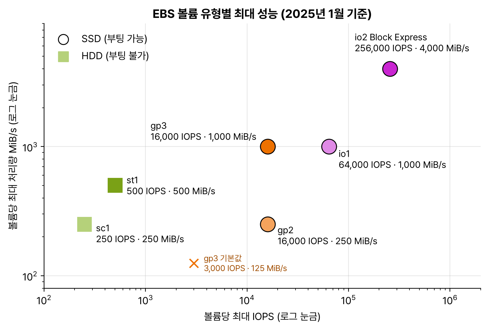

도메인 3, 고성능 아키텍처 설계(24%) 첫 번째. 과제 3.1 '고성능 또는 확장 가능한 스토리지 솔루션 결정'. 블록, 파일, 객체 중에 무엇을 고를지, 같은 종류 안에서도 어떤 유형과 설정으로 성능을 맞출지를 정리했다.

## 요약

- 스토리지는 **블록**(EBS, 인스턴스 스토어), **파일**(EFS, FSx), **객체**(S3) 세 가지다. 한 인스턴스의 디스크면 블록, 여러 서버가 함께 쓰는 폴더면 파일, 웹에서 무한히 쌓는 데이터면 객체다.
- S3는 접두사(prefix)마다 초당 쓰기 3,500건, 읽기 5,500건을 처리하고, 멀티파트 업로드·Transfer Acceleration·바이트 범위 가져오기로 속도를 높인다.
- EBS는 기본으로 **gp3**를 쓰고, 볼륨 하나에 아주 높은 IOPS가 필요하면 **io2 Block Express**, 큰 파일을 순차로 읽는 저렴한 처리량이 필요하면 **st1**을 고른다.
- 리눅스 서버 여러 대가 여러 AZ에서 함께 쓰는 파일 시스템은 **EFS**, 윈도우(SMB)와 AD 연동은 **FSx for Windows File Server**, HPC·머신러닝은 **FSx for Lustre**이다.
- 온프레미스에서 S3를 NFS·SMB 파일처럼 쓰려면 **Storage Gateway**를 쓴다.

## 1. 스토리지의 세 가지 유형

| 유형 | 특징 | AWS 서비스 | 쓰임 |
|---|---|---|---|
| 블록 | 디스크처럼 블록 단위로 읽고 쓴다. 한 인스턴스에 붙인다(일부 예외) | EBS, 인스턴스 스토어 | OS 부팅 디스크, 데이터베이스 |
| 파일 | 폴더와 파일 구조. 여러 서버가 NFS·SMB로 함께 마운트 | EFS, FSx | 공유 콘텐츠, 홈 디렉터리, HPC |
| 객체 | 키로 객체를 저장. HTTP API로 접근, 용량 무제한 | S3 | 백업, 데이터 레이크, 정적 웹 콘텐츠, 미디어 |


flowchart TB
  Q{"어떤 데이터를 저장하나?"} -->|"인스턴스 하나의 디스크"| B{"꺼져도 남아야 하나?"}
  B -->|"예"| EBS["EBS"]
  B -->|"아니오, 임시 데이터"| IS["인스턴스 스토어"]
  Q -->|"여러 서버가 공유하는 파일"| F{"OS와 용도는?"}
  F -->|"리눅스, NFS"| EFS["EFS"]
  F -->|"윈도우, SMB, AD"| FW["FSx for Windows"]
  F -->|"HPC, 머신러닝"| FL["FSx for Lustre"]
  F -->|"NetApp 기능, 다중 프로토콜"| FN["FSx for NetApp ONTAP"]
  Q -->|"웹 규모의 객체, 백업, 데이터 레이크"| S3["S3"]


## 2. Amazon S3의 성능

### 기본 사항

| 항목 | 내용 |
|---|---|
| 버킷 | 리전에 만든다. 이름은 전 세계에서 고유해야 한다 |
| 객체 크기 | 최대 5TB |
| 업로드 | PUT 한 번에 최대 5GB. 100MB가 넘으면 멀티파트 업로드를 권장하고, 5GB가 넘으면 멀티파트 업로드가 필수다 |
| 일관성 | 쓰기 직후 읽어도 최신 데이터를 돌려주는 강력한 쓰기 후 읽기 일관성 |
| 내구성 | 99.999999999%(9가 11개). 여러 AZ에 저장(One Zone 클래스 제외) |

### 성능을 높이는 방법

| 방법 | 설명 |
|---|---|
| 접두사 나누기 | 접두사(예: `logs/2024/12/`)마다 초당 PUT·COPY·POST·DELETE 3,500건, GET·HEAD 5,500건을 처리한다. 접두사를 여러 개로 나눠 병렬로 요청하면 처리량이 그만큼 늘어난다 |
| 멀티파트 업로드 | 큰 파일을 여러 조각으로 나눠 병렬로 올린다. 실패한 조각만 다시 보낸다 |
| S3 Transfer Acceleration | 멀리 있는 사용자가 가까운 엣지 로케이션으로 올리면, AWS 백본 네트워크로 버킷까지 빠르게 전달한다 |
| 바이트 범위 가져오기 | 객체의 일부 범위만 병렬로 내려받는다 |
| CloudFront | 자주 읽는 객체를 엣지에 캐시한다 |
| S3 Express One Zone | 디렉터리 버킷에 데이터를 AZ 하나에 두고 한 자릿수 밀리초로 읽고 쓴다. 같은 AZ의 컴퓨팅과 함께 쓰는 고성능 작업용 |

### 자주 쓰는 기능

- **미리 서명된 URL(presigned URL):** 버킷을 공개하지 않고, 일정 시간 동안만 특정 객체를 올리거나 내려받게 하는 URL을 발급한다.
- **이벤트 알림:** 객체가 생기거나 지워지면 SQS, SNS, Lambda, EventBridge로 알린다. 업로드된 이미지로 썸네일을 만드는 식이다.
- **정적 웹 사이트 호스팅:** HTML 파일을 S3에서 바로 서비스한다. HTTPS가 필요하면 앞에 CloudFront를 둔다.

## 3. Amazon EBS

**EBS(Elastic Block Store)** 는 EC2에 붙이는 네트워크 블록 스토리지다. 볼륨은 **AZ 하나**에 속하고, 같은 AZ의 인스턴스에만 붙일 수 있다. 인스턴스를 꺼도 데이터가 남는다.

### 볼륨 유형

| 유형 | 종류 | 최대 IOPS | 최대 처리량 | 최대 크기 | 쓰임 | 부팅 |
|---|---|---|---|---|---|---|
| gp3 | 범용 SSD | 16,000 | 1,000MiB/s | 16TiB | 대부분의 작업. 크기와 무관하게 기본 3,000 IOPS·125MiB/s를 주고 IOPS와 처리량을 따로 늘린다 | 가능 |
| gp2 | 범용 SSD(이전 세대) | 16,000 | 250MiB/s | 16TiB | IOPS가 크기에 비례(GiB당 3 IOPS). 1TiB 미만은 3,000까지 버스트 | 가능 |
| io2 Block Express | 프로비저닝된 IOPS SSD | 256,000 | 4,000MiB/s | 64TiB | 꾸준히 높은 IOPS가 필요한 핵심 DB. 내구성 99.999% | 가능 |
| io1 | 프로비저닝된 IOPS SSD(이전 세대) | 64,000 | 1,000MiB/s | 16TiB | | 가능 |
| st1 | 처리량 최적화 HDD | 500 | 500MiB/s | 16TiB | 빅데이터, 로그 처리처럼 큰 파일 순차 읽기 | 불가 |
| sc1 | 콜드 HDD | 250 | 250MiB/s | 16TiB | 가끔 읽는 대용량 데이터. 가장 저렴 | 불가 |

_가로축은 최대 IOPS, 세로축은 최대 처리량(둘 다 로그 눈금). 작은 블록을 무작위로 읽고 쓰는 DB는 오른쪽(IOPS)이 중요하고, 큰 파일을 순차로 읽는 작업은 위쪽(처리량)이 중요하다_

| 기능 | 설명 |
|---|---|
| 스냅샷 | S3에 증분 저장된다. 다른 AZ나 리전으로 복사해 그곳에서 볼륨을 만든다 |
| 탄력적 볼륨(Elastic Volumes) | 사용 중에 크기, 유형, IOPS를 바꾼다 |
| 다중 연결(Multi-Attach) | io1, io2만 가능. 같은 AZ의 Nitro 인스턴스 여러 대(최대 16대)에 하나의 볼륨을 붙인다. 동시 쓰기를 조율하는 클러스터 파일 시스템이 필요하다 |
| EBS 최적화 인스턴스 | EBS 전용 대역폭을 둔다. 최신 인스턴스는 기본으로 켜져 있다 |

### 인스턴스 스토어

호스트 서버에 직접 붙은 로컬 디스크다. 지연이 매우 짧고 IOPS가 높지만, 인스턴스를 **중지하거나 종료하면 데이터가 사라진다**(재부팅에는 남는다). 캐시, 버퍼, 임시 파일, 또는 여러 노드에 데이터를 복제해 두는 분산 DB에 쓴다.

> **쉬운 설명**
>
> EBS는 컴퓨터에 꽂는 외장 SSD이다. 컴퓨터를 꺼도 데이터가 남고, 같은 방(AZ)에 있는 컴퓨터에만 꽂을 수 있다. 인스턴스 스토어는 컴퓨터 안의 메모리 같은 작업대라서 아주 빠르지만, 컴퓨터를 끄면 작업대 위 물건이 모두 치워진다. EFS는 여러 컴퓨터가 함께 쓰는 공용 네트워크 드라이브, S3는 끝없이 넓은 창고다.

## 4. Amazon EFS

**EFS(Elastic File System)** 는 리눅스용 완전 관리형 NFS 파일 시스템이다.

| 항목 | 내용 |
|---|---|
| 접근 | NFS v4로 마운트. 여러 AZ의 수천 개 EC2, 컨테이너, Lambda가 동시에 접근 |
| 용량 | 파일을 넣고 빼는 대로 자동으로 늘고 준다. 미리 정하지 않는다 |
| 가용성 | 리전형(여러 AZ에 저장) 또는 One Zone(AZ 하나, 더 저렴) |
| 처리량 모드 | Elastic(사용량에 맞춰 자동, 권장), 프로비저닝(고정 처리량), 버스팅(크기에 비례) |
| 스토리지 클래스 | Standard, Infrequent Access, Archive. 수명 주기 관리로 오래 안 쓴 파일을 자동으로 옮긴다 |
| 보안 | 보안 그룹, IAM, KMS 저장 중 암호화, TLS 전송 중 암호화 |

EFS는 **윈도우를 지원하지 않는다.** 윈도우 서버의 공유 폴더는 FSx for Windows File Server를 쓴다.

## 5. Amazon FSx

| 종류 | 프로토콜 | 특징 | 쓰는 때 |
|---|---|---|---|
| FSx for Windows File Server | SMB | Active Directory 연동, Windows ACL, DFS 네임스페이스, Multi-AZ | 윈도우 애플리케이션, 사용자 홈 폴더 |
| FSx for Lustre | Lustre(POSIX) | 1밀리초 미만 지연, 초당 수백 GB 처리량. S3 버킷과 연결해 S3 데이터를 파일처럼 처리하고 결과를 S3로 내보낸다. 스크래치(임시, 복제 없음)와 영구 배포 | HPC, 머신러닝 학습, 영상 렌더링 |
| FSx for NetApp ONTAP | NFS, SMB, iSCSI | 리눅스·윈도우·macOS를 함께 지원, 스냅샷, 클론, 중복 제거, SnapMirror 복제 | 온프레미스 NetApp 이전, 다중 프로토콜 |
| FSx for OpenZFS | NFS | 낮은 지연, 스냅샷과 클론 | 온프레미스 ZFS 이전 |

## 6. 하이브리드 스토리지: AWS Storage Gateway

온프레미스 서버가 AWS 스토리지를 로컬 저장소처럼 쓰게 해 주는 서비스다.

| 유형 | 온프레미스 쪽 인터페이스 | AWS 쪽 저장 | 쓰는 때 |
|---|---|---|---|
| S3 File Gateway | NFS, SMB 파일 공유 | 파일이 S3 객체로 저장된다. 자주 쓰는 데이터는 로컬 캐시 | 온프레미스 파일을 S3로, 이후 S3 수명 주기와 분석 활용 |
| Volume Gateway(캐시형) | iSCSI 볼륨 | 기본 데이터는 S3, 자주 쓰는 데이터만 로컬 캐시 | 로컬 용량이 적을 때 |
| Volume Gateway(저장형) | iSCSI 볼륨 | 기본 데이터는 로컬, S3에 EBS 스냅샷으로 비동기 백업 | 전체 데이터를 낮은 지연으로 로컬에서 써야 할 때 |
| Tape Gateway | 가상 테이프 라이브러리(VTL) | S3, S3 Glacier | 기존 백업 소프트웨어의 테이프 백업을 클라우드로 |

## 헷갈렸던 것들

- EBS 볼륨은 AZ에 묶인다. 다른 AZ의 인스턴스에서 쓰려면 스냅샷을 만들어 그 AZ에서 볼륨을 새로 만든다.
- 볼륨 하나에서 16,000 IOPS를 넘게 꾸준히 써야 하면 io2 Block Express이다. gp3와 gp2는 볼륨당 16,000 IOPS가 한계다.
- st1, sc1은 부팅 볼륨으로 쓸 수 없다.
- 인스턴스 스토어는 중지·종료하면 데이터가 사라진다. 오래 보관할 데이터에 쓰는 보기는 오답이다.
- 다중 연결은 io1·io2만, 같은 AZ 안에서만 된다. 여러 AZ에서 공유하는 파일은 EFS이다.
- 윈도우·SMB·AD 공유 폴더는 FSx for Windows File Server, 리눅스 NFS 공유는 EFS이다.
- S3에 있는 데이터를 고속으로 처리하는 HPC는 S3와 연결한 FSx for Lustre이다.
- 먼 곳의 사용자가 큰 파일을 올리는 속도를 높이려면 S3 Transfer Acceleration과 멀티파트 업로드다.
- S3 객체 하나는 최대 5TB다. 한 번의 PUT으로는 5GB까지만 올라가서, 그보다 크면 멀티파트 업로드를 써야 한다.

## 용어 정리

| 용어 | 뜻 |
|---|---|
| IOPS | 초당 읽기·쓰기 작업 수. 작은 무작위 I/O 성능 |
| 처리량 | 초당 읽고 쓰는 데이터 양(MiB/s). 큰 순차 I/O 성능 |
| gp3 | 크기와 무관하게 IOPS와 처리량을 정하는 범용 SSD |
| io2 Block Express | 최고 성능의 프로비저닝된 IOPS SSD |
| 인스턴스 스토어 | 호스트에 붙은 임시 로컬 디스크 |
| EFS | 리눅스용 관리형 NFS 파일 시스템 |
| FSx for Lustre | HPC·머신러닝용 고성능 파일 시스템 |
| Storage Gateway | 온프레미스와 AWS 스토리지를 잇는 하이브리드 서비스 |

## 복습 문제

**1.** A machine learning training job must read hundreds of TB of data from Amazon S3 with sub-millisecond latency. The file system is not needed after training ends. Which storage solution meets these requirements?

- A. Amazon EFS
- B. gp3 EBS volumes
- C. Amazon FSx for Lustre (scratch deployment) linked to Amazon S3
- D. Amazon FSx for Windows File Server

**2.** Multiple Windows-based application servers must share an SMB file share with Active Directory permissions. Which service meets these requirements?

- A. Amazon EFS
- B. S3 File Gateway
- C. Amazon FSx for Windows File Server
- D. EBS Multi-Attach

**3.** Multiple Linux web servers across two Availability Zones must read and write a shared folder of uploaded images. The amount of data keeps growing. Which solution meets these requirements?

- A. Store the images separately on each server's EBS volume.
- B. Store the images on instance store volumes.
- C. Attach an io2 volume to instances in both Availability Zones with Multi-Attach.
- D. Mount an Amazon EFS file system.

**4.** A database that runs on Amazon EC2 needs a sustained 120,000 IOPS from a single volume. Which EBS volume type should the company use?

- A. gp2
- B. io2 Block Express
- C. gp3
- D. st1

**5.** A log analysis job reads multi-TB files sequentially. Throughput matters, and cost must be low. The instance already has a separate boot volume. Which data volume type should the company use?

- A. io2
- B. st1
- C. gp3
- D. sc1

**6.** Users around the world upload multi-GB files to an S3 bucket in the Seoul Region. Uploads from distant continents are very slow. What is the MOST effective solution?

- A. Turn on S3 Transfer Acceleration and use multipart upload.
- B. Make the bucket public.
- C. Change the storage class to S3 One Zone-IA.
- D. Save the files to Amazon EBS before uploading them.

## 답과 풀이

1. **C** FSx for Lustre는 S3와 연결해 1밀리초 미만 지연으로 처리하고, 스크래치 배포는 임시 작업에 알맞고 저렴하다.
2. **C** SMB와 AD 연동은 FSx for Windows File Server이다. EFS는 윈도우를 지원하지 않는다.
3. **D** EFS는 여러 AZ의 리눅스 서버가 동시에 마운트하고 용량이 자동으로 늘어난다. 다중 연결은 같은 AZ에서만 된다.
4. **B** gp3와 gp2는 볼륨당 최대 16,000 IOPS라 부족하다. io2 Block Express는 최대 256,000 IOPS이다.
5. **B** st1은 큰 순차 읽기에 맞춘 처리량 최적화 HDD이다. sc1은 더 싸지만 처리량이 낮아 자주 돌리는 분석에는 st1이 맞다.
6. **A** Transfer Acceleration은 가까운 엣지에서 AWS 백본으로 전달하고, 멀티파트 업로드는 조각을 병렬로 올린다.

## 참고 자료

- Amazon S3 사용 설명서, 성능 최적화 설계 패턴: <https://docs.aws.amazon.com/AmazonS3/latest/userguide/optimizing-performance.html>
- Amazon EBS 사용 설명서, 볼륨 유형: <https://docs.aws.amazon.com/ebs/latest/userguide/ebs-volume-types.html>
- Amazon EFS 사용 설명서: <https://docs.aws.amazon.com/efs/latest/ug/whatisefs.html>
- Amazon FSx 제품 비교: <https://aws.amazon.com/fsx/when-to-choose-fsx/>
