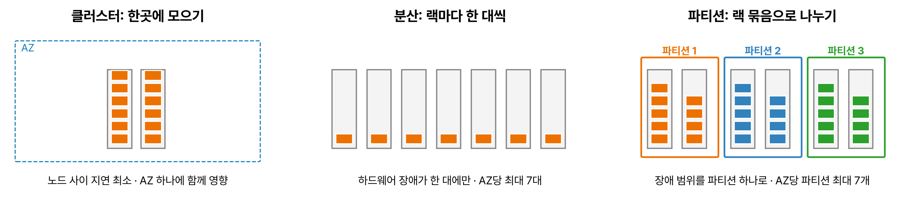

과제 3.2 '고성능의 탄력적인 컴퓨팅 솔루션 설계'는 인스턴스 유형과 배치 고르기, 수요에 따라 빠르게 늘고 줄게 하기, 서버리스·컨테이너·배치 중 실행 방식 고르기가 중심이다.

## 요약

- EC2 인스턴스는 범용(M, T), 컴퓨팅 최적화(C), 메모리 최적화(R, X), 가속 컴퓨팅(P, G, Inf, Trn), 스토리지 최적화(I, D) 패밀리로 나뉜다. 이름의 `g`는 AWS Graviton(Arm) 프로세서로, 같은 일을 더 싸게 한다.
- 배치 그룹은 노드 사이 지연이 가장 짧은 **클러스터**, 하드웨어 장애를 나눠 받는 **분산**, 랙 단위로 묶는 **파티션** 세 가지다.
- HPC처럼 노드끼리 긴밀하게 통신하는 작업은 클러스터 배치 그룹과 **EFA**를 쓴다.
- 부팅이 느려 확장이 늦으면 필요한 소프트웨어를 미리 설치한 **골든 AMI**를 만들거나 웜 풀을 쓴다.
- 짧고 이벤트 중심이면 Lambda, 컨테이너면 ECS·EKS(서버 관리가 싫으면 Fargate), 몇 시간짜리 일괄 작업이면 AWS Batch, 코드만 올리고 플랫폼 관리를 맡기려면 Elastic Beanstalk이다.

## 1. EC2 인스턴스 유형

| 패밀리 | 대표 | 특징 | 쓰임 |
|---|---|---|---|
| 범용 | M, T | CPU·메모리·네트워크 균형. T는 버스트 가능(평소에는 기준 성능, 필요할 때 CPU 크레딧으로 순간 성능) | 웹 서버, 개발 환경. 대부분 한가하다가 가끔 바쁜 작업은 T |
| 컴퓨팅 최적화 | C | vCPU 대비 높은 CPU 성능 | 배치 처리, 동영상 인코딩, 게임 서버, 과학 모델링 |
| 메모리 최적화 | R, X | 메모리가 크다 | 인메모리 DB, 대용량 캐시, 실시간 빅데이터 분석 |
| 가속 컴퓨팅 | P, G, Inf, Trn | GPU, AWS Inferentia(추론), AWS Trainium(학습) | 머신러닝 학습·추론, 그래픽 렌더링 |
| 스토리지 최적화 | I, D | 로컬 NVMe SSD(I)나 대용량 HDD(D) 인스턴스 스토어 | 높은 무작위 I/O의 NoSQL, 데이터 웨어하우스 |

이름 읽는 법은 다음과 같다. `m7g.2xlarge`라면 `m`은 패밀리, `7`은 세대, `g`는 Graviton 프로세서, `2xlarge`는 크기다. 추가 문자 `d`는 로컬 NVMe 인스턴스 스토어, `n`은 네트워크 강화, `a`는 AMD, `i`는 Intel 프로세서를 뜻한다.

T 인스턴스는 기준 성능보다 덜 쓸 때 CPU 크레딧이 쌓이고, 바쁠 때 그 크레딧을 써서 순간적으로 성능을 높인다. 크레딧이 떨어지면 기준 성능으로 내려간다(무제한 모드를 켜면 추가 요금을 내고 계속 높게 쓸 수 있다). CPU를 계속 높게 쓰는 작업에는 T가 맞지 않는다.

## 2. 배치 그룹(Placement Group)

_클러스터는 한 AZ의 가까운 하드웨어에 모으고, 분산은 인스턴스마다 다른 랙에 두고, 파티션은 랙 묶음(파티션) 단위로 나눈다_

| 종류 | 배치 방식 | 장점 | 제한과 단점 | 쓰임 |
|---|---|---|---|---|
| 클러스터(Cluster) | 한 AZ 안의 가까운 하드웨어에 모은다 | 노드 사이 지연이 가장 짧고 대역폭이 크다 | AZ 하나·랙 장애에 함께 영향을 받는다 | 긴밀하게 통신하는 HPC, 빅데이터 작업 |
| 분산(Spread) | 인스턴스마다 서로 다른 랙(하드웨어)에 둔다 | 하드웨어 장애가 한 대에만 영향 | AZ당 실행 중인 인스턴스 최대 7대 | 서로 떨어져 있어야 하는 소수의 중요한 인스턴스 |
| 파티션(Partition) | 인스턴스를 파티션(랙 묶음)으로 나눈다. 파티션끼리는 랙을 공유하지 않는다 | 수백 대 규모에서 장애 범위를 파티션 하나로 제한. 인스턴스가 자기 파티션 번호를 알 수 있다 | AZ당 파티션 최대 7개 | HDFS, HBase, Cassandra, Kafka 같은 랙 인식 분산 시스템 |

### 네트워크 성능

| 기능 | 설명 |
|---|---|
| 향상된 네트워킹(ENA) | SR-IOV로 높은 대역폭과 낮은 지연. 최신 인스턴스는 기본 지원 |
| EFA(Elastic Fabric Adapter) | OS를 거치지 않고(OS 바이패스) 노드끼리 통신해 MPI 같은 긴밀한 HPC·머신러닝 분산 학습의 지연을 줄인다 |
| 점보 프레임 | VPC 안에서 MTU 9001바이트까지 써서 큰 데이터 전송 효율을 높인다 |

> **쉬운 설명**
>
> 클러스터 배치 그룹은 팀원들을 한 회의실에 모아 앉히는 것이라 대화가 가장 빠르지만, 그 회의실이 정전되면 다 같이 멈춘다. 분산 배치는 중요한 사람 몇 명을 서로 다른 건물에 앉히는 것이고, 파티션은 큰 부서를 층별로 나눠 한 층의 문제가 다른 층으로 번지지 않게 하는 거다.

## 3. 빠르게 늘고 줄게 만들기

| 방법 | 설명 |
|---|---|
| Auto Scaling | 목표 추적 정책으로 CPU, 대상당 요청 수, 큐 백로그 같은 지표에 맞춰 늘린다('고가용성' 편 참고) |
| 시작 템플릿 | 인스턴스 유형, AMI, 보안 그룹, 사용자 데이터를 버전으로 관리. 여러 인스턴스 유형과 구매 옵션을 섞는 Auto Scaling 그룹에 쓴다 |
| 골든 AMI | OS 패치와 애플리케이션을 미리 설치한 AMI. 사용자 데이터로 매번 설치하는 것보다 부팅이 훨씬 빠르다. EC2 Image Builder로 자동화 |
| 웜 풀 | 미리 초기화해 둔 인스턴스로 확장 시간을 줄인다 |
| 최대 절전 모드(Hibernate) | 메모리 내용을 EBS 루트 볼륨에 저장했다가 다시 시작할 때 복원한다. 오래 걸리는 초기화를 건너뛴다 |

## 4. 서버리스와 컨테이너 컴퓨팅의 성능

| 서비스 | 성능 관련 설정 |
|---|---|
| Lambda | 메모리를 늘리면 CPU도 비례해서 늘어난다(10,240MB에서 vCPU 6개). 콜드 스타트는 프로비저닝된 동시성으로 없애고, Java·Python·.NET은 SnapStart로 초기화한 상태를 스냅샷으로 저장해 시작을 빠르게 한다 |
| Fargate | 작업마다 vCPU와 메모리를 지정한다. 서버 패치와 용량 계획이 필요 없다 |
| ECS·EKS on EC2 | GPU, 특정 인스턴스 유형, 높은 밀도가 필요할 때 직접 인스턴스를 고른다 |


flowchart TB
  Q{"작업의 성격은?"} -->|"이벤트로 시작, 15분 이내"| L["Lambda"]
  Q -->|"컨테이너로 만든 서비스"| C{"서버를 관리할까?"}
  C -->|"아니오"| F["ECS · EKS on Fargate"]
  C -->|"예, GPU나 특정 유형 필요"| E["ECS · EKS on EC2"]
  Q -->|"몇 시간짜리 일괄 작업"| B["AWS Batch"]
  Q -->|"코드만 올리고 플랫폼은 맡기기"| EB["Elastic Beanstalk"]
  Q -->|"OS까지 직접 제어"| EC2["EC2 + Auto Scaling"]


## 5. 일괄 처리와 HPC

| 서비스 | 설명 |
|---|---|
| AWS Batch | 작업 대기열에 일괄 작업을 넣으면 필요한 만큼 EC2(Spot 포함)나 Fargate를 띄워 실행하고 끝나면 정리한다. 실행 시간 제한이 없어 Lambda의 15분을 넘는 작업에 알맞다 |
| AWS ParallelCluster | HPC 클러스터(스케줄러, 공유 스토리지, EFA)를 자동으로 구성하는 오픈소스 도구 |
| Amazon EMR | 관리형 Spark, Hadoop 클러스터('데이터 수집과 변환' 편) |

## 6. AWS Elastic Beanstalk

웹 애플리케이션 코드를 올리면 EC2, Auto Scaling, ELB, 모니터링을 자동으로 구성해 주는 PaaS이다. 인프라를 직접 고칠 수도 있다.

| 배포 정책 | 특징 |
|---|---|
| 한 번에 모두(All at once) | 가장 빠르지만 배포 중 중단된다 |
| 롤링(Rolling) | 일부씩 바꾼다. 그동안 용량이 줄어든다 |
| 추가 배치와 롤링 | 새 인스턴스를 먼저 띄워 용량을 유지하며 바꾼다 |
| 변경 불가능(Immutable) | 새 Auto Scaling 그룹에 새 버전을 띄워 확인한 뒤 교체한다. 롤백이 빠르다 |
| 트래픽 분할 | 새 버전에 일부 트래픽만 보내 확인(카나리) |
| 블루/그린 | 별도 환경을 만들고 URL(CNAME)을 바꿔 전환 |

## 7. 성능 모니터링

- CloudWatch 기본 모니터링은 5분 간격, 세부 모니터링은 1분 간격이다. **메모리 사용률과 디스크 사용률은 기본 지표에 없어서** CloudWatch 에이전트를 설치해야 한다.
- **AWS Compute Optimizer**는 사용 기록을 분석해 EC2, Auto Scaling 그룹, EBS, Lambda의 알맞은 크기를 추천한다.

## 헷갈렸던 것들

- 노드 사이 지연이 가장 짧아야 하면 **클러스터** 배치 그룹(+ EFA)이다. 클러스터는 AZ 하나에만 둘 수 있다.
- 하드웨어 장애가 여러 인스턴스에 함께 번지면 안 되는 소수의 인스턴스는 **분산**, AZ당 최대 7대다.
- HDFS, Cassandra, Kafka처럼 큰 랙 인식 시스템은 **파티션**이다.
- CPU를 꾸준히 높게 쓰는 작업에 T 인스턴스를 고르면 크레딧이 떨어져 느려진다.
- 부팅 때 사용자 데이터로 소프트웨어를 설치해 확장이 느리면 **골든 AMI**이다.
- 메모리 사용률로 확장하거나 경보를 걸려면 CloudWatch 에이전트가 필요하다.
- Lambda 콜드 스타트는 프로비저닝된 동시성(또는 SnapStart)이다. 메모리를 늘리면 CPU도 늘어나 실행이 빨라질 수 있다.
- 15분이 넘는 일괄 작업은 Lambda가 아니라 AWS Batch나 Fargate 작업이다.

## 용어 정리

| 용어 | 뜻 |
|---|---|
| 버스트 가능 인스턴스 | CPU 크레딧으로 순간 성능을 내는 T 패밀리 |
| Graviton | AWS가 설계한 Arm 기반 프로세서 |
| 배치 그룹 | 인스턴스를 하드웨어에 어떻게 배치할지 정하는 설정 |
| EFA | HPC용 OS 바이패스 네트워크 인터페이스 |
| 골든 AMI | 필요한 소프트웨어를 미리 설치한 AMI |
| SnapStart | Lambda 초기화 상태를 스냅샷으로 저장해 시작을 빠르게 하는 기능 |
| AWS Batch | 관리형 일괄 작업 실행 서비스 |

## 복습 문제

**1.** A computational fluid dynamics simulation runs on dozens of instances. The nodes communicate very frequently through MPI, so latency must be as low as possible. Which configuration meets these requirements?

- A. A cluster placement group in one Availability Zone with Elastic Fabric Adapter (EFA)
- B. A spread placement group across multiple Availability Zones
- C. A partition placement group
- D. Each instance in a different Region

**2.** A company has five critical instances that must not be affected together by the same hardware failure. Which placement group should the company use?

- A. Cluster
- B. Partition
- C. Spread
- D. No placement group

**3.** A company runs an Apache Cassandra cluster with hundreds of nodes. The company must limit the impact of rack failures, and each node must know which group of racks it belongs to so that replicas can be placed evenly. Which placement group should the company use?

- A. Cluster
- B. Spread
- C. Dedicated Hosts
- D. Partition

**4.** Instances that Auto Scaling launches install packages through a user data script, so they take 10 minutes before they can serve traffic. As a result, the application cannot handle sudden traffic spikes. What is the MOST effective improvement?

- A. Change to a larger instance type.
- B. Update the launch template to use a golden AMI with the packages preinstalled.
- C. Increase the cooldown period.
- D. Reduce the maximum capacity.

**5.** A Java-based AWS Lambda function responds to user requests. When the function is invoked after a period of inactivity, the first response is delayed by several seconds. How can the company keep the latency consistently low?

- A. Configure provisioned concurrency.
- B. Increase the function timeout to 15 minutes.
- C. Set reserved concurrency to 0.
- D. Move the function out of the VPC.

**6.** A video transcoding job runs every night. Each job takes 2-3 hours, and a job that fails partway through can be run again. How can the company reduce server management effort and cost?

- A. Run the job with AWS Batch in a compute environment that uses Spot Instances.
- B. Run the job on AWS Lambda.
- C. Keep On-Demand Instances running 24 hours a day.
- D. Run the job in an AWS Elastic Beanstalk web server environment.

## 답과 풀이

1. **A** 클러스터 배치 그룹은 노드를 가까이 모으고, EFA는 MPI 통신 지연을 줄인다.
2. **C** 분산 배치 그룹은 인스턴스마다 다른 랙에 둔다. AZ당 7대 이하라 5대는 들어간다.
3. **D** 파티션 배치 그룹은 대규모 랙 인식 분산 시스템에 맞고, 인스턴스가 자기 파티션 번호를 알 수 있다.
4. **B** 골든 AMI는 설치 시간을 없애 확장 속도를 높인다.
5. **A** 프로비저닝된 동시성은 미리 초기화한 실행 환경을 준비해 콜드 스타트를 없앤다.
6. **A** 몇 시간짜리 작업은 Lambda의 15분 제한을 넘고, Batch는 다시 실행해도 되는 작업을 Spot으로 싸게 처리한다.

## 참고 자료

- Amazon EC2 인스턴스 유형: <https://aws.amazon.com/ec2/instance-types/>
- Amazon EC2 사용 설명서, 배치 그룹: <https://docs.aws.amazon.com/AWSEC2/latest/UserGuide/placement-groups.html>
- Amazon EC2 사용 설명서, Elastic Fabric Adapter: <https://docs.aws.amazon.com/AWSEC2/latest/UserGuide/efa.html>
- AWS Lambda 개발자 안내서, 프로비저닝된 동시성과 SnapStart: <https://docs.aws.amazon.com/lambda/latest/dg/provisioned-concurrency.html>
- AWS Batch 사용 설명서: <https://docs.aws.amazon.com/batch/latest/userguide/what-is-batch.html>
