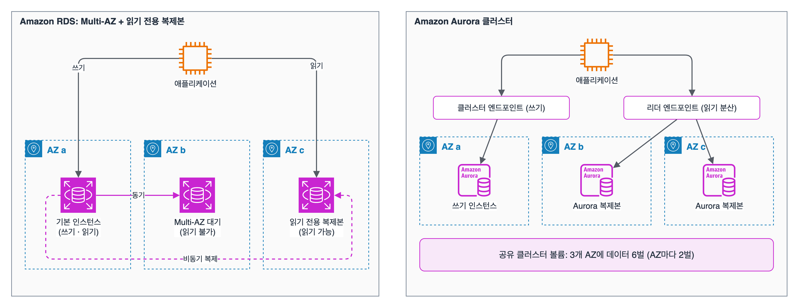

도메인 3 세 번째. 과제 3.3 '고성능 데이터베이스 솔루션 결정'. 관계형이냐 NoSQL이냐, 읽기가 많을 때와 연결이 많을 때 각각 무엇으로 버티는지, 캐시는 어디에 두는지를 정리했다.

## 요약

- 관계형 DB는 **RDS**(MySQL, PostgreSQL, MariaDB, Oracle, SQL Server, Db2)와 **Aurora**(MySQL·PostgreSQL 호환)이다. 읽기가 많으면 **읽기 전용 복제본**, 연결이 너무 많으면 **RDS Proxy**를 둔다.
- Aurora는 3개 AZ에 데이터를 6벌 저장하는 공유 스토리지 위에서 최대 15개의 복제본을 두고, 리더 엔드포인트로 읽기를 나눈다. 수요가 들쭉날쭉하면 Aurora Serverless v2이다.
- **DynamoDB**는 어떤 규모에서도 한 자릿수 밀리초로 응답하는 서버리스 키-값 DB이다. 다른 속성으로 조회하려면 GSI, 마이크로초 읽기가 필요하면 DAX, 여러 리전에서 쓰려면 글로벌 테이블을 쓴다.
- 반복해서 읽는 결과는 **ElastiCache**(Valkey, Redis OSS, Memcached)에 캐시해 DB 부하와 지연을 줄인다.
- 그래프는 Neptune, MongoDB 호환 문서는 DocumentDB, Cassandra는 Keyspaces, 시계열은 Timestream처럼 목적별 DB를 고른다.

## 1. Amazon RDS

**RDS(Relational Database Service)** 는 관계형 DB의 설치, 패치, 백업, 장애 조치를 AWS가 맡는 관리형 서비스다.

| 기능 | 설명 |
|---|---|
| 스토리지 | gp3, io2 등 EBS 기반. 스토리지 자동 조정을 켜면 공간이 부족할 때 자동으로 늘어난다 |
| 자동 백업 | 매일 스냅샷 + 트랜잭션 로그. 보존 기간 최대 35일 안의 원하는 시점으로 복원(새 인스턴스로 복원된다) |
| Multi-AZ | 다른 AZ의 동기 대기 복제본과 자동 장애 조치(가용성, '고가용성' 편 참고) |
| 읽기 전용 복제본 | 비동기 복제로 읽기 트래픽을 나눈다. MySQL·MariaDB·PostgreSQL은 최대 15개. 다른 리전에도 만들 수 있고, 독립 DB로 승격할 수 있다(DR 용도) |
| RDS Proxy | DB 앞의 완전 관리형 연결 풀. 수많은 짧은 연결(특히 Lambda)을 모아 재사용해 DB가 연결 수에 짓눌리지 않게 하고, 장애 조치 시간도 줄인다. IAM 인증과 Secrets Manager를 쓴다 |
| RDS Custom | Oracle, SQL Server에서 OS와 DB 설정을 직접 바꿔야 할 때 |

애플리케이션은 쓰기를 기본 인스턴스의 엔드포인트로, 읽기를 복제본 엔드포인트로 보내야 한다. 복제본은 비동기라 막 쓴 데이터가 잠깐 보이지 않을 수 있다(복제 지연).

_왼쪽: RDS는 Multi-AZ 대기 인스턴스(동기, 읽기 불가)와 읽기 전용 복제본(비동기, 읽기 가능)을 따로 둔다. 오른쪽: Aurora는 인스턴스들이 3개 AZ에 걸친 하나의 클러스터 볼륨을 함께 쓰고, 엔드포인트로 쓰기와 읽기를 나눈다_

## 2. Amazon Aurora

| 특징 | 설명 |
|---|---|
| 호환성 | MySQL, PostgreSQL과 호환. 기존 드라이버와 도구를 그대로 쓴다 |
| 스토리지 | 3개 AZ에 데이터 6벌을 저장하는 공유 클러스터 볼륨. 쓰는 만큼 자동으로 늘어난다 |
| 복제본 | 최대 15개의 Aurora 복제본. 스토리지를 공유하므로 복제 지연이 매우 짧고, 장애 시 복제본을 자동으로 승격한다 |
| 엔드포인트 | 클러스터 엔드포인트(쓰기), 리더 엔드포인트(복제본에 읽기 분산), 사용자 지정 엔드포인트(특정 복제본 묶음) |
| Aurora Serverless v2 | 사용량에 따라 용량(ACU)을 잘게 자동 조절. 간헐적이거나 예측하기 어려운 작업 |
| Aurora Global Database | 한 리전에서 쓰고, 다른 리전에 보통 1초 미만의 지연으로 복제해 읽기용으로 쓴다. 재해 때 보조 리전을 승격 |
| 빠른 복제(Cloning) | 쓰기 시 복사 방식으로 운영 DB의 사본을 몇 분 만에 만든다. 테스트용 |
| 역추적(Backtrack) | Aurora MySQL에서 백업 복원 없이 클러스터를 과거 시점으로 되감는다 |

## 3. Amazon DynamoDB

완전 관리형 서버리스 키-값·문서 DB이다. 서버를 관리하지 않고, 어떤 규모에서도 한 자릿수 밀리초로 응답한다. 데이터는 리전 안 여러 AZ에 자동으로 복제된다.

### 키와 인덱스

| 개념 | 설명 |
|---|---|
| 파티션 키 | 항목을 저장할 파티션을 정하는 키. 값이 고르게 퍼져야 특정 파티션에 몰리지(핫 파티션) 않는다 |
| 정렬 키 | 파티션 키와 함께 기본 키를 이룬다. 같은 파티션 키 안에서 범위 조회 |
| 항목 크기 | 최대 400KB. 더 큰 데이터는 S3에 두고 위치만 저장 |
| GSI(글로벌 보조 인덱스) | 파티션 키와 정렬 키를 다르게 둘 수 있다. 언제든 추가 가능. 최종적 일관성 읽기만 지원 |
| LSI(로컬 보조 인덱스) | 파티션 키는 같고 정렬 키만 다르다. 테이블을 만들 때만 정의할 수 있다. 강력한 일관성 읽기 가능 |

### 용량 모드

| 모드 | 특징 | 쓰는 때 |
|---|---|---|
| 온디맨드 | 요청한 만큼 요금. 용량 계획 불필요 | 트래픽을 예측하기 어렵거나 새 서비스 |
| 프로비저닝 | 초당 읽기·쓰기 용량(RCU·WCU)을 정하고 Auto Scaling으로 조절 | 트래픽이 예측 가능하고 꾸준할 때, 비용 최적화 |

- 1 **RCU**: 4KB 항목을 초당 강력한 일관성으로 1번(최종적 일관성이면 2번) 읽기
- 1 **WCU**: 1KB 항목을 초당 1번 쓰기

예를 들어 6KB 항목을 초당 10번 강력한 일관성으로 읽으려면, 6KB는 4KB 단위로 올림해 2단위이므로 2 × 10 = 20 RCU가 필요하다.

### 주요 기능

| 기능 | 설명 |
|---|---|
| DAX | DynamoDB 앞의 인메모리 캐시. 읽기 지연을 마이크로초로 줄인다. 코드 변경이 거의 없다(DAX 클라이언트로 교체) |
| DynamoDB Streams | 항목 변경 기록을 24시간 보관. Lambda로 받아 후속 처리(변경 데이터 캡처) |
| 글로벌 테이블 | 여러 리전에 복제되는 다중 활성(multi-active) 테이블. 각 리전에서 읽고 쓴다 |
| TTL | 만료 시간이 지난 항목을 추가 비용 없이 자동 삭제 |
| 특정 시점 복구(PITR) | 최근 35일 안의 원하는 초 단위 시점으로 복원 |
| 트랜잭션 | 여러 항목에 대한 전부 아니면 전무(ACID) 작업 |

## 4. 캐싱: Amazon ElastiCache

| 엔진 | 특징 | 쓰는 때 |
|---|---|---|
| Valkey, Redis OSS | 복제, Multi-AZ 자동 장애 조치, 스냅샷 백업, 정렬된 집합·해시 같은 자료 구조, 발행/구독 | 세션 저장, 실시간 순위표(정렬된 집합), 고가용성이 필요한 캐시 |
| Memcached | 단순한 키-값, 멀티스레드. 복제와 백업 없음 | 단순하게 수평 확장하는 캐시 |

ElastiCache Serverless를 쓰면 노드 크기를 정하지 않고 사용량에 따라 자동으로 늘어난다. 캐시가 아니라 **영구 저장하는 기본 DB**로 Redis 호환 데이터 저장소가 필요하면 **Amazon MemoryDB**를 쓴다.

### 캐싱 전략


sequenceDiagram
  participant App as 애플리케이션
  participant C as ElastiCache
  participant DB as RDS
  App->>C: 1. 캐시 조회
  alt 캐시 적중
    C-->>App: 값 반환 (빠름)
  else 캐시 누락
    C-->>App: 없음
    App->>DB: 2. DB 조회
    DB-->>App: 값
    App->>C: 3. 캐시에 저장 (TTL 설정)
  end


| 전략 | 방식 | 장점 | 단점 |
|---|---|---|---|
| 지연 로딩(Lazy loading, cache-aside) | 캐시에 없을 때만 DB에서 읽어 캐시에 넣는다 | 실제로 읽는 데이터만 캐시. 캐시 장애에도 동작 | 처음 읽을 때 느리고, 데이터가 오래될 수 있다 |
| 연속 쓰기(Write-through) | DB에 쓸 때 캐시에도 함께 쓴다 | 캐시가 항상 최신 | 읽지 않을 데이터도 캐시에 쌓이고 쓰기가 느려진다 |
| TTL | 일정 시간이 지나면 캐시 항목을 만료 | 오래된 데이터 문제를 줄인다 | |

> **쉬운 설명**
>
> DB는 도서관 서고, 캐시는 책상 위 메모장이다. 자주 찾는 내용은 메모장에 적어 두면 서고까지 가지 않아도 된다(지연 로딩). 다만 서고의 책이 바뀌었는데 메모장을 안 고치면 틀린 내용을 보게 되니, 일정 시간이 지나면 메모를 지우는 TTL을 둔다. 읽기 전용 복제본은 같은 책을 여러 열람실에 비치해 사람들을 나눠 받는 것이고, RDS Proxy는 도서관 입구에서 대기 줄을 정리해 주는 안내원이다.

## 5. 목적별 데이터베이스 선택

| 요구 사항 | 서비스 |
|---|---|
| 기존 관계형 앱, SQL과 조인 | RDS, Aurora |
| 예측 불가능한 관계형 작업량 | Aurora Serverless v2 |
| 어떤 규모에서도 밀리초 응답하는 키-값, 서버리스 | DynamoDB |
| 여러 리전에서 낮은 지연으로 읽고 쓰기 | DynamoDB 글로벌 테이블 |
| 마이크로초 읽기 | DAX(DynamoDB 앞), ElastiCache |
| 소셜 관계, 추천처럼 관계 탐색 | Amazon Neptune(그래프) |
| MongoDB 호환 문서 DB | Amazon DocumentDB |
| Apache Cassandra 호환 | Amazon Keyspaces |
| IoT 센서 같은 시계열 데이터 | Amazon Timestream |
| 전문 검색, 로그 분석 | Amazon OpenSearch Service |
| 대규모 분석(OLAP), 데이터 웨어하우스 | Amazon Redshift('데이터 수집과 변환' 편) |

## 헷갈렸던 것들

- 읽기 성능은 **읽기 전용 복제본**, 가용성은 **Multi-AZ**이다. Multi-AZ 인스턴스 배포의 대기 인스턴스로는 읽기를 나눌 수 없다.
- Lambda가 DB 연결을 너무 많이 열어 'too many connections' 오류가 나면 **RDS Proxy**이다.
- 읽기 전용 복제본은 비동기라 복제 지연이 있다. 쓰자마자 읽어야 하는 요청은 기본 인스턴스로 보내야 한다.
- Aurora 복제본은 최대 15개이고, 읽기를 나누려면 **리더 엔드포인트**를 쓴다.
- DynamoDB에서 테이블을 만든 뒤 다른 속성으로 조회해야 하면 **GSI**이다. LSI는 테이블을 만들 때만 정의할 수 있다.
- DynamoDB 읽기를 마이크로초로 줄이려면 **DAX**이다. ElastiCache로도 되지만 코드를 크게 바꿔야 한다.
- 실시간 순위표는 ElastiCache(Valkey·Redis)의 정렬된 집합이다. Memcached는 복제와 백업이 없다.
- DynamoDB 항목은 400KB까지다. 큰 데이터는 S3에 두고 키만 저장한다.

## 용어 정리

| 용어 | 뜻 |
|---|---|
| 읽기 전용 복제본 | 비동기 복제로 읽기를 나누는 DB 사본 |
| RDS Proxy | DB 연결을 모아 재사용하는 관리형 프록시 |
| 리더 엔드포인트 | Aurora 복제본에 읽기를 나누는 엔드포인트 |
| Aurora Serverless v2 | 용량이 자동으로 늘고 주는 Aurora |
| GSI / LSI | 다른 파티션 키로 조회하는 인덱스 / 같은 파티션 키에 다른 정렬 키 |
| RCU / WCU | DynamoDB 읽기 / 쓰기 용량 단위 |
| DAX | DynamoDB용 마이크로초 인메모리 캐시 |
| 지연 로딩 | 캐시에 없을 때만 DB에서 읽어 채우는 캐싱 전략 |

## 복습 문제

**1.** On an Amazon RDS for MySQL DB instance, report queries that run every afternoon slow down order processing (writes). How can the company solve this problem with the fewest application changes?

- A. Convert the instance to Multi-AZ and run the reports on the standby instance.
- B. Change the storage to io2.
- C. Create a read replica and send the report queries to the replica endpoint.
- D. Store the report results in Amazon S3.

**2.** During traffic spikes, thousands of AWS Lambda functions connect to an Amazon RDS for PostgreSQL database at the same time and exceed the connection limit. Which solution will resolve this issue?

- A. Keep increasing the DB instance class.
- B. Increase the Lambda timeout.
- C. Move the database to a public subnet.
- D. Place Amazon RDS Proxy between Lambda and the database.

**3.** A gaming service reads the same player data from Amazon DynamoDB very frequently. The company wants to reduce read latency to microseconds with minimal application changes. Which solution meets these requirements?

- A. DynamoDB Streams
- B. Global tables
- C. DynamoDB Accelerator (DAX)
- D. Double the provisioned capacity.

**4.** A leaderboard with scores that change in real time must be shown to millions of users. Which solution should the company use?

- A. Sorted sets in Amazon ElastiCache (Valkey or Redis OSS)
- B. Amazon ElastiCache for Memcached
- C. Amazon RDS read replicas
- D. An S3 static website

**5.** A production DynamoDB table uses `user_id` as its partition key. The company needs to add a feature that looks up users by `email`. Which solution meets this requirement?

- A. Add an LSI.
- B. Add a GSI with `email` as the partition key.
- C. Scan the entire table.
- D. Delete the table and create a new one.

**6.** A relational database is busy only during business hours and is almost idle at night. The company wants to match cost and performance without adjusting capacity manually. Which solution meets these requirements?

- A. Five RDS read replicas
- B. The largest RDS instance class
- C. Amazon Aurora Serverless v2
- D. MySQL installed on Amazon EC2

## 답과 풀이

1. **C** 읽기 전용 복제본으로 보고서 읽기를 떼어 낸다. Multi-AZ 대기 인스턴스는 읽을 수 없다.
2. **D** RDS Proxy가 연결을 모아 재사용해 DB의 연결 수를 줄인다.
3. **C** DAX는 DynamoDB 앞의 인메모리 캐시로 마이크로초 지연을 주고, DynamoDB API와 호환된다.
4. **A** 정렬된 집합은 점수 순 정렬과 순위 조회를 빠르게 처리한다.
5. **B** GSI는 테이블을 만든 뒤에도 추가할 수 있고, 다른 파티션 키로 조회한다. LSI는 생성 시에만 가능하고 파티션 키가 같아야 한다.
6. **C** Aurora Serverless v2는 사용량에 따라 용량을 자동으로 조절한다.

## 참고 자료

- Amazon RDS 사용 설명서, 읽기 전용 복제본: <https://docs.aws.amazon.com/AmazonRDS/latest/UserGuide/USER_ReadRepl.html>
- Amazon RDS 사용 설명서, RDS Proxy: <https://docs.aws.amazon.com/AmazonRDS/latest/UserGuide/rds-proxy.html>
- Amazon Aurora 사용 설명서: <https://docs.aws.amazon.com/AmazonRDS/latest/AuroraUserGuide/CHAP_AuroraOverview.html>
- Amazon DynamoDB 개발자 안내서, 읽기·쓰기 용량 모드: <https://docs.aws.amazon.com/amazondynamodb/latest/developerguide/capacity-mode.html>
- Amazon ElastiCache 사용 설명서, 캐싱 전략: <https://docs.aws.amazon.com/AmazonElastiCache/latest/dg/Strategies.html>
