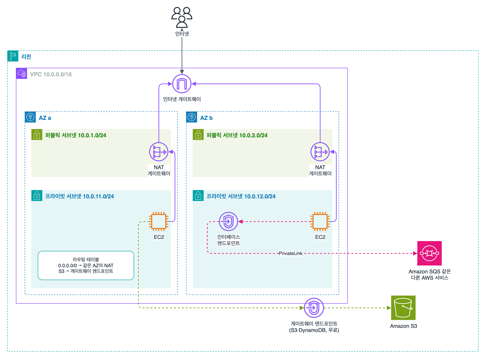
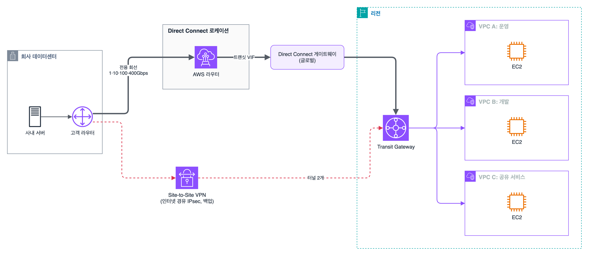

과제 3.4 '고성능 네트워크 아키텍처 결정'. 서브넷과 보안 그룹은 보안 편에서, 로드 밸런서는 고가용성 편에서 이미 정리했으니 여기서는 '어디와 어디를 무엇으로 잇는가'만 판다. 서비스 이름이 비슷비슷해서 처음엔 다 같은 말 같았는데, 연결 대상별로 나눠 보니 정리가 됐다.

## 요약

- 프라이빗 서브넷에서 인터넷으로 나가는 길은 NAT 게이트웨이. 고가용성이면 AZ마다 하나씩 두고 각 AZ의 라우팅 테이블이 자기 AZ의 NAT를 가리키게 한다.
- S3, DynamoDB는 게이트웨이 엔드포인트(무료), 나머지 AWS 서비스는 인터페이스 엔드포인트(PrivateLink, 유료)로 인터넷 없이 접근한다.
- VPC 몇 개끼리는 피어링, 많아지면 Transit Gateway. 피어링은 전이 라우팅이 안 된다.
- 온프레미스 연결은 빨리 싸게면 Site-to-Site VPN, 안정적인 대역폭과 지연이면 Direct Connect. 둘을 같이 쓰면 VPN이 백업이 된다.
- 전 세계 사용자에게 빠르게 보내는 건 CloudFront(HTTP 캐싱)와 Global Accelerator(TCP·UDP, 고정 IP). 캐싱이 필요한지, HTTP인지로 가른다.

## 1. VPC 안에서 밖으로 나가는 길

### IP 계획

| 항목 | 내용 |
|---|---|
| VPC CIDR | /16(65,536개) ~ /28(16개). 나중에 보조 CIDR을 추가할 수 있다 |
| 서브넷 | 한 AZ에만 속한다. 서브넷마다 IP 5개는 AWS가 예약한다(/24면 251개 사용 가능) |
| 겹침 주의 | 피어링, Transit Gateway, VPN으로 이을 네트워크끼리 CIDR이 겹치면 라우팅이 안 된다. 처음부터 겹치지 않게 나눠 둔다 |

### 인터넷 게이트웨이와 NAT 게이트웨이

| 구성 요소 | 하는 일 | 특징 |
|---|---|---|
| 인터넷 게이트웨이(IGW) | VPC와 인터넷 사이의 문. 양방향 | VPC당 1개. AWS가 알아서 수평 확장하고 이중화한다. 대역폭 제한을 신경 쓸 필요가 없다 |
| NAT 게이트웨이 | 프라이빗 서브넷의 인스턴스가 밖으로 나가게만 해 준다. 밖에서 먼저 들어오는 연결은 못 받는다 | 퍼블릭 서브넷에 만들고 탄력적 IP를 붙인다. AZ 단위 리소스. 5Gbps에서 시작해 100Gbps까지 자동으로 늘어나고 초당 최대 1,000만 패킷을 처리한다. 시간당 요금 + 처리한 GB당 요금 |
| NAT 인스턴스 | EC2로 직접 만드는 NAT. 소스/대상 확인을 꺼야 한다 | 예전 방식. 관리와 확장을 직접 해야 해서 시험에서는 대부분 오답 |
| 송신 전용 IGW | IPv6 트래픽을 밖으로만 내보낸다 | IPv6에는 NAT가 없으니 이걸 쓴다 |

NAT 게이트웨이 하나는 같은 목적지(IP·포트·프로토콜)로 IP 하나당 동시 연결 55,000개까지 만든다. 모자라면 IP를 최대 8개까지 붙여 440,000개까지 늘릴 수 있다.

NAT 게이트웨이가 AZ 단위라는 게 포인트다. AZ a에만 NAT를 두고 두 AZ가 같이 쓰면, AZ a가 멈출 때 AZ b의 인스턴스도 밖으로 못 나간다. AZ를 건너는 트래픽 요금도 붙는다. 그래서 정답은 항상 AZ마다 NAT 하나, 그리고 각 AZ의 프라이빗 라우팅 테이블이 자기 AZ의 NAT를 가리키게 하는 구성이다.

_보라색: 프라이빗 서브넷의 EC2가 같은 AZ의 NAT 게이트웨이를 거쳐 인터넷으로 나간다. 초록색: S3로 가는 트래픽은 게이트웨이 엔드포인트로 빠진다. 분홍색: 다른 AWS 서비스는 서브넷 안의 인터페이스 엔드포인트(ENI)를 거쳐 PrivateLink로 간다_

## 2. VPC 엔드포인트

인터넷이나 NAT를 거치지 않고 AWS 서비스에 사설 경로로 붙는 방법이다. 보안 편에서는 '인터넷에 안 나간다'는 쪽으로 봤는데, 성능과 비용 쪽에서 보면 NAT 처리 요금과 병목을 없애는 수단이기도 하다.

| 종류 | 대상 | 동작 | 요금 | 기억할 것 |
|---|---|---|---|---|
| 게이트웨이 엔드포인트 | S3, DynamoDB만 | 라우팅 테이블에 접두사 목록 경로가 추가된다 | 무료 | 같은 리전에서만 쓴다. 온프레미스나 피어링된 VPC에서는 이 경로를 못 쓴다 |
| 인터페이스 엔드포인트 | 대부분의 AWS 서비스(S3 포함), 다른 계정의 서비스 | 서브넷에 사설 IP를 가진 ENI가 생긴다(PrivateLink) | AZ별 시간당 + GB당 | 보안 그룹을 붙인다. Direct Connect·VPN을 통해 온프레미스에서도 접근할 수 있다 |
| 게이트웨이 로드 밸런서 엔드포인트 | GWLB 뒤의 보안 어플라이언스 | 트래픽을 방화벽 장비로 돌린다 | 유료 | 서드 파티 방화벽 검사용 |

S3는 두 가지를 다 지원한다. VPC 안에서만 쓰면 무료인 게이트웨이 엔드포인트, 온프레미스에서 사설로 S3에 붙어야 하면 인터페이스 엔드포인트다.

> **쉬운 설명**
>
> NAT 게이트웨이는 아파트 단지의 공용 출구다. 집(프라이빗 서브넷)에서 나갈 수는 있지만 밖에서 이 출구로 들어올 수는 없다. 출구가 한 동 앞에만 있으면 그 동 앞이 막히는 순간 다들 못 나가니 동(AZ)마다 출구를 하나씩 둔다. VPC 엔드포인트는 단지 안에 있는 은행 ATM 같은 것이다. 굳이 단지 밖 은행까지 안 나가도 되고, S3·DynamoDB 전용 ATM(게이트웨이 엔드포인트)은 수수료도 없다.

## 3. VPC끼리 잇기

### VPC 피어링과 Transit Gateway

| 항목 | VPC 피어링 | Transit Gateway |
|---|---|---|
| 구조 | 두 VPC를 1:1로 직접 연결 | 리전의 중앙 허브에 VPC, VPN, Direct Connect를 붙인다 |
| 전이 라우팅 | 안 된다. A-B, B-C가 연결돼도 A에서 C로 못 간다 | 된다. 허브에 붙은 것끼리 서로 통한다 |
| 규모 | VPC가 n개면 연결이 n(n-1)/2개 필요 | 수천 개 VPC를 허브 하나에 |
| 범위 | 다른 계정, 다른 리전도 가능 | 리전 단위. 다른 리전 TGW와 피어링, RAM으로 계정 간 공유 |
| 분리 | 연결 단위로만 | TGW 라우팅 테이블로 운영·개발 같은 세그먼트를 나눈다 |
| 비용 | 연결 자체는 무료, 데이터 전송 요금만 | 연결(attachment)당 시간 요금 + 처리 GB 요금 |

피어링은 CIDR이 겹치면 안 되고, 상대 VPC의 IGW나 NAT, VPN을 빌려 쓰는 것(엣지 투 엣지 라우팅)도 안 된다. VPC가 두세 개면 피어링이 싸고 간단하지만, 개수가 늘거나 온프레미스까지 한데 묶어야 하면 Transit Gateway가 답이다.


flowchart LR
  subgraph P["VPC 피어링"]
    A1["VPC A"] <-->|"피어링"| B1["VPC B"]
    B1 <-->|"피어링"| C1["VPC C"]
    A1 -.-x|"B를 거쳐 갈 수 없다"| C1
  end
  subgraph T["Transit Gateway"]
    TG(("TGW")) <--> A2["VPC A"]
    TG <--> B2["VPC B"]
    TG <--> C2["VPC C"]
    TG <--> ON["온프레미스 VPN·DX"]
  end


### PrivateLink로 서비스만 공개하기

네트워크 전체를 잇는 게 아니라 서비스 하나만 다른 VPC에 열어 줄 때는 PrivateLink다. 제공하는 쪽이 NLB 앞에 엔드포인트 서비스를 만들고, 쓰는 쪽은 자기 VPC에 인터페이스 엔드포인트를 만든다.

- 소비자 쪽에서 제공자 쪽으로 한 방향으로만 연결된다. 제공자 VPC의 다른 리소스는 안 보인다.
- 양쪽 CIDR이 겹쳐도 된다. 고객 VPC 수백 개에 서비스를 파는 SaaS 구조에 맞다.

VPC 공유(RAM으로 서브넷을 다른 계정에 공유)는 같은 조직 안에서 VPC를 아예 하나로 같이 쓰는 방법이라 연결이 필요 없다.

> **쉬운 설명**
>
> 피어링은 이웃집끼리 담에 문을 하나씩 뚫는 것이다. 두 집 사이는 편한데, 우리 집에서 옆집을 거쳐 그 옆집으로 넘어가는 건 안 된다. 집이 열 채면 문을 45개 뚫어야 한다. Transit Gateway는 마을 한가운데 로터리를 만들고 모든 집이 로터리로만 길을 내는 것이다. PrivateLink는 담을 트지 않고 창구 하나만 내서, 정해진 서비스만 주고받는 방식이다.

## 4. 온프레미스와 잇기

| 항목 | Site-to-Site VPN | Direct Connect |
|---|---|---|
| 경로 | 인터넷 위의 IPsec 터널 | 데이터센터와 AWS를 잇는 전용 회선 |
| 구축 시간 | 몇 분~몇 시간 | 보통 몇 주(회선 공사) |
| 대역폭 | 터널당 최대 1.25Gbps | 전용 연결 1·10·100·400Gbps, 파트너 호스팅 연결 50Mbps~25Gbps |
| 지연 | 인터넷 상황에 따라 흔들린다 | 일정하다 |
| 암호화 | 기본으로 암호화 | 기본은 암호화 안 됨. MACsec(전용 10·100·400Gbps 연결, 지원 로케이션) 또는 DX 위에 VPN |
| 비용 | 싸다 | 포트 시간 요금. 대신 AWS에서 나가는 데이터 전송 요금이 인터넷보다 싸다 |

VPN 연결 하나에는 터널이 2개 있고, AWS 쪽 끝점이 서로 다른 AZ에 있다. 대역폭이 더 필요하면 Transit Gateway에 VPN을 여러 개 붙이고 ECMP로 묶어서 합칠 수 있다. 직원 개개인의 노트북을 붙이는 건 Site-to-Site가 아니라 Client VPN이다.

Direct Connect는 가상 인터페이스(VIF)를 골라서 쓴다.

| VIF | 연결 대상 |
|---|---|
| 프라이빗 VIF | 가상 프라이빗 게이트웨이나 Direct Connect 게이트웨이를 거쳐 VPC |
| 퍼블릭 VIF | S3 같은 AWS 퍼블릭 엔드포인트 |
| 트랜싯 VIF | Direct Connect 게이트웨이를 거쳐 Transit Gateway |

Direct Connect 게이트웨이는 글로벌 리소스라서, 회선 하나로 여러 리전의 VPC에 붙을 수 있다.

_Direct Connect 전용 회선이 Direct Connect 게이트웨이와 트랜싯 VIF를 거쳐 Transit Gateway에 붙고, Transit Gateway가 여러 VPC를 잇는다. 인터넷 위의 Site-to-Site VPN은 회선이 끊길 때를 대비한 백업이다_

복원력은 요구 수준에 따라 고른다. 비용을 아끼려면 Direct Connect 1회선 + VPN 백업, 중요한 업무면 서로 다른 Direct Connect 로케이션에 회선을 하나씩 두는 구성이다. 문제에 '가장 높은 복원력'이 나오면 로케이션 2곳에 각각 회선 2개씩이다.

## 5. 사용자와 가까운 곳에서 받기

| 항목 | CloudFront | Global Accelerator |
|---|---|---|
| 하는 일 | 엣지 로케이션에 콘텐츠를 캐시해서 가까운 곳에서 응답 | 가까운 엣지로 들어온 트래픽을 AWS 백본망으로 리전까지 실어 나른다 |
| 프로토콜 | HTTP, HTTPS, WebSocket | TCP, UDP |
| 캐싱 | 한다 | 안 한다 |
| 진입 주소 | 배포 도메인 이름(IP는 바뀐다) | 고정 애니캐스트 IP 2개 |
| 장애 조치 | 오리진 그룹으로 오리진 장애 조치 | 상태 확인으로 다른 리전 엔드포인트에 바로 넘긴다. DNS 캐시가 만료되길 기다리지 않는다 |
| 어울리는 곳 | 정적 웹, 동영상, API 가속 | 게임, IoT, VoIP, 고정 IP를 방화벽에 등록해야 하는 경우 |

CloudFront에서 같이 나오는 것들:

- 오리진: S3, ALB, EC2, 사용자 정의 HTTP 서버. S3는 OAC로 버킷을 비공개로 두고 CloudFront만 읽게 한다.
- 캐시 정책과 TTL로 얼마나 오래 캐시할지 정한다. 바뀐 파일을 바로 반영하려면 무효화를 하거나 파일 이름에 버전을 붙인다.
- Origin Shield는 엣지와 오리진 사이에 캐시 층을 하나 더 둬서 오리진 부하를 줄인다.
- 엣지에서 코드를 돌릴 때 헤더 조작처럼 가볍고 빠른 일은 CloudFront Functions, 오리진 요청 단계까지 다루거나 무거운 일은 Lambda@Edge.
- 지역 제한(특정 국가 차단), 서명된 URL·쿠키(유료 콘텐츠)도 CloudFront 기능이다.

Route 53 지연 시간 기반 라우팅도 사용자를 가까운 리전으로 보내지만 DNS 단계에서만 고른다. 연결 경로 자체를 빠르게 하는 건 Global Accelerator다.

> **쉬운 설명**
>
> CloudFront는 동네마다 있는 편의점 창고다. 자주 팔리는 물건(캐시)을 미리 갖다 놔서 본사 물류센터(오리진)까지 안 가도 된다. Global Accelerator는 물건을 쌓아 두지 않는 대신, 가까운 고속도로 입구까지만 오면 본사까지 전용 고속도로로 태워 주는 셔틀이다. 대표 번호(고정 IP)도 바뀌지 않는다.

## 6. 하이브리드 DNS

온프레미스와 VPC가 서로의 도메인 이름을 찾아야 할 때는 Route 53 Resolver 엔드포인트를 쓴다.

| 방향 | 쓰는 것 |
|---|---|
| 온프레미스 → AWS 프라이빗 호스팅 영역 | 인바운드 엔드포인트. 온프레미스 DNS가 이 IP로 질의를 넘긴다 |
| VPC → 온프레미스 도메인(corp.example.com 등) | 아웃바운드 엔드포인트 + 전달 규칙 |

## 헷갈렸던 것들

- NAT 게이트웨이는 퍼블릭 서브넷에 둔다. 프라이빗 서브넷에 두는 보기는 오답이다.
- NAT 게이트웨이 하나를 여러 AZ가 같이 쓰면 그 AZ가 단일 장애점이 된다. AZ마다 하나씩.
- NAT 게이트웨이에는 보안 그룹을 붙일 수 없다. 막으려면 인스턴스 보안 그룹이나 NACL.
- 프라이빗 서브넷에서 S3로 대용량 데이터를 보내며 NAT 요금이 많이 나오면 S3 게이트웨이 엔드포인트. 무료다.
- 온프레미스에서 S3에 사설로 접근하려면 게이트웨이 엔드포인트가 아니라 인터페이스 엔드포인트.
- 피어링은 전이 라우팅이 안 되고 CIDR이 겹치면 안 된다. VPC가 많으면 Transit Gateway.
- CIDR이 겹치는 고객 VPC들에 서비스를 제공하는 문제는 PrivateLink.
- 빨리 연결해야 하면 VPN, 일정한 성능과 대량 전송이면 Direct Connect. Direct Connect는 구축에 몇 주 걸린다.
- Direct Connect는 기본적으로 암호화되지 않는다. 암호화가 필요하면 MACsec이나 DX 위의 VPN.
- UDP, 고정 IP, 빠른 리전 장애 조치가 같이 나오면 Global Accelerator. 캐싱이 나오면 CloudFront.

## 용어 정리

| 용어 | 뜻 |
|---|---|
| NAT 게이트웨이 | 프라이빗 서브넷이 밖으로만 나가게 해 주는 AZ 단위 관리형 NAT |
| 게이트웨이 엔드포인트 | S3·DynamoDB로 가는 무료 사설 경로. 라우팅 테이블에 경로가 생긴다 |
| 인터페이스 엔드포인트 | 서브넷에 ENI를 만들어 AWS 서비스에 사설로 붙는 PrivateLink 엔드포인트 |
| 전이 라우팅 | A-B, B-C 연결을 통해 A에서 C로 가는 것. 피어링은 불가 |
| Transit Gateway | VPC, VPN, Direct Connect를 한데 묶는 리전 허브 라우터 |
| VIF | Direct Connect 회선 위의 논리 연결(프라이빗, 퍼블릭, 트랜싯) |
| Direct Connect 게이트웨이 | 회선 하나로 여러 리전의 VPC에 붙게 해 주는 글로벌 리소스 |
| 애니캐스트 IP | 여러 위치에서 같은 IP를 광고해 가장 가까운 곳으로 들어오게 하는 방식 |

## 복습 문제

**1.** EC2 instances in private subnets in two Availability Zones must download patches from the internet. The downloads must continue even if one Availability Zone fails. Which solution meets these requirements?

- A. Deploy a NAT gateway in a public subnet in each AZ, and point each AZ's private route table to the NAT gateway in the same AZ.
- B. Deploy one NAT gateway in a public subnet in AZ a and share it between both AZs.
- C. Add a route to the internet gateway in the private route tables.
- D. Deploy one NAT instance in each AZ.

**2.** Analytics servers in private subnets upload several TB of data every day to Amazon S3 in the same Region. The NAT gateway data processing charges are high. What is the MOST cost-effective solution?

- A. Create an S3 interface endpoint.
- B. Create an S3 gateway endpoint and associate it with the route tables.
- C. Create another NAT gateway.
- D. Move the servers to public subnets.

**3.** Thirty VPCs in multiple accounts and an on-premises data center must all be able to communicate with each other. Which solution has the LEAST management overhead?

- A. Peer every VPC with every other VPC.
- B. Attach all VPCs and the VPN to a transit gateway, and share the transit gateway across accounts with AWS RAM.
- C. Create a separate Site-to-Site VPN for each VPC.
- D. Create a PrivateLink endpoint service in every VPC.

**4.** A financial company needs a 10 Gbps connection to AWS with consistent latency, and the traffic must be encrypted on the circuit. The connection must stay available if the circuit fails, without a large cost increase. Which solution meets these requirements?

- A. Use a 10 Gbps AWS Direct Connect dedicated connection with MACsec, and keep a Site-to-Site VPN as a backup.
- B. Use only Site-to-Site VPN.
- C. Use two 1 Gbps hosted connections.
- D. Put Amazon CloudFront in front of the workload.

**5.** A UDP-based game server runs in two Regions and serves users around the world. Customers need static IP addresses to register in their firewalls, and traffic must fail over quickly if a Region fails. Which service should the company use?

- A. Amazon CloudFront
- B. AWS Global Accelerator
- C. Route 53 latency-based routing
- D. An Application Load Balancer in each Region

**6.** A SaaS company wants to provide an API to hundreds of customer VPCs. The CIDR ranges of the customer VPCs overlap, and customers must be able to reach only this API. Which solution meets these requirements?

- A. Peer the company's VPC with each customer VPC.
- B. Attach all customer VPCs to a transit gateway.
- C. Expose the API to the internet and allow only the customers' IP addresses.
- D. Create a PrivateLink endpoint service backed by a Network Load Balancer, and have customers connect through interface endpoints.

## 답과 풀이

1. **A** NAT 게이트웨이는 AZ 단위라서 AZ마다 하나씩 둬야 한 AZ 장애가 다른 AZ로 번지지 않는다. D NAT 인스턴스는 관리 부담이 크다.
2. **B** 게이트웨이 엔드포인트는 무료이고 NAT를 거치지 않는다. A도 되지만 시간당·GB당 요금이 붙는다.
3. **B** 30개를 피어링하면 연결이 435개고 온프레미스까지 전이 라우팅이 안 된다.
4. **A** Direct Connect가 일정한 지연과 대역폭을 주고, MACsec이 회선 구간을 암호화한다. VPN 백업은 싼 이중화다.
5. **B** Global Accelerator는 고정 애니캐스트 IP 2개를 주고 TCP·UDP를 지원하며, 상태 확인으로 바로 다른 리전으로 넘긴다.
6. **D** PrivateLink는 CIDR이 겹쳐도 되고, 고객은 그 서비스에만 접근한다.

## 참고 자료

- Amazon VPC 사용 설명서, NAT 게이트웨이 기본 사항: <https://docs.aws.amazon.com/vpc/latest/userguide/nat-gateway-basics.html>
- AWS PrivateLink 안내서, 게이트웨이 엔드포인트: <https://docs.aws.amazon.com/vpc/latest/privatelink/gateway-endpoints.html>
- Amazon VPC Transit Gateways: <https://docs.aws.amazon.com/vpc/latest/tgw/what-is-transit-gateway.html>
- Site-to-Site VPN 사용 설명서, 할당량: <https://docs.aws.amazon.com/vpn/latest/s2svpn/vpn-limits.html>
- AWS Direct Connect 사용 설명서, 연결 옵션: <https://docs.aws.amazon.com/directconnect/latest/UserGuide/connection_options.html>
- AWS Global Accelerator 개발자 안내서: <https://docs.aws.amazon.com/global-accelerator/latest/dg/what-is-global-accelerator.html>
- Route 53 개발자 안내서, Resolver: <https://docs.aws.amazon.com/Route53/latest/DeveloperGuide/resolver.html>

