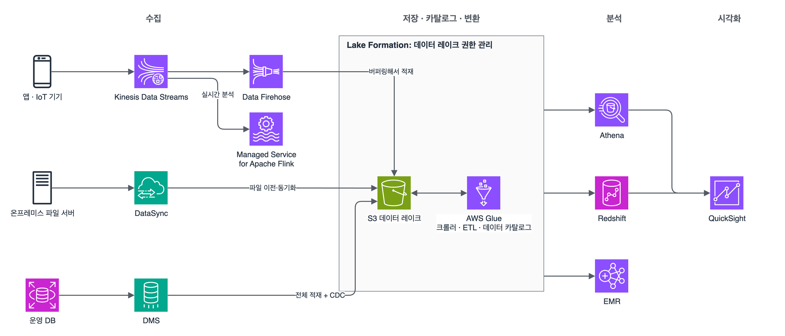
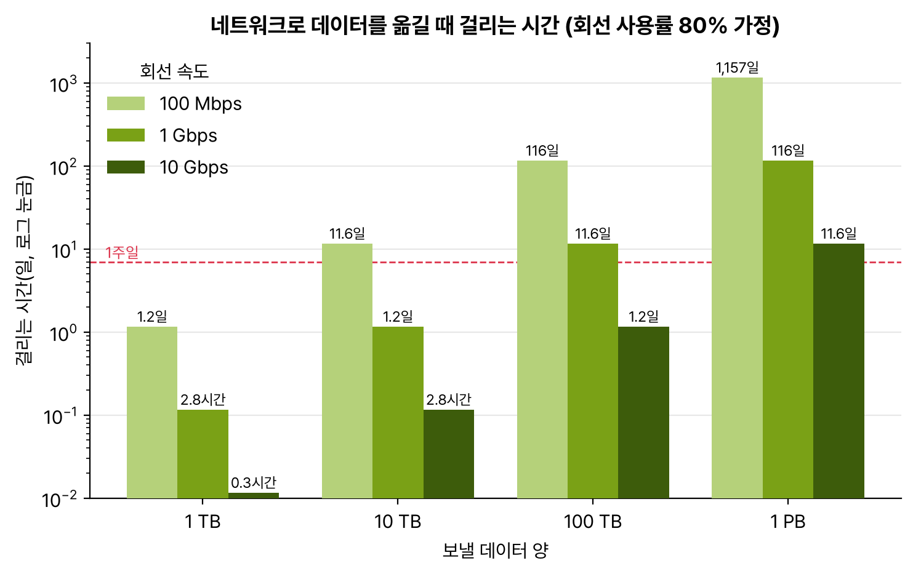

도메인 3 마지막. 과제 3.5 '고성능 데이터 수집 및 변환 솔루션 결정'. 분석 서비스는 이름만 봐서는 뭐가 뭔지 구분이 안 돼서, 데이터가 흘러가는 순서(수집 → 저장 → 변환 → 분석 → 시각화)대로 자리를 잡아 놓고 외웠다. 문제도 대부분 '이 단계에 뭘 끼울까'를 묻는다.

## 요약

- 실시간 스트림은 Kinesis Data Streams(직접 처리, 재처리 가능), 최소한의 운영으로 S3·Redshift에 쌓기만 하면 Data Firehose.
- 데이터 레이크는 S3. Glue 크롤러가 스키마를 찾아 데이터 카탈로그에 등록하고, Glue ETL이 변환하고, Lake Formation이 권한을 관리한다.
- S3에 바로 SQL은 Athena(서버리스, 스캔한 만큼 과금), 반복되는 대규모 분석은 Redshift, Spark·Hadoop을 직접 다루려면 EMR.
- 온프레미스 파일은 DataSync, SFTP로 받는 파일은 Transfer Family, DB는 DMS, 네트워크로 몇 주 걸리는 양은 Snowball Edge.
- 시각화는 QuickSight.

_스트림은 Kinesis로, 파일은 DataSync로, DB는 DMS로 들어와 S3 데이터 레이크에 모인다. Glue가 카탈로그와 변환을 맡고, Athena·Redshift·EMR이 분석하고, QuickSight가 보여 준다_

## 1. 스트리밍 수집

### Kinesis Data Streams와 Data Firehose

| 항목 | Kinesis Data Streams | Amazon Data Firehose |
|---|---|---|
| 지연 | 실시간. 들어오는 즉시 읽을 수 있다 | 거의 실시간. 버퍼 크기나 시간만큼 모았다가 보낸다 |
| 보관과 재처리 | 보존 기간(기본 24시간, 최대 365일) 동안 몇 번이고 다시 읽는다 | 저장하지 않는다. 재처리 불가 |
| 소비자 | 직접 붙인다. Lambda, KCL 애플리케이션, Managed Service for Apache Flink, Firehose. 여러 소비자가 같은 데이터를 각자 읽는다 | 정해진 대상으로 전달. S3, Redshift, OpenSearch, Splunk, Apache Iceberg 테이블, HTTP 엔드포인트 등 |
| 용량 | 온디맨드 모드(자동) 또는 프로비저닝 모드(샤드 수 지정) | 완전 자동 |
| 변환 | 소비자 코드에서 처리 | Lambda로 레코드 변환, JSON을 Parquet·ORC로 바꾸는 형식 변환 내장 |
| 운영 부담 | 소비자 코드를 직접 관리 | 거의 없다 |

샤드 하나는 쓰기 초당 1MB(또는 1,000레코드), 읽기 초당 2MB다. 읽기 2MB는 소비자들이 나눠 쓰는데, 향상된 팬아웃(enhanced fan-out)을 켜면 소비자마다 샤드당 2MB를 따로 받는다. 같은 파티션 키의 레코드는 같은 샤드로 가서 순서가 지켜진다. 쓰기가 막히면(ProvisionedThroughputExceeded) 샤드를 늘리거나 파티션 키가 한쪽에 몰리지 않게 고른다.

레코드 하나의 데이터는 최대 1MB다. 더 큰 데이터는 S3에 두고 스트림에는 위치만 넣는다.

Firehose에서 Redshift로 보낼 때는 내부적으로 S3에 먼저 쓰고 Redshift COPY 명령으로 넣는다.

### 그 밖의 스트리밍 서비스

| 서비스 | 쓰는 때 |
|---|---|
| Managed Service for Apache Flink | 스트림을 실시간으로 집계·필터링·이상 탐지(예: 1분 단위 이동 평균). 예전 이름은 Kinesis Data Analytics |
| Amazon MSK | 이미 Apache Kafka를 쓰고 있어서 Kafka API 그대로 옮기고 싶을 때. 서버리스 옵션도 있다 |
| Amazon AppFlow | Salesforce, SAP, Slack 같은 SaaS 데이터를 S3나 Redshift로 코드 없이 가져올 때 |

> **쉬운 설명**
>
> Kinesis Data Streams는 공장 컨베이어 벨트에 CCTV 녹화가 붙어 있는 것이다. 지나가는 물건을 여러 작업자(소비자)가 각자 보고, 놓쳤으면 녹화(보존 기간)를 돌려 다시 볼 수 있다. Firehose는 택배 기사다. 물건을 어느 정도 모았다가 정해진 창고(S3, Redshift)에 갖다 놓을 뿐 따로 보관해 두지 않는다. 대신 기사를 관리할 필요가 없다.

## 2. 파일과 DB 옮기기

| 상황 | 서비스 |
|---|---|
| 온프레미스 NFS·SMB·HDFS의 파일을 S3, EFS, FSx로 옮기거나 정기적으로 동기화 | AWS DataSync. 온프레미스에 에이전트를 두고, 예약 실행, 전송 중 암호화, 무결성 검증, 대역폭 제한을 해 준다 |
| 거래처가 SFTP·FTPS·FTP·AS2로 파일을 보내는데 받는 쪽을 S3로 바꾸고 싶다 | AWS Transfer Family. 거래처는 쓰던 방식 그대로 |
| 온프레미스 앱이 파일을 계속 쓰면서 뒤에서 S3에 저장 | Storage Gateway(파일 게이트웨이) |
| 먼 지역에서 S3로 큰 파일 업로드가 느리다 | S3 Transfer Acceleration(가까운 엣지로 받아 AWS 백본으로 전달) + 멀티파트 업로드 |
| DB를 중단 최소로 옮긴다 | AWS DMS. 전체 적재 후 변경 데이터 캡처(CDC)로 원본이 돌아가는 동안 계속 따라간다 |
| 엔진이 다른 DB로(Oracle → Aurora PostgreSQL 등) | DMS + 스키마 변환(DMS Schema Conversion 또는 SCT) |
| 네트워크로는 몇 주 넘게 걸리는 수백 TB~PB | Snowball Edge(오프라인 이전 장비) |

얼마나 걸리는지는 '데이터 양 × 8 ÷ 회선 속도'로 바로 계산할 수 있다. 1Gbps 회선을 80% 쓴다고 쳐도 100TB면 11일이 넘게 걸린다. 문제에 '회선이 이미 바쁘다', '일주일 안에'가 같이 나오면 네트워크 말고 오프라인 이전을 고르라는 신호다.

_회선 사용률 80%를 가정한 계산. 데이터가 10배 늘면 회선도 10배 빨라야 같은 시간이 걸린다. 빨간 점선이 1주일_

Snow 패밀리에서 시험에 나오는 건 Snowball Edge다. 스토리지 최적화형은 대용량 오프라인 이전용이고, 컴퓨팅 최적화형은 인터넷이 약한 현장에서 EC2 인스턴스를 돌리는 엣지 처리용이다. 더 작은 Snowcone은 2024년 11월에 주문이 끝났다.

## 3. 저장과 카탈로그: S3 데이터 레이크

원본 데이터를 형식 그대로 S3에 쌓아 두고, 필요할 때 여러 분석 도구가 같은 데이터를 읽는 구조가 데이터 레이크다. 보통 원본(raw), 정제(cleaned), 분석용(curated)처럼 단계별 접두사로 나눈다.

| 구성 요소 | 하는 일 |
|---|---|
| Glue 크롤러 | S3의 파일을 훑어 스키마와 파티션을 찾아 카탈로그에 등록 |
| Glue 데이터 카탈로그 | 테이블 정의(메타데이터) 저장소. Athena, Redshift Spectrum, EMR이 같은 카탈로그를 본다 |
| Lake Formation | 데이터 레이크 권한을 한곳에서 관리. 데이터베이스·테이블뿐 아니라 열, 행, 셀 단위로 허용한다 |

Athena나 Redshift Spectrum은 읽은 데이터 양만큼 비용과 시간이 든다. 그래서 같은 데이터라도 저장 방식을 바꾸면 성능이 확 달라진다.

- CSV·JSON 대신 열 기반 형식인 Parquet이나 ORC로 바꾼다. 필요한 열만 읽는다.
- 날짜처럼 자주 거르는 값으로 파티션을 나눈다(s3://logs/year=2024/month=12/). 필요한 폴더만 읽는다.
- 압축하고, 작은 파일 수천 개보다는 적당히 큰 파일로 합친다.

## 4. 변환

| 서비스 | 특징 | 쓰는 때 |
|---|---|---|
| AWS Glue ETL | 서버리스 Spark. 작업 북마크로 새로 들어온 데이터만 처리 | 서버 관리 없이 ETL, 형식 변환(CSV → Parquet) |
| Glue DataBrew | 코드 없이 화면에서 정제 규칙을 만든다 | 분석가가 직접 데이터 정리 |
| Amazon EMR | Spark, Hadoop, Hive, Presto 같은 오픈 소스 클러스터. EC2, EKS, 서버리스로 실행 | 대규모 처리, 프레임워크를 세밀하게 조정해야 할 때, 기존 Hadoop 작업 이전 |
| Lambda | 이벤트 하나하나 가볍게 변환 | S3 업로드마다 썸네일 생성, Firehose 레코드 변환 |

EMR 클러스터는 HDFS를 들고 있는 코어 노드와 계산만 하는 태스크 노드로 나뉜다. 태스크 노드는 언제 빠져도 데이터를 잃지 않아서 스팟 인스턴스로 비용을 줄이기 좋다.

## 5. 분석과 시각화

| 요구 사항 | 서비스 |
|---|---|
| S3에 있는 로그를 가끔 SQL로 조회, 서버 없이 | Amazon Athena |
| 정형 데이터를 모아 놓고 복잡한 집계를 반복, 대시보드 여러 개가 동시에 조회 | Amazon Redshift(열 기반 MPP 데이터 웨어하우스). 용량 관리를 안 하려면 Redshift Serverless |
| Redshift에 없는 S3의 오래된 데이터까지 같이 조회 | Redshift Spectrum |
| 운영 DB(Aurora 등)의 데이터를 ETL 없이 Redshift로 | 제로 ETL 통합 |
| 로그 검색, 전문 검색, 실시간 로그 대시보드 | Amazon OpenSearch Service |
| BI 대시보드 | Amazon QuickSight. 인메모리 엔진 SPICE로 빠르게 그린다 |


flowchart TD
  Q["S3의 데이터를 분석하고 싶다"] --> A{"서버 없이 가끔 SQL?"}
  A -->|"예"| ATH["Athena"]
  A -->|"아니오"| B{"정형 데이터로 반복·복잡한 집계?"}
  B -->|"예"| RS["Redshift (S3까지는 Spectrum)"]
  B -->|"아니오"| C{"Spark·Hadoop을 직접 조정?"}
  C -->|"예"| EMR["EMR"]
  C -->|"아니오"| GL["Glue ETL로 변환 후 Athena·Redshift"]


> **쉬운 설명**
>
> S3 데이터 레이크는 물건을 일단 다 받아 두는 큰 창고다. Glue 크롤러는 창고를 돌며 '이 선반엔 뭐가 있다'는 재고 목록(카탈로그)을 만드는 직원이고, Glue ETL은 물건을 손질해 다시 진열하는 직원이다. Athena는 창고 안에서 바로 '이런 물건 있어요?' 하고 찾아보는 검색대인데, 뒤진 선반 수만큼 돈을 낸다. 그래서 선반을 날짜별로 나누고(파티션) 물건을 압축 포장(Parquet)해 두면 싸고 빨라진다. Redshift는 잘 팔리는 물건만 골라 정리해 둔 전시장이라 반복해서 찾기에 빠르다.

## 헷갈렸던 것들

- 여러 애플리케이션이 같은 스트림을 실시간으로 읽고 다시 읽어야 하면 Kinesis Data Streams. '최소한의 운영으로 S3에 적재'면 Firehose.
- Firehose는 데이터를 보관하지 않는다. 재처리가 필요하면 Data Streams.
- Firehose는 거의 실시간이지 실시간이 아니다. 밀리초 단위 처리가 필요하다고 하면 Data Streams + Lambda나 Flink.
- 스트림 데이터를 Parquet으로 S3에 쌓는 문제는 Firehose 형식 변환이 가장 간단하다.
- Athena 비용·속도 개선은 Parquet 변환 + 파티션 + 압축.
- 정기적인 온프레미스 파일 이전·동기화는 DataSync. SFTP 거래처는 Transfer Family. 둘을 바꿔 낸 보기가 자주 나온다.
- DB 이전 중 다운타임 최소화는 DMS의 CDC. 엔진이 바뀌면 스키마 변환도 필요하다.
- 열·행 단위로 데이터 레이크 권한을 나눠 줘야 하면 Lake Formation.
- 기존 Kafka 그대로면 MSK, 기존 Hadoop·Spark 작업이면 EMR.

## 용어 정리

| 용어 | 뜻 |
|---|---|
| 샤드 | Kinesis Data Streams의 처리 단위. 쓰기 1MB/s, 읽기 2MB/s |
| 향상된 팬아웃 | 소비자마다 샤드당 읽기 2MB/s를 따로 주는 기능 |
| 데이터 레이크 | 원본 데이터를 형식 그대로 한곳(S3)에 모아 여러 도구가 함께 쓰는 저장소 |
| 데이터 카탈로그 | 테이블 이름, 열, 위치, 파티션 같은 메타데이터 저장소 |
| 열 기반 형식 | Parquet, ORC처럼 열 단위로 저장해 필요한 열만 읽는 파일 형식 |
| CDC | 변경 데이터 캡처. 원본 DB의 변경분을 계속 따라가 복제하는 방식 |
| ETL | 추출(Extract), 변환(Transform), 적재(Load) |

## 복습 문제

**1.** A recommendation service and a fraud detection service must each read an online store's clickstream events in real time. If a failure occurs, the services must be able to reprocess the last 7 days of events. Which service meets these requirements?

- A. Amazon Data Firehose
- B. Amazon Kinesis Data Streams with the retention period extended to 7 days
- C. An Amazon SQS standard queue
- D. S3 Event Notifications

**2.** A company wants to land IoT sensor data in Amazon S3 in Parquet format within minutes and analyze it with Amazon Athena. Which solution has the LEAST operational overhead?

- A. Amazon Data Firehose with record format conversion turned on
- B. Kinesis Data Streams with a consumer application on EC2
- C. An Amazon EMR cluster that runs every hour
- D. Upload CSV files from the sensors directly to S3, and convert them with AWS Lambda

**3.** Amazon Athena queries with date filters on 3 years of CSV logs in Amazon S3 are slow and expensive. What is the MOST effective improvement?

- A. Partition the data by date and convert it to Parquet.
- B. Move the data from Athena to Amazon RDS.
- C. Turn on S3 Transfer Acceleration.
- D. Cache the query results in Amazon QuickSight.

**4.** Every night, a company wants to move only the changed files from an on-premises NFS server to Amazon S3 and automatically verify data integrity after the transfer. Which service meets these requirements?

- A. AWS Transfer Family
- B. AWS DataSync
- C. AWS Database Migration Service (AWS DMS)
- D. S3 Transfer Acceleration

**5.** A company must move 600 TB of data from its data center to Amazon S3 within 3 weeks. The internet connection is 1 Gbps, and business traffic already uses more than half of it. Which solution meets these requirements?

- A. Transfer the data over a Site-to-Site VPN.
- B. Transfer the data with AWS DataSync.
- C. Use multiple AWS Snowball Edge devices for an offline transfer.
- D. Turn on S3 Transfer Acceleration.

**6.** A company is migrating an on-premises Oracle database to Amazon Aurora PostgreSQL and wants to minimize downtime at cutover. Which solution meets these requirements?

- A. Convert the schema, run a full load and CDC with AWS DMS, and cut over after replication catches up.
- B. Upload a dump file to Amazon S3 and restore it.
- C. Copy the data files with AWS DataSync.
- D. Create an Aurora read replica on premises.

## 답과 풀이

1. **B** 여러 소비자가 같은 데이터를 각자 읽고, 보존 기간 안에서 다시 읽을 수 있다. Firehose는 보관하지 않는다.
2. **A** Firehose가 버퍼링, Parquet 변환, S3 적재를 모두 관리형으로 해 준다.
3. **A** 파티션으로 읽을 폴더를 줄이고, Parquet으로 읽을 열을 줄인다. Athena는 스캔한 양만큼 비용이 든다.
4. **B** DataSync는 변경분 전송, 예약 실행, 무결성 검증을 해 준다.
5. **C** 남는 대역폭이 500Mbps 정도면 600TB에 100일이 넘게 걸린다. Snowball Edge 여러 대를 병렬로 받으면 회선 사정과 상관없이 옮길 수 있다.
6. **A** 엔진이 달라서 스키마 변환이 필요하고, DMS의 CDC가 전환 직전까지 변경분을 따라간다.

## 참고 자료

- Amazon Kinesis Data Streams 개발자 안내서, 할당량과 제한: <https://docs.aws.amazon.com/streams/latest/dev/service-sizes-and-limits.html>
- Amazon Data Firehose 개발자 안내서: <https://docs.aws.amazon.com/firehose/latest/dev/what-is-this-service.html>
- Amazon Athena 사용 설명서, 성능 튜닝: <https://docs.aws.amazon.com/athena/latest/ug/performance-tuning.html>
- AWS Lake Formation 개발자 안내서: <https://docs.aws.amazon.com/lake-formation/latest/dg/what-is-lake-formation.html>
- AWS DataSync 사용 설명서: <https://docs.aws.amazon.com/datasync/latest/userguide/what-is-datasync.html>
- AWS Snowball Edge 개발자 안내서: <https://docs.aws.amazon.com/snowball/latest/developer-guide/whatisedge.html>

