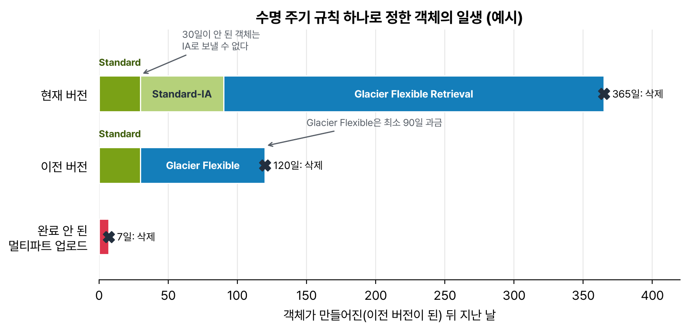

도메인 4, 비용 최적화 아키텍처 설계(20%) 첫 번째. 과제 4.1 '비용 최적화 스토리지 솔루션 설계'. 비중은 제일 작은 도메인이지만 문제마다 '가장 비용 효율적인'이 붙어 있어서 체감은 훨씬 크다. 스토리지 쪽은 결국 S3 스토리지 클래스를 언제 무엇으로 바꾸느냐가 거의 전부다.

## 요약

- 자주 읽으면 S3 Standard, 가끔이지만 바로 읽어야 하면 Standard-IA나 Glacier Instant Retrieval, 몇 시간 기다려도 되면 Glacier Flexible Retrieval, 거의 안 꺼내는 장기 보관은 Glacier Deep Archive.
- 접근 패턴을 모르면 S3 Intelligent-Tiering. 검색 요금 없이 알아서 계층을 옮긴다.
- 수명 주기 규칙으로 날짜에 따라 클래스를 내리고, 다 쓴 객체·이전 버전·완료 안 된 멀티파트 업로드를 지운다.
- 차가운 클래스일수록 저장은 싸지만 최소 보관 기간, 최소 과금 크기, 검색 요금이 붙는다. 작은 파일이 많으면 오히려 비싸질 수 있다.
- EBS는 gp2를 gp3로 바꾸고, 안 쓰는 볼륨과 오래된 스냅샷을 정리한다. EFS도 수명 주기 관리로 덜 쓰는 파일을 싼 클래스로 보낸다.

## 1. S3 스토리지 클래스

| 클래스 | 맞는 데이터 | AZ | 최소 보관 기간 | 꺼내는 시간 | 기억할 것 |
|---|---|---|---|---|---|
| S3 Standard | 자주 읽는 데이터 | 3개 이상 | 없음 | 즉시 | 검색 요금 없음 |
| S3 Intelligent-Tiering | 접근 패턴을 모르거나 바뀌는 데이터 | 3개 이상 | 없음 | 즉시(선택형 아카이브 계층은 예외) | 객체당 모니터링 요금. 검색 요금 없음 |
| S3 Standard-IA | 가끔 읽지만 읽을 땐 바로 필요 | 3개 이상 | 30일 | 즉시 | GB당 검색 요금. 최소 과금 크기 128KB |
| S3 One Zone-IA | 다시 만들 수 있는 데이터(썸네일, 복제본) | 1개 | 30일 | 즉시 | AZ가 망가지면 잃을 수 있다 |
| S3 Glacier Instant Retrieval | 분기에 한 번쯤 읽지만 즉시 필요(의료 영상 등) | 3개 이상 | 90일 | 밀리초 | 최소 과금 크기 128KB |
| S3 Glacier Flexible Retrieval | 백업, 몇 분~몇 시간 기다려도 되는 아카이브 | 3개 이상 | 90일 | 신속 1~5분, 표준 3~5시간, 대량 5~12시간 | 대량 검색은 무료 |
| S3 Glacier Deep Archive | 규제 때문에 몇 년씩 보관만 하는 데이터 | 3개 이상 | 180일 | 표준 12시간 이내, 대량 48시간 이내 | 가장 싸다 |

최소 보관 기간은 '이 기간만큼은 무조건 요금을 낸다'는 뜻이다. Standard-IA에 넣고 10일 만에 지우면 나머지 20일 치도 과금된다. Glacier Flexible과 Deep Archive는 객체마다 메타데이터 40KB가 추가로 붙어서, 작은 파일 수백만 개를 넣으면 저장 요금보다 요청 요금과 부가 요금이 더 커질 수 있다. 작은 파일은 묶어서(tar, zip) 넣는 게 낫다.

### Intelligent-Tiering

객체마다 접근을 지켜보다가 안 읽히면 알아서 싼 계층으로 옮긴다.

| 계층 | 옮겨지는 조건 |
|---|---|
| Frequent Access | 기본 |
| Infrequent Access | 30일 동안 접근 없음 |
| Archive Instant Access | 90일 동안 접근 없음 |
| Archive Access(선택) | 설정한 기간(90일 이상) 접근 없음. 꺼낼 때 복원 필요 |
| Deep Archive Access(선택) | 설정한 기간(180일 이상) 접근 없음. 꺼낼 때 복원 필요 |

다시 읽으면 Frequent Access로 돌아오고, 이때 검색 요금이 없다. 128KB보다 작은 객체는 모니터링하지 않고 항상 Frequent Access 요금이 나간다. 접근 패턴이 뻔하면 수명 주기 규칙이 더 싸고, 모르겠으면 Intelligent-Tiering이다.


flowchart TD
  Q["이 데이터를 얼마나 자주 읽나?"] --> K{"접근 패턴을 알고 있나?"}
  K -->|"모른다·바뀐다"| IT["Intelligent-Tiering"]
  K -->|"안다"| F{"한 달에 여러 번?"}
  F -->|"예"| ST["Standard"]
  F -->|"아니오"| I{"읽을 때 바로 필요한가?"}
  I -->|"예"| R{"다시 만들 수 있는 데이터?"}
  R -->|"예"| OZ["One Zone-IA"]
  R -->|"아니오"| IA["Standard-IA (분기 1번 수준이면 Glacier Instant Retrieval)"]
  I -->|"몇 시간 기다려도 됨"| GF["Glacier Flexible Retrieval"]
  I -->|"거의 안 꺼냄, 이틀도 OK"| DA["Glacier Deep Archive"]


## 2. 수명 주기 규칙

버킷 전체나 접두사, 태그, 객체 크기로 대상을 골라 두 가지 작업을 건다.

- 전환 작업: N일이 지나면 다른 스토리지 클래스로 옮긴다.
- 만료 작업: N일이 지나면 지운다. 이전 버전, 삭제 마커, 완료 안 된 멀티파트 업로드도 지울 수 있다.

_현재 버전은 30일 뒤 Standard-IA, 90일 뒤 Glacier Flexible Retrieval, 365일에 삭제. 이전 버전은 30일 뒤 Glacier로 보냈다가 120일에 삭제. 끝나지 않은 멀티파트 업로드 조각은 7일 뒤 정리_

규칙을 짤 때 걸리는 제약이 몇 개 있다.

- Standard에서 Standard-IA나 One Zone-IA로는 만든 지 30일이 지나야 옮길 수 있다.
- 방향은 더 차가운 쪽으로만 간다(Standard → IA → Glacier Instant → Glacier Flexible → Deep Archive). 다시 따뜻한 클래스로 올리는 건 수명 주기로는 안 되고 복사해야 한다.
- 2024년 9월부터 수명 주기 규칙은 기본적으로 128KB보다 작은 객체를 옮기지 않는다. 작은 객체는 옮기는 요청 요금이 아끼는 저장 요금보다 클 수 있어서다. 그전에 만든 규칙은 고치기 전까지 예전처럼 동작하고, 객체 크기 필터를 직접 넣으면 이 기본값을 바꿀 수 있다.

버전 관리를 켠 버킷에서 같은 키를 자주 덮어쓰면 이전 버전이 계속 쌓여서 요금이 조용히 늘어난다. 이전 버전 만료 규칙을 같이 걸어 두는 게 거의 필수다.

> **쉬운 설명**
>
> 스토리지 클래스는 옷 보관이랑 똑같다. 자주 입는 옷은 옷장(Standard), 계절 지난 옷은 리빙박스(IA)에 넣는다. 리빙박스는 공간이 싸지만 꺼낼 때마다 수고비(검색 요금)가 든다. 몇 년 안 입을 옷은 보관 업체(Glacier)에 맡기는데, 맡기는 값은 아주 싸지만 찾으려면 며칠 걸리고 최소 계약 기간이 있다. Intelligent-Tiering은 월 관리비를 받고 안 입는 옷을 알아서 리빙박스로 옮겨 주는 정리 서비스다. 양말 한 짝(작은 객체)까지 맡기면 관리비가 더 나오니 그건 그냥 옷장에 둔다.

## 3. S3에서 같이 챙기는 비용

| 항목 | 내용 |
|---|---|
| 요청자 지불(Requester Pays) | 데이터를 내려받는 쪽이 요청 요금과 전송 요금을 낸다. 저장 요금은 버킷 주인이 낸다. 큰 데이터를 다른 회사와 공유할 때 |
| 스토리지 클래스 분석 | 버킷의 접근 패턴을 관찰해 언제 Standard-IA로 옮기면 좋을지 알려 준다 |
| S3 Storage Lens | 조직 전체 버킷의 사용량과 활동을 한눈에 보고, 완료 안 된 멀티파트 업로드나 이전 버전이 많은 버킷 같은 절감 포인트를 짚어 준다 |
| S3 Inventory | 객체 목록과 클래스, 암호화 상태를 정기적으로 파일로 받아 분석 |
| 데이터 전송 | 인터넷에서 S3로 올리는 건 무료, 같은 리전 EC2로 가는 것도 무료, 인터넷으로 내보내는 건 유료. 많이 내보내면 CloudFront를 앞에 둔다 |

## 4. EBS 비용

- gp2를 gp3로 바꾼다. gp3는 GB당 요금이 gp2보다 최대 20% 싸고, 용량과 상관없이 기본 3,000 IOPS·125MiB/s를 준다. Elastic Volumes로 중단 없이 바꿀 수 있다.
- 인스턴스를 중지해도 EBS 요금은 계속 나간다. 연결되지 않은 볼륨은 스냅샷을 남기고 지운다.
- 처리량 위주의 큰 순차 작업은 st1, 거의 안 쓰는 데이터는 sc1(HDD)이 싸다.
- 스냅샷은 증분이라 첫 스냅샷 뒤로는 바뀐 블록만 저장한다. Data Lifecycle Manager로 만들고 지우는 걸 자동화한다.
- 오래 보관만 할 스냅샷은 EBS Snapshots Archive 계층으로 옮긴다. 보관 요금이 훨씬 싼 대신 최소 90일 보관이고 복원하는 데 시간이 걸린다.

## 5. EFS, FSx, 백업

| 서비스 | 비용 줄이는 방법 |
|---|---|
| EFS | Standard, Infrequent Access, Archive 스토리지 클래스. 수명 주기 관리로 N일 동안 안 읽은 파일을 자동으로 내린다. 한 AZ로 충분하면 One Zone 파일 시스템. 처리량은 쓰는 만큼 내는 Elastic 모드 |
| FSx for Windows File Server | HDD 스토리지 옵션, 데이터 중복 제거 |
| FSx for Lustre | 임시 처리용이면 복제 없는 scratch 배포가 싸다. 오래 쓸 데이터는 persistent |
| AWS Backup | 백업 계획에서 오래된 백업을 콜드 스토리지로 보내고 보존 기간이 끝나면 지운다 |
| Storage Gateway(테이프 게이트웨이) | 물리 테이프를 가상 테이프로 바꿔 Glacier·Deep Archive에 보관. 테이프 장비와 오프사이트 보관 비용이 사라진다 |

## 헷갈렸던 것들

- 'N일 뒤에는 거의 안 읽지만 읽을 땐 바로 필요'는 Standard-IA(또는 Glacier Instant Retrieval). '몇 시간 기다려도 됨'은 Glacier Flexible, '12시간 이상도 됨'은 Deep Archive.
- 다시 만들 수 있는 데이터만 One Zone-IA. 하나뿐인 원본을 One Zone-IA에 두는 보기는 오답이다.
- 접근 패턴을 '알 수 없다', '예측할 수 없다'가 나오면 Intelligent-Tiering.
- 30일이 안 된 객체는 Standard-IA로 못 보낸다. '7일 뒤 Standard-IA로 전환' 같은 규칙은 만들 수 없다.
- 최소 보관 기간보다 일찍 지우면 남은 기간 요금이 그대로 나온다. 며칠만 보관할 임시 파일을 IA나 Glacier에 넣으면 손해다.
- 버전 관리 버킷 요금이 계속 늘면 이전 버전 만료 규칙. 멀티파트 업로드가 자주 실패하면 완료 안 된 업로드 삭제 규칙.
- gp2 → gp3 전환은 거의 항상 정답 쪽이다. 성능을 유지하면서 싸진다.

## 용어 정리

| 용어 | 뜻 |
|---|---|
| 최소 보관 기간 | 그보다 일찍 지우거나 옮겨도 그 기간만큼 요금이 나오는 기간 |
| 최소 과금 크기 | 이보다 작은 객체도 이 크기로 계산(IA, Glacier Instant는 128KB) |
| 검색 요금 | IA, Glacier 계열에서 데이터를 읽을 때 GB당 붙는 요금 |
| 수명 주기 규칙 | 날짜에 따라 객체를 다른 클래스로 옮기거나 지우는 버킷 설정 |
| 요청자 지불 | 내려받는 쪽이 전송·요청 요금을 내는 버킷 설정 |
| EBS Snapshots Archive | 오래 보관할 스냅샷을 싸게 두는 계층. 최소 90일 |

## 복습 문제

**1.** Application logs are read frequently for the first 30 days. Up to 90 days, they are read occasionally and must be available immediately. After that, they are needed only for audits, and retrieval within a few hours is acceptable. The logs must be deleted after 5 years. What is the MOST cost-effective solution?

- A. Keep all logs in S3 Standard and delete them manually after 5 years.
- B. Use a lifecycle rule that transitions objects to S3 Standard-IA after 30 days and to S3 Glacier Flexible Retrieval after 90 days, and expires them after 5 years.
- C. Store the logs in S3 Glacier Deep Archive from the start.
- D. Transition objects to S3 One Zone-IA after 7 days.

**2.** Many teams share a data lake, so no one can predict when any object will be read. How can the company reduce storage costs without operational overhead?

- A. S3 One Zone-IA
- B. S3 Intelligent-Tiering
- C. Change storage classes manually every month.
- D. S3 Glacier Deep Archive

**3.** A company stores thumbnails that can be regenerated from the original images at any time. The thumbnails are read occasionally, but they must be displayed immediately when they are read. What is the LOWEST-cost option?

- A. S3 Standard
- B. S3 Standard-IA
- C. S3 One Zone-IA
- D. S3 Glacier Flexible Retrieval

**4.** In a bucket with versioning turned on, the same files are overwritten every day, and storage costs keep increasing. What should a solutions architect do?

- A. Suspend versioning.
- B. Add a lifecycle rule that expires noncurrent versions after 30 days.
- C. Create a new bucket.
- D. Change the storage class to S3 Intelligent-Tiering.

**5.** A company uses dozens of 1 TB gp2 volumes. How can the company reduce costs without reducing performance?

- A. Change the volumes to sc1.
- B. Move the data to instance store volumes.
- C. Reduce the size of each volume by half.
- D. Change the volumes to gp3 with Elastic Volumes, and set the IOPS and throughput that the workload needs.

**6.** A hospital must keep medical images for 10 years. The images are viewed only a few times a year, but doctors must be able to view them immediately. Which storage class should the hospital use?

- A. S3 Glacier Deep Archive
- B. S3 Glacier Flexible Retrieval
- C. S3 Glacier Instant Retrieval
- D. S3 One Zone-IA

## 답과 풀이

1. **B** 접근 빈도에 맞춰 단계별로 내리고 만료까지 자동화한다. D는 30일 전 전환이 안 되고, 원본 로그를 한 AZ에 두는 것도 위험하다.
2. **B** 접근 패턴을 모를 때는 Intelligent-Tiering이 검색 요금 없이 알아서 옮긴다.
3. **C** 다시 만들 수 있으니 한 AZ에 둬도 되고, 바로 읽을 수 있다.
4. **B** 덮어쓸 때마다 이전 버전이 쌓인다. 버전 관리를 끄면 실수로 지운 데이터를 되살리는 보호 기능도 잃는다.
5. **D** gp3는 GB당 더 싸고 IOPS·처리량을 용량과 따로 정할 수 있다.
6. **C** 거의 안 읽지만 밀리초로 꺼내야 하면 Glacier Instant Retrieval. Flexible과 Deep Archive는 몇 시간이 걸린다.

## 참고 자료

- Amazon S3 사용 설명서, 스토리지 클래스: <https://docs.aws.amazon.com/AmazonS3/latest/userguide/storage-class-intro.html>
- Amazon S3 사용 설명서, 수명 주기 전환 고려 사항: <https://docs.aws.amazon.com/AmazonS3/latest/userguide/lifecycle-transition-general-considerations.html>
- AWS 새 소식, 수명 주기 전환의 기본 최소 객체 크기: <https://aws.amazon.com/about-aws/whats-new/2024/09/amazon-s3-default-minimum-object-size-lifecycle-transition-rules/>
- Amazon S3 사용 설명서, Intelligent-Tiering: <https://docs.aws.amazon.com/AmazonS3/latest/userguide/intelligent-tiering-overview.html>
- Amazon EBS 사용 설명서, 볼륨 유형: <https://docs.aws.amazon.com/ebs/latest/userguide/ebs-volume-types.html>
- Amazon EFS 사용 설명서, 스토리지 수명 주기 관리: <https://docs.aws.amazon.com/efs/latest/ug/lifecycle-management-efs.html>

