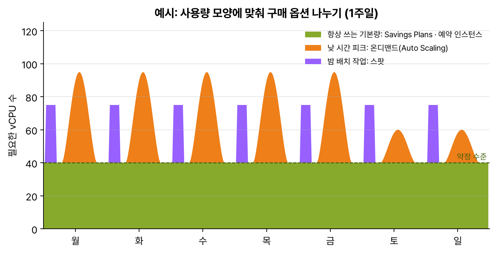

과제 4.2 '비용 최적화 컴퓨팅 솔루션 설계'는 구매 옵션 이름이 다 비슷해서 처음엔 표를 통째로 외우려다 실패했고, '얼마나 오래, 얼마나 꾸준히, 끊겨도 되나' 세 질문으로 나누니까 거의 다 풀렸다.

## 요약

- 꾸준히 도는 기본 사용량은 Savings Plans나 예약 인스턴스(RI)로 약정해서 싸게, 들쭉날쭉한 부분은 온디맨드, 끊겨도 되는 작업은 스팟.
- 패밀리·리전·서비스(Fargate, Lambda)를 바꿀 가능성이 있으면 Compute Savings Plans, 한 리전의 한 패밀리로 고정이면 EC2 Instance Savings Plans나 표준 RI가 할인이 더 크다.
- 물리 코어 단위 라이선스(BYOL)는 전용 호스트, 특정 AZ에 용량만 확보하려면 온디맨드 용량 예약.
- 약정보다 먼저 적정 크기(right-sizing). Compute Optimizer로 과하게 큰 인스턴스를 찾고, Graviton으로 바꾸고, 안 쓸 때는 끈다.

## 1. EC2 구매 옵션

| 옵션 | 할인(최대) | 약정 | 유연성 | 맞는 작업 |
|---|---|---|---|---|
| 온디맨드 | 없음 | 없음 | 언제든 켜고 끈다 | 짧거나 예측 불가하고 중단되면 안 되는 작업 |
| Compute Savings Plans | 66% | 1·3년, 시간당 사용 금액 | 인스턴스 패밀리, 크기, OS, 테넌시, 리전 상관없음. Fargate, Lambda에도 적용 | 꾸준하지만 구성이 바뀔 수 있는 사용량 |
| EC2 Instance Savings Plans | 72% | 1·3년, 시간당 사용 금액 | 한 리전의 한 인스턴스 패밀리 안에서 크기, OS, 테넌시는 자유 | 패밀리와 리전이 정해진 꾸준한 사용량 |
| 표준 RI | 72% | 1·3년, 특정 인스턴스 유형 | 거의 없음. 안 쓰게 되면 RI 마켓플레이스에서 팔 수 있다 | 오래 그대로 돌릴 서버 |
| 전환형 RI | 66% | 1·3년 | 다른 패밀리·OS로 교환 가능 | 구성이 바뀔 수 있는 장기 사용 |
| 스팟 인스턴스 | 90% | 없음 | AWS가 용량이 필요하면 2분 전에 알리고 회수 | 끊겨도 다시 하면 되는 작업 |
| 전용 호스트 | 온디맨드 또는 예약 | 선택 | 물리 서버 한 대를 통째로. 소켓·코어 수를 볼 수 있다 | 코어 단위 라이선스(BYOL), 규정 준수 |
| 전용 인스턴스 | 없음 | 없음 | 하드웨어를 다른 고객과 공유하지 않지만 호스트는 못 고른다 | 단일 테넌트만 요구하는 규정 |
| 온디맨드 용량 예약 | 없음 | 없음(언제든 취소) | 특정 AZ에 용량 확보. 안 써도 과금 | 행사 기간처럼 용량이 꼭 있어야 할 때 |

선결제 방식은 전부 선결제, 부분 선결제, 선결제 없음 세 가지이고, 3년 + 전부 선결제가 할인이 가장 크다. RI는 AZ를 지정하면(영역 RI) 그 AZ의 용량까지 예약되고, 리전 RI는 용량 예약이 없는 대신 AZ와 크기가 유연하다. 용량 예약 자체는 할인이 없어서, Savings Plans나 리전 RI를 같이 사서 요금을 낮춘다.

_항상 깔려 있는 40 vCPU는 Savings Plans로 약정하고, 평일 낮 피크는 Auto Scaling 온디맨드로, 매일 밤 배치는 스팟으로 처리한다. 약정을 피크에 맞추면 남는 시간만큼 돈을 버린다_


flowchart TD
  Q["이 작업, 뭘로 살까?"] --> A{"중간에 끊겨도 다시 하면 되나?"}
  A -->|"예"| SP["스팟"]
  A -->|"아니오"| B{"1년 넘게 꾸준히 도나?"}
  B -->|"아니오"| OD["온디맨드"]
  B -->|"예"| C{"패밀리·리전·서비스가 바뀔 수 있나?"}
  C -->|"예"| CSP["Compute Savings Plans"]
  C -->|"아니오"| ESP["EC2 Instance Savings Plans 또는 표준 RI"]
  Q --> L{"코어 단위 라이선스?"}
  L -->|"예"| DH["전용 호스트"]


> **쉬운 설명**
>
> 온디맨드는 택시, Savings Plans와 RI는 1년·3년 장기 렌터카, 스팟은 남는 좌석을 싸게 파는 땡처리 항공권이다. 매일 출퇴근하는 거리(기본 사용량)는 렌터카가 훨씬 싸고, 가끔 생기는 약속(피크)은 택시를 탄다. 땡처리 표는 싸지만 항공사가 좌석이 필요하면 탑승 직전에 취소될 수 있으니, 일정을 바꿔도 되는 여행(배치 작업)에만 쓴다. 전용 호스트는 차 한 대를 통째로 빌려서 차량 번호까지 아는 것이라, 차 단위로 보험(라이선스)을 들어야 할 때 쓴다.

## 2. 스팟 인스턴스 제대로 쓰기

- 회수 2분 전에 인스턴스 메타데이터와 EventBridge로 중단 알림이 온다. 그 전에 리밸런싱 권장 신호가 먼저 올 수도 있다. 체크포인트를 저장하거나 작업을 큐에 돌려놓게 만든다.
- 한 가지 유형만 고집하면 회수가 잦다. 여러 인스턴스 유형과 AZ를 섞고, 할당 전략은 가격과 남은 용량을 같이 보는 price-capacity-optimized를 쓴다.
- Auto Scaling 그룹의 혼합 인스턴스 정책으로 '온디맨드 기본 N대 + 그 위는 스팟 70%' 같은 비율을 정할 수 있다.
- 잘 맞는 곳: 상태 없는 웹 서버 뒷단, 배치, CI 빌드, 빅데이터(EMR 태스크 노드), 컨테이너(ECS·EKS, Fargate Spot).
- 안 맞는 곳: DB 기본 인스턴스, 중간에 멈추면 처음부터 다시 해야 하는 긴 작업.

## 3. 약정보다 먼저: 적정 크기와 끄기

| 방법 | 내용 |
|---|---|
| AWS Compute Optimizer | 사용률 기록을 분석해 EC2, Auto Scaling 그룹, EBS, Lambda, Fargate의 ECS 서비스에 맞는 크기를 추천한다. 메모리 사용률은 CloudWatch 에이전트를 깔아야 반영된다 |
| Graviton(Arm) 인스턴스 | 같은 일을 x86보다 싸게 한다. 대부분의 리눅스 워크로드와 관리형 서비스(RDS, ElastiCache, Lambda 등)에서 고를 수 있다 |
| 근무 시간에만 켜기 | 개발·테스트 서버는 Instance Scheduler나 EventBridge Scheduler로 밤과 주말에 중지. Auto Scaling 예약 작업으로 0대로 줄이기 |
| 놀고 있는 리소스 정리 | 중지된 인스턴스의 EBS, 연결 안 된 탄력적 IP, 안 쓰는 로드 밸런서. 2024년 2월부터 퍼블릭 IPv4 주소는 붙어 있기만 해도 시간당 요금이 나온다 |
| Trusted Advisor, Cost Optimization Hub | 사용률 낮은 인스턴스, 유휴 리소스, 살 만한 Savings Plans를 한곳에서 보여 준다 |

순서가 중요하다. 크기부터 줄이고 나서 남은 기본 사용량만큼 약정해야 한다. 큰 인스턴스에 먼저 3년 약정을 걸면 줄일 수 없는 낭비를 3년 동안 내게 된다.

## 4. 서버리스와 컨테이너의 비용

| 선택 | 비용 구조 | 유리한 경우 |
|---|---|---|
| Lambda | 요청 수 + 실행 시간 × 메모리(GB-초). 메모리를 늘리면 CPU도 같이 늘어 실행이 짧아질 수 있다 | 트래픽이 적거나 들쭉날쭉. 놀 때는 0원. 한 번 실행은 최대 15분 |
| Fargate | 작업이 쓰는 vCPU와 메모리만큼 초 단위 | 서버 관리 없이 컨테이너. 끊겨도 되면 Fargate Spot |
| EC2 위의 ECS·EKS | 인스턴스 요금. 한 인스턴스에 컨테이너를 빽빽하게 채울수록 싸다 | 사용량이 크고 꾸준해서 RI·Savings Plans와 높은 사용률을 낼 수 있을 때 |

Lambda와 Fargate도 Compute Savings Plans로 할인받는다. Lambda는 arm64(Graviton)로 바꾸면 같은 시간 기준 요금이 더 싸다. 하루 종일 일정하게 바쁜 API라면 Lambda보다 컨테이너나 EC2가 싸질 수 있다. 'Lambda가 무조건 싸다'는 아니다.

## 헷갈렸던 것들

- '인스턴스 패밀리나 리전을 바꿀 수 있어야 한다', 'Fargate·Lambda도 같이'는 Compute Savings Plans. EC2 Instance Savings Plans는 패밀리와 리전이 고정이다.
- 스팟은 '중단돼도 괜찮다', '재시작 가능', '가장 싼'이 같이 나올 때. 중단되면 안 되는 DB에 스팟을 쓰는 보기는 오답이다.
- 소켓·코어 단위 라이선스, BYOL은 전용 호스트. 전용 인스턴스는 호스트가 안 보여서 라이선스 문제를 못 푼다.
- 용량 확보가 목적이면 온디맨드 용량 예약. 할인은 없으니 Savings Plans와 같이 쓴다.
- 기본 사용량은 약정, 피크는 온디맨드. 피크까지 약정하는 보기는 낭비다.
- 약정 전에 적정 크기 조정. 과하게 큰 인스턴스면 Compute Optimizer.
- 인스턴스를 중지해도 EBS와 탄력적 IP 요금은 나간다.

## 용어 정리

| 용어 | 뜻 |
|---|---|
| Savings Plans | 1·3년 동안 시간당 사용 금액을 약정하고 할인받는 방식 |
| 예약 인스턴스(RI) | 특정 인스턴스 구성을 1·3년 약정하고 할인받는 방식 |
| 스팟 인스턴스 | 남는 용량을 크게 할인해 쓰되, 2분 알림 후 회수될 수 있는 인스턴스 |
| 전용 호스트 | 내 계정 전용 물리 서버. 소켓·코어 수를 보고 라이선스를 적용 |
| 온디맨드 용량 예약 | 특정 AZ의 인스턴스 용량을 할인 없이 확보 |
| 적정 크기(right-sizing) | 실제 사용률에 맞게 인스턴스 유형·크기를 줄이거나 바꾸는 것 |
| 혼합 인스턴스 정책 | Auto Scaling 그룹에서 여러 유형과 온디맨드·스팟 비율을 섞는 설정 |

## 복습 문제

**1.** A service runs 24 hours a day and will run for 3 years. During that time, the company plans to change instance families and move part of the workload to AWS Fargate. Which option provides the largest discount while keeping this flexibility?

- A. 3-year Standard Reserved Instances
- B. 3-year EC2 Instance Savings Plans
- C. 3-year Compute Savings Plans
- D. Stay on On-Demand pricing.

**2.** A batch job processes thousands of satellite images. The work is split into tasks of a few minutes each, and a failed task can be picked up from the queue and processed again. What is the LOWEST-cost solution?

- A. On-Demand Instances
- B. Spot Instances with a mix of instance types
- C. Dedicated Instances
- D. Standard Reserved Instances

**3.** A company wants to bring its existing licenses for commercial database software that is licensed per physical core to Amazon EC2. Which option should the company use?

- A. Dedicated Instances
- B. Spot Instances
- C. Compute Savings Plans
- D. Dedicated Hosts

**4.** A web tier needs at least 10 instances all day and scales unpredictably up to 40 instances during the daytime. What is the MOST cost-effective configuration?

- A. Buy Reserved Instances for 40 instances.
- B. Commit to 10 instances with Savings Plans, and run the rest as On-Demand Instances with Auto Scaling.
- C. Use only Spot Instances.
- D. Use only Dedicated Hosts.

**5.** For a large event that lasts 2 weeks, a company must be guaranteed that it can launch 100 c7g instances in a specific Availability Zone. Which solution meets this requirement?

- A. Buy 1-year Standard Reserved Instances.
- B. Use a Spot Fleet.
- C. Create On-Demand Capacity Reservations.
- D. Buy Compute Savings Plans.

**6.** EC2 instances in a development account keep running at night and on weekends. Developers use them only on weekdays from 09:00 to 19:00. What is the SIMPLEST way to reduce cost?

- A. Buy 3-year Reserved Instances.
- B. Stop the instances outside working hours with Amazon EventBridge Scheduler or Instance Scheduler on AWS.
- C. Change to Spot Instances.
- D. Use larger instances so that work finishes faster.

## 답과 풀이

1. **C** 패밀리·리전·서비스가 바뀌어도 적용되는 건 Compute Savings Plans다. 표준 RI와 EC2 Instance Savings Plans는 할인이 더 크지만 묶인다.
2. **B** 끊겨도 다시 처리하면 되는 작업은 스팟. 유형을 섞어야 회수에 덜 흔들린다.
3. **D** 전용 호스트는 물리 소켓·코어를 볼 수 있어 BYOL 라이선스를 맞출 수 있다.
4. **B** 항상 필요한 10대만 약정하고 변동분은 온디맨드로 탄다.
5. **C** 용량 확보가 목적이고 기간이 짧으니 온디맨드 용량 예약. RI는 1년 약정이다.
6. **B** 일주일 168시간 중 50시간만 쓰니, 끄기만 해도 컴퓨팅 요금이 70% 가까이 준다.

## 참고 자료

- Savings Plans 사용 설명서, Savings Plans와 RI 비교: <https://docs.aws.amazon.com/savingsplans/latest/userguide/sp-ris.html>
- Amazon EC2 사용 설명서, 구매 옵션: <https://docs.aws.amazon.com/AWSEC2/latest/UserGuide/instance-purchasing-options.html>
- Amazon EC2 사용 설명서, 스팟 인스턴스: <https://docs.aws.amazon.com/AWSEC2/latest/UserGuide/using-spot-instances.html>
- EC2 Auto Scaling 사용 설명서, 혼합 인스턴스 그룹: <https://docs.aws.amazon.com/autoscaling/ec2/userguide/ec2-auto-scaling-mixed-instances-groups.html>
- AWS Compute Optimizer 사용 설명서: <https://docs.aws.amazon.com/compute-optimizer/latest/ug/what-is-compute-optimizer.html>
- AWS 블로그, 퍼블릭 IPv4 주소 요금: <https://aws.amazon.com/blogs/aws/new-aws-public-ipv4-address-charge-public-ip-insights/>

