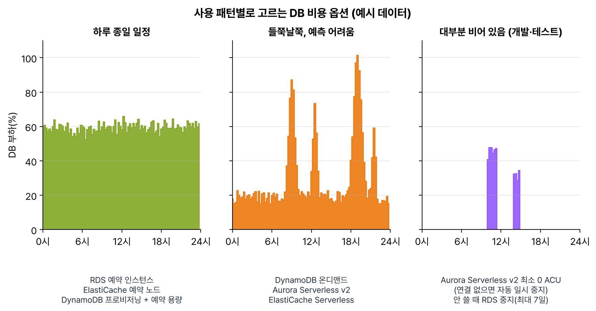

과제 4.3 '비용 최적화 데이터베이스 솔루션 설계'. DB 비용 문제는 거의 다 '사용 패턴을 보고 요금 방식을 고르라'는 문제였다. 하루 종일 일정한지, 들쭉날쭉한지, 대부분 놀고 있는지 먼저 가르고 나면 답이 좁혀진다.

## 요약

- 하루 종일 일정한 부하는 약정: RDS·ElastiCache 예약 인스턴스, DynamoDB 프로비저닝 + 예약 용량.
- 들쭉날쭉하거나 예측이 안 되면 DynamoDB 온디맨드, Aurora Serverless v2.
- 대부분 놀고 있는 개발·테스트 DB는 Aurora Serverless v2의 최소 0 ACU(자동 일시 중지)나 RDS 중지. 단, RDS 중지는 최대 7일이다. 더 오래 안 쓰면 스냅샷만 남기고 지운다.
- 같은 읽기가 반복되면 캐시(ElastiCache, DAX)로 DB 크기 자체를 줄인다.

_예시 데이터로 그린 하루 부하. 일정하면 약정, 튀면 온디맨드·서버리스, 거의 비어 있으면 자동 일시 중지나 중지가 맞다_

## 1. RDS와 Aurora

### 약정 할인

| 방법 | 내용 |
|---|---|
| RDS 예약 인스턴스 | 1·3년 약정. 같은 인스턴스 패밀리 안에서 크기 유연성이 적용되는 엔진이 많다. 시험에서 'RDS를 몇 년 계속 쓴다'의 정답 |
| ElastiCache 예약 노드 | 노드 기반 캐시를 1·3년 약정 |
| DynamoDB 예약 용량 | 프로비저닝 모드의 RCU·WCU를 1·3년 약정(아래 DynamoDB 절) |

### 안 쓸 때 줄이기

| 상황 | 방법 |
|---|---|
| 며칠 안 쓴다 | RDS 인스턴스(또는 Aurora 클러스터) 중지. 최대 7일이 지나면 자동으로 다시 켜진다. 중지 중에도 스토리지와 백업 요금은 나간다 |
| 몇 주~몇 달 안 쓴다 | 스냅샷을 찍고 인스턴스를 지운다. 필요할 때 스냅샷에서 복원 |
| 하루 몇 시간만 쓰는 개발 DB | Aurora Serverless v2 최소 용량을 0 ACU로. 연결이 없으면 자동으로 멈추고, 멈춘 동안 컴퓨팅 요금이 없다(스토리지 요금은 나간다). 다시 켜질 때 잠깐 지연이 있어 앱에 재연결 로직이 필요하다 |
| 운영 DB 사본으로 테스트 | Aurora 빠른 복제. 쓰기 시 복사 방식이라 바뀐 데이터만큼만 스토리지 요금이 붙는다 |

### 구성에서 줄이기

- 적정 크기: CloudWatch, Performance Insights로 CPU·메모리 여유를 보고 줄인다. Graviton 인스턴스 클래스가 같은 성능에 싸다.
- 스토리지: gp3를 쓰고, IOPS를 과하게 프로비저닝하지 않는다.
- Multi-AZ는 대기 인스턴스 요금이 그대로 붙는다. 운영에만 켜고 개발·테스트는 단일 AZ.
- Aurora 스토리지 구성: 기본(Standard)은 I/O 요청마다 과금되고, I/O-Optimized는 I/O 요금이 없는 대신 인스턴스·스토리지 단가가 높다. I/O 요금이 청구서에서 큰 비중을 차지하는 클러스터면 I/O-Optimized가 유리하다.
- 백업: 자동 백업 저장 공간은 리전의 프로비저닝 DB 스토리지 크기까지 추가 요금이 없다. 그 이상 쌓인 수동 스냅샷은 과금되니 정리한다. 분석이나 장기 보관용이면 스냅샷을 S3로 내보내기(Parquet)가 싸다.
- 라이선스: Oracle, SQL Server 라이선스 비용이 크면 DMS로 Aurora PostgreSQL·MySQL로 옮기는 것 자체가 비용 최적화다.

## 2. DynamoDB

| 용량 모드 | 요금 | 맞는 경우 |
|---|---|---|
| 온디맨드 | 읽기·쓰기 요청마다 | 새 서비스, 트래픽 예측 불가, 놀 때가 많다 |
| 프로비저닝 + Auto Scaling | 정해 둔 RCU·WCU만큼 시간당. 1·3년 예약 용량으로 더 할인 | 트래픽이 예측 가능하고 꾸준하다 |

2024년 11월부터 온디맨드 처리량 요금이 50%, 글로벌 테이블 요금이 최대 67% 내렸다. 설정을 안 바꿔도 자동 적용됐다. 예전보다 온디맨드가 훨씬 유리해져서, '무조건 프로비저닝이 싸다'는 감각은 버리는 게 맞다. 그래도 꾸준한 대량 트래픽은 프로비저닝 + 예약 용량이 싸다.

그 밖의 절감 포인트:

- 테이블 클래스 Standard-IA: 저장 단가가 싼 대신 읽기·쓰기 단가가 비싸다. 오래된 주문 기록처럼 저장 비용이 대부분인 테이블에 맞다.
- TTL: 만료된 항목을 쓰기 용량 소모 없이 무료로 지운다. 세션, 임시 데이터.
- GSI도 쓰기 용량과 스토리지를 따로 먹는다. 필요한 속성만 프로젝션한다.
- Scan은 테이블 전체를 읽어 용량을 크게 쓴다. 쿼리 패턴에 맞는 키 설계가 곧 비용 절감이다.
- 같은 항목을 반복해서 읽는 부하는 DAX로 받으면 읽기 용량을 줄일 수 있다.

## 3. 캐시로 DB 줄이기: ElastiCache

- 같은 쿼리 결과를 반복해서 읽으면 ElastiCache에 캐시해서 DB 인스턴스 크기나 읽기 전용 복제본 수를 줄인다. 캐시 노드 요금이 줄어든 DB 요금보다 싸면 이득이다.
- 노드 기반은 예약 노드로 약정 할인, 부하가 들쭉날쭉하면 ElastiCache Serverless.
- AWS는 Valkey 엔진을 Redis OSS보다 노드 기반은 20%, 서버리스는 33% 낮게 책정했다. 새로 만든다면 Valkey가 기본 선택이다.


flowchart TD
  Q["DB 비용을 줄이고 싶다"] --> P{"부하 모양은?"}
  P -->|"하루 종일 일정"| C["예약 인스턴스·예약 노드 예약 용량"]
  P -->|"들쭉날쭉"| S["DynamoDB 온디맨드 Aurora Serverless v2"]
  P -->|"대부분 놀고 있음"| I{"얼마나 오래 안 쓰나?"}
  I -->|"하루 중 대부분"| Z["Aurora Serverless v2 최소 0 ACU"]
  I -->|"7일 이내"| ST["RDS 중지"]
  I -->|"몇 주 이상"| SN["스냅샷 후 삭제"]
  Q --> R{"같은 읽기 반복?"}
  R -->|"예"| CA["ElastiCache·DAX로 DB 크기 줄이기"]


> **쉬운 설명**
>
> DB 요금 고르기는 헬스장 결제랑 비슷하다. 매일 가면 연간 회원권(예약 인스턴스, 프로비저닝 + 예약 용량)이 제일 싸고, 갈 때만 들르는 사람은 일일권(온디맨드)이 낫다. Aurora Serverless v2 최소 0 ACU는 안 갈 때 자동으로 회원권이 일시 정지되는 헬스장이다. RDS 중지는 최대 7일까지만 정지해 주는 휴회 신청이라, 한 달 넘게 안 갈 거면 아예 해지(스냅샷 후 삭제)하는 게 맞다. 캐시는 자주 쓰는 운동 기구를 집에 하나 들여놓는 것이라, 헬스장 갈 일 자체를 줄여 준다.

## 헷갈렸던 것들

- RDS는 최대 7일까지만 중지된다. 7일 뒤 자동으로 켜져서 요금이 다시 나온다. 몇 주 이상 안 쓰면 스냅샷 후 삭제.
- 중지해도 스토리지 요금은 나간다.
- 24시간 꾸준히 몇 년 쓸 RDS는 예약 인스턴스. 온디맨드로 계속 두는 보기는 비용 최적화가 아니다.
- DynamoDB 새 서비스, 예측 불가 트래픽은 온디맨드. 예측 가능하고 꾸준하면 프로비저닝 + Auto Scaling(+ 예약 용량).
- 저장 비용이 대부분인 DynamoDB 테이블은 Standard-IA 테이블 클래스.
- 만료 데이터 삭제는 TTL. 직접 Scan해서 지우면 용량을 먹는다.
- Multi-AZ는 가용성 기능이지 비용 절감 기능이 아니다. 개발 DB에는 끈다.
- 반복 읽기를 캐시로 돌리면 DB 인스턴스를 줄일 수 있다. '더 큰 인스턴스로 올린다'보다 싼 경우가 많다.

## 용어 정리

| 용어 | 뜻 |
|---|---|
| RDS 예약 인스턴스 | RDS 인스턴스를 1·3년 약정하고 할인받는 방식 |
| ACU | Aurora Serverless의 용량 단위. 최소 0 ACU면 자동 일시 중지 |
| 예약 용량 | DynamoDB 프로비저닝 모드의 RCU·WCU를 1·3년 약정하는 것 |
| Standard-IA 테이블 클래스 | 저장이 싸고 읽기·쓰기가 비싼 DynamoDB 테이블 클래스 |
| I/O-Optimized | I/O 요금 없이 인스턴스·스토리지 단가가 높은 Aurora 구성 |

## 복습 문제

**1.** A reporting Amazon RDS for MySQL DB instance is used for only 2 weeks each quarter and is not used at all for the rest of the time. What is the MOST cost-effective solution?

- A. Stop the instance.
- B. Buy a 3-year Reserved Instance.
- C. Take a snapshot and delete the instance after use, and restore it from the snapshot when needed.
- D. Turn off Multi-AZ.

**2.** A production Amazon RDS for PostgreSQL database will run 24 hours a day with a steady load for 3 years. Which option reduces cost the MOST?

- A. Stay on On-Demand pricing.
- B. Stop the database every night.
- C. Move the database to Spot Instances.
- D. 3-year RDS Reserved Instances

**3.** A company is launching a new mobile game that uses a DynamoDB table. Traffic is unpredictable and might be close to zero right after launch. Which setting should the company use?

- A. Provisioned capacity mode fixed at the maximum capacity
- B. On-demand capacity mode
- C. Provisioned capacity mode with 3-year reserved capacity
- D. Add only a DAX cluster.

**4.** A DynamoDB table holds several years of order history. Most of the table's cost is storage, and old items are rarely read. How can the company reduce cost without changing the application?

- A. Add a GSI.
- B. Switch to on-demand capacity mode.
- C. Change the table class to DynamoDB Standard-IA.
- D. Convert the table to a global table.

**5.** A development team's Aurora PostgreSQL cluster is used for only 2-3 hours a day and has no connections for the rest of the day. How can the team reduce cost without any management work?

- A. Change to a smaller provisioned instance.
- B. Turn on Multi-AZ.
- C. Add a read replica.
- D. Change to Aurora Serverless v2 with a minimum capacity of 0 ACUs.

**6.** A product detail page repeatedly queries the same product information, and the RDS instance will soon need to be scaled up. The data can be a few minutes out of date. What is the MOST cost-effective solution?

- A. Use a larger RDS instance.
- B. Add Multi-AZ.
- C. Increase the Provisioned IOPS.
- D. Cache the product information in Amazon ElastiCache with a TTL.

## 답과 풀이

1. **C** RDS는 7일이 지나면 자동으로 다시 켜진다. 석 달 가까이 안 쓰면 스냅샷만 남기는 게 싸다.
2. **D** 일정한 장기 부하는 약정 할인인 예약 인스턴스가 가장 싸다.
3. **B** 예측 불가, 저사용 구간이 있는 새 서비스는 온디맨드.
4. **C** 저장 비용이 대부분이고 접근이 드문 테이블에 맞는 클래스다.
5. **D** 연결이 없으면 자동으로 멈춰 컴퓨팅 요금이 사라진다.
6. **D** 반복 읽기를 캐시로 돌리면 DB를 키우지 않아도 된다. 몇 분 지연이 괜찮으니 TTL로 충분하다.

## 참고 자료

- Aurora 사용 설명서, Serverless v2 자동 일시 중지: <https://docs.aws.amazon.com/AmazonRDS/latest/AuroraUserGuide/aurora-serverless-v2-auto-pause.html>
- RDS 사용 설명서, DB 인스턴스 일시 중지: <https://docs.aws.amazon.com/AmazonRDS/latest/UserGuide/USER_StopInstance.html>
- AWS 새 소식, DynamoDB 온디맨드·글로벌 테이블 가격 인하: <https://aws.amazon.com/about-aws/whats-new/2024/11/amazon-dynamo-db-reduces-prices-on-demand-throughput-global-tables/>
- DynamoDB 개발자 안내서, 테이블 클래스: <https://docs.aws.amazon.com/amazondynamodb/latest/developerguide/HowItWorks.TableClasses.html>

