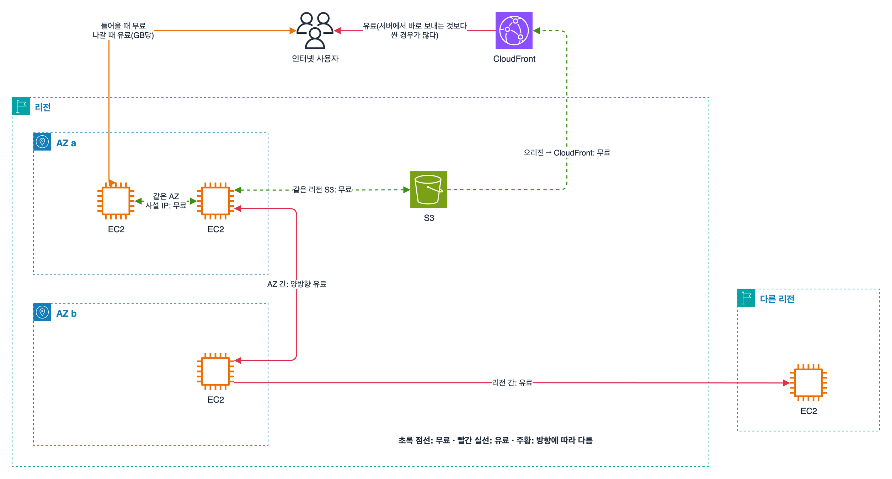

과제 4.4 '비용 최적화 네트워크 아키텍처 설계'와, 도메인 4 전체에 걸쳐 나오는 비용 관리 도구를 같이 묶었다. 네트워크 요금은 '어디에서 어디로 가느냐'로 정해져서, 무료인 길과 유료인 길을 그림 하나로 외워 두는 게 제일 빨랐다.

## 요약

- 들어오는 건 무료, 나가는 건 유료. 같은 AZ 안 사설 IP 통신은 무료, AZ를 넘으면 양방향 유료, 리전을 넘으면 유료.
- 같은 리전의 S3·DynamoDB와 EC2 사이는 무료지만, NAT 게이트웨이를 거치면 처리 요금이 붙는다. 게이트웨이 엔드포인트로 돌린다.
- 인터넷으로 많이 내보내면 CloudFront를 앞에 둔다. AWS 오리진에서 CloudFront로 가는 건 무료다.
- 비용은 태그로 나누고(비용 할당 태그), Cost Explorer로 보고, Budgets로 경고·자동 조치하고, 자세한 분석은 CUR(Data Exports)로 S3에 받아 Athena로 본다.

## 1. 데이터 전송 요금 지도

_초록 점선은 무료, 빨간 실선은 유료. 같은 AZ의 사설 IP 통신과 같은 리전 S3, 오리진에서 CloudFront로 가는 길은 무료이고, AZ를 넘거나 리전을 넘거나 인터넷으로 나가면 요금이 붙는다_

| 경로 | 요금 |
|---|---|
| 인터넷 → AWS | 무료 |
| AWS → 인터넷 | 유료(GB당, 많이 보낼수록 단가가 내려간다) |
| 같은 AZ 안, 사설 IP | 무료 |
| 같은 리전 다른 AZ | 유료. 보내는 쪽과 받는 쪽 모두 |
| 같은 리전인데 퍼블릭 IP·탄력적 IP로 통신 | AZ 간 요금이 붙는다. 사설 IP로 바꾼다 |
| 리전 간 | 유료(보내는 리전 기준) |
| 같은 리전의 S3·DynamoDB ↔ EC2 | 무료(NAT를 거치면 NAT 처리 요금은 별도) |
| AWS 오리진 → CloudFront | 무료 |
| CloudFront → 사용자 | 유료. 서버에서 바로 내보내는 것보다 싼 경우가 많고, 캐시 적중만큼 오리진 부하도 준다 |

AZ 간 요금 때문에 '전부 한 AZ에 몰자'가 정답이 되는 건 아니다. 가용성을 포기하는 대가가 더 크다. 다만 서로 대량으로 주고받는 구성 요소(예: 배치 서버와 임시 캐시)는 같은 AZ에 두는 게 맞을 때가 있다.

## 2. 연결 서비스별 비용

| 서비스 | 비용 구조 | 줄이는 방법 |
|---|---|---|
| NAT 게이트웨이 | 시간당 + 처리한 GB당(목적지가 같은 리전 S3여도) | S3·DynamoDB는 게이트웨이 엔드포인트(무료)로 돌린다. 다른 AZ의 NAT를 쓰면 AZ 간 요금까지 붙으니 AZ마다 NAT |
| 인터페이스 엔드포인트 | AZ별 시간당 + GB당 | AWS API 호출이 많으면 NAT를 거치는 것보다 쌀 수 있다. 쓸 AZ에만 만든다 |
| VPC 피어링 | 연결 요금 없음. 같은 AZ 안은 무료, AZ를 넘으면 데이터 전송 요금 | VPC 몇 개끼리 대량으로 주고받으면 Transit Gateway보다 싸다 |
| Transit Gateway | 연결(attachment)당 시간 + 처리 GB당 | VPC가 많을 때의 관리 편의와 비교해서 고른다 |
| Site-to-Site VPN | 연결 시간당 + 나가는 데이터 | 양이 적거나 임시면 VPN |
| Direct Connect | 포트 시간당 + 나가는 데이터(인터넷보다 싼 단가) | 매달 대량으로 내보내면 오히려 싸진다 |
| Global Accelerator | 고정 요금 + 데이터 전송 할증 | 정말 필요한 경우(고정 IP, UDP, 빠른 장애 조치)에만 |
| 퍼블릭 IPv4 주소 | 2024년 2월부터 주소마다 시간당 요금(사용 중이어도) | 안 쓰는 탄력적 IP 해제, 퍼블릭 IP 없이 로드 밸런서 뒤에 두기, IPv6 사용 |

> **쉬운 설명**
>
> AWS 네트워크 요금은 택배비랑 비슷하다. 물건을 받는 건 공짜고 보낼 때 돈을 낸다. 같은 건물(AZ) 안에서 옆 사무실로 들고 가는 건 공짜지만, 옆 건물로 보내면 퀵비가 들고, 다른 도시(리전)로 보내면 더 든다. NAT 게이트웨이는 건물 1층 우편실이라 거기를 거치면 건당 수수료가 붙는데, S3·DynamoDB행은 무료 전용 통로(게이트웨이 엔드포인트)가 따로 있다. CloudFront는 전국 지점 창고라, 본사에서 지점 창고로 옮기는 건 공짜이고 고객은 가까운 지점에서 받는다.

## 3. 비용 관리 도구

| 도구 | 하는 일 | 문제에서 보이는 표현 |
|---|---|---|
| AWS Pricing Calculator | 만들기 전에 예상 비용 견적 | '구축 전에 월 비용을 추정' |
| Cost Explorer | 지난 비용을 서비스·계정·태그별로 그래프로 보고 앞으로를 예측. RI·Savings Plans 구매 추천, 사용률·커버리지 보고서 | '비용 추세를 시각화', '어떤 서비스가 늘었나' |
| AWS Budgets | 비용·사용량·RI/SP 사용률에 예산을 걸고, 실제 또는 예측 금액이 넘으면 이메일·SNS로 알림. 예산 작업(budget actions)으로 IAM 정책·SCP 적용, EC2·RDS 중지까지 자동으로 | '예산을 넘을 것 같으면 알림', '넘으면 자동으로 막기' |
| Cost Anomaly Detection | 머신러닝으로 평소와 다른 지출을 찾아 알림 | '예상치 못한 비용 급증을 자동으로 감지' |
| Cost and Usage Report(CUR 2.0, Data Exports) | 가장 자세한 시간·리소스 단위 청구 데이터를 S3로 내보낸다. Athena, QuickSight로 분석 | '항목별 상세 분석', 'SQL로 청구 데이터 조회' |
| 비용 할당 태그 | 리소스 태그(Project, Team 등)로 비용을 나눈다. Billing 콘솔에서 활성화해야 보고서에 나오고, 활성화 이후 비용부터 반영된다 | '프로젝트별·부서별 비용' |
| 비용 범주(Cost Categories) | 계정, 태그, 서비스를 규칙으로 묶어 팀이나 사업 단위로 비용을 보여 준다 | '여러 계정을 사업부 단위로 묶어 보기' |
| Organizations 통합 결제 | 여러 계정 청구를 하나로 합친다. 사용량을 합산해 구간 할인을 받고 RI·Savings Plans 할인을 계정끼리 나눈다 | '여러 계정의 할인 공유' |
| Trusted Advisor | 비용 최적화 점검(사용률 낮은 EC2, 유휴 로드 밸런서, 연결 안 된 탄력적 IP 등). 전체 점검은 Business 이상 Support 플랜 | '모범 사례 점검' |
| Compute Optimizer, Cost Optimization Hub | 적정 크기 추천, 여러 계정·리전의 절감 추천을 한곳에 모아 우선순위 | '과하게 큰 리소스 찾기' |

태그 정책(Organizations)으로 태그 키와 값을 표준화하고, SCP로 태그 없는 리소스 생성을 막으면 비용 할당 태그가 실제로 쓸모 있어진다. 태그를 나중에 붙이면 그 전 비용은 나눌 수 없다는 점도 기억해 둘 것.

## 헷갈렸던 것들

- 들어오는 데이터는 무료, 나가는 데이터는 유료. 'S3에 업로드 요금' 같은 보기는 함정이다(요청 요금은 따로 있다).
- 같은 리전 안이라도 AZ를 넘으면 양방향 유료. 퍼블릭 IP로 통신해도 AZ 간 요금.
- 프라이빗 서브넷 → S3 대용량 전송으로 NAT 요금이 크면 S3 게이트웨이 엔드포인트.
- 전 세계 사용자에게 S3 파일을 많이 내보내면 CloudFront. 오리진 → CloudFront 전송은 무료.
- 예산 초과 '알림'은 Budgets, 이상 지출 '자동 감지'는 Cost Anomaly Detection, 비용 '시각화·예측'은 Cost Explorer, '가장 상세한 데이터'는 CUR.
- 비용 할당 태그는 붙이기만 해서는 안 되고 Billing 콘솔에서 활성화해야 한다.
- 여러 계정이 RI·Savings Plans 할인을 같이 받으려면 Organizations 통합 결제.

## 용어 정리

| 용어 | 뜻 |
|---|---|
| 데이터 송신(DTO) | AWS에서 인터넷이나 다른 리전으로 나가는 데이터. 요금이 붙는다 |
| AZ 간 전송 요금 | 같은 리전 다른 AZ 사이 통신에 양방향으로 붙는 요금 |
| NAT 처리 요금 | NAT 게이트웨이를 지나는 GB마다 붙는 요금 |
| 예산 작업 | Budgets 임계값을 넘으면 IAM 정책·SCP 적용이나 인스턴스 중지를 자동 실행하는 기능 |
| CUR | 시간·리소스 단위로 가장 자세한 비용과 사용량 보고서 |
| 비용 할당 태그 | 비용을 나누는 데 쓰도록 활성화한 리소스 태그 |
| 통합 결제 | Organizations로 여러 계정 청구를 합쳐 할인을 공유하는 기능 |

## 복습 문제

**1.** Users around the world download large video files directly from an S3 bucket. Data transfer costs are high, and downloads are slow. What is the MOST appropriate improvement?

- A. Create an Amazon CloudFront distribution with the S3 bucket as the origin, using origin access control (OAC).
- B. Turn on S3 Transfer Acceleration.
- C. Replicate the bucket to another Region.
- D. Turn on Requester Pays.

**2.** EC2 instances in two Availability Zones in the same Region exchange large amounts of data through Elastic IP addresses. How can the company reduce cost while keeping the same functionality?

- A. Add AWS Global Accelerator.
- B. Create another internet gateway.
- C. Communicate over private IP addresses.
- D. Route the traffic through a NAT gateway.

**3.** The finance team wants a notification when the development account's monthly cost is forecast to exceed the budget. When the budget is actually exceeded, development EC2 instances must stop automatically. Which tool should the team use?

- A. AWS Budgets with budget actions
- B. AWS Cost Explorer
- C. AWS Trusted Advisor
- D. AWS CloudTrail

**4.** A company wants to see the cost of resources in multiple accounts broken down by project. What should the company do FIRST?

- A. Use a different Region for each project.
- B. Create an Amazon CloudWatch dashboard.
- C. Create a VPC for each project.
- D. Add a project tag to the resources, and activate it as a cost allocation tag in the Billing console.

**5.** A company wants to analyze hourly billing data at the resource ID level with SQL to build internal chargeback reports. Which solution meets this requirement?

- A. Take screenshots of Cost Explorer.
- B. Export the Cost and Usage Report (Data Exports) to Amazon S3 and query it with Amazon Athena.
- C. Receive AWS Budgets alerts by email.
- D. Download AWS Trusted Advisor reports.

**6.** A company pays for 20 accounts separately, so each account receives Reserved Instance discounts only for itself. How can the company share the discounts across accounts and also benefit from volume pricing tiers?

- A. Buy more Reserved Instances in each account.
- B. Combine the accounts with consolidated billing in AWS Organizations.
- C. Move all resources into one account.
- D. Turn on AWS Cost Anomaly Detection.

## 답과 풀이

1. **A** CloudFront는 엣지 캐시로 빠르게 주고, 오리진에서 CloudFront로의 전송은 무료다. Transfer Acceleration은 업로드를 빠르게 하는 기능이다.
2. **C** 퍼블릭·탄력적 IP로 통신하면 같은 리전 안이라도 요금이 붙는다. 사설 IP를 쓴다.
3. **A** Budgets는 예측 기준 알림과 예산 작업(인스턴스 중지)을 지원한다.
4. **D** 태그를 붙이고 활성화해야 Cost Explorer와 CUR에서 태그별로 나뉜다.
5. **B** CUR이 가장 자세한 청구 데이터이고, S3에 쌓이니 Athena로 바로 조회할 수 있다.
6. **B** 통합 결제는 사용량을 합산하고 RI·Savings Plans 할인을 계정끼리 공유한다.

이걸로 SAA 정리는 끝이다. 시험 직전에는 각 글의 '헷갈렸던 것들'과 복습 문제만 다시 훑어보는 용도로 쓰면 된다.

## 참고 자료

- Amazon EC2 요금, 데이터 전송: <https://aws.amazon.com/ec2/pricing/on-demand/#Data_Transfer>
- AWS 블로그, 퍼블릭 IPv4 주소 요금: <https://aws.amazon.com/blogs/aws/new-aws-public-ipv4-address-charge-public-ip-insights/>
- AWS Cost Management 사용 설명서, Cost Explorer: <https://docs.aws.amazon.com/cost-management/latest/userguide/ce-what-is.html>
- AWS Cost Management 사용 설명서, Budgets: <https://docs.aws.amazon.com/cost-management/latest/userguide/budgets-managing-costs.html>
- AWS Billing 사용 설명서, 비용 할당 태그: <https://docs.aws.amazon.com/awsaccountbilling/latest/aboutv2/cost-alloc-tags.html>
- AWS Data Exports 사용 설명서: <https://docs.aws.amazon.com/cur/latest/userguide/what-is-data-exports.html>

