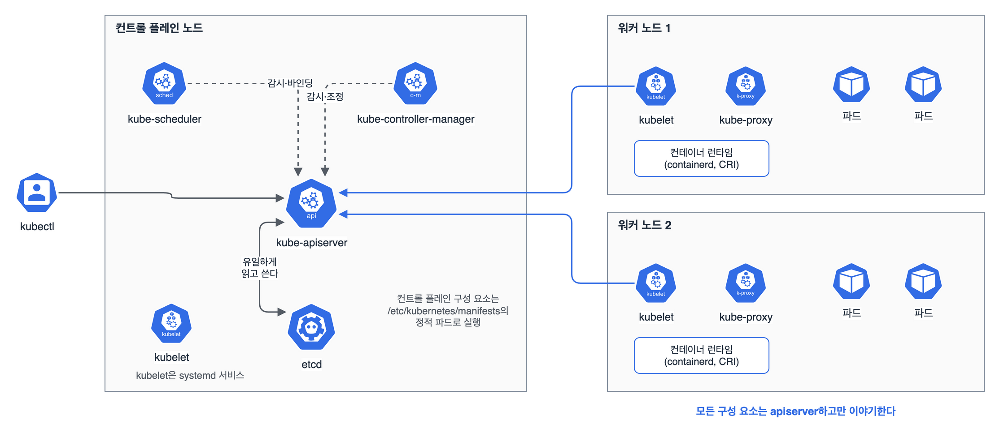

클러스터 아키텍처·설치·구성(25%)의 첫 정리. 새 범위의 '설치 준비', 'kubeadm으로 클러스터 만들기', '클러스터 수명 주기 관리', '고가용성 컨트롤 플레인'을 한 글에 묶었다. 업그레이드는 시험에서 손이 제일 많이 가는 문제라 1.31에서 1.32로 올리는 순서를 통째로 외웠다.

## 요약

- 컨트롤 플레인은 kube-apiserver, etcd, kube-scheduler, kube-controller-manager로 이루어진다. kubeadm 클러스터에서 이들은 /etc/kubernetes/manifests의 정적 파드로 돌고, kubelet만 systemd 서비스다.
- 노드 준비는 스왑 끄기, IPv4 포워딩 켜기, 컨테이너 런타임(containerd)의 cgroup 드라이버를 systemd로 맞추기, kubeadm·kubelet·kubectl 설치 후 버전 고정(apt-mark hold)이다.
- 업그레이드는 마이너 버전을 하나씩만 올린다. 컨트롤 플레인 먼저, 노드마다 drain → kubeadm·kubelet 업그레이드 → kubelet 재시작 → uncordon 순서다.
- pkgs.k8s.io 저장소는 마이너 버전마다 따로라서, 1.32로 올리려면 저장소 주소부터 v1.32로 바꿔야 한다.
- 고가용성은 로드 밸런서 뒤에 컨트롤 플레인 노드를 최소 3대 둔다. kubeadm 기본은 etcd를 같은 노드에 두는 스택형이다.

## 1. 구성 요소


_kubectl, 스케줄러, 컨트롤러 매니저, 각 노드의 kubelet은 모두 kube-apiserver와만 통신하고, etcd를 직접 읽고 쓰는 것은 apiserver뿐이다_

| 구성 요소 | 위치 | 하는 일 |
|---|---|---|
| kube-apiserver | 컨트롤 플레인 | 모든 요청의 입구. 인증·인가·어드미션을 거쳐 etcd에 저장한다 |
| etcd | 컨트롤 플레인(또는 별도 노드) | 클러스터 상태를 저장하는 키-값 저장소 |
| kube-scheduler | 컨트롤 플레인 | 아직 노드가 정해지지 않은 파드를 보고 알맞은 노드를 고른다 |
| kube-controller-manager | 컨트롤 플레인 | 디플로이먼트, 레플리카셋, 노드 같은 컨트롤러를 돌리며 원하는 상태로 맞춘다 |
| kubelet | 모든 노드 | 자기 노드에 배정된 파드를 컨테이너 런타임으로 띄우고 상태를 보고한다 |
| kube-proxy | 모든 노드 | 서비스 IP로 온 트래픽을 파드로 보내는 iptables·IPVS 규칙을 관리한다 |
| 컨테이너 런타임 | 모든 노드 | CRI로 kubelet의 지시를 받아 컨테이너를 실행한다(containerd, CRI-O) |

컨트롤 플레인 파드가 안 뜨면 kubectl로는 고칠 수 없다. 노드에 들어가서 /etc/kubernetes/manifests의 YAML을 고치면 kubelet이 알아서 다시 띄운다. 정적 파드는 kubectl delete로 지워도 곧 다시 생긴다.

## 2. 설치 준비

```bash
# 스왑이 켜져 있으면 kubelet이 시작하지 않는다
sudo swapoff -a          # /etc/fstab의 swap 줄도 주석 처리

# IPv4 포워딩
cat <<EOF | sudo tee /etc/sysctl.d/k8s.conf
net.ipv4.ip_forward = 1
EOF
sudo sysctl --system

# containerd 설정에서 cgroup 드라이버를 systemd로
#   [plugins."io.containerd.grpc.v1.cri".containerd.runtimes.runc.options]
#     SystemdCgroup = true
sudo systemctl restart containerd

# 마이너 버전별 저장소(v1.32)를 등록하고 설치
curl -fsSL https://pkgs.k8s.io/core:/stable:/v1.32/deb/Release.key | sudo gpg --dearmor -o /etc/apt/keyrings/kubernetes-apt-keyring.gpg
echo 'deb [signed-by=/etc/apt/keyrings/kubernetes-apt-keyring.gpg] https://pkgs.k8s.io/core:/stable:/v1.32/deb/ /' | sudo tee /etc/apt/sources.list.d/kubernetes.list
sudo apt-get update && sudo apt-get install -y kubelet kubeadm kubectl
sudo apt-mark hold kubelet kubeadm kubectl   # 실수로 올라가지 않게 고정
```

kubelet과 containerd의 cgroup 드라이버가 다르면 노드가 불안정해진다. kubeadm은 v1.22부터 kubelet의 기본 드라이버를 systemd로 잡으니 런타임 쪽을 맞춘다.

## 3. kubeadm init과 join

```bash
# 컨트롤 플레인에서
sudo kubeadm init --pod-network-cidr=10.244.0.0/16   # 대역은 쓸 CNI에 맞춘다
mkdir -p $HOME/.kube
sudo cp -i /etc/kubernetes/admin.conf $HOME/.kube/config
sudo chown $(id -u):$(id -g) $HOME/.kube/config
# CNI를 설치하기 전까지 노드는 NotReady

# 워커 추가용 명령을 다시 뽑을 때(토큰은 기본 24시간 유효)
kubeadm token create --print-join-command

# 워커에서
sudo kubeadm join <apiserver>:6443 --token <토큰> --discovery-token-ca-cert-hash sha256:<해시>
```

## 4. 업그레이드 (1.31 → 1.32)

마이너 버전을 건너뛰는 업그레이드는 지원하지 않는다. 1.30에서 1.32로 가려면 1.31을 거친다.


flowchart TD
  A["저장소 주소를 v1.32로 변경"] --> B["첫 컨트롤 플레인:<br>kubeadm 업그레이드"]
  B --> C["kubeadm upgrade plan<br>kubeadm upgrade apply v1.32.x"]
  C --> D["다른 컨트롤 플레인:<br>kubeadm upgrade node"]
  D --> E["노드마다: drain"]
  E --> F["kubelet·kubectl 업그레이드<br>daemon-reload<br>kubelet 재시작"]
  F --> G["uncordon"]
  G --> H["워커 노드:<br>kubeadm 업그레이드,<br>kubeadm upgrade node 후<br>drain부터 uncordon까지 반복"]


첫 번째 컨트롤 플레인 노드에서 하는 일은 이렇다.

```bash
sudo apt-mark unhold kubeadm && sudo apt-get update && \
  sudo apt-get install -y kubeadm='1.32.x-*' && sudo apt-mark hold kubeadm
kubeadm version
sudo kubeadm upgrade plan
sudo kubeadm upgrade apply v1.32.x

kubectl drain <노드> --ignore-daemonsets
sudo apt-mark unhold kubelet kubectl && sudo apt-get update && \
  sudo apt-get install -y kubelet='1.32.x-*' kubectl='1.32.x-*' && sudo apt-mark hold kubelet kubectl
sudo systemctl daemon-reload
sudo systemctl restart kubelet
kubectl uncordon <노드>
```

워커 노드는 kubeadm을 올린 뒤 kubeadm upgrade apply 대신 kubeadm upgrade node를 실행하고, 나머지(drain, kubelet, uncordon)는 같다. drain은 그 노드가 아니라 kubectl이 되는 곳(보통 컨트롤 플레인)에서 실행한다.

버전 차이는 어디까지 허용될까. 업그레이드 도중 잠깐 버전이 섞이는 게 정상이라 범위를 알아 둬야 한다.

| 구성 요소 | kube-apiserver가 1.32일 때 허용 |
|---|---|
| 다른 kube-apiserver(HA) | 1.32, 1.31 |
| kubelet, kube-proxy | 1.32 ~ 1.29 (최대 3단계 낮게, 높게는 안 됨) |
| kube-controller-manager, scheduler | 1.32, 1.31 |
| kubectl | 1.33 ~ 1.31 (위아래 1단계) |

## 5. 고가용성 컨트롤 플레인

| 구성 | 특징 |
|---|---|
| 스택형 etcd(kubeadm 기본) | 컨트롤 플레인 노드마다 etcd가 같이 돈다. 구성이 간단하지만 노드 하나를 잃으면 컨트롤 플레인과 etcd 멤버를 같이 잃는다. 최소 3대 |
| 외부 etcd | etcd를 별도 노드에 둔다. 장애 영향이 분리되지만 호스트가 두 배 필요하다(컨트롤 플레인 3대 + etcd 3대) |

etcd는 과반(쿼럼)이 살아 있어야 쓰기가 된다. 3대면 1대, 5대면 2대까지 잃어도 버틴다. 그래서 짝수보다 홀수로 둔다.

```bash
# 첫 컨트롤 플레인: 로드 밸런서 주소를 엔드포인트로, 인증서를 클러스터에 올려 공유
sudo kubeadm init --control-plane-endpoint "LB_DNS:6443" --upload-certs
# 나머지 컨트롤 플레인: init 출력에 나온 명령에 --control-plane, --certificate-key가 붙어 있다
sudo kubeadm join LB_DNS:6443 --token <토큰> --discovery-token-ca-cert-hash sha256:<해시> \
  --control-plane --certificate-key <키>
```

## 6. 인증서

| 항목 | 내용 |
|---|---|
| 유효 기간 | 구성 요소 인증서는 기본 1년, CA는 10년 |
| 만료 확인 | kubeadm certs check-expiration |
| 갱신 | kubeadm certs renew all 후 컨트롤 플레인 정적 파드를 다시 띄운다. kubeadm upgrade를 하면 자동으로 갱신된다 |
| 위치 | /etc/kubernetes/pki, etcd 인증서는 /etc/kubernetes/pki/etcd |

## 7. etcd 스냅샷 (범위 밖이지만 알아 둔 것)

새 범위에서 빠졌지만, 컨트롤 플레인을 이해하는 데 도움이 돼서 한 번은 해 봤다. 인증서 경로는 etcd 정적 파드 YAML에 적혀 있다.

```bash
ETCDCTL_API=3 etcdctl --endpoints=https://127.0.0.1:2379 \
  --cacert=/etc/kubernetes/pki/etcd/ca.crt \
  --cert=/etc/kubernetes/pki/etcd/server.crt \
  --key=/etc/kubernetes/pki/etcd/server.key \
  snapshot save /opt/backup/etcd.db
etcdutl --write-out=table snapshot status /opt/backup/etcd.db   # 확인·복원은 etcdutl 권장
```

> **쉬운 설명**
>
> 클러스터는 회사다. apiserver는 모든 결재가 거쳐 가는 비서실이고, etcd는 비서실만 열 수 있는 문서 보관실이다. 스케줄러는 새 일감을 어느 팀(노드)에 줄지 정하는 인사 담당, 컨트롤러 매니저는 '팀마다 세 명씩 있어야 한다' 같은 규칙을 계속 확인하는 감사팀이다. 각 팀의 kubelet은 팀장이라 본사에서 정해 준 일을 실제로 하게 한다. 업그레이드는 본사부터 새 규정으로 바꾸고, 팀은 하나씩 업무를 잠깐 멈추고(drain) 교육을 받은 뒤 다시 일을 받는(uncordon) 순서다.

## 헷갈렸던 것들

- 마이너 버전을 건너뛰어 업그레이드할 수 없다. 1.30 → 1.32는 1.31을 거쳐야 한다.
- pkgs.k8s.io는 마이너 버전마다 저장소가 다르다. 저장소를 안 바꾸면 apt에 1.32 패키지가 안 보인다.
- 첫 컨트롤 플레인은 kubeadm upgrade apply, 나머지 컨트롤 플레인과 워커는 kubeadm upgrade node다.
- kubelet을 올린 뒤 systemctl daemon-reload와 restart kubelet을 해야 새 버전이 돈다.
- drain에는 --ignore-daemonsets가 거의 항상 필요하다. 데몬셋 파드는 지울 수 없어서 막힌다.
- kubelet은 apiserver보다 최대 3단계 낮아도 되지만 높으면 안 된다. 그래서 컨트롤 플레인을 먼저 올린다.
- 정적 파드는 kubectl delete로 못 지운다. 매니페스트 파일을 옮기거나 지워야 한다.
- CNI를 설치하기 전에는 노드가 NotReady이고 CoreDNS 파드가 Pending이다.

## 용어 정리

| 용어 | 뜻 |
|---|---|
| 정적 파드 | apiserver를 거치지 않고 kubelet이 매니페스트 디렉터리를 보고 직접 띄우는 파드 |
| drain | 노드를 스케줄 불가로 표시하고 파드를 내보내는 것 |
| cordon / uncordon | 노드를 스케줄 불가로만 표시 / 다시 스케줄 가능으로 되돌리기 |
| 버전 차이 정책 | 구성 요소끼리 버전이 얼마나 달라도 되는지 정한 규칙 |
| 스택형 etcd | etcd를 컨트롤 플레인 노드 위에 같이 두는 HA 구성 |
| 쿼럼 | etcd 멤버의 과반. 이게 살아 있어야 쓰기가 된다 |

## 복습 문제

**1.** The worker node `node01` is running v1.31.x. The control plane has already been upgraded to v1.32.x. Upgrade `node01` to v1.32.x.

**2.** You need to join a new worker node, but the join command printed by `kubeadm init` has been lost. Generate it again.

**3.** Check when the control plane certificates expire, and renew all of them.

**4.** The `kube-scheduler` Pod is in CrashLoopBackOff, and you cannot view its configuration with kubectl. Where do you fix it?

## 답과 풀이

1. 저장소 주소부터 v1.32로 바꾼 뒤, 노드에서 kubeadm → upgrade node, kubelet 순서로 올린다. drain과 uncordon은 kubectl이 되는 곳에서 한다.

```bash
kubectl drain node01 --ignore-daemonsets      # 컨트롤 플레인에서
ssh node01
sudo sed -i 's/v1.31/v1.32/' /etc/apt/sources.list.d/kubernetes.list
sudo apt-mark unhold kubeadm kubelet kubectl && sudo apt-get update
sudo apt-get install -y kubeadm='1.32.x-*'
sudo kubeadm upgrade node
sudo apt-get install -y kubelet='1.32.x-*' kubectl='1.32.x-*'
sudo apt-mark hold kubeadm kubelet kubectl
sudo systemctl daemon-reload && sudo systemctl restart kubelet
exit
kubectl uncordon node01
```

2. 토큰과 CA 해시까지 들어간 명령을 한 번에 출력한다.

```bash
kubeadm token create --print-join-command
```

3. 갱신 뒤에는 컨트롤 플레인 정적 파드가 새 인증서를 읽도록 다시 띄워야 한다(매니페스트를 잠깐 옮겼다가 되돌리는 식).

```bash
sudo kubeadm certs check-expiration
sudo kubeadm certs renew all
```

4. 컨트롤 플레인 노드의 /etc/kubernetes/manifests/kube-scheduler.yaml을 고친다. 저장하면 kubelet이 파드를 다시 만든다. 원인은 sudo crictl ps -a, crictl logs, journalctl -u kubelet로 본다.

## 참고 자료

- Kubernetes v1.32 문서, 구성 요소: <https://v1-32.docs.kubernetes.io/docs/concepts/overview/components/>
- Kubernetes v1.32 문서, kubeadm 설치: <https://v1-32.docs.kubernetes.io/docs/setup/production-environment/tools/kubeadm/install-kubeadm/>
- Kubernetes v1.32 문서, 컨테이너 런타임: <https://v1-32.docs.kubernetes.io/docs/setup/production-environment/container-runtimes/>
- Kubernetes v1.32 문서, kubeadm 클러스터 업그레이드: <https://v1-32.docs.kubernetes.io/docs/tasks/administer-cluster/kubeadm/kubeadm-upgrade/>
- Kubernetes v1.32 문서, 패키지 저장소 변경: <https://v1-32.docs.kubernetes.io/docs/tasks/administer-cluster/kubeadm/change-package-repository/>
- Kubernetes, 버전 차이 정책: <https://v1-32.docs.kubernetes.io/releases/version-skew-policy/>
- Kubernetes v1.32 문서, HA 토폴로지: <https://v1-32.docs.kubernetes.io/docs/setup/production-environment/tools/kubeadm/ha-topology/>
- Kubernetes v1.32 문서, kubeadm 인증서 관리: <https://v1-32.docs.kubernetes.io/docs/tasks/administer-cluster/kubeadm/kubeadm-certs/>
- Kubernetes v1.32 문서, etcd 운영: <https://v1-32.docs.kubernetes.io/docs/tasks/administer-cluster/configure-upgrade-etcd/>

