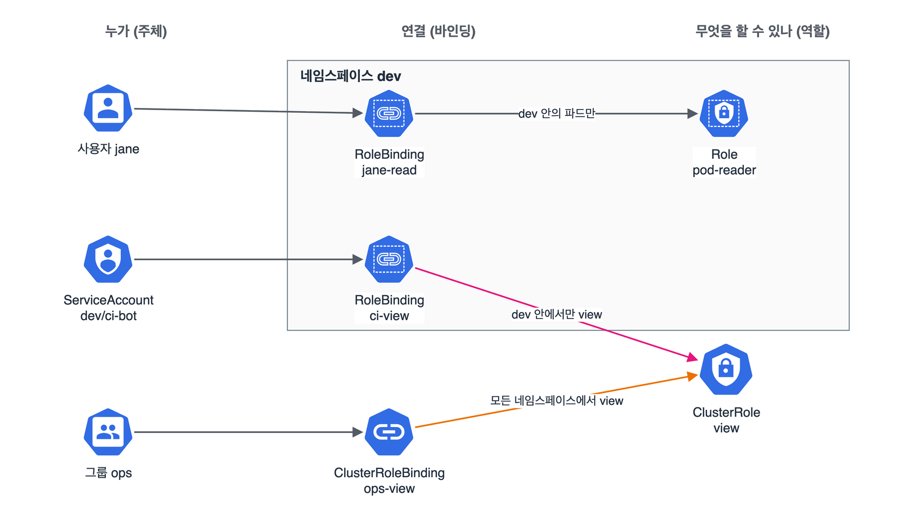

클러스터 아키텍처·설치·구성의 두 번째 정리, RBAC. 개정 전이나 후나 꼭 나오는 단골이다. 개념은 단순한데 Role, ClusterRole, RoleBinding, ClusterRoleBinding 네 가지 조합이 헷갈려서 그림으로 정리했다.

## 요약

- 요청은 인증(누구인가) → 인가(해도 되는가) → 어드미션(규칙에 맞는가) 순서로 검사된다. kubeadm 클러스터의 인가 모드는 Node, RBAC이다.
- Role은 네임스페이스 안의 권한, ClusterRole은 클러스터 범위 권한(또는 여러 네임스페이스에서 재사용할 권한 묶음)이다.
- RoleBinding은 그 네임스페이스 안에서만, ClusterRoleBinding은 클러스터 전체에서 권한을 준다. RoleBinding이 ClusterRole을 가리키면 그 네임스페이스로 범위가 좁혀진다.
- 쿠버네티스에는 사용자 객체가 없다. 클러스터 CA가 서명한 인증서의 CN이 사용자 이름, O가 그룹이 된다.
- 권한 확인은 kubectl auth can-i. --as로 다른 사용자나 ServiceAccount인 척 물어볼 수 있다.

## 1. 요청이 통과하는 단계


flowchart LR
  R["kubectl 요청"] --> A["인증<br>인증서, 토큰"]
  A --> Z["인가<br>Node, RBAC"]
  Z --> M["어드미션<br>변경·검증 웹훅, 정책"]
  M --> E["etcd 저장"]
  A -.->|"실패"| X1["401"]
  Z -.->|"권한 없음"| X2["403"]


## 2. 네 가지 리소스

| 리소스 | 범위 | 하는 일 |
|---|---|---|
| Role | 네임스페이스 | 그 네임스페이스 안의 리소스에 대한 권한 묶음 |
| ClusterRole | 클러스터 | 노드, PV 같은 클러스터 리소스 권한. 여러 네임스페이스에서 쓰는 공통 권한 묶음으로도 쓴다 |
| RoleBinding | 네임스페이스 | 주체에게 Role이나 ClusterRole을 그 네임스페이스 안에서 준다 |
| ClusterRoleBinding | 클러스터 | 주체에게 ClusterRole을 모든 네임스페이스와 클러스터 리소스에서 준다 |


_jane은 Role로 dev 안의 파드만 본다. ci-bot은 ClusterRole view를 RoleBinding으로 받아 dev 안에서만 view 권한을 갖는다. ops 그룹은 ClusterRoleBinding이라 모든 네임스페이스에서 view다_

규칙 하나는 apiGroups, resources, verbs로 이루어진다. 파드처럼 코어 그룹 리소스는 apiGroups가 빈 문자열이고, 디플로이먼트는 apps다. 로그 보기 같은 하위 리소스는 pods/log처럼 쓰고, 특정 객체만 허용하려면 resourceNames를 쓴다.

```yaml
apiVersion: rbac.authorization.k8s.io/v1
kind: Role
metadata:
  name: deploy-manager
  namespace: dev
rules:
- apiGroups: ["apps"]
  resources: ["deployments", "deployments/scale"]
  verbs: ["get", "list", "watch", "update", "patch"]
- apiGroups: [""]
  resources: ["pods", "pods/log"]
  verbs: ["get", "list"]
- apiGroups: [""]
  resources: ["configmaps"]
  resourceNames: ["app-config"]
  verbs: ["get", "update"]
```

resourceNames로는 create와 deletecollection을 막을 수 없다. 만들기 전에는 이름을 알 수 없어서다.

명령형으로 만들면 훨씬 빠르다. kubectl v1.32.2로 RoleBinding을 만들어 보면 ServiceAccount 주체에는 apiGroup이 없고 namespace가 붙는다. User나 Group 주체에는 apiGroup: rbac.authorization.k8s.io가 붙는다.

```bash
k create role pod-reader --verb=get,list,watch --resource=pods -n dev
k create rolebinding jane-read --role=pod-reader --user=jane -n dev
k create rolebinding ci-view --clusterrole=view --serviceaccount=dev:ci-bot -n dev
k create clusterrolebinding ops-view --clusterrole=view --group=ops
```

```yaml
apiVersion: rbac.authorization.k8s.io/v1
kind: RoleBinding
metadata:
  creationTimestamp: null
  name: ci-view
  namespace: dev
roleRef:
  apiGroup: rbac.authorization.k8s.io
  kind: ClusterRole
  name: view
subjects:
- kind: ServiceAccount
  name: ci-bot
  namespace: dev
```

바인딩의 roleRef는 만든 뒤에 바꿀 수 없다. 다른 역할로 바꾸려면 바인딩을 지우고 새로 만든다.

## 3. 권한 확인: auth can-i

```bash
k auth can-i list pods -n dev --as jane                         # yes / no
k auth can-i delete deployments -n dev --as jane
k auth can-i get pods -n dev --as system:serviceaccount:dev:ci-bot
k auth can-i --list -n dev --as jane                            # 할 수 있는 것 전부
```

문제에서 '권한을 줬는지 확인하라'고 하면 이걸로 마무리한다. ServiceAccount는 system:serviceaccount:<네임스페이스>:<이름> 형식으로 쓴다.

## 4. 인증서로 사용자 만들기

쿠버네티스에는 사용자 객체가 없다. 클러스터 CA가 서명한 인증서를 가져오면 인증된 사용자로 본다. 인증서의 CN이 사용자 이름, O가 그룹이다.

```bash
openssl genrsa -out jane.key 2048
openssl req -new -key jane.key -out jane.csr -subj "/CN=jane/O=dev-team"

cat <<EOF | k apply -f -
apiVersion: certificates.k8s.io/v1
kind: CertificateSigningRequest
metadata:
  name: jane
spec:
  request: $(base64 < jane.csr | tr -d '\n')
  signerName: kubernetes.io/kube-apiserver-client
  expirationSeconds: 86400
  usages: ["client auth"]
EOF

k certificate approve jane                     # 이 서명자는 자동 승인되지 않는다
k get csr jane -o jsonpath='{.status.certificate}' | base64 -d > jane.crt

k config set-credentials jane --client-key=jane.key --client-certificate=jane.crt --embed-certs=true
k config set-context jane@kubernetes --cluster=kubernetes --user=jane
k --context jane@kubernetes get pods -n dev    # RoleBinding이 있으면 성공
```

expirationSeconds는 600(10분) 이상이어야 한다. 비우면 컨트롤러 매니저 기본값(1년)으로 서명된다.

## 5. ServiceAccount

파드 안의 애플리케이션이 API를 부를 때 쓰는 계정이다. 네임스페이스마다 default ServiceAccount가 있고, 파드에 따로 지정하지 않으면 그걸 쓴다.

```bash
k create sa ci-bot -n dev
k create token ci-bot -n dev            # 만료 시간이 있는 토큰을 발급
```

v1.24부터는 ServiceAccount를 만들어도 만료 없는 토큰 Secret이 자동으로 생기지 않는다. 필요한 토큰은 create token이나 파드에 자동으로 마운트되는 짧은 수명의 토큰으로 받는다. API를 안 쓰는 파드는 spec.automountServiceAccountToken: false로 토큰 마운트를 끈다.

> **쉬운 설명**
>
> RBAC은 회사 출입 관리다. Role은 '3층 회의실 열쇠', ClusterRole은 '모든 층 회의실 열쇠' 같은 열쇠 꾸러미 설계도이고, 바인딩은 그 꾸러미를 누구에게 건네는 기록이다. RoleBinding은 '3층에서만 쓸 수 있게' 건네는 것이라, 모든 층 열쇠 설계도(ClusterRole)를 건네도 3층 문만 열린다. ClusterRoleBinding은 건물 전체에서 쓰게 건네는 것이다. 사원증(인증서)은 인사팀(CA) 도장이 찍혀 있으면 따로 명부에 없어도 통과된다.

## 헷갈렸던 것들

- RoleBinding이 ClusterRole을 가리킬 수 있다. 권한은 그 RoleBinding의 네임스페이스로만 적용된다.
- ClusterRoleBinding은 Role을 가리킬 수 없다. Role은 네임스페이스 리소스라서다.
- 노드, PV, 네임스페이스 같은 클러스터 리소스 권한은 ClusterRole + ClusterRoleBinding으로만 줄 수 있다.
- 파드 로그 권한은 pods가 아니라 pods/log다. exec는 pods/exec에 create 동사다.
- 디플로이먼트의 apiGroups는 apps, 파드·서비스·ConfigMap은 빈 문자열이다.
- roleRef는 수정할 수 없다. 지우고 다시 만든다.
- ServiceAccount 주체 형식은 --serviceaccount=네임스페이스:이름, can-i에서는 --as system:serviceaccount:네임스페이스:이름이다.
- CSR을 만들기만 하면 끝이 아니다. approve 해야 인증서가 발급된다.

## 용어 정리

| 용어 | 뜻 |
|---|---|
| 주체(subject) | 권한을 받는 대상. User, Group, ServiceAccount |
| 동사(verb) | get, list, watch, create, update, patch, delete 같은 동작 |
| 하위 리소스 | pods/log, pods/exec, deployments/scale처럼 리소스 아래의 기능 |
| roleRef | 바인딩이 가리키는 역할. 만든 뒤 바꿀 수 없다 |
| CSR | 인증서 서명 요청. 쿠버네티스 CertificateSigningRequest 리소스로 CA 서명을 받는다 |
| ServiceAccount | 파드 안의 애플리케이션이 쓰는 쿠버네티스 계정 |

## 복습 문제

**1.** Allow the user `jane` to create, view, and delete Deployments in the namespace `dev`. She must not be able to do this in any other namespace.

**2.** Allow the ServiceAccount `prom` in the namespace `monitoring` to read Pods in all namespaces and all Nodes.

**3.** Verify both of the settings above with `kubectl auth can-i`.

**4.** The RoleBinding for the user `jane` references the Role `deploy-manager`. You want it to reference the ClusterRole `edit` instead. How do you do this?

## 답과 풀이

1. 디플로이먼트는 apps 그룹이다. 명령형 create role이 리소스 이름에서 그룹을 찾아 준다.

```bash
k create role deploy-crud --verb=create,get,list,watch,delete --resource=deployments -n dev
k create rolebinding jane-deploy --role=deploy-crud --user=jane -n dev
```

2. 노드는 클러스터 리소스라 ClusterRole + ClusterRoleBinding이 필요하다.

```bash
k create clusterrole pod-node-reader --verb=get,list,watch --resource=pods,nodes
k create clusterrolebinding prom-read --clusterrole=pod-node-reader --serviceaccount=monitoring:prom
```

3. 됨과 안 됨을 둘 다 확인해야 확실하다.

```bash
k auth can-i create deployments -n dev --as jane          # yes
k auth can-i create deployments -n default --as jane      # no
k auth can-i list nodes --as system:serviceaccount:monitoring:prom   # yes
```

4. roleRef는 수정할 수 없으니 지우고 다시 만든다.

```bash
k delete rolebinding jane-deploy -n dev
k create rolebinding jane-deploy --clusterrole=edit --user=jane -n dev
```

## 참고 자료

- Kubernetes v1.32 문서, RBAC 인가: <https://v1-32.docs.kubernetes.io/docs/reference/access-authn-authz/rbac/>
- Kubernetes v1.32 문서, 인증: <https://v1-32.docs.kubernetes.io/docs/reference/access-authn-authz/authentication/>
- Kubernetes v1.32 문서, 인증서 서명 요청: <https://v1-32.docs.kubernetes.io/docs/reference/access-authn-authz/certificate-signing-requests/>
- Kubernetes v1.32 문서, ServiceAccount: <https://v1-32.docs.kubernetes.io/docs/concepts/security/service-accounts/>

