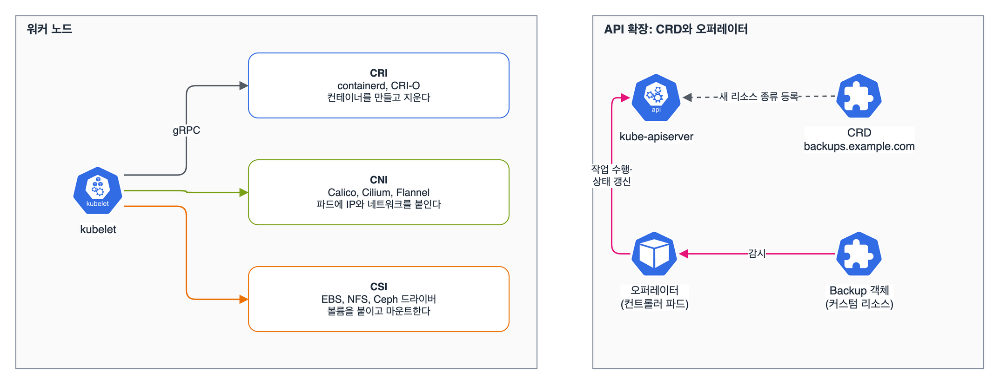

클러스터 아키텍처·설치·구성의 마지막 정리. 내일(2월 18일)부터 새로 들어오는 항목 세 개, 'Helm과 Kustomize로 구성 요소 설치', '확장 인터페이스(CNI, CSI, CRI) 이해', 'CRD 이해와 오퍼레이터 설치'를 모았다. 예전 범위에서는 '템플릿 도구를 알기만 하면' 됐는데, 이제는 직접 설치하고 고치는 문제가 나온다고 봐야 한다.

## 요약

- Helm은 차트(패키지)를 저장소에서 받아 값(values)을 바꿔 설치한다. install, upgrade, rollback, uninstall, list -A, show values를 손에 익힌다.
- Kustomize는 kubectl에 들어 있다(kubectl v1.32.2에는 Kustomize v5.5.0). base에 overlay를 겹쳐 kubectl apply -k로 적용한다.
- Kustomize의 commonLabels는 사용 중단이고 셀렉터까지 바꾼다. 새로 쓸 때는 labels를 쓴다.
- CRD는 API에 새 리소스 종류를 추가하고, 오퍼레이터는 그 리소스를 감시해 실제 일을 하는 컨트롤러다.
- kubelet은 CRI로 컨테이너 런타임을, CNI로 네트워크 플러그인을, CSI로 스토리지 드라이버를 부른다.

## 1. Helm

시험 중에는 helm.sh/docs를 볼 수 있다. 자주 쓰는 명령은 이 정도다.

| 하고 싶은 것 | 명령 |
|---|---|
| 저장소 추가·갱신 | `helm repo add ingress-nginx https://kubernetes.github.io/ingress-nginx`, `helm repo update` |
| 차트·버전 찾기 | `helm search repo ingress-nginx --versions` |
| 기본값 보기 | `helm show values ingress-nginx/ingress-nginx > values.yaml` |
| 설치 | `helm install my-ingress ingress-nginx/ingress-nginx -n ingress-nginx --create-namespace --set controller.replicaCount=2` |
| 설치된 것 보기 | `helm list -A`, `helm status my-ingress -n ingress-nginx`, `helm get values my-ingress -n ingress-nginx` |
| 값 바꾸기 | `helm upgrade my-ingress ingress-nginx/ingress-nginx -n ingress-nginx -f values.yaml` |
| 이력, 되돌리기 | `helm history my-ingress -n ingress-nginx`, `helm rollback my-ingress 1 -n ingress-nginx` |
| 지우기 | `helm uninstall my-ingress -n ingress-nginx` |
| 설치 없이 YAML만 | `helm template my-ingress ingress-nginx/ingress-nginx -f values.yaml` |

릴리스는 네임스페이스 안에 저장된다. helm list만 치면 현재 네임스페이스만 보여서, 처음 상황을 볼 때는 -A를 붙인다. 버전을 지정하라는 문제면 --version을 꼭 넣는다.

## 2. Kustomize

템플릿 없이 원본 YAML(base) 위에 환경별 수정(overlay)을 겹친다. 실제로 base(디플로이먼트 + 서비스)와 prod overlay를 만들어 v1.32.2의 kubectl kustomize로 돌려 봤다.

```bash
# 디렉터리 구조
# base/        deployment.yaml  service.yaml  kustomization.yaml
# overlays/prod/                              kustomization.yaml
k kustomize overlays/prod       # 결과만 보기
k apply -k overlays/prod        # 적용
```

overlays/prod/kustomization.yaml은 이렇게 썼다.

```
resources:
- ../../base
namespace: prod
namePrefix: prod-
labels:
- pairs:
    env: prod
images:
- name: nginx
  newTag: "1.27.4"
patches:
- target:
    kind: Deployment
    name: web
  patch: |-
    - op: replace
      path: /spec/replicas
      value: 3
configMapGenerator:
- name: web-config
  literals:
  - MODE=prod
```

결과 가운데 디플로이먼트만 보면 이렇다. 이름 앞에 prod-가 붙고, 네임스페이스와 이미지 태그, 복제본 수가 바뀌었다. labels로 넣은 env: prod는 메타데이터에만 붙고 셀렉터와 파드 템플릿은 그대로다.

```yaml
apiVersion: apps/v1
kind: Deployment
metadata:
  labels:
    env: prod
  name: prod-web
  namespace: prod
spec:
  replicas: 3
  selector:
    matchLabels:
      app: web
  template:
    metadata:
      labels:
        app: web
    spec:
      containers:
      - image: nginx:1.27.4
        name: web
```

같이 만들어진 ConfigMap 이름은 prod-web-config-2h42td9ggm처럼 내용 해시가 붙는다. 값이 바뀌면 이름이 바뀌어서, 이걸 참조하는 디플로이먼트가 새로 롤아웃된다.

예전 방식인 commonLabels로 같은 라벨을 넣어 보면 경고가 나오고, 셀렉터까지 바뀐다.

```bash
k kustomize overlays/cl | head -1
# Warning: 'commonLabels' is deprecated. Please use 'labels' instead. ...
```

이미 배포된 디플로이먼트의 셀렉터는 바꿀 수 없어서, 운영 중인 리소스에 commonLabels를 새로 넣으면 apply가 실패한다.

## 3. CRD와 오퍼레이터


_왼쪽: kubelet은 CRI로 컨테이너를, CNI로 파드 네트워크를, CSI로 볼륨을 다룬다. 오른쪽: CRD로 새 리소스 종류를 등록하고, 오퍼레이터가 그 리소스를 감시하며 실제 작업을 한다_

CRD 이름은 반드시 <복수형>.<그룹>이어야 한다. 버전마다 served(API로 제공)와 storage(etcd 저장 버전, 하나만 true)를 정한다.

```yaml
apiVersion: apiextensions.k8s.io/v1
kind: CustomResourceDefinition
metadata:
  name: backups.example.com
spec:
  group: example.com
  scope: Namespaced
  names:
    plural: backups
    singular: backup
    kind: Backup
    shortNames: ["bk"]
  versions:
  - name: v1
    served: true
    storage: true
    schema:
      openAPIV3Schema:
        type: object
        properties:
          spec:
            type: object
            properties:
              schedule:
                type: string
              retentionDays:
                type: integer
                minimum: 1
```

CRD를 적용하면 그때부터 Backup 객체를 만들 수 있다. 스키마에 맞지 않는 값(retentionDays: 0)은 apiserver가 거절한다.

```yaml
apiVersion: example.com/v1
kind: Backup
metadata:
  name: nightly
  namespace: default
spec:
  schedule: "0 2 * * *"
  retentionDays: 7
```

```bash
k get crd | grep example.com
k api-resources --api-group=example.com
k explain backup.spec              # CRD 스키마로 설명이 나온다
k get bk -A
```

CRD만 있으면 객체가 저장될 뿐 아무 일도 안 일어난다. 실제로 백업을 돌리는 건 오퍼레이터(컨트롤러) 몫이다. 오퍼레이터는 보통 Helm 차트나 매니페스트 묶음으로 설치하고, 설치하면 CRD와 컨트롤러 디플로이먼트, RBAC가 함께 들어온다.


flowchart LR
  U["Backup 생성·수정"] --> A["kube-apiserver<br>(CRD 스키마로 검증)"]
  A --> O["오퍼레이터가 감시"]
  O --> W["실제 작업<br>(잡 생성, 외부 저장소 호출)"]
  W --> S["status 갱신"]
  S --> O


## 4. CNI, CSI, CRI

| 인터페이스 | 누가 부르나 | 구현 예 | 노드에서 확인할 곳 |
|---|---|---|---|
| CRI | kubelet → 런타임(gRPC) | containerd, CRI-O | sudo crictl ps, crictl pods, crictl logs <ID> |
| CNI | 파드를 만들 때 런타임이 플러그인 실행 | Calico, Cilium, Flannel | 설정 /etc/cni/net.d, 실행 파일 /opt/cni/bin |
| CSI | kubelet(마운트)과 컨트롤러(볼륨 생성·연결) | AWS EBS, NFS, Ceph 드라이버 | k get csidrivers, StorageClass의 provisioner |

v1.24에 도커심이 빠지면서 노드에서 docker 명령 대신 crictl을 쓴다. 컨트롤 플레인 파드가 안 떠서 kubectl이 안 될 때는 crictl ps -a와 crictl logs로 원인을 본다.

> **쉬운 설명**
>
> Helm은 앱스토어다. 앱(차트)을 받으면서 설정(values)만 고르면 알아서 깔리고, 업데이트하다 망가지면 이전 버전으로 되돌릴 수 있다. Kustomize는 원본 문서에 포스트잇을 붙이는 방식이라, 원본은 그대로 두고 '운영에서는 3개, 태그는 1.27.4' 같은 메모만 겹친다. CRD는 새 서류 양식을 회사에 등록하는 것이고, 오퍼레이터는 그 서류가 접수되면 실제로 일을 처리하는 담당자다. 양식만 있고 담당자가 없으면 서류는 쌓이기만 한다.

## 헷갈렸던 것들

- helm list는 현재 네임스페이스만 보여 준다. 전체는 helm list -A.
- helm install은 네임스페이스가 없으면 실패한다. --create-namespace를 붙인다.
- helm upgrade에 --set을 일부만 주면 예전에 준 다른 값은 차트 기본값으로 돌아간다. 이전 값을 지키려면 --reuse-values를 붙이거나 전체 값을 -f values.yaml로 다시 준다.
- kubectl apply -k는 디렉터리를 받는다. -f가 아니다.
- Kustomize labels는 기본적으로 셀렉터를 건드리지 않고, commonLabels는 셀렉터까지 바꾼다.
- CRD 이름은 <복수형>.<그룹>. storage: true인 버전은 하나뿐이다.
- CRD를 지우면 그 종류의 커스텀 리소스도 모두 지워진다.
- 노드에서 컨테이너를 볼 때는 docker가 아니라 crictl이다.

## 용어 정리

| 용어 | 뜻 |
|---|---|
| 차트 | Helm 패키지. 템플릿과 기본 values로 이루어진다 |
| 릴리스 | 차트를 한 번 설치한 인스턴스. 리비전 이력이 남는다 |
| base / overlay | Kustomize의 원본 리소스 묶음 / 그 위에 겹치는 환경별 수정 |
| CRD | 쿠버네티스 API에 새 리소스 종류를 추가하는 정의 |
| 커스텀 리소스 | CRD로 만든 종류의 객체 |
| 오퍼레이터 | 커스텀 리소스를 감시하며 애플리케이션 운영을 자동화하는 컨트롤러 |
| CRI, CNI, CSI | 컨테이너 런타임, 네트워크, 스토리지를 붙이는 표준 인터페이스 |

## 복습 문제

**1.** Add the Helm repository `ingress-nginx`, and install a release named `edge` in the namespace `ingress` with 2 controller replicas.

**2.** Upgrade the release from question 1 to 3 replicas, and then roll it back to the previous revision.

**3.** Without changing the directory `base`, create and apply an overlay that deploys to the namespace `staging` and changes only the image tag to `1.27.4`.

**4.** Find all CRDs installed in the cluster that belong to the `cert-manager.io` group, and check the `spec` fields of the `Certificate` resource.

## 답과 풀이

1. 차트의 값 이름은 helm show values로 확인한다.

```bash
helm repo add ingress-nginx https://kubernetes.github.io/ingress-nginx && helm repo update
helm install edge ingress-nginx/ingress-nginx -n ingress --create-namespace --set controller.replicaCount=2
helm list -n ingress
```

2. 리비전 번호는 history로 확인한다.

```bash
helm upgrade edge ingress-nginx/ingress-nginx -n ingress --reuse-values --set controller.replicaCount=3
helm history edge -n ingress
helm rollback edge 1 -n ingress
```

3. overlay에는 resources, namespace, images만 있으면 된다.

```bash
mkdir -p overlays/staging
cat > overlays/staging/kustomization.yaml <<EOF
resources:
- ../../base
namespace: staging
images:
- name: nginx
  newTag: "1.27.4"
EOF
k create ns staging
k apply -k overlays/staging
```

4. api-resources로 그룹을 거르고, explain으로 스키마를 본다.

```bash
k get crd | grep cert-manager.io
k api-resources --api-group=cert-manager.io
k explain certificate.spec
```

## 참고 자료

- Helm 문서, 사용법: <https://helm.sh/docs/intro/using_helm/>
- Kubernetes v1.32 문서, Kustomize: <https://v1-32.docs.kubernetes.io/docs/tasks/manage-kubernetes-objects/kustomization/>
- Kubernetes v1.32 문서, CRD로 API 확장: <https://v1-32.docs.kubernetes.io/docs/tasks/extend-kubernetes/custom-resources/custom-resource-definitions/>
- Kubernetes v1.32 문서, 오퍼레이터 패턴: <https://v1-32.docs.kubernetes.io/docs/concepts/extend-kubernetes/operator/>
- Kubernetes v1.32 문서, 쿠버네티스 확장: <https://v1-32.docs.kubernetes.io/docs/concepts/extend-kubernetes/>
- Kubernetes v1.32 문서, CRI: <https://v1-32.docs.kubernetes.io/docs/concepts/architecture/cri/>

