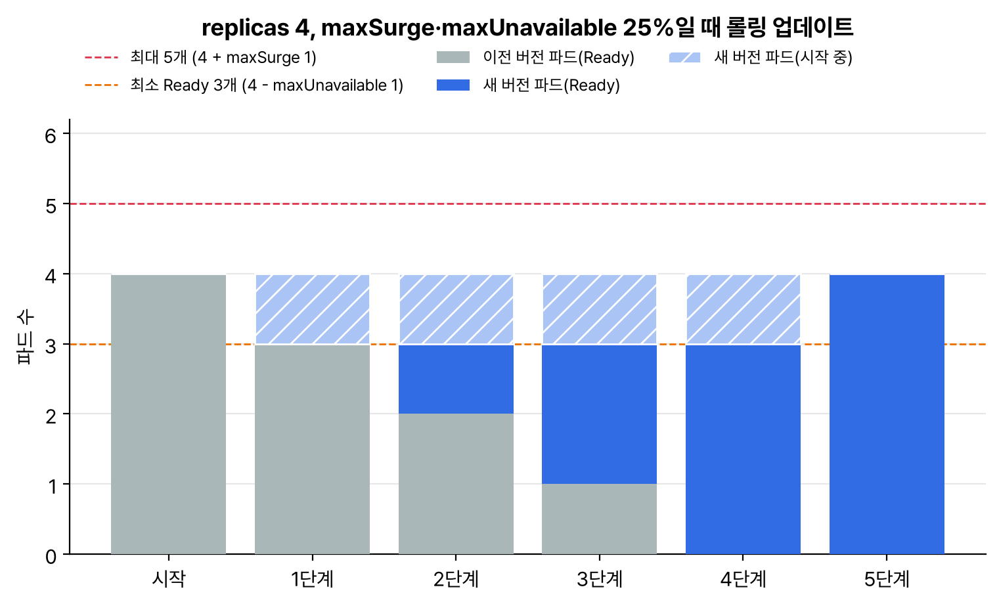

워크로드와 스케줄링(15%) 범위 중 '롤링 업데이트와 롤백', 'ConfigMap과 Secret으로 앱 설정', '워크로드 오토스케일링', '스스로 복구되는 배포의 기본 요소'를 묶었다. 오토스케일링은 이번 개편에서 새로 이름이 붙은 항목이다.

## 요약

- 디플로이먼트 → 레플리카셋 → 파드 순서로 관리한다. 파드 템플릿이 바뀔 때마다 새 레플리카셋이 생기고, 이전 것은 기본 10개까지 남아 롤백에 쓰인다.
- 롤링 업데이트는 maxSurge(더 띄울 수 있는 수)와 maxUnavailable(줄어도 되는 수)로 속도를 정한다. 기본값은 둘 다 25%다.
- ConfigMap과 Secret은 환경 변수나 볼륨으로 넣는다. 환경 변수와 subPath 마운트는 값이 바뀌어도 자동으로 갱신되지 않는다.
- HPA는 metrics-server가 있어야 동작한다. 원하는 복제본 수는 ceil(현재 복제본 × 현재 지표 ÷ 목표 지표)로 계산한다.

## 1. 디플로이먼트와 자가 복구


flowchart LR
  D["Deployment web<br>replicas: 3"] --> RS2["ReplicaSet (새 버전)<br>3개"]
  D -.-> RS1["ReplicaSet (이전 버전)<br>0개, 롤백용으로 남음"]
  RS2 --> P1["Pod"]
  RS2 --> P2["Pod"]
  RS2 --> P3["Pod"]


파드 하나가 죽거나 노드가 사라지면 레플리카셋이 개수를 맞추려고 새 파드를 만든다. 이게 '스스로 복구'의 기본이다. 여기에 컨테이너가 멈췄을 때 재시작해 주는 restartPolicy와 liveness probe, 준비되기 전엔 트래픽을 안 받게 하는 readiness probe, 노드 작업 중에도 최소 개수를 지키는 PodDisruptionBudget이 더해진다. 프로브는 CKAD 쪽에서 더 자세히 정리한다.

## 2. 롤링 업데이트와 롤백

| 필드 | 기본값 | 뜻 |
|---|---|---|
| strategy.type | RollingUpdate | Recreate로 바꾸면 이전 파드를 모두 지운 뒤 새로 띄운다(잠깐 중단) |
| rollingUpdate.maxSurge | 25% | 원하는 개수보다 더 띄울 수 있는 수. 퍼센트는 올림 |
| rollingUpdate.maxUnavailable | 25% | 원하는 개수보다 줄어도 되는 수. 퍼센트는 내림 |
| revisionHistoryLimit | 10 | 남겨 둘 이전 레플리카셋 수. 0이면 롤백할 수 없다 |


_replicas 4에 기본값이면 maxSurge 1, maxUnavailable 1이다. 전체는 5개를 넘지 않고 Ready는 3개 아래로 내려가지 않게 한 단계씩 바꾼다(새 파드는 다음 단계에 Ready가 된다고 단순화한 계산)_

```bash
k set image deploy/web nginx=nginx:1.27.4        # 컨테이너 이름=새 이미지
k rollout status deploy/web
k rollout history deploy/web
k rollout undo deploy/web                        # 바로 이전으로
k rollout undo deploy/web --to-revision=2        # 특정 리비전으로
k rollout restart deploy/web                     # 템플릿 그대로 파드만 새로
k rollout pause deploy/web                       # 여러 군데 고칠 때 잠시 멈춤
k rollout resume deploy/web
```

set image의 왼쪽은 이미지 이름이 아니라 컨테이너 이름이다. create deploy로 만들면 컨테이너 이름이 이미지 이름(nginx)으로 정해져서 헷갈리기 쉽다. 파일만 고쳐 볼 때는 --local을 쓰면 서버 없이 결과를 확인할 수 있다.

```bash
k set image -f web.yaml nginx=nginx:1.27.4 --local -o yaml | grep image:
#       - image: nginx:1.27.4
```

## 3. ConfigMap과 Secret

```bash
k create cm app-config --from-literal=MODE=prod --from-file=app.properties
k create secret generic db-cred --from-literal=username=app --from-literal=password=s3cr3t
k create secret tls web-tls --cert=tls.crt --key=tls.key
```

```yaml
apiVersion: v1
kind: Pod
metadata:
  name: app
spec:
  containers:
  - name: app
    image: busybox:1.36
    command: ["sh", "-c", "env; ls /etc/app; sleep 3600"]
    env:
    - name: MODE
      valueFrom:
        configMapKeyRef:
          name: app-config
          key: MODE
    - name: DB_PASSWORD
      valueFrom:
        secretKeyRef:
          name: db-cred
          key: password
    envFrom:
    - configMapRef:
        name: app-config
    volumeMounts:
    - name: config
      mountPath: /etc/app
      readOnly: true
  volumes:
  - name: config
    configMap:
      name: app-config
```

| 넣는 방법 | ConfigMap이 바뀌면 |
|---|---|
| env, envFrom | 자동 반영 안 됨. 파드를 다시 띄워야 한다(rollout restart) |
| 볼륨 마운트 | 잠시 뒤 파일이 바뀐다(kubelet 동기화 주기만큼 지연) |
| subPath로 파일 하나만 마운트 | 자동 반영 안 됨 |

Secret은 기본적으로 etcd에 암호화되지 않은 채 저장되고, 하나에 1MiB까지다. 그 네임스페이스에서 파드를 만들 수 있는 사람은 Secret을 마운트해서 읽을 수 있다는 점도 알아 둔다.

## 4. 오토스케일링: HPA

```bash
k top pods                                   # metrics-server가 있어야 나온다
k autoscale deploy web --min=2 --max=10 --cpu-percent=70
k get hpa
```

명령형 autoscale은 CPU만 된다. 메모리나 스케일 속도까지 정하려면 autoscaling/v2 YAML로 쓴다.

```yaml
apiVersion: autoscaling/v2
kind: HorizontalPodAutoscaler
metadata:
  name: web
spec:
  scaleTargetRef:
    apiVersion: apps/v1
    kind: Deployment
    name: web
  minReplicas: 2
  maxReplicas: 10
  metrics:
  - type: Resource
    resource:
      name: cpu
      target:
        type: Utilization
        averageUtilization: 70
  behavior:
    scaleDown:
      stabilizationWindowSeconds: 300
```

계산은 이렇게 한다. 복제본 4개가 평균 CPU 90%로 돌고 목표가 70%라면 ceil(4 × 90 ÷ 70) = ceil(5.14) = 6개로 늘린다. 비율이 1.0에서 0.1 안쪽이면(예: 목표 70%, 현재 75%) 움직이지 않는다. 줄일 때는 기본 300초 동안 가장 높았던 추천값을 써서 들쭉날쭉한 축소를 막는다.

Utilization은 requests 대비 비율이다. 컨테이너에 cpu requests가 없으면 HPA가 계산하지 못하고 대상이 unknown으로 나온다.

> **쉬운 설명**
>
> 롤링 업데이트는 식당이 영업을 멈추지 않고 직원을 교대하는 것이다. maxSurge는 '잠깐 겹쳐서 한 명 더 있어도 된다', maxUnavailable은 '한 명까지는 비어도 된다'는 규칙이다. ConfigMap을 환경 변수로 넣는 건 출근할 때 받은 업무 지시서라서, 본사가 지시를 바꿔도 다시 출근(재시작)해야 새 지시를 받는다. 볼륨으로 넣으면 벽에 붙은 공지판이라 바뀌면 곧 보인다. HPA는 손님이 몰리면 알바를 더 부르는 점장인데, 손님 수를 세는 카운터(metrics-server)가 없으면 아무것도 못 한다.

## 헷갈렸던 것들

- maxSurge는 올림, maxUnavailable은 내림이다. replicas 3에 25%면 maxSurge 1, maxUnavailable 0이다.
- 둘 다 0으로는 둘 수 없다.
- k set image의 왼쪽은 컨테이너 이름이다.
- rollout undo는 바로 이전 리비전으로 간다. 특정 버전은 --to-revision.
- 디플로이먼트의 replicas만 바꾸면(scale) 새 리비전이 생기지 않는다. 파드 템플릿이 바뀔 때만 생긴다.
- ConfigMap을 env로 넣었으면 값을 바꾼 뒤 rollout restart가 필요하다.
- HPA는 metrics-server와 컨테이너 requests가 있어야 한다. 없으면 TARGETS가 <unknown>이다.
- HPA가 붙은 디플로이먼트에 replicas를 직접 고정해 두면 apply할 때마다 HPA와 싸운다. HPA를 쓰면 매니페스트에서 replicas를 빼는 게 낫다.

## 용어 정리

| 용어 | 뜻 |
|---|---|
| 리비전 | 디플로이먼트 파드 템플릿의 버전. 레플리카셋 하나에 대응한다 |
| maxSurge / maxUnavailable | 롤링 업데이트 중 더 띄울 수 있는 수 / 줄어도 되는 수 |
| HPA | 지표를 보고 복제본 수를 늘리고 줄이는 HorizontalPodAutoscaler |
| metrics-server | 노드와 파드의 CPU·메모리 사용량을 모아 API로 제공하는 애드온 |
| 안정화 기간 | 스케일 결정을 잠시 지켜보며 흔들림을 막는 시간 |

## 복습 문제

**1.** Change the image of the Deployment `web` (container name `nginx`) to `nginx:1.27.4`, watch until the update finishes, and then roll back to the previous version.

**2.** Configure `web` so that the number of Ready Pods never drops below the desired count during a rolling update.

**3.** Create a Pod named `cfg-test` that uses the key `MODE` of the ConfigMap `app-config` as the environment variable `APP_MODE`.

**4.** Make `web` scale between 3 and 8 replicas based on 60% CPU utilization. If the HPA target shows `<unknown>`, what do you check first?

## 답과 풀이

1. 상태 확인과 되돌리기까지 한 번에.

```bash
k set image deploy/web nginx=nginx:1.27.4
k rollout status deploy/web
k rollout undo deploy/web
k rollout history deploy/web
```

2. maxUnavailable을 0으로 두면 된다. 그러면 maxSurge가 0보다 커야 한다.

```bash
k patch deploy web -p '{"spec":{"strategy":{"rollingUpdate":{"maxUnavailable":0,"maxSurge":1}}}}'
```

3. 명령형으로 뼈대를 만들고 env 부분만 추가한다.

```bash
k run cfg-test --image=busybox:1.36 $do -- sleep 3600 > cfg.yaml
# containers[0] 아래에 추가:
#   env:
#   - name: APP_MODE
#     valueFrom:
#       configMapKeyRef: {name: app-config, key: MODE}
k apply -f cfg.yaml
k exec cfg-test -- env | grep APP_MODE
```

4. 명령형 autoscale로 충분하다. unknown이면 metrics-server(k top pods가 되는지)와 컨테이너의 cpu requests부터 본다.

```bash
k autoscale deploy web --min=3 --max=8 --cpu-percent=60
k get hpa web
k top pods
k get deploy web -o jsonpath='{.spec.template.spec.containers[0].resources}'
```

## 참고 자료

- Kubernetes v1.32 문서, 디플로이먼트: <https://v1-32.docs.kubernetes.io/docs/concepts/workloads/controllers/deployment/>
- Kubernetes v1.32 문서, ConfigMap: <https://v1-32.docs.kubernetes.io/docs/concepts/configuration/configmap/>
- Kubernetes v1.32 문서, Secret: <https://v1-32.docs.kubernetes.io/docs/concepts/configuration/secret/>
- Kubernetes v1.32 문서, HPA: <https://v1-32.docs.kubernetes.io/docs/tasks/run-application/horizontal-pod-autoscale/>
- Kubernetes v1.32 문서, PodDisruptionBudget: <https://v1-32.docs.kubernetes.io/docs/tasks/run-application/configure-pdb/>

