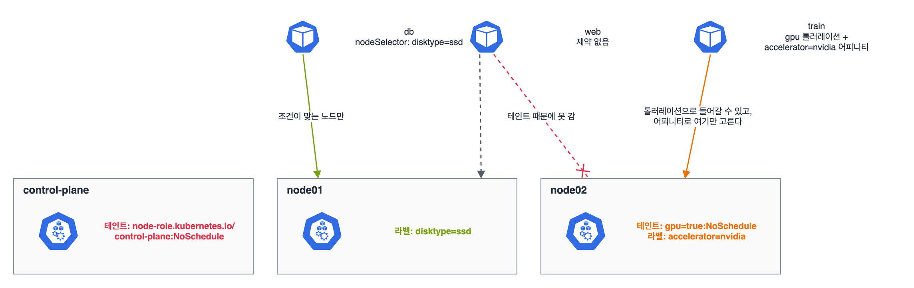

개편된 범위에서 '파드 어드미션과 스케줄링 구성(리소스 제한, 노드 어피니티 등)'이다. 파드가 만들어질 때 어드미션에서 거절되는 경우와, 만들어졌는데 Pending으로 남는 경우를 나눠서 봤더니 정리가 쉬웠다.

## 요약

- requests는 스케줄링 기준(이만큼 남은 노드에만 놓는다), limits는 실행 중 상한이다. 메모리 limits를 넘으면 OOMKilled, CPU limits를 넘으면 느려진다(스로틀링).
- LimitRange는 네임스페이스의 기본값과 최소·최대를, ResourceQuota는 네임스페이스 전체 합계를 정한다. 둘 다 어드미션 단계에서 검사해 위반하면 생성 자체가 거절된다.
- 특정 노드로 보내려면 nodeSelector나 노드 어피니티, 특정 노드에서 밀어내려면 테인트를 쓴다. 테인트가 있는 노드에는 톨러레이션이 있는 파드만 들어간다.
- 톨러레이션은 '들어가도 된다'는 허락일 뿐이다. 그 노드로 가게 만들려면 어피니티를 같이 쓴다.
- PriorityClass가 높은 파드는 자리가 없으면 낮은 파드를 밀어내고(선점) 들어간다.

## 1. 파드가 노드에 놓이기까지


flowchart TB
  C["파드 생성 요청"] --> A{"어드미션<br>LimitRange·ResourceQuota<br>Pod Security"}
  A -->|"위반"| R["생성 거절<br>(Forbidden)"]
  A -->|"통과"| P["Pending<br>(노드 미정)"]
  P --> F{"스케줄러 필터<br>자원, 셀렉터, 어피니티,<br>테인트"}
  F -->|"맞는 노드 없음"| W["Pending 유지<br>(이벤트: FailedScheduling)"]
  F -->|"후보 있음"| S["점수 매겨<br>노드 선택·바인딩"]
  S --> K["kubelet이 실행"]


Pending 파드는 k describe pod의 Events에 이유가 나온다. 'Insufficient cpu', 'node(s) didn't match Pod's node affinity/selector', 'node(s) had untolerated taint'처럼 무엇이 막았는지 적혀 있다.

## 2. requests와 limits, QoS

```yaml
apiVersion: v1
kind: Pod
metadata:
  name: api
spec:
  containers:
  - name: api
    image: nginx:1.27
    resources:
      requests:
        cpu: 250m
        memory: 128Mi
      limits:
        cpu: 500m
        memory: 256Mi
```

| QoS 등급 | 조건 | 노드 메모리가 모자랄 때 |
|---|---|---|
| Guaranteed | 모든 컨테이너가 CPU·메모리 requests와 limits를 같게 지정 | 가장 늦게 쫓겨난다 |
| Burstable | 하나라도 requests나 limits가 있지만 Guaranteed 조건은 아님 | 중간 |
| BestEffort | 아무것도 지정 안 함 | 가장 먼저 쫓겨난다 |

CPU 250m은 0.25코어, 메모리 128Mi는 128 × 2^20바이트다. M(10^6)과 Mi(2^20)는 다르다.

## 3. LimitRange와 ResourceQuota

```yaml
apiVersion: v1
kind: LimitRange
metadata:
  name: defaults
  namespace: team-a
spec:
  limits:
  - type: Container
    defaultRequest:
      cpu: 100m
      memory: 64Mi
    default:
      cpu: 200m
      memory: 128Mi
    max:
      cpu: "1"
      memory: 512Mi
```

```yaml
apiVersion: v1
kind: ResourceQuota
metadata:
  name: team-a
  namespace: team-a
spec:
  hard:
    pods: "10"
    requests.cpu: "4"
    requests.memory: 8Gi
    limits.memory: 16Gi
```

명령형으로는 k create quota team-a --hard=pods=10,requests.cpu=4 -n team-a가 된다. 쿼터에 requests.cpu가 있으면 그 네임스페이스의 모든 파드가 cpu requests를 가져야 해서, 없는 파드는 거절된다. 그래서 LimitRange로 기본값을 같이 둔다.

## 4. 노드 고르기: nodeSelector, 어피니티, 테인트


_db는 nodeSelector로 ssd 노드에만 간다. 제약 없는 web은 테인트가 걸린 node02에는 못 간다. train은 gpu 톨러레이션으로 node02에 들어갈 수 있고, accelerator 어피니티로 node02만 고른다_

```bash
k label node node01 disktype=ssd
k taint node node02 gpu=true:NoSchedule
k taint node node02 gpu=true:NoSchedule-     # 끝에 -를 붙이면 제거
k describe node node02 | grep -i taint
```

```yaml
apiVersion: v1
kind: Pod
metadata:
  name: train
spec:
  tolerations:
  - key: gpu
    operator: Equal
    value: "true"
    effect: NoSchedule
  affinity:
    nodeAffinity:
      requiredDuringSchedulingIgnoredDuringExecution:
        nodeSelectorTerms:
        - matchExpressions:
          - key: accelerator
            operator: In
            values: ["nvidia"]
      preferredDuringSchedulingIgnoredDuringExecution:
      - weight: 50
        preference:
          matchExpressions:
          - key: disktype
            operator: In
            values: ["ssd"]
  containers:
  - name: train
    image: busybox:1.36
    command: ["sleep", "3600"]
```

| 테인트 효과 | 새 파드 | 이미 돌던 파드 |
|---|---|---|
| NoSchedule | 톨러레이션 없으면 안 놓는다 | 그대로 둔다 |
| PreferNoSchedule | 되도록 피한다 | 그대로 둔다 |
| NoExecute | 안 놓는다 | 톨러레이션 없으면 쫓아낸다(tolerationSeconds 뒤) |

그 밖에 파드끼리 붙이거나 떼는 podAffinity·podAntiAffinity(같은 노드나 같은 존에), 존·노드에 고르게 퍼뜨리는 topologySpreadConstraints가 있다. nodeName을 직접 쓰면 스케줄러를 건너뛰고 바로 그 노드에 놓인다.

## 5. 우선순위와 선점

```bash
k create priorityclass high --value=100000 --description="batch first"
```

v1.32.2로 만들어 보면 preemptionPolicy: PreemptLowerPriority가 기본으로 들어간다. 파드에는 spec.priorityClassName: high로 붙인다. 자리가 없으면 스케줄러가 우선순위 낮은 파드를 내보내고 이 파드를 놓는다. 선점 없이 대기열에서만 앞서게 하려면 preemptionPolicy: Never로 만든다.

## 6. 어드미션: Pod Security

PodSecurityPolicy는 v1.25에 없어졌고, 지금은 네임스페이스 라벨로 거는 Pod Security 어드미션을 쓴다.

```bash
k label ns team-a pod-security.kubernetes.io/enforce=restricted
k label ns team-a pod-security.kubernetes.io/warn=restricted
```

| 수준 | 내용 |
|---|---|
| privileged | 제한 없음 |
| baseline | 특권 컨테이너, hostNetwork 같은 알려진 위험만 막는다 |
| restricted | root 실행 금지, 권한 상승 금지, capability 제거 등 강하게 막는다 |

enforce는 위반 파드를 거절하고, warn은 경고만, audit은 감사 로그에만 남긴다.

> **쉬운 설명**
>
> 스케줄링은 결혼식 하객 자리 배치다. requests는 '의자 하나는 꼭 필요하다'는 신청서라서 빈 의자가 있는 테이블에만 앉힌다. 테인트는 테이블에 붙인 '가족석' 팻말이고, 톨러레이션은 '저는 가족이에요'라는 초대장이다. 초대장이 있다고 가족석에 앉아야 하는 건 아니라서, 꼭 거기 앉히려면 어피니티로 '가족석에 앉혀 주세요'까지 써야 한다. LimitRange와 ResourceQuota는 입구에서 신청서를 보고 돌려보내는 접수처이고, PriorityClass는 VIP라서 자리가 없으면 다른 하객을 일으켜 세운다.

## 헷갈렸던 것들

- requests가 노드 남은 용량보다 크면 Pending이다. 실제 사용량이 아니라 requests 합계로 계산한다.
- 쿼터에 requests.cpu가 있으면 requests 없는 파드는 생성 자체가 거절된다(Pending이 아니다).
- 톨러레이션만으로는 그 노드로 가지 않는다. 어피니티나 nodeSelector가 필요하다.
- 테인트 제거는 같은 명령 끝에 -를 붙인다.
- 컨트롤 플레인 노드에는 node-role.kubernetes.io/control-plane:NoSchedule 테인트가 있어서 일반 파드가 안 간다.
- IgnoredDuringExecution: 파드가 놓인 뒤 노드 라벨이 바뀌어도 쫓겨나지 않는다.
- Mi와 M은 다르다. 128Mi는 약 134MB다.
- PodSecurityPolicy는 없어졌다. Pod Security 어드미션은 네임스페이스 라벨로 건다.

## 용어 정리

| 용어 | 뜻 |
|---|---|
| requests / limits | 스케줄링에 쓰는 요청량 / 실행 중 넘을 수 없는 상한 |
| QoS 등급 | requests·limits 설정에 따라 정해지는 Guaranteed, Burstable, BestEffort |
| LimitRange | 네임스페이스 안 컨테이너·파드의 기본값과 최소·최대 |
| ResourceQuota | 네임스페이스 전체 리소스 합계와 개수 상한 |
| 테인트 / 톨러레이션 | 노드에 거는 '오지 마시오' 표시 / 파드가 그 표시를 견딜 수 있다는 선언 |
| 노드 어피니티 | 노드 라벨로 파드를 놓을 곳을 고르는 규칙(필수·선호) |
| 선점 | 높은 우선순위 파드를 위해 낮은 우선순위 파드를 내보내는 것 |

## 복습 문제

**1.** In the namespace `team-a`, allow at most 5 Pods and at most 2 CPU cores in total CPU requests. Containers that do not set requests must get a default CPU request of `100m`.

**2.** What happens if you add the taint `maintenance=true:NoExecute` to `node02`? How do you keep only the Pod `batch` running on it?

**3.** Schedule the Pod `db` only on nodes that have the label `disktype=ssd`. What happens if no such node exists?

**4.** The Pod `big` is Pending. In what order do you look for the cause?

## 답과 풀이

1. ResourceQuota로 합계를, LimitRange로 기본 requests를 건다.

```bash
k create quota team-a --hard=pods=5,requests.cpu=2 -n team-a
cat <<EOF | k apply -f -
apiVersion: v1
kind: LimitRange
metadata: {name: defaults, namespace: team-a}
spec:
  limits:
  - type: Container
    defaultRequest: {cpu: 100m}
EOF
```

2. NoExecute라 톨러레이션 없는 파드는 바로 쫓겨난다. batch에만 같은 키의 톨러레이션(effect: NoExecute)을 넣으면 남는다. tolerationSeconds를 주면 그 시간 뒤에 쫓겨난다.

3. 간단히 nodeSelector를 쓴다. 맞는 노드가 없으면 Pending으로 남고 이벤트에 FailedScheduling이 찍힌다.

```bash
k run db --image=nginx:1.27 $do > db.yaml
# spec 아래: nodeSelector: {disktype: ssd}
k apply -f db.yaml
```

4. 이벤트를 먼저 보고, 노드 쪽 여유와 테인트를 확인한다.

```bash
k describe pod big | sed -n '/Events/,$p'
k describe node node01 | grep -A8 'Allocated resources'
k get nodes -o custom-columns=NAME:.metadata.name,TAINTS:.spec.taints
```

## 참고 자료

- Kubernetes v1.32 문서, 컨테이너 리소스 관리: <https://v1-32.docs.kubernetes.io/docs/concepts/configuration/manage-resources-containers/>
- Kubernetes v1.32 문서, LimitRange: <https://v1-32.docs.kubernetes.io/docs/concepts/policy/limit-range/>
- Kubernetes v1.32 문서, ResourceQuota: <https://v1-32.docs.kubernetes.io/docs/concepts/policy/resource-quotas/>
- Kubernetes v1.32 문서, 파드를 노드에 할당하기: <https://v1-32.docs.kubernetes.io/docs/concepts/scheduling-eviction/assign-pod-node/>
- Kubernetes v1.32 문서, 테인트와 톨러레이션: <https://v1-32.docs.kubernetes.io/docs/concepts/scheduling-eviction/taint-and-toleration/>
- Kubernetes v1.32 문서, 우선순위와 선점: <https://v1-32.docs.kubernetes.io/docs/concepts/scheduling-eviction/pod-priority-preemption/>
- Kubernetes v1.32 문서, Pod Security 어드미션: <https://v1-32.docs.kubernetes.io/docs/concepts/security/pod-security-admission/>

