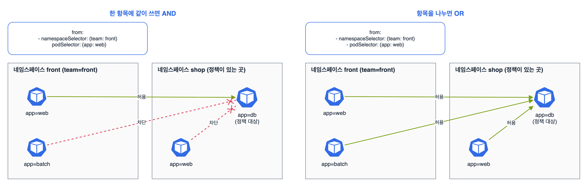

서비스와 네트워킹(20%)의 첫 정리. 범위의 '파드 간 연결 이해', 'ClusterIP·NodePort·LoadBalancer와 엔드포인트', 'CoreDNS 이해와 사용', 'NetworkPolicy 정의와 적용'을 묶었다. NetworkPolicy는 이번 개편에서 '정의하고 적용하라'로 문구가 세졌다. 직접 써서 막고 여는 문제가 나온다고 보고, AND와 OR 차이를 그림으로 정리했다.

## 요약

- 모든 파드는 NAT 없이 서로 통신할 수 있다(쿠버네티스 네트워크 모델). 이걸 실제로 만들어 주는 게 CNI 플러그인이다.
- Service는 라벨 셀렉터로 고른 파드 앞에 고정된 가상 IP와 DNS 이름을 준다. 파드 목록은 EndpointSlice에 들어 있다.
- ClusterIP는 클러스터 안에서, NodePort는 모든 노드의 30000~32767 포트로, LoadBalancer는 외부 로드 밸런서로 노출한다.
- DNS 이름은 <서비스>.<네임스페이스>.svc.cluster.local. 같은 네임스페이스면 서비스 이름만 써도 된다.
- NetworkPolicy가 하나도 없으면 다 열려 있다. 어떤 파드를 고른 정책이 생기면 그 파드는 정책에 적힌 것만 허용된다. 지원하는 CNI(Calico, Cilium 등)가 있어야 동작한다.

## 1. Service 종류

| 종류 | 어디서 접근 | 특징 |
|---|---|---|
| ClusterIP(기본) | 클러스터 안 | 가상 IP 하나. kube-proxy가 iptables·IPVS 규칙으로 파드에 나눠 보낸다 |
| NodePort | 노드IP:노드포트 | ClusterIP에 더해 모든 노드의 30000~32767 중 한 포트를 연다 |
| LoadBalancer | 외부 LB 주소 | NodePort에 더해 클라우드 로드 밸런서를 만든다. 클라우드 컨트롤러가 있어야 EXTERNAL-IP가 생긴다 |
| ExternalName | 클러스터 안 | 셀렉터 없이 외부 도메인을 CNAME으로 돌려준다 |
| Headless(clusterIP: None) | 클러스터 안 | 가상 IP 없이 DNS가 파드 IP들을 바로 돌려준다. 스테이트풀셋과 같이 쓴다 |

```bash
k expose deploy web --port=80 --target-port=8080                 # ClusterIP
k expose deploy web --port=80 --target-port=8080 --type=NodePort --name=web-np
k create service nodeport web --tcp=80:8080 --node-port=30080    # 노드 포트를 직접 지정
```

expose는 노드 포트를 고를 수 없다. 특정 번호가 필요하면 create service nodeport --node-port를 쓰거나 YAML에 넣는다. v1.32.2로 만든 결과의 spec은 이렇다.

```
spec:
  ports:
  - name: 80-8080
    nodePort: 30080
    port: 80
    protocol: TCP
    targetPort: 8080
  selector:
    app: web
  type: NodePort
```

port는 서비스가 받는 포트, targetPort는 파드 컨테이너 포트, nodePort는 노드에서 여는 포트다. create service는 셀렉터를 서비스 이름(app: web)으로 잡으니, 파드 라벨이 다르면 고쳐야 한다.


flowchart LR
  C["클라이언트 파드"] -->|"web.shop.svc.cluster.local"| D["CoreDNS"]
  D -->|"ClusterIP 10.96.x.x"| C
  C -->|"10.96.x.x:80"| K["kube-proxy 규칙<br>(노드마다)"]
  K -->|"8080"| P1["파드 A"]
  K -->|"8080"| P2["파드 B"]
  E["EndpointSlice<br>준비된 파드 IP 목록"] -.-> K


서비스가 응답하지 않으면 제일 먼저 k get endpointslices -l kubernetes.io/service-name=web(또는 k get ep web)를 본다. 비어 있으면 셀렉터와 파드 라벨이 안 맞거나 파드가 Ready가 아니다.

## 2. CoreDNS

| 이름 | 형식 |
|---|---|
| 서비스 | web.shop.svc.cluster.local (같은 네임스페이스면 web, 다른 네임스페이스면 web.shop) |
| 헤드리스 서비스의 파드 | <파드 호스트명>.<서비스>.<네임스페이스>.svc.cluster.local |
| 파드 IP | 10-244-1-5.shop.pod.cluster.local (점을 -로) |

CoreDNS는 kube-system의 디플로이먼트이고, 설정은 ConfigMap coredns의 Corefile이다. 서비스 이름은 kube-dns로 남아 있다.

```bash
k -n kube-system get deploy coredns
k -n kube-system get cm coredns -o yaml          # Corefile
k run dns-test --image=busybox:1.36 --rm -it --restart=Never -- nslookup web.shop
k exec <파드> -- cat /etc/resolv.conf            # search 도메인과 nameserver
```

## 3. NetworkPolicy

규칙 세 가지만 기억하면 된다.

- 정책이 하나도 없는 파드는 모두 허용이다.
- 정책의 podSelector에 걸린 파드는 그 정책의 policyTypes(Ingress, Egress) 방향에서 적힌 것만 허용된다. 정책은 허용 목록이라 거부 규칙은 없다.
- 여러 정책이 같은 파드를 고르면 허용이 합쳐진다.

먼저 기본 차단을 깔고 필요한 것만 여는 게 정석이다.

```yaml
apiVersion: networking.k8s.io/v1
kind: NetworkPolicy
metadata:
  name: default-deny
  namespace: shop
spec:
  podSelector: {}
  policyTypes: ["Ingress", "Egress"]
```

```yaml
apiVersion: networking.k8s.io/v1
kind: NetworkPolicy
metadata:
  name: db-from-front-web
  namespace: shop
spec:
  podSelector:
    matchLabels:
      app: db
  policyTypes: ["Ingress"]
  ingress:
  - from:
    - namespaceSelector:
        matchLabels:
          team: front
      podSelector:
        matchLabels:
          app: web
    ports:
    - protocol: TCP
      port: 5432
```


_왼쪽: namespaceSelector와 podSelector를 한 항목에 쓰면 'front 네임스페이스의 app=web'만 허용된다. 오른쪽: 항목을 나누면 'front의 모든 파드' 또는 '정책이 있는 shop 네임스페이스의 app=web'이 허용된다_

from 아래 - 하나 차이로 뜻이 완전히 바뀐다. 위 정책처럼 namespaceSelector 아래에 들여 쓴 podSelector(앞에 - 없음)는 AND다.

Egress를 막았다면 DNS도 막힌다. 이름으로 통신하려면 kube-system의 CoreDNS로 가는 UDP·TCP 53을 열어 줘야 한다.

```yaml
apiVersion: networking.k8s.io/v1
kind: NetworkPolicy
metadata:
  name: allow-dns
  namespace: shop
spec:
  podSelector: {}
  policyTypes: ["Egress"]
  egress:
  - to:
    - namespaceSelector:
        matchLabels:
          kubernetes.io/metadata.name: kube-system
    ports:
    - protocol: UDP
      port: 53
    - protocol: TCP
      port: 53
```

kubernetes.io/metadata.name 라벨은 모든 네임스페이스에 자동으로 붙어 있어서, 라벨을 따로 달지 않고 네임스페이스를 이름으로 고를 때 쓴다.

> **쉬운 설명**
>
> Service는 대표 전화번호다. 직원(파드)이 바뀌어도 번호는 그대로이고, 교환원(kube-proxy)이 그때 자리에 있는 직원에게 돌려 준다. CoreDNS는 회사 전화번호부라 '영업팀 web'이라고 찾으면 번호를 알려 준다. NetworkPolicy는 출입 명단이다. 명단을 한 번 만들면 그 방은 명단에 있는 사람만 들어올 수 있다. 'front 팀이면서 web 담당'과 'front 팀이거나 web 담당'은 한 줄 차이인데 들어오는 사람 수가 확 달라진다.

## 헷갈렸던 것들

- 서비스 셀렉터와 파드 라벨이 안 맞으면 엔드포인트가 비고, 에러 없이 연결만 안 된다.
- targetPort는 컨테이너 포트, port는 서비스 포트다. expose할 때 반대로 넣기 쉽다.
- NodePort 범위는 기본 30000~32767이다.
- LoadBalancer는 클라우드 연동이 없으면 EXTERNAL-IP가 pending으로 남는다.
- NetworkPolicy는 CNI가 지원해야 효과가 있다. Flannel만 쓰면 만들어도 아무것도 안 막힌다.
- podSelector: {}는 네임스페이스의 모든 파드를 고른다.
- from 아래에서 namespaceSelector와 podSelector를 한 항목에 쓰면 AND, - 로 나누면 OR다.
- 출구(Egress)를 막으면 DNS(53)도 같이 막힌다.
- namespaceSelector만 쓰면 그 네임스페이스의 모든 파드가 허용된다.

## 용어 정리

| 용어 | 뜻 |
|---|---|
| ClusterIP | 서비스에 주어지는 클러스터 안 가상 IP |
| EndpointSlice | 서비스가 트래픽을 보낼 준비된 파드 IP·포트 목록 |
| kube-proxy | 노드마다 서비스 IP를 파드로 보내는 규칙을 관리하는 구성 요소 |
| 헤드리스 서비스 | 가상 IP 없이 파드 IP를 DNS로 직접 알려 주는 서비스 |
| CoreDNS | 클러스터 DNS 서버. 서비스와 파드 이름을 IP로 바꿔 준다 |
| NetworkPolicy | 파드에 들어오고 나가는 트래픽을 라벨로 허용하는 규칙 |

## 복습 문제

**1.** Make the Deployment `api` (container port 8080) reachable on port 80 inside the cluster, and also expose it on node port 31080.

**2.** From a Pod in another namespace, call the Service `web` in the namespace `shop` by name to verify that it works.

**3.** In the namespace `shop`, allow only Pods with the label `app=api` in the same namespace to access the Pod `db` on port 5432.

**4.** Block all outgoing traffic from every Pod in the namespace `shop`, but keep DNS lookups working.

## 답과 풀이

1. ClusterIP와 NodePort를 각각 만든다. 노드 포트 번호를 정해야 하니 NodePort는 YAML이나 create service로 만든다.

```bash
k expose deploy api --port=80 --target-port=8080
k create service nodeport api-np --tcp=80:8080 --node-port=31080 $do > np.yaml
# selector를 api 디플로이먼트의 파드 라벨(app: api)로 고친다
k apply -f np.yaml
k get ep api api-np
```

2. 다른 네임스페이스에서는 서비스.네임스페이스까지 쓴다.

```bash
k run t --image=busybox:1.36 --rm -it --restart=Never -n default -- wget -qO- -T 3 http://web.shop
```

3. podSelector만 쓰면 같은 네임스페이스의 파드로 한정된다.

```bash
cat <<EOF | k apply -f -
apiVersion: networking.k8s.io/v1
kind: NetworkPolicy
metadata: {name: db-from-api, namespace: shop}
spec:
  podSelector: {matchLabels: {app: db}}
  policyTypes: [Ingress]
  ingress:
  - from:
    - podSelector: {matchLabels: {app: api}}
    ports:
    - {protocol: TCP, port: 5432}
EOF
```

4. 위의 default-deny(Egress만)와 allow-dns 두 정책을 같이 적용한다. 허용은 합쳐지므로 DNS만 나간다.

## 참고 자료

- Kubernetes v1.32 문서, 서비스: <https://v1-32.docs.kubernetes.io/docs/concepts/services-networking/service/>
- Kubernetes v1.32 문서, EndpointSlice: <https://v1-32.docs.kubernetes.io/docs/concepts/services-networking/endpoint-slices/>
- Kubernetes v1.32 문서, 서비스와 파드의 DNS: <https://v1-32.docs.kubernetes.io/docs/concepts/services-networking/dns-pod-service/>
- Kubernetes v1.32 문서, 네트워크 정책: <https://v1-32.docs.kubernetes.io/docs/concepts/services-networking/network-policies/>
- Kubernetes v1.32 문서, 클러스터 네트워킹: <https://v1-32.docs.kubernetes.io/docs/concepts/cluster-administration/networking/>

