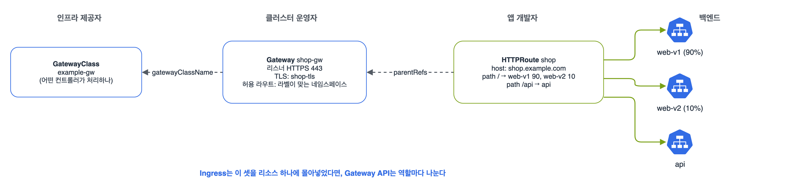

서비스와 네트워킹의 두 번째 정리. 범위의 'Ingress 컨트롤러와 Ingress 리소스 사용'과, 이번 개편에서 새로 들어온 'Gateway API로 인그레스 트래픽 관리'다. Gateway API는 처음 보는 리소스가 많아서, Ingress의 어느 부분이 어디로 갔는지 짝지어 외웠다. 기준 버전은 2025년 3월 현재 최신 안정판인 Gateway API v1.2.1(2024년 11월 출시)이다.

## 요약

- Ingress 리소스만 만들어서는 아무 일도 안 일어난다. ingress-nginx 같은 Ingress 컨트롤러가 있어야 하고, ingressClassName으로 어느 컨트롤러가 처리할지 정한다.
- Ingress는 호스트와 경로로 서비스에 나눠 보낸다. pathType은 Prefix, Exact, ImplementationSpecific 중 하나를 꼭 써야 한다.
- Gateway API는 쿠버네티스에 기본으로 들어 있지 않은 CRD다. GatewayClass(인프라), Gateway(진입점, 리스너, TLS), HTTPRoute(라우팅 규칙)로 역할을 나눈다.
- HTTPRoute는 backendRefs의 weight로 트래픽을 비율대로 나눌 수 있어서, 카나리 배포를 어노테이션 없이 표준 필드로 할 수 있다.

## 1. Ingress

```bash
k get ingressclass                                   # 어떤 컨트롤러가 있는지
k create ingress shop --class=nginx \
  --rule="shop.example.com/*=web:80,tls=shop-tls" \
  --rule="shop.example.com/api*=api:8080"
```

v1.32.2로 만든 결과다. 경로 끝에 *를 붙이면 Prefix가 되고, tls=를 붙이면 tls 블록과 Secret 이름이 같이 들어간다.

```yaml
apiVersion: networking.k8s.io/v1
kind: Ingress
metadata:
  name: shop
spec:
  ingressClassName: nginx
  rules:
  - host: shop.example.com
    http:
      paths:
      - backend:
          service:
            name: web
            port:
              number: 80
        path: /
        pathType: Prefix
      - backend:
          service:
            name: api
            port:
              number: 8080
        path: /api
        pathType: Prefix
  tls:
  - hosts:
    - shop.example.com
    secretName: shop-tls
```

| pathType | 뜻 |
|---|---|
| Prefix | 경로를 /로 나눈 단위로 앞부분이 맞으면 된다. /api는 /api, /api/v1과 맞고 /apis와는 안 맞는다 |
| Exact | 정확히 같아야 한다 |
| ImplementationSpecific | 컨트롤러가 정한 방식 |

TLS Secret은 Ingress와 같은 네임스페이스에 있어야 하고, k create secret tls shop-tls --cert=tls.crt --key=tls.key로 만든다. 경로를 바꿔서 백엔드로 넘기는 rewrite 같은 기능은 표준 필드가 없어서 nginx.ingress.kubernetes.io/rewrite-target 같은 컨트롤러별 어노테이션으로 한다. 이게 Gateway API가 나온 이유 가운데 하나다.

## 2. Gateway API


_GatewayClass는 어떤 컨트롤러가 처리할지, Gateway는 어디서 어떤 포트와 인증서로 받을지, HTTPRoute는 어떤 요청을 어느 서비스로 보낼지를 정한다. HTTPRoute 하나가 web-v1과 web-v2에 90:10으로 나눠 보낸다_

| Ingress에서 | Gateway API에서 |
|---|---|
| IngressClass | GatewayClass |
| 컨트롤러가 여는 진입점(LB), tls 블록 | Gateway의 listeners(프로토콜, 포트, 호스트명, TLS 인증서) |
| rules의 host, path, backend | HTTPRoute의 hostnames, rules.matches, backendRefs |
| 컨트롤러별 어노테이션(rewrite, redirect, 카나리) | HTTPRoute의 filters(URLRewrite, RequestRedirect, 헤더 수정)와 backendRefs weight |

Gateway API는 클러스터에 CRD가 설치돼 있어야 쓸 수 있다. 실습할 때는 표준 채널 CRD를 먼저 넣고, 구현체(Envoy Gateway, NGINX Gateway Fabric, Istio, Cilium 등)를 따로 설치한다.

```bash
k apply -f https://github.com/kubernetes-sigs/gateway-api/releases/download/v1.2.1/standard-install.yaml
k get crd | grep gateway.networking.k8s.io
k get gatewayclass
```

운영자가 만드는 Gateway다. HTTPS 443으로 받아 인증서로 TLS를 끝내고, 라벨 gateway-access=true가 붙은 네임스페이스의 라우트만 붙을 수 있게 했다.

```yaml
apiVersion: gateway.networking.k8s.io/v1
kind: Gateway
metadata:
  name: shop-gw
  namespace: infra
spec:
  gatewayClassName: example-gw
  listeners:
  - name: https
    protocol: HTTPS
    port: 443
    hostname: shop.example.com
    tls:
      mode: Terminate
      certificateRefs:
      - kind: Secret
        name: shop-tls
    allowedRoutes:
      namespaces:
        from: Selector
        selector:
          matchLabels:
            gateway-access: "true"
```

앱 개발자가 자기 네임스페이스에서 만드는 HTTPRoute다. parentRefs로 Gateway에 붙고, /api는 api 서비스로, 나머지는 web-v1과 web-v2에 90:10으로 보낸다.

```yaml
apiVersion: gateway.networking.k8s.io/v1
kind: HTTPRoute
metadata:
  name: shop
  namespace: shop
spec:
  parentRefs:
  - name: shop-gw
    namespace: infra
  hostnames: ["shop.example.com"]
  rules:
  - matches:
    - path:
        type: PathPrefix
        value: /api
    backendRefs:
    - name: api
      port: 8080
  - matches:
    - path:
        type: PathPrefix
        value: /
    backendRefs:
    - name: web-v1
      port: 80
      weight: 90
    - name: web-v2
      port: 80
      weight: 10
```

HTTP로 들어온 요청을 HTTPS로 돌리는 것도 필터 하나다.

```yaml
apiVersion: gateway.networking.k8s.io/v1
kind: HTTPRoute
metadata:
  name: http-to-https
  namespace: infra
spec:
  parentRefs:
  - name: shop-gw
    sectionName: http
  hostnames: ["shop.example.com"]
  rules:
  - filters:
    - type: RequestRedirect
      requestRedirect:
        scheme: https
        statusCode: 301
```

이 라우트가 붙으려면 Gateway에 이름이 http인 HTTP 80 리스너가 하나 더 있어야 한다. sectionName은 Gateway의 어느 리스너에 붙을지 정한다.

```bash
k get gateway -A                          # PROGRAMMED가 True인지, ADDRESS가 있는지
k describe httproute shop -n shop         # Status.Parents의 Accepted, ResolvedRefs 조건
```

라우트가 안 붙으면 HTTPRoute의 status에 이유가 나온다. 네임스페이스 라벨이 allowedRoutes와 안 맞으면 Accepted가 False이고, 서비스 이름이나 포트가 틀리면 ResolvedRefs가 False다.


flowchart TD
  Q["요청이 서비스에 안 닿는다"] --> A{"k get gateway<br>PROGRAMMED True?"}
  A -->|"아니오"| G["GatewayClass,<br>컨트롤러 설치,<br>리스너 TLS Secret 확인"]
  A -->|"예"| B{"HTTPRoute status<br>Accepted True?"}
  B -->|"아니오"| N["parentRefs<br>이름·네임스페이스,<br>allowedRoutes 라벨,<br>hostname 확인"]
  B -->|"예"| C{"ResolvedRefs True?"}
  C -->|"아니오"| S["backendRefs<br>서비스 이름·포트,<br>다른 네임스페이스면<br>ReferenceGrant"]
  C -->|"예"| E["서비스 엔드포인트 확인"]


> **쉬운 설명**
>
> Ingress는 건물 1층 안내 데스크 한 곳에 모든 걸 맡기는 방식이다. 안내 직원(컨트롤러)마다 쓰는 메모 방식(어노테이션)이 달라서, 직원이 바뀌면 메모를 다 다시 써야 한다. Gateway API는 역할을 나눴다. 건물주(인프라 제공자)는 어느 경비 회사를 쓸지(GatewayClass), 관리소장(운영자)은 어느 출입문을 열고 어떤 출입증을 받을지(Gateway), 입주 회사(개발자)는 자기 손님을 어느 방으로 보낼지(HTTPRoute)만 정한다. 각자 자기 서류만 고치면 된다.

## 헷갈렸던 것들

- Ingress 컨트롤러가 없으면 Ingress를 만들어도 ADDRESS가 비어 있고 아무 일도 안 생긴다.
- ingressClassName을 빼면 기본 IngressClass(ingressclass.kubernetes.io/is-default-class 어노테이션이 붙은 것)가 처리한다. 기본이 없으면 아무도 처리하지 않는다.
- k create ingress에서 경로를 /로 쓰면 Exact, /*로 쓰면 Prefix다.
- Prefix의 /api는 /apis와 맞지 않는다. 경로 구분자(/) 단위로 비교한다.
- TLS Secret은 Ingress와 같은 네임스페이스에 있어야 한다. Gateway API에서는 Gateway와 같은 네임스페이스가 기본이다.
- Gateway API는 기본 설치가 아니다. CRD와 구현체 컨트롤러가 둘 다 있어야 한다.
- HTTPRoute가 다른 네임스페이스의 서비스를 backendRefs로 가리키려면 그 네임스페이스에 ReferenceGrant가 있어야 한다.
- HTTPRoute의 경로 타입 이름은 PathPrefix와 Exact다. Ingress의 Prefix와 이름이 다르다.

## 용어 정리

| 용어 | 뜻 |
|---|---|
| Ingress 컨트롤러 | Ingress 리소스를 읽어 실제 프록시(nginx 등)를 설정하는 파드 |
| IngressClass | 어느 컨트롤러가 Ingress를 처리할지 정하는 리소스 |
| GatewayClass | Gateway를 처리할 컨트롤러 종류 |
| Gateway | 리스너(프로토콜, 포트, 호스트, TLS)를 가진 진입점 |
| HTTPRoute | 호스트·경로·헤더로 요청을 골라 서비스로 보내는 규칙 |
| ReferenceGrant | 다른 네임스페이스의 리소스를 참조해도 된다고 허락하는 리소스 |

## 복습 문제

**1.** Create an Ingress named `app` with the class `nginx`. For the host `app.example.com`, send `/` to the Service `front:80` and everything under `/api` to `back:8080`. Enable TLS with the Secret `app-tls`.

**2.** In the namespace `shop`, create an HTTPRoute that attaches to the Gateway `shop-gw` (namespace `infra`, listener `https`) and splits all requests 80% to `web-v1` and 20% to `web-v2`.

**3.** The HTTPRoute from question 2 has the status `Accepted: False`. What do you check first?

## 답과 풀이

1. 명령형 한 줄로 된다. 경로 끝의 *를 빠뜨리지 않는다.

```bash
k create ingress app --class=nginx \
  --rule="app.example.com/*=front:80,tls=app-tls" \
  --rule="app.example.com/api*=back:8080"
k describe ingress app
```

2. 본문의 HTTPRoute에서 /api 규칙을 빼고 weight만 80, 20으로 바꾼다. parentRefs에 namespace: infra와 sectionName: https를 쓴다.

3. Gateway의 allowedRoutes가 shop 네임스페이스를 허용하는지(라벨 gateway-access=true가 붙어 있는지), parentRefs의 이름·네임스페이스·sectionName이 맞는지, hostnames가 리스너 hostname과 겹치는지 본다.

```bash
k get ns shop --show-labels
k label ns shop gateway-access=true
k describe httproute -n shop
```

## 참고 자료

- Kubernetes v1.32 문서, Ingress: <https://v1-32.docs.kubernetes.io/docs/concepts/services-networking/ingress/>
- Kubernetes v1.32 문서, Ingress 컨트롤러: <https://v1-32.docs.kubernetes.io/docs/concepts/services-networking/ingress-controllers/>
- Kubernetes v1.32 문서, Gateway API: <https://v1-32.docs.kubernetes.io/docs/concepts/services-networking/gateway/>
- Gateway API 문서: <https://gateway-api.sigs.k8s.io/>
- Gateway API v1.2.1 릴리스: <https://github.com/kubernetes-sigs/gateway-api/releases/tag/v1.2.1>

