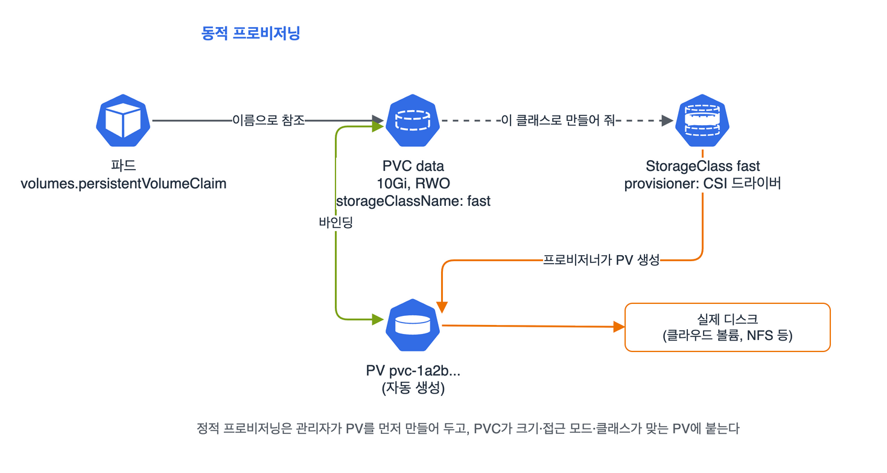

스토리지(10%) 정리. 비중은 제일 작지만 PV·PVC·파드를 이어 붙이는 문제는 거의 매번 나온다고 해서 YAML 세 개를 손에 익혔다. 새 범위에는 'StorageClass와 동적 프로비저닝'이 명시됐다.

## 요약

- PV는 클러스터에 준비된 저장 공간, PVC는 '이만큼, 이런 방식으로 쓰고 싶다'는 요청이다. 파드는 PVC를 이름으로 참조한다.
- PVC는 크기(PV가 같거나 더 커야 함), 접근 모드, storageClassName이 맞는 PV에 붙는다.
- StorageClass가 있으면 PVC를 만들 때 프로비저너가 PV를 자동으로 만든다(동적 프로비저닝). storageClassName을 안 쓰면 기본 StorageClass가 쓰인다.
- 회수 정책은 Retain(남겨 둠)과 Delete(같이 지움)다. Recycle은 사용 중단이다. 동적으로 만든 PV는 기본이 Delete다.
- PVC는 늘릴 수만 있고 줄일 수 없다. 늘리려면 StorageClass에 allowVolumeExpansion: true가 있어야 한다.

## 1. 연결 구조


_파드는 PVC를 참조하고, PVC는 StorageClass를 통해 PV를 자동으로 받거나(동적), 미리 만든 PV에 붙는다(정적). PV는 실제 디스크를 가리킨다_

| 접근 모드 | 약어 | 뜻 |
|---|---|---|
| ReadWriteOnce | RWO | 노드 하나에서 읽고 쓰기(같은 노드의 여러 파드는 가능) |
| ReadOnlyMany | ROX | 여러 노드에서 읽기만 |
| ReadWriteMany | RWX | 여러 노드에서 읽고 쓰기(NFS, CephFS 같은 파일 스토리지) |
| ReadWriteOncePod | RWOP | 파드 하나만 읽고 쓰기(v1.29부터 정식) |

## 2. 정적 프로비저닝: PV를 먼저 만든다

```yaml
apiVersion: v1
kind: PersistentVolume
metadata:
  name: pv-log
spec:
  capacity:
    storage: 1Gi
  accessModes: ["ReadWriteOnce"]
  persistentVolumeReclaimPolicy: Retain
  storageClassName: manual
  hostPath:
    path: /mnt/data/log
```

```yaml
apiVersion: v1
kind: PersistentVolumeClaim
metadata:
  name: log-claim
  namespace: default
spec:
  accessModes: ["ReadWriteOnce"]
  storageClassName: manual
  resources:
    requests:
      storage: 500Mi
```

PVC가 500Mi를 요청해도 1Gi짜리 PV에 붙고, 용량은 1Gi로 보인다. 크기는 '이상', 접근 모드는 PV가 그 모드를 포함해야 하고, storageClassName은 정확히 같아야 한다. PVC에 storageClassName: ""(빈 문자열)을 쓰면 동적 프로비저닝 없이 클래스 없는 PV에만 붙는다.

```yaml
apiVersion: v1
kind: Pod
metadata:
  name: logger
spec:
  containers:
  - name: logger
    image: busybox:1.36
    command: ["sh", "-c", "while true; do date >> /var/log/app/out.log; sleep 5; done"]
    volumeMounts:
    - name: log
      mountPath: /var/log/app
  volumes:
  - name: log
    persistentVolumeClaim:
      claimName: log-claim
```

hostPath는 노드 디렉터리를 그대로 쓰는 거라 연습용이다. 파드가 다른 노드로 가면 데이터가 따라가지 않는다.

## 3. 동적 프로비저닝: StorageClass

```yaml
apiVersion: storage.k8s.io/v1
kind: StorageClass
metadata:
  name: fast
  annotations:
    storageclass.kubernetes.io/is-default-class: "false"
provisioner: ebs.csi.aws.com
reclaimPolicy: Delete
allowVolumeExpansion: true
volumeBindingMode: WaitForFirstConsumer
parameters:
  type: gp3
```

| 필드 | 뜻 |
|---|---|
| provisioner | PV를 실제로 만들 CSI 드라이버 |
| reclaimPolicy | 이 클래스로 만든 PV의 회수 정책. 기본 Delete |
| volumeBindingMode | Immediate(PVC를 만들자마자 생성)나 WaitForFirstConsumer(그 PVC를 쓰는 파드가 스케줄될 때 생성) |
| allowVolumeExpansion | true면 PVC 크기를 늘릴 수 있다 |

WaitForFirstConsumer는 파드가 놓일 노드(AZ)가 정해진 뒤에 디스크를 만든다. Immediate로 두면 디스크가 다른 AZ에 생겨서 파드가 Pending에 빠질 수 있다. 그래서 WaitForFirstConsumer 클래스의 PVC는 파드를 만들기 전까지 Pending이 정상이다.

기본 StorageClass를 바꾸려면 어노테이션을 고친다. 기본이 둘 이상이면 가장 최근에 만든 것이 쓰인다.

```bash
k get sc                                           # (default) 표시 확인
k patch sc standard -p '{"metadata":{"annotations":{"storageclass.kubernetes.io/is-default-class":"false"}}}'
k patch sc fast -p '{"metadata":{"annotations":{"storageclass.kubernetes.io/is-default-class":"true"}}}'
```

## 4. PV 상태와 회수


stateDiagram-v2
  [*] --> Available: PV 생성
  Available --> Bound: PVC와 바인딩
  Bound --> Released: PVC 삭제
  Released --> [*]: Delete 정책<br>PV와 디스크 삭제
  Released --> Available: Retain 정책<br>관리자가 정리하고<br>claimRef 삭제


Retain으로 남은 PV는 Released 상태라 새 PVC가 바로 붙지 않는다. 이전 데이터가 남아 있어서다. 다시 쓰려면 데이터를 확인·정리한 뒤 PV의 spec.claimRef를 지운다. 이미 있는 PV의 정책은 k patch pv pv-log -p '{"spec":{"persistentVolumeReclaimPolicy":"Retain"}}'으로 바꿀 수 있다.

## 5. 볼륨 크기 늘리기

```bash
k patch pvc data -p '{"spec":{"resources":{"requests":{"storage":"20Gi"}}}}'
k get pvc data -w              # CAPACITY가 바뀌는지
```

StorageClass에 allowVolumeExpansion: true가 없으면 거절된다. 줄이는 건 지원하지 않는다.

> **쉬운 설명**
>
> PV는 창고 칸, PVC는 '10평짜리 칸 하나 주세요'라는 임대 신청서, 파드는 그 칸에 짐을 넣는 사람이다. 정적 프로비저닝은 관리인이 칸을 미리 만들어 두고 신청서가 오면 맞는 칸을 내주는 것이고, StorageClass는 신청서가 오면 그때 칸을 새로 지어 주는 시공사다. 회수 정책은 계약이 끝났을 때 칸을 허무는지(Delete), 짐째로 잠가 두는지(Retain)의 차이다. 잠가 둔 칸은 관리인이 짐을 정리하기 전에는 다음 사람에게 못 준다.

## 헷갈렸던 것들

- PVC와 PV는 storageClassName이 정확히 같아야 붙는다. 한쪽만 비어 있으면 안 붙는다.
- PVC의 storageClassName을 아예 안 쓰면 기본 StorageClass, ""로 쓰면 '클래스 없음'이다. 둘은 다르다.
- PV가 PVC보다 크면 붙는다. 작으면 안 붙는다.
- RWO는 '파드 하나'가 아니라 '노드 하나'다. 파드 하나로 제한하려면 RWOP.
- WaitForFirstConsumer면 파드가 생기기 전까지 PVC가 Pending이다. 고장이 아니다.
- 동적 PV의 기본 회수 정책은 Delete라서 PVC를 지우면 디스크까지 지워진다.
- Retain PV는 PVC를 지워도 Released로 남고, 바로 재사용되지 않는다.
- PV와 StorageClass는 클러스터 리소스, PVC는 네임스페이스 리소스다.

## 용어 정리

| 용어 | 뜻 |
|---|---|
| PersistentVolume(PV) | 클러스터에 준비된 저장 공간 리소스 |
| PersistentVolumeClaim(PVC) | 사용자가 저장 공간을 요청하는 리소스 |
| StorageClass | 동적 프로비저닝 방법(프로비저너, 매개변수, 정책)을 정한 클래스 |
| 동적 프로비저닝 | PVC를 만들 때 PV와 실제 디스크를 자동으로 만드는 것 |
| 회수 정책 | PVC가 지워진 뒤 PV를 어떻게 할지(Retain, Delete) |
| volumeBindingMode | PV를 언제 만들고 붙일지(Immediate, WaitForFirstConsumer) |

## 복습 문제

**1.** Create a PV named `web-pv` that uses `/srv/web` on the node, with 2Gi, RWO, the reclaim policy `Retain`, and the storageClassName `local-web`. Then create a PVC named `web-pvc` that requests 1Gi and binds to this PV.

**2.** Create an nginx Pod named `web` that mounts `web-pvc` at `/usr/share/nginx/html`.

**3.** A PVC is Pending. What do you check?

**4.** You try to expand the PVC `data`, which was created with the StorageClass `fast`, from 10Gi to 20Gi, but the request is rejected. Why, and how do you fix it?

## 답과 풀이

1. 본문의 PV·PVC에서 이름, 경로, 크기, 클래스만 바꾼다. 붙었는지는 STATUS가 Bound인지로 본다.

```bash
k get pv web-pv
k get pvc web-pvc       # STATUS Bound, VOLUME web-pv
```

2. volumes의 persistentVolumeClaim.claimName에 PVC 이름을 쓴다.

```bash
k run web --image=nginx:1.27 $do > web.yaml
# spec.volumes: [{name: html, persistentVolumeClaim: {claimName: web-pvc}}]
# containers[0].volumeMounts: [{name: html, mountPath: /usr/share/nginx/html}]
k apply -f web.yaml
```

3. 이벤트부터 본다. 맞는 PV가 없는지(크기, 접근 모드, 클래스), 클래스의 프로비저너가 동작하는지, WaitForFirstConsumer라서 파드를 기다리는 중인지 확인한다.

```bash
k describe pvc <이름> | sed -n '/Events/,$p'
k get pv
k get sc
```

4. StorageClass에 allowVolumeExpansion: true가 없어서다. 클래스에 이 필드를 추가한 뒤 PVC 크기를 다시 고친다.

```bash
k patch sc fast -p '{"allowVolumeExpansion": true}'
k patch pvc data -p '{"spec":{"resources":{"requests":{"storage":"20Gi"}}}}'
```

## 참고 자료

- Kubernetes v1.32 문서, 퍼시스턴트 볼륨: <https://v1-32.docs.kubernetes.io/docs/concepts/storage/persistent-volumes/>
- Kubernetes v1.32 문서, 스토리지 클래스: <https://v1-32.docs.kubernetes.io/docs/concepts/storage/storage-classes/>
- Kubernetes v1.32 문서, 동적 프로비저닝: <https://v1-32.docs.kubernetes.io/docs/concepts/storage/dynamic-provisioning/>
- Kubernetes v1.32 문서, 파드에서 PV 사용하기: <https://v1-32.docs.kubernetes.io/docs/tasks/configure-pod-container/configure-persistent-volume-storage/>

