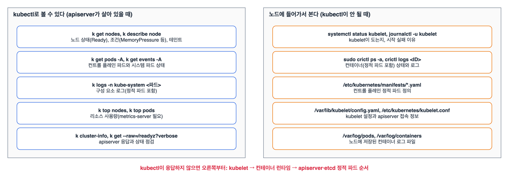

트러블슈팅(30%)은 비중이 가장 커서 두 편으로 나눴다. 이 글은 범위의 '클러스터와 노드', '클러스터 구성 요소', '클러스터와 애플리케이션 리소스 사용량 모니터링'이다. 고장 난 클러스터를 받았을 때 어디부터 볼지 순서를 정해 두려고, 증상별로 '먼저 볼 곳'을 정리했다.

## 요약

- kubectl이 되면 describe와 events로, 안 되면 노드에 ssh해서 kubelet → 컨테이너 런타임 → 컨트롤 플레인 정적 파드 순서로 본다.
- 노드 NotReady는 대부분 kubelet이 멈췄거나, 런타임(containerd)이 멈췄거나, kubelet 설정이 틀렸거나, CNI가 없어서다.
- apiserver가 죽으면 kubectl이 6443 접속 거부로 실패한다. 정적 파드 매니페스트를 고치고 crictl로 확인한다.
- 스케줄러가 죽으면 새 파드가 노드 없이 Pending에 머물고, 컨트롤러 매니저가 죽으면 디플로이먼트를 만들어도 파드가 안 생긴다.
- 사용량은 k top nodes, k top pods --sort-by=cpu|memory. metrics-server가 있어야 한다.

## 1. 어디부터 볼까


_왼쪽은 apiserver가 살아 있을 때 kubectl로 보는 곳, 오른쪽은 kubectl이 안 될 때 노드에 들어가서 보는 곳이다_


flowchart TD
  S["문제 발생"] --> K{"kubectl 응답?"}
  K -->|"connection refused<br>:6443"| A["컨트롤 플레인 노드에 ssh<br>crictl ps -a | grep apiserver<br>crictl logs, 매니페스트 확인"]
  K -->|"됨"| N{"k get nodes<br>NotReady?"}
  N -->|"예"| L["그 노드에 ssh<br>systemctl status kubelet<br>journalctl -u kubelet"]
  N -->|"아니오"| P{"k get pods -A<br>kube-system 이상?"}
  P -->|"예"| C["describe, logs로<br>scheduler<br>controller-manager<br>etcd, CoreDNS 확인"]
  P -->|"아니오"| APP["애플리케이션 쪽<br>(트러블슈팅 2편)"]


## 2. 노드가 NotReady일 때

```bash
k get nodes
k describe node node01 | sed -n '/Conditions/,/Addresses/p'   # Ready 조건의 Message
ssh node01
sudo systemctl status kubelet              # inactive, failed, activating(재시작 반복)?
sudo journalctl -u kubelet --no-pager | tail -30
sudo systemctl status containerd
```

| journalctl에 보이는 것 | 원인과 해결 |
|---|---|
| kubelet이 inactive(dead) | 멈춰 있다. systemctl start kubelet, 부팅 때도 켜지게 systemctl enable kubelet |
| failed to load kubelet config file /var/lib/kubelet/config.yaml | 설정 파일 경로나 내용이 틀렸다. 파일과 /etc/systemd/system/kubelet.service.d의 드롭인을 확인 |
| unable to load client CA file, x509 | 인증서 경로가 틀렸거나 만료. config.yaml의 clientCAFile, 인증서 날짜 확인 |
| connect: connection refused ... :6443 | kubelet.conf의 server 주소나 포트가 틀렸거나 apiserver가 죽었다 |
| failed to run Kubelet: running with swap on | 스왑이 켜져 있다. swapoff -a |
| container runtime is down, failed to connect to containerd.sock | containerd가 멈췄다. systemctl restart containerd |
| network plugin is not ready: cni config uninitialized | CNI가 설치되지 않았거나 /etc/cni/net.d가 비었다 |

설정을 고쳤으면 systemctl daemon-reload(서비스 파일을 고친 경우)와 systemctl restart kubelet, 그리고 k get nodes로 Ready를 확인할 때까지가 한 문제다.

## 3. 컨트롤 플레인 구성 요소가 고장일 때

컨트롤 플레인은 정적 파드라서 매니페스트(/etc/kubernetes/manifests)를 고치면 kubelet이 다시 띄운다. 고장 문제는 보통 이 파일에 오타를 심어 둔다.

| 멈춘 구성 요소 | 겉으로 보이는 증상 | 확인 |
|---|---|---|
| kube-apiserver | kubectl 전체가 실패(connection refused) | crictl ps -a에서 kube-apiserver 찾기, crictl logs <ID>, 매니페스트의 인자(etcd 주소, 인증서 경로) |
| etcd | apiserver가 etcd에 못 붙어 재시작 반복 | etcd 매니페스트의 인증서·데이터 경로, crictl logs |
| kube-scheduler | 새 파드가 Pending, NODE 칸이 비고 FailedScheduling 이벤트도 없음 | k -n kube-system get pods, k logs kube-scheduler-<노드> |
| kube-controller-manager | 디플로이먼트를 만들어도 레플리카셋·파드가 안 생김, scale이 반영 안 됨 | k -n kube-system logs kube-controller-manager-<노드> |
| CoreDNS | 서비스 이름 조회 실패, IP로는 됨 | k -n kube-system get pods -l k8s-app=kube-dns, k logs |
| kube-proxy | 서비스 IP로 접속 안 됨, 파드 IP로는 됨 | k -n kube-system get ds kube-proxy, k logs |

```bash
sudo crictl ps -a | grep -E 'kube-apiserver|etcd'
sudo crictl logs <컨테이너 ID> 2>&1 | tail -20
sudo vim /etc/kubernetes/manifests/kube-apiserver.yaml
sudo ls /var/log/pods/ | grep apiserver        # crictl이 안 되면 로그 파일로
```

매니페스트를 저장하고 1분쯤 기다리면 kubelet이 새 정의로 파드를 다시 만든다. 파일을 백업할 때 /etc/kubernetes/manifests 안에 두면 kubelet이 그것도 정적 파드로 띄우니 꼭 밖에 둔다.

## 4. kubeconfig 문제

```bash
k config view --minify          # 지금 쓰는 클러스터 주소, 사용자
k config get-contexts
k config use-context <컨텍스트>
```

server 주소의 포트가 6443이 아니거나, certificate-authority-data가 다른 클러스터 것이면 x509나 connection refused가 난다. 관리자 설정 원본은 컨트롤 플레인의 /etc/kubernetes/admin.conf다.

## 5. 리소스 사용량 모니터링

metrics-server가 있어야 k top이 동작한다. 실습 클러스터에서는 공식 매니페스트를 apply하고, 인증서 문제로 안 뜨면 --kubelet-insecure-tls 인자를 넣는 경우가 많다(연습용).

```bash
k top nodes
k top pods -A --sort-by=memory | head
k top pods -n shop --containers                 # 컨테이너별
# 'CPU를 가장 많이 쓰는 파드 이름을 파일에 써라' 같은 문제
k top pods -n shop --sort-by=cpu --no-headers | head -1 | awk '{print $1}' > /opt/top-cpu.txt
```

k top의 값은 실제 사용량이고, 스케줄링은 requests 합계로 한다. 노드 사용률은 낮은데 파드가 Pending이면 k describe node의 Allocated resources(requests 합계)를 본다.

> **쉬운 설명**
>
> 고장 난 클러스터는 정전된 아파트다. 관리사무소(apiserver)에 전화가 되면 관리 대장(describe, events)부터 보고, 전화조차 안 되면 직접 가서 배전반을 연다. 각 집의 차단기(kubelet)가 내려갔는지, 수도 본관(containerd)이 잠겼는지, 관리사무소 직원 출근부(정적 파드 매니페스트)에 오타가 있는지를 순서대로 본다. 스케줄러가 없으면 이사 온 사람이 동·호수를 못 받고 계속 대기하고, 컨트롤러 매니저가 없으면 '세 집이 있어야 한다'는 계약이 지켜지지 않는다.

## 헷갈렸던 것들

- kubectl이 안 된다고 apiserver부터 의심하지 않는다. kubeconfig 주소가 틀렸을 수도 있다.
- 정적 파드는 kubectl로 지워도 다시 생긴다. 고치려면 매니페스트 파일을 고친다.
- 매니페스트 백업을 /etc/kubernetes/manifests 안에 두면 안 된다.
- kubelet 설정을 고친 뒤에는 restart가 필요하고, 서비스 드롭인 파일을 고쳤으면 daemon-reload도 해야 한다.
- 스케줄러가 죽으면 Pending 파드에 FailedScheduling 이벤트조차 안 생긴다. 이벤트가 '없는' 것도 단서다.
- k top은 metrics-server가 필요하고, 스케줄링 판단(requests)과는 다른 숫자다.
- 노드에서는 docker가 없다. crictl을 쓴다.

## 용어 정리

| 용어 | 뜻 |
|---|---|
| journalctl -u kubelet | systemd 서비스 kubelet의 로그 |
| crictl | CRI 런타임에 직접 붙어 컨테이너·파드를 보는 명령 |
| 노드 조건(Conditions) | Ready, MemoryPressure, DiskPressure, PIDPressure 같은 노드 상태 |
| 드롭인 파일 | systemd 서비스 설정을 덧붙이는 *.conf 파일(kubelet.service.d) |
| metrics-server | k top과 HPA가 쓰는 사용량 지표를 모으는 애드온 |

## 복습 문제

**1.** `node01` is NotReady. Find the cause, fix it, and make the node Ready. (Lab setup: break it by running `sudo systemctl stop kubelet` on `node01`.)

**2.** kubectl returns `The connection to the server 10.0.0.10:6443 was refused`. What do you check on the control plane node? (Lab setup: break it by changing the port in `--etcd-servers` in `kube-apiserver.yaml` to 2380.)

**3.** Every newly created Pod is Pending, and `kubectl describe` shows no events at all. What do you suspect?

**4.** Write the name of the Pod that uses the most memory in the namespace `shop` to `/opt/mem.txt`.

## 답과 풀이

1. kubelet 상태와 로그를 보고 다시 켠다. 재부팅 뒤에도 켜지게 enable까지 한다.

```bash
ssh node01
sudo systemctl status kubelet
sudo journalctl -u kubelet --no-pager | tail -20
sudo systemctl enable --now kubelet
exit
k get nodes -w
```

2. apiserver 컨테이너가 재시작을 반복하는지 보고, 로그에서 etcd 접속 실패를 찾는다. 매니페스트의 --etcd-servers를 https://127.0.0.1:2379로 고친다(2380은 etcd 피어 포트다).

```bash
sudo crictl ps -a | grep kube-apiserver
sudo crictl logs <ID> 2>&1 | tail
sudo grep etcd-servers /etc/kubernetes/manifests/kube-apiserver.yaml
```

3. 스케줄러다. 스케줄러가 있으면 실패라도 FailedScheduling 이벤트를 남긴다.

```bash
k -n kube-system get pods | grep scheduler
k -n kube-system describe pod kube-scheduler-controlplane
```

4. 정렬하고 첫 줄의 이름만 뽑는다.

```bash
k top pods -n shop --sort-by=memory --no-headers | head -1 | awk '{print $1}' > /opt/mem.txt
```

## 참고 자료

- Kubernetes v1.32 문서, 클러스터 트러블슈팅: <https://v1-32.docs.kubernetes.io/docs/tasks/debug/debug-cluster/>
- Kubernetes v1.32 문서, crictl로 노드 디버깅: <https://v1-32.docs.kubernetes.io/docs/tasks/debug/debug-cluster/crictl/>
- Kubernetes v1.32 문서, 정적 파드: <https://v1-32.docs.kubernetes.io/docs/tasks/configure-pod-container/static-pod/>
- Kubernetes v1.32 문서, 리소스 지표 파이프라인: <https://v1-32.docs.kubernetes.io/docs/tasks/debug/debug-cluster/resource-metrics-pipeline/>
- Kubernetes v1.32 문서, kubeconfig로 클러스터 접근 구성: <https://v1-32.docs.kubernetes.io/docs/concepts/configuration/organize-cluster-access-kubeconfig/>

