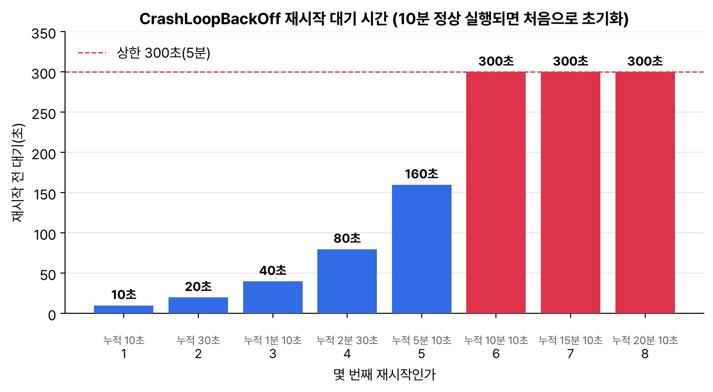

트러블슈팅 두 번째이자 CKA 정리 마지막 글. 범위의 '컨테이너 출력 스트림 관리와 확인'과 '서비스와 네트워킹 트러블슈팅'이다. 다음 주 시험 전에 killer.sh 2회차를 풀어 봤는데, 틀린 문제는 거의 다 '어디가 고장인지 찾는 데 시간을 너무 썼다'였다. 그래서 파드 상태별로 먼저 칠 명령을 정해 뒀다.

## 요약

- 파드 상태(STATUS)가 첫 단서다. Pending은 스케줄링, ImagePullBackOff는 이미지, CrashLoopBackOff는 앱 자체, CreateContainerConfigError는 ConfigMap·Secret 참조 문제다.
- 로그는 k logs. 재시작된 컨테이너의 직전 로그는 --previous, 컨테이너가 여럿이면 -c를 붙인다.
- 셸이 없는 이미지는 k debug로 임시 컨테이너를 붙여서 들여다본다.
- 서비스 문제는 엔드포인트 → 포트 → DNS → NetworkPolicy 순서로 좁힌다.

## 1. 파드 상태별로 먼저 볼 것

| STATUS | 뜻 | 먼저 칠 명령 | 흔한 원인 |
|---|---|---|---|
| Pending | 노드에 못 놓임 | k describe pod(Events) | requests 과다, 셀렉터·어피니티 불일치, 테인트, PVC 미바인딩 |
| ContainerCreating | 노드에 놓였지만 컨테이너 준비 중 | k describe pod | 볼륨 마운트 실패, CNI 문제 |
| ErrImagePull, ImagePullBackOff | 이미지를 못 받음 | k describe pod | 이미지 이름·태그 오타, 비공개 저장소 인증(imagePullSecrets) |
| CreateContainerConfigError | 컨테이너 설정을 못 만듦 | k describe pod | 없는 ConfigMap·Secret이나 키를 참조 |
| CrashLoopBackOff | 시작했다 죽기를 반복 | k logs --previous | 앱 오류, 잘못된 command·args, liveness probe 실패 |
| OOMKilled(종료 코드 137) | 메모리 limits 초과로 종료 | k describe pod(Last State) | limits가 너무 작음, 메모리 누수 |
| Running인데 READY 0/1 | readiness probe 실패 | k describe pod | 프로브 경로·포트가 틀림, 앱 준비 지연 |

CrashLoopBackOff일 때 kubelet은 바로 다시 띄우지 않고 기다렸다가 재시작한다. 대기 시간이 10초부터 두 배씩 늘어서, 몇 번 죽고 나면 5분을 기다린다.


_대기 시간은 10초에서 두 배씩 늘어 300초에서 멈춘다. 컨테이너가 10분 동안 문제없이 돌면 처음 값으로 돌아간다. 고친 뒤에도 바로 안 뜨면 이 대기 때문일 수 있다_


flowchart TD
  S["k get pods<br>STATUS 확인"] --> P{"Pending?"}
  P -->|"예"| E1["describe Events<br>FailedScheduling 이유"]
  P -->|"아니오"| I{"ImagePull<br>계열?"}
  I -->|"예"| E2["이미지 이름·태그,<br>imagePullSecrets"]
  I -->|"아니오"| C{"CrashLoop<br>또는 Error?"}
  C -->|"예"| E3["logs --previous,<br>describe Last State<br>(종료 코드)"]
  C -->|"아니오"| R{"READY 0/1?"}
  R -->|"예"| E4["readiness probe<br>경로·포트"]
  R -->|"아니오"| SV["서비스·네트워크<br>(아래 4절)"]


종료 코드도 단서다. 137은 SIGKILL(128+9)로 대개 OOMKilled이고, 143은 SIGTERM(128+15)으로 정상 종료 요청을 받은 경우, 1처럼 작은 숫자는 앱이 스스로 오류로 끝난 경우다.

## 2. 컨테이너 출력 스트림: 로그

컨테이너가 stdout·stderr로 쓴 내용은 노드의 /var/log/pods 아래 파일로 저장되고, k logs로 읽는다. 파일은 기본 10Mi씩, 5개까지 보관하며 돌아가며 지운다.

```bash
k logs web-7d9f-abcde                        # 컨테이너가 하나일 때
k logs web-7d9f-abcde -c sidecar             # 컨테이너 지정
k logs web-7d9f-abcde --previous             # 직전에 죽은 컨테이너의 로그
k logs deploy/web --tail=50 --since=1h       # 디플로이먼트의 파드 하나
k logs -l app=web --all-containers --prefix  # 라벨로 여러 파드, 줄마다 출처 표시
k logs web-7d9f-abcde -f --timestamps        # 따라가며 보기
k logs web-7d9f-abcde | grep -i error > /opt/errors.log   # '에러 줄을 파일로 저장하라' 문제
```

kubectl이 안 될 때는 노드에서 /var/log/pods/<네임스페이스>_<파드>_<UID>/<컨테이너>/0.log를 직접 보거나 crictl logs를 쓴다. 이벤트는 따로 모아 본다.

```bash
k get events -n shop --sort-by=.lastTimestamp
k get events -n shop --field-selector involvedObject.name=web-7d9f-abcde
```

## 3. 안으로 들어가 보기: exec, debug

```bash
k exec -it web-7d9f-abcde -- sh
k exec web-7d9f-abcde -- cat /etc/resolv.conf
# 셸이 없는 이미지: 임시(ephemeral) 컨테이너를 붙인다. --target은 그 컨테이너의 프로세스를 보이게 한다
k debug -it web-7d9f-abcde --image=busybox:1.36 --target=web
# 파드를 복사해서 명령을 바꿔 띄우기(원본은 그대로)
k debug web-7d9f-abcde -it --copy-to=web-debug --container=web -- sh
# 노드 디버깅: 노드의 루트 파일 시스템이 /host에 마운트된다
k debug node/node01 -it --image=busybox:1.36
```

## 4. 서비스와 네트워크

```bash
k get svc web -o wide                    # 셀렉터, 포트
k get endpointslices -l kubernetes.io/service-name=web
k get pods -l app=web -o wide --show-labels
k run t --image=busybox:1.36 --rm -it --restart=Never -- sh
#   wget -qO- -T 3 http://web          (이름으로)
#   wget -qO- -T 3 http://10.96.12.34  (ClusterIP로)
#   wget -qO- -T 3 http://10.244.1.7:8080 (파드 IP로)
#   nslookup web
k get netpol -A
```

| 증상 | 원인 |
|---|---|
| 엔드포인트가 비어 있다 | 서비스 셀렉터와 파드 라벨이 다르거나, 파드가 Ready가 아니다 |
| 엔드포인트는 있는데 연결 거부 | targetPort가 컨테이너가 실제로 듣는 포트와 다르다 |
| 파드 IP로는 되는데 ClusterIP로는 안 된다 | kube-proxy 문제 |
| IP로는 되는데 이름으로는 안 된다 | CoreDNS 문제, 다른 네임스페이스인데 서비스 이름만 썼다 |
| 특정 파드에서만 안 된다 | NetworkPolicy가 막고 있다 |

> **쉬운 설명**
>
> 파드 상태는 병원 접수표의 증상란이다. Pending은 '병실이 없다', ImagePullBackOff는 '약이 안 들어왔다', CrashLoopBackOff는 '입원했다가 계속 쓰러진다'라서 진단 순서가 다르다. 쓰러지는 환자는 직전 기록(logs --previous)이 가장 중요하고, 말을 못 하는 환자(셸 없는 이미지)는 옆에 간호사(debug 임시 컨테이너)를 붙여 지켜본다. 서비스 문제는 전화가 안 걸리는 상황이라 번호부(DNS), 교환기(kube-proxy), 내선 번호(targetPort), 차단 목록(NetworkPolicy)을 하나씩 확인한다.

## 헷갈렸던 것들

- CrashLoopBackOff의 원인은 지금 로그가 아니라 --previous 로그에 있다.
- 컨테이너가 둘 이상이면 k logs에 -c가 필요하다. 안 쓰면 기본 컨테이너나 에러 메시지가 나온다.
- 종료 코드 137은 OOMKilled일 때가 많다. describe의 Last State에 Reason이 나온다.
- 고친 뒤에도 바로 안 뜨는 건 재시작 대기(최대 5분) 때문일 수 있다. 디플로이먼트면 rollout restart로 새 파드를 만든다.
- 엔드포인트가 비어 있으면 셀렉터부터 본다. 에러 없이 조용히 연결만 안 된다.
- k debug의 --target은 런타임이 지원해야 한다. 안 되면 ps에 원래 프로세스가 안 보인다.
- 이벤트는 기본 1시간만 남는다. 오래된 문제는 이벤트에 안 보일 수 있다.

## 용어 정리

| 용어 | 뜻 |
|---|---|
| CrashLoopBackOff | 컨테이너가 계속 죽어서 kubelet이 늘어나는 간격으로 재시작을 기다리는 상태 |
| 임시 컨테이너 | 실행 중인 파드에 디버깅용으로 잠깐 붙이는 컨테이너(k debug) |
| 종료 코드 | 컨테이너 프로세스가 끝날 때 남긴 숫자. 128+시그널 번호면 시그널로 죽은 것 |
| 이벤트 | 스케줄링, 이미지 받기, 프로브 실패 같은 일을 기록한 리소스 |

## 복습 문제

**1.** The Pod `api` in the namespace `shop` is in CrashLoopBackOff. Save the logs from just before it crashed to `/opt/api-crash.log`.

**2.** The Pod `web` has the status CreateContainerConfigError. Find the cause and fix it.

**3.** Connections through the Service `web` fail, even though all of its Pods are Running. Write down the order in which you check things, and fix the problem.

**4.** The Pod `pay` uses a distroless image, so it has no shell. Check its `/etc/hosts` file.

## 답과 풀이

1. 재시작된 컨테이너의 직전 로그는 --previous다.

```bash
k logs api -n shop --previous > /opt/api-crash.log
```

2. describe의 Events에 어떤 ConfigMap·Secret이나 키가 없는지 나온다. 빠진 걸 만들거나 참조를 고친다.

```bash
k describe pod web | grep -A3 -i 'error'
k create cm web-config --from-literal=MODE=prod     # 없던 ConfigMap을 만든 경우
```

3. 엔드포인트가 비어 있으면 셀렉터와 라벨을, 있으면 targetPort를 본다. 셀렉터가 틀렸다면 서비스를 고친다.

```bash
k get ep web
k get svc web -o jsonpath='{.spec.selector}'; echo
k get pods --show-labels
k patch svc web -p '{"spec":{"selector":{"app":"web"}}}'
```

4. 임시 컨테이너를 붙이고 --target으로 원래 컨테이너의 네임스페이스를 본다. 파일은 /proc/1/root 아래로 볼 수 있다.

```bash
k debug -it pay --image=busybox:1.36 --target=pay -- sh
#   cat /proc/1/root/etc/hosts
```

## 참고 자료

- Kubernetes v1.32 문서, 애플리케이션 트러블슈팅: <https://v1-32.docs.kubernetes.io/docs/tasks/debug/debug-application/>
- Kubernetes v1.32 문서, 실행 중인 파드 디버깅: <https://v1-32.docs.kubernetes.io/docs/tasks/debug/debug-application/debug-running-pod/>
- Kubernetes v1.32 문서, 서비스 디버깅: <https://v1-32.docs.kubernetes.io/docs/tasks/debug/debug-application/debug-service/>
- Kubernetes v1.32 문서, 로깅 아키텍처: <https://v1-32.docs.kubernetes.io/docs/concepts/cluster-administration/logging/>
- Kubernetes v1.32 문서, 파드 수명 주기: <https://v1-32.docs.kubernetes.io/docs/concepts/workloads/pods/pod-lifecycle/>

