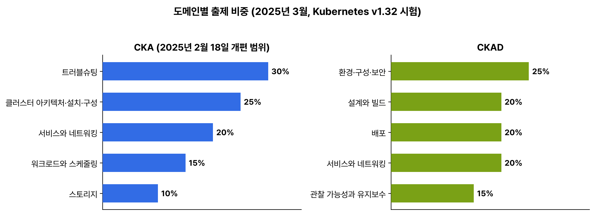
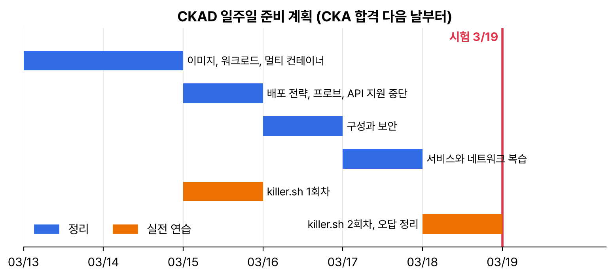

어제 CKA를 붙었다. 손이 굳기 전에 바로 다음 주 CKAD를 예약했다. 두 시험은 형식과 환경이 같고 겹치는 범위가 많아서, CKAD는 일주일 동안 '개발자 쪽에서 새로 나오는 것'만 채우기로 했다. 이 시리즈는 CKA 정리를 바탕으로 차이만 적는다.

## 요약

- 형식은 CKA와 같다. 2시간 실기, Kubernetes v1.32, 66% 이상 합격, 재시험 1회, 유효 기간 2년, killer.sh 2회다.
- CKAD에는 클러스터 설치·업그레이드, etcd, 노드 트러블슈팅이 없다. 대신 이미지 빌드, 잡·크론잡, 멀티 컨테이너 파드, 프로브, 배포 전략, 보안 컨텍스트가 더 깊게 나온다.
- 비중이 가장 큰 도메인은 '환경·구성·보안'(25%)이다.
- 문제마다 네임스페이스가 다르다. -n을 빼먹는 실수가 제일 많다고 해서 습관을 들였다.

## 1. 시험 정보 (2025년 3월 기준)

| 항목 | 내용 |
|---|---|
| 형식, 시간 | 온라인 감독 실기, 2시간 |
| 환경 | Kubernetes v1.32. 과제마다 지정된 호스트에 ssh |
| 합격 기준 | 66% 이상 |
| 재시험, 유효 기간 | 1회 포함, 2년 |
| 볼 수 있는 문서 | kubernetes.io/docs, kubernetes.io/blog, helm.sh/docs |


_오른쪽이 CKAD다. 환경·구성·보안이 25%로 가장 크고, 나머지 네 도메인이 20%, 20%, 20%, 15%다_

## 2. 도메인별로 CKA와 겹치는 정도

| CKAD 도메인 | 세부 항목 | CKA에서 이미 본 것 | 새로 볼 것 |
|---|---|---|---|
| 설계와 빌드 (20%) | 이미지 정의·빌드·수정, 워크로드 고르기, 멀티 컨테이너 패턴, 영구·임시 볼륨 | 디플로이먼트, PV·PVC | Dockerfile·이미지 빌드, 잡·크론잡 세부 옵션, init·사이드카 컨테이너, emptyDir |
| 배포 (20%) | 배포 전략(블루/그린, 카나리), 롤링 업데이트, Helm, Kustomize | 롤링 업데이트·롤백, Helm, Kustomize | 블루/그린·카나리를 기본 리소스로 구현 |
| 관찰 가능성과 유지보수 (15%) | API 지원 중단, 프로브, CLI 모니터링, 로그, 디버깅 | 로그, k top, k debug | 세 가지 프로브 설정, 사용 중단된 API 찾고 바꾸기 |
| 환경·구성·보안 (25%) | CRD·오퍼레이터, 인증·인가·어드미션, requests·limits·쿼터, ConfigMap, Secret, ServiceAccount, SecurityContext | 대부분 | SecurityContext와 capabilities, 앱 입장의 ServiceAccount |
| 서비스와 네트워킹 (20%) | NetworkPolicy 기초, 서비스로 접근 제공·문제 해결, Ingress 규칙 | 전부 | 앱 계층별 NetworkPolicy 연습 |

## 3. 일주일 계획


_CKA 합격 다음 날(3월 12일)에 계획을 세웠다. 새로 나오는 범위를 앞에 몰고, killer.sh는 중간과 시험 전날에 한 번씩 둔다_

## 4. CKAD에서 특히 챙길 습관

```bash
k config set-context --current --namespace=shop   # 문제 네임스페이스로 기본값을 바꿔 둔다
k config view --minify | grep namespace           # 지금 어디인지 확인
export do="--dry-run=client -o yaml"
k explain pod.spec.containers.securityContext     # 필드 이름은 explain으로
```

CKAD 문제는 '이 디플로이먼트를 고쳐라'처럼 이미 있는 리소스를 수정하는 경우가 많다. k edit로 바로 고치거나, k get -o yaml로 파일을 받아 고친 뒤 k replace --force -f로 바꾼다. 파드의 대부분 필드는 실행 중에 바꿀 수 없어서 지우고 다시 만들어야 하는데, replace --force가 그걸 한 번에 해 준다.

> **쉬운 설명**
>
> CKA가 건물 관리자 시험이라면 CKAD는 입주 회사 직원 시험이다. 같은 건물(쿠버네티스)을 쓰지만, 전기 배선(설치, 업그레이드, 노드)은 신경 쓰지 않고, 자기 사무실을 어떻게 꾸미고(파드 설계), 손님을 어떻게 받고(서비스), 문단속을 어떻게 하는지(보안 컨텍스트, NetworkPolicy)를 본다. 건물 구조는 이미 알고 있으니, 사무실 안쪽 일만 새로 익히면 된다.

## 헷갈렸던 것들

- 문제마다 네임스페이스가 다르다. 기본 네임스페이스를 바꾸거나 매번 -n을 붙인다.
- 실행 중인 파드의 이미지, 일부 필드 말고는 대부분 수정이 안 된다. k replace --force -f로 지우고 다시 만든다.
- CKAD에도 Helm과 Kustomize가 나온다. CKA 정리를 그대로 쓴다.
- 클러스터 설치·업그레이드는 CKAD 범위가 아니다.

## 용어 정리

| 용어 | 뜻 |
|---|---|
| 기본 네임스페이스 | 현재 컨텍스트에 정해 둔 네임스페이스. -n이 없을 때 쓰인다 |
| k replace --force | 리소스를 지우고 같은 파일로 다시 만드는 명령 |
| k edit | 리소스를 편집기로 열어 바로 수정하는 명령 |

## 복습 문제

**1.** Change the default namespace of the current context to `ckad`, and verify the change.

**2.** Add the environment variable `MODE=prod` to the container of the running Pod `web`.

## 답과 풀이

1. set-context --current로 바꾸고 view --minify로 확인한다.

```bash
k config set-context --current --namespace=ckad
k config view --minify | grep namespace
```

2. 파드의 env는 실행 중에 바꿀 수 없다. YAML로 받아 고친 뒤 지우고 다시 만든다.

```bash
k get pod web -o yaml > web.yaml
# containers[0].env에 {name: MODE, value: prod} 추가
k replace --force -f web.yaml
```

## 참고 자료

- Linux Foundation, CKAD 시험 안내: <https://training.linuxfoundation.org/certification/certified-kubernetes-application-developer-ckad/>
- Linux Foundation, CKA·CKAD 시험 환경 안내: <https://docs.linuxfoundation.org/tc-docs/certification/tips-cka-and-ckad>
- Linux Foundation, CKA·CKAD·CKS 자주 묻는 질문: <https://docs.linuxfoundation.org/tc-docs/certification/faq-cka-ckad-cks>
- Kubernetes v1.32 문서, kubectl 빠른 참조: <https://v1-32.docs.kubernetes.io/docs/reference/kubectl/quick-reference/>

