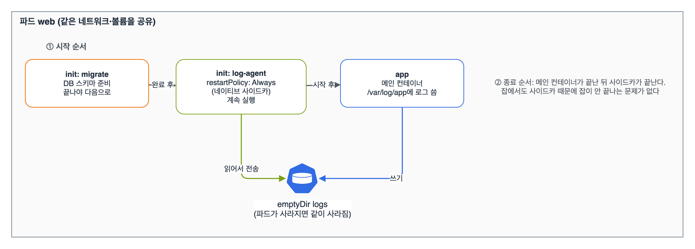

같은 도메인의 나머지 범위인 '멀티 컨테이너 파드 설계 패턴(사이드카, init 등)'과 '영구·임시 볼륨 활용'이다. v1.32에서는 initContainers에 restartPolicy: Always를 주는 네이티브 사이드카가 베타(기본 켜짐)라서, 예전 방식과 새 방식을 같이 정리했다.

## 요약

- 파드 안의 컨테이너는 같은 네트워크(localhost)와 볼륨을 공유한다.
- init 컨테이너는 정의한 순서대로 하나씩 실행되고, 모두 성공해야 메인 컨테이너가 시작된다.
- 네이티브 사이드카는 initContainers에 restartPolicy: Always를 준 컨테이너다. 메인보다 먼저 시작해 계속 돌고, 메인이 끝난 뒤에 종료된다.
- 컨테이너끼리 파일을 주고받을 때는 emptyDir를 쓴다. emptyDir는 파드가 사라지면 같이 지워진다.
- 파드 이름, IP, 라벨, 리소스 값 같은 파드 자신의 정보는 Downward API로 환경 변수나 파일로 넣는다.

## 1. 멀티 컨테이너 패턴

| 패턴 | 하는 일 | 예 |
|---|---|---|
| init 컨테이너 | 메인 시작 전에 준비 작업을 하고 끝난다 | DB가 뜰 때까지 기다리기, 설정 파일 생성, 스키마 마이그레이션 |
| 사이드카 | 메인 옆에서 계속 돌며 기능을 보탠다 | 로그 수집·전송, 프록시, 설정 동기화 |
| 앰배서더 | 메인 대신 바깥과 통신하는 프록시 | localhost:6379로 받아 실제 Redis 클러스터에 연결 |
| 어댑터 | 메인의 출력을 표준 형식으로 바꿔 준다 | 앱 로그·지표를 모니터링 형식으로 변환 |


_migrate가 끝나야 log-agent가 시작되고, log-agent가 시작된 뒤 app이 뜬다. app이 emptyDir에 쓴 로그를 log-agent가 읽어 보낸다. 종료할 때는 app이 먼저, 사이드카가 나중에 끝난다_

## 2. init 컨테이너와 네이티브 사이드카

```yaml
apiVersion: v1
kind: Pod
metadata:
  name: web
spec:
  initContainers:
  - name: wait-db
    image: busybox:1.36
    command: ["sh", "-c", "until nslookup db.shop.svc.cluster.local; do echo waiting; sleep 2; done"]
  - name: log-agent
    image: busybox:1.36
    restartPolicy: Always
    command: ["sh", "-c", "tail -F /var/log/app/app.log"]
    volumeMounts:
    - name: logs
      mountPath: /var/log/app
  containers:
  - name: app
    image: busybox:1.36
    command: ["sh", "-c", "while true; do date >> /var/log/app/app.log; sleep 5; done"]
    volumeMounts:
    - name: logs
      mountPath: /var/log/app
  volumes:
  - name: logs
    emptyDir: {}
```

| 구분 | 일반 init 컨테이너 | 네이티브 사이드카(restartPolicy: Always) | containers에 둔 옛날식 사이드카 |
|---|---|---|---|
| 시작 | 순서대로, 끝나야 다음 | 순서대로 시작, 시작되면 다음으로 넘어간다 | 메인과 동시에 |
| 실행 | 끝나야 한다 | 파드가 끝날 때까지 계속 | 계속 |
| 종료 | 이미 끝남 | 메인이 끝난 뒤 역순으로 | 메인과 같이 |
| 잡에서 | 문제없음 | 메인이 끝나면 잡이 완료된다 | 사이드카가 안 끝나서 잡이 완료되지 않는 문제가 있었다 |

init 컨테이너가 끝나지 않으면 STATUS가 Init:0/2처럼 나오고, 실패를 반복하면 Init:CrashLoopBackOff다. 로그는 k logs web -c wait-db로 본다.

## 3. 볼륨

| 종류 | 수명 | 쓰는 때 |
|---|---|---|
| emptyDir | 파드와 같다 | 컨테이너끼리 파일 공유, 임시 캐시. medium: Memory면 메모리(tmpfs), sizeLimit으로 크기 제한 |
| configMap, secret | 원본 리소스를 따른다 | 설정 파일, 인증서를 파일로 넣기 |
| downwardAPI | 파드와 같다 | 파드 이름·라벨·리소스 값을 파일로 |
| projected | 원본을 따른다 | configMap, secret, downwardAPI, serviceAccountToken을 한 디렉터리에 합쳐 넣기 |
| persistentVolumeClaim | 파드와 무관 | 파드가 바뀌어도 남아야 하는 데이터(CKA 스토리지 편) |
| hostPath | 노드와 같다 | 노드 파일에 접근해야 하는 시스템 파드. 일반 앱에는 쓰지 않는다 |

## 4. Downward API

```yaml
apiVersion: v1
kind: Pod
metadata:
  name: info
  labels:
    app: info
spec:
  containers:
  - name: info
    image: busybox:1.36
    command: ["sh", "-c", "env | grep MY_; cat /etc/podinfo/labels; sleep 3600"]
    resources:
      limits:
        memory: 128Mi
    env:
    - name: MY_POD_NAME
      valueFrom:
        fieldRef:
          fieldPath: metadata.name
    - name: MY_POD_IP
      valueFrom:
        fieldRef:
          fieldPath: status.podIP
    - name: MY_MEM_LIMIT
      valueFrom:
        resourceFieldRef:
          containerName: info
          resource: limits.memory
    volumeMounts:
    - name: podinfo
      mountPath: /etc/podinfo
  volumes:
  - name: podinfo
    downwardAPI:
      items:
      - path: labels
        fieldRef:
          fieldPath: metadata.labels
```

환경 변수로는 metadata.name, metadata.namespace, status.podIP, spec.nodeName 같은 단일 값을 넣고, 라벨·어노테이션 전체는 파일(downwardAPI 볼륨)로 넣는다. 파일로 넣은 라벨은 나중에 라벨을 바꾸면 갱신되지만, 환경 변수는 갱신되지 않는다.

> **쉬운 설명**
>
> 파드는 한 방을 같이 쓰는 룸메이트들이다. 같은 와이파이(localhost)를 쓰고 같은 책상 서랍(emptyDir)을 연다. init 컨테이너는 입주 전에 청소하고 짐을 풀어 주는 이사 업체라 일이 끝나면 떠난다. 사이드카는 같이 사는 매니저라 집주인(메인)보다 먼저 들어와서 끝까지 남는다. Downward API는 문 앞 명패를 방 안에서 볼 수 있게 붙여 주는 것이다.

## 헷갈렸던 것들

- init 컨테이너는 하나씩 순서대로 돈다. 동시에 돌지 않는다.
- 네이티브 사이드카는 containers가 아니라 initContainers에 쓰고 restartPolicy: Always를 붙인다. 컨테이너 수준의 restartPolicy는 이 경우에만 쓴다.
- 사이드카가 먼저 시작돼야 하는 이유(프록시, 로그 수집)가 있으면 네이티브 사이드카가 맞다.
- emptyDir는 파드가 지워지면 사라진다. 컨테이너만 재시작되면 남아 있다.
- 같은 파드의 컨테이너는 포트가 겹치면 안 된다. localhost를 같이 쓰기 때문이다.
- Downward API 환경 변수는 갱신되지 않고, 볼륨 파일은 갱신된다.
- resourceFieldRef는 어느 컨테이너의 값인지 containerName을 써야 한다(볼륨에서는 필수).

## 용어 정리

| 용어 | 뜻 |
|---|---|
| init 컨테이너 | 메인 컨테이너 전에 순서대로 실행되고 끝나는 컨테이너 |
| 네이티브 사이드카 | restartPolicy: Always를 준 init 컨테이너. 파드가 끝날 때까지 돈다 |
| emptyDir | 파드가 생길 때 만들어지고 지워질 때 사라지는 빈 볼륨 |
| Downward API | 파드와 컨테이너 자신의 정보를 환경 변수나 파일로 넣는 방법 |
| projected 볼륨 | 여러 볼륨 소스를 한 디렉터리에 합친 볼륨 |

## 복습 문제

**1.** Create a Pod named `web`. An init container named `setup` must write `hello` to `/work/index.html`, and the main container `nginx:1.27` must serve that file from `/usr/share/nginx/html`.

**2.** Add a log shipping sidecar named `shipper` (`busybox:1.36`, `tail -F /logs/api.log`) to the Deployment `api`. The sidecar must start before the main container, and both containers must share `/logs`.

**3.** Expose the name of the node that runs the Pod as the environment variable `NODE_NAME`.

## 답과 풀이

1. 두 컨테이너가 같은 emptyDir를 서로 다른 경로에 마운트한다.

```bash
cat <<EOF | k apply -f -
apiVersion: v1
kind: Pod
metadata: {name: web}
spec:
  initContainers:
  - name: setup
    image: busybox:1.36
    command: ["sh", "-c", "echo hello > /work/index.html"]
    volumeMounts: [{name: html, mountPath: /work}]
  containers:
  - name: nginx
    image: nginx:1.27
    volumeMounts: [{name: html, mountPath: /usr/share/nginx/html}]
  volumes: [{name: html, emptyDir: {}}]
EOF
k exec web -c nginx -- cat /usr/share/nginx/html/index.html
```

2. 먼저 시작해야 하니 initContainers에 restartPolicy: Always로 넣고, emptyDir를 양쪽에 마운트한다. 디플로이먼트를 고치면 롤링 업데이트로 파드가 바뀐다.

```bash
k edit deploy api
# spec.template.spec.initContainers:
# - name: shipper
#   image: busybox:1.36
#   restartPolicy: Always
#   command: ["sh", "-c", "tail -F /logs/api.log"]
#   volumeMounts: [{name: logs, mountPath: /logs}]
# containers[0].volumeMounts에 {name: logs, mountPath: /logs}, volumes에 {name: logs, emptyDir: {}}
k get pods -l app=api       # READY 2/2
```

3. fieldRef의 spec.nodeName을 쓴다.

```bash
# containers[0].env:
# - name: NODE_NAME
#   valueFrom: {fieldRef: {fieldPath: spec.nodeName}}
```

## 참고 자료

- Kubernetes v1.32 문서, init 컨테이너: <https://v1-32.docs.kubernetes.io/docs/concepts/workloads/pods/init-containers/>
- Kubernetes v1.32 문서, 사이드카 컨테이너: <https://v1-32.docs.kubernetes.io/docs/concepts/workloads/pods/sidecar-containers/>
- Kubernetes v1.32 문서, 볼륨: <https://v1-32.docs.kubernetes.io/docs/concepts/storage/volumes/>
- Kubernetes v1.32 문서, 임시 볼륨: <https://v1-32.docs.kubernetes.io/docs/concepts/storage/ephemeral-volumes/>
- Kubernetes v1.32 문서, Downward API: <https://v1-32.docs.kubernetes.io/docs/concepts/workloads/pods/downward-api/>

