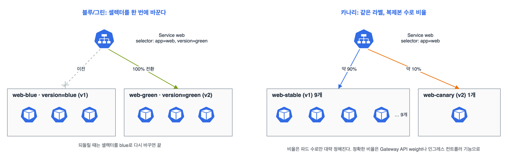

애플리케이션 배포(20%)에서 롤링 업데이트, Helm, Kustomize는 CKA 때 정리한 걸 그대로 쓰고, 여기서는 범위의 '기본 리소스로 블루/그린, 카나리 같은 배포 전략 구현'을 중심으로 적었다. 오늘 오후에 killer.sh 1회차를 풀었는데 카나리 문제가 실제로 나와서, 그 풀이를 기준으로 정리했다.

## 요약

- 롤링 업데이트(기본)는 파드를 조금씩 바꾸고, Recreate는 다 지우고 새로 띄운다(잠깐 중단).
- 블루/그린은 두 버전의 디플로이먼트를 다 띄워 두고, 서비스 셀렉터를 바꿔 한 번에 넘긴다. 되돌릴 때도 셀렉터만 바꾼다.
- 카나리는 두 디플로이먼트가 같은 서비스 라벨을 갖게 하고, 복제본 수로 트래픽 비율을 대략 맞춘다(9:1이면 약 10%).
- Helm은 helm upgrade --install로 설치와 업그레이드를 한 명령으로, Kustomize는 overlay로 이미지·복제본만 바꿔 배포한다.

## 1. 기본 리소스로 만드는 배포 전략


_왼쪽: 블루/그린은 서비스 셀렉터의 version을 blue에서 green으로 바꿔 트래픽을 한 번에 넘긴다. 오른쪽: 카나리는 같은 라벨(app=web)을 단 두 디플로이먼트를 서비스가 함께 고르고, 파드 수 9:1로 약 10%만 새 버전에 간다_

| 전략 | 방법 | 장점 | 단점 |
|---|---|---|---|
| 롤링 업데이트 | 디플로이먼트 이미지 교체(maxSurge, maxUnavailable) | 자원이 적게 든다 | 한동안 두 버전이 섞인다 |
| Recreate | strategy.type: Recreate | 두 버전이 절대 섞이지 않는다 | 바꾸는 동안 중단 |
| 블루/그린 | 디플로이먼트 두 개 + 서비스 셀렉터 전환 | 즉시 전환, 즉시 롤백 | 잠깐 자원이 두 배 |
| 카나리 | 디플로이먼트 두 개가 같은 라벨 + 복제본 비율 | 일부 사용자로 먼저 확인 | 비율이 파드 수 단위로만 정해진다 |

### 블루/그린

```yaml
apiVersion: apps/v1
kind: Deployment
metadata:
  name: web-green
spec:
  replicas: 3
  selector:
    matchLabels:
      app: web
      version: green
  template:
    metadata:
      labels:
        app: web
        version: green
    spec:
      containers:
      - name: web
        image: nginx:1.27
```

```yaml
apiVersion: v1
kind: Service
metadata:
  name: web
spec:
  selector:
    app: web
    version: blue
  ports:
  - port: 80
    targetPort: 80
```

```bash
k apply -f web-green.yaml
k rollout status deploy/web-green                       # 그린이 다 뜬 뒤에
k patch svc web -p '{"spec":{"selector":{"app":"web","version":"green"}}}'
k get ep web                                            # 엔드포인트가 그린 파드로 바뀌었는지
# 문제가 있으면 version을 blue로 되돌린다. 확인이 끝나면 web-blue를 지운다
```

### 카나리

```bash
# 서비스는 app=web만 고른다(version 없음)
k get deploy web-stable -o yaml > canary.yaml
# 이름을 web-canary로, 라벨에 track: canary 추가(app: web은 유지), 이미지를 새 버전으로, replicas: 1
k apply -f canary.yaml
k scale deploy web-stable --replicas=9                  # 9:1 → 새 버전에 약 10%
k get ep web -o wide                                    # 두 디플로이먼트 파드가 다 들어 있는지
# 괜찮으면 stable의 이미지를 올리고 canary를 지운다
```

비율은 '전체 파드 중 카나리 파드의 비율'이라서 20%를 원하면 4:1, 25%면 3:1처럼 파드 수로 맞춘다. 문제에서 '전체 파드 수는 10개를 넘지 말 것'처럼 조건을 주면 그 안에서 비율을 맞춘다. 셀렉터가 두 디플로이먼트를 모두 고르려면 공통 라벨이 있어야 하고, 각 디플로이먼트의 셀렉터는 서로 겹치지 않게 다른 라벨(track이나 version)을 하나 더 둔다.

## 2. 롤링 업데이트 다시 보기

CKA 정리와 같다. 개발자 쪽에서 자주 쓰는 건 이 정도다.

```bash
k set image deploy/web web=nginx:1.27.4
k rollout status deploy/web
k rollout history deploy/web
k annotate deploy/web kubernetes.io/change-cause="nginx 1.27.4로 업데이트"   # history에 남는 메모
k rollout undo deploy/web --to-revision=1
```

## 3. Helm으로 배포

```bash
helm upgrade --install shop ./shop-chart -n shop --create-namespace \
  --set image.tag=1.4.0 -f values-prod.yaml    # 없으면 설치, 있으면 업그레이드
helm get values shop -n shop                   # 지금 적용된 값
helm get manifest shop -n shop | head          # 실제로 만들어진 리소스
helm rollback shop 1 -n shop
helm template shop ./shop-chart -f values-prod.yaml > out.yaml   # 설치 없이 결과 확인
```

## 4. Kustomize로 배포

```
# overlays/prod/kustomization.yaml
resources:
- ../../base
images:
- name: nginx
  newTag: "1.27.4"
replicas:
- name: web
  count: 5
```

```bash
k diff -k overlays/prod      # 적용하면 무엇이 바뀌는지
k apply -k overlays/prod
```

> **쉬운 설명**
>
> 블루/그린은 무대 두 개를 다 세워 두고 조명(서비스)만 옆 무대로 돌리는 공연이다. 문제가 생기면 조명을 다시 돌리면 끝이다. 카나리는 새 메뉴를 열 테이블 중 한 테이블에만 먼저 내는 식당이다. 몇 테이블에 낼지는 테이블 수로만 정할 수 있어서, 정확히 7%처럼은 못 한다. 롤링 업데이트는 테이블을 하나씩 새 메뉴로 바꿔 가는 방식이다.

## 헷갈렸던 것들

- 블루/그린은 서비스 셀렉터를 바꾸는 것이다. 디플로이먼트의 셀렉터는 만든 뒤 바꿀 수 없다.
- 카나리에서 서비스가 두 디플로이먼트를 다 고르려면 공통 라벨만 셀렉터에 둔다.
- 두 디플로이먼트의 셀렉터가 완전히 같으면 서로의 파드를 자기 것으로 착각할 수 있다. 각자 고유 라벨을 하나 더 둔다.
- 카나리 비율은 파드 수 비율이다. 9:1이면 10%, 3:1이면 25%.
- Recreate는 중단이 생긴다. '중단 없이'라는 조건이면 롤링 업데이트나 블루/그린.
- helm upgrade --install은 릴리스가 없으면 설치한다. 처음 배포와 업데이트를 한 명령으로 처리한다.
- Kustomize의 replicas 필드는 이름으로 디플로이먼트를 찾아 복제본 수만 바꾼다.

## 용어 정리

| 용어 | 뜻 |
|---|---|
| 블루/그린 | 두 버전을 모두 띄워 두고 트래픽을 한 번에 전환하는 배포 |
| 카나리 | 새 버전에 트래픽 일부만 먼저 보내 확인하는 배포 |
| Recreate | 이전 파드를 모두 지운 뒤 새 파드를 띄우는 디플로이먼트 전략 |
| change-cause | rollout history에 표시되는 변경 사유 어노테이션 |
| helm upgrade --install | 릴리스가 없으면 설치, 있으면 업그레이드하는 명령 |

## 복습 문제

**1.** The Service `app` points to the Deployment `web-v1` (labels `app=app`, `ver=v1`). Create `web-v2` (image `nginx:1.27.4`, labels `app=app`, `ver=v2`), and switch all traffic to v2.

**2.** The Deployment `api-stable` (4 replicas) is behind the Service `api`. Create `api-canary` with a new image so that it receives about 20% of the traffic. The total number of Pods must be 5.

**3.** Change the Deployment `front` so that, during an update, all old Pods are terminated before any new Pod is created.

## 답과 풀이

1. 새 디플로이먼트가 다 뜬 뒤 서비스 셀렉터를 바꾼다.

```bash
k create deploy web-v2 --image=nginx:1.27.4 $do > v2.yaml
# selector.matchLabels와 template 라벨을 {app: app, ver: v2}로
k apply -f v2.yaml && k rollout status deploy/web-v2
k patch svc app -p '{"spec":{"selector":{"app":"app","ver":"v2"}}}'
k get ep app
```

2. 전체 5개 중 1개가 카나리면 20%다. stable을 4개로 두고 canary 1개를 같은 공통 라벨로 만든다.

```bash
k get deploy api-stable -o yaml > canary.yaml
# 이름 api-canary, 고유 라벨 track: canary 추가, 새 이미지, replicas: 1
k apply -f canary.yaml
k get pods -l app=api --show-labels
```

3. strategy를 Recreate로 바꾸고 rollingUpdate 블록은 지운다. 둘이 같이 있으면 거절된다.

```bash
k patch deploy front --type=json -p '[{"op":"remove","path":"/spec/strategy/rollingUpdate"},{"op":"replace","path":"/spec/strategy/type","value":"Recreate"}]'
```

## 참고 자료

- Kubernetes v1.32 문서, 디플로이먼트: <https://v1-32.docs.kubernetes.io/docs/concepts/workloads/controllers/deployment/>
- Kubernetes v1.32 문서, 리소스 관리(카나리 배포): <https://v1-32.docs.kubernetes.io/docs/concepts/workloads/management/>
- Helm 문서, helm upgrade: <https://helm.sh/docs/helm/helm_upgrade/>
- Kubernetes v1.32 문서, Kustomize: <https://v1-32.docs.kubernetes.io/docs/tasks/manage-kubernetes-objects/kustomization/>

