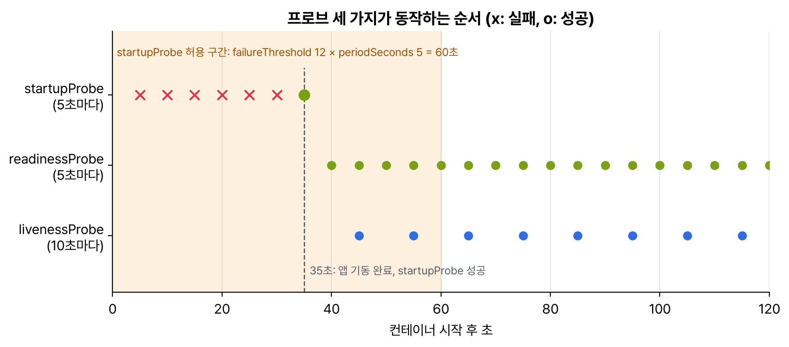

관찰 가능성과 유지보수(15%)의 범위는 'API 지원 중단 이해', '프로브와 헬스 체크', 'CLI로 앱 모니터링', '컨테이너 로그', '디버깅'이다. 로그와 디버깅은 CKA 트러블슈팅 2편을 그대로 쓰고, 여기서는 프로브 세 가지와 지원 중단된 API를 고치는 법을 정리했다.

## 요약

- livenessProbe가 실패하면 컨테이너를 재시작하고, readinessProbe가 실패하면 서비스 엔드포인트에서 뺀다(재시작은 안 함).
- startupProbe가 성공하기 전에는 나머지 두 프로브가 돌지 않는다. 기동이 느린 앱은 failureThreshold × periodSeconds가 최악의 기동 시간을 덮게 잡는다.
- 프로브 방식은 httpGet, tcpSocket, exec, grpc 네 가지다.
- 지원 중단된 apiVersion은 언젠가 서버가 받지 않는다. k api-resources와 k explain으로 지금 클러스터가 받는 버전을 확인하고 매니페스트를 고친다.

## 1. 프로브 세 가지

| 프로브 | 실패하면 | 쓰는 때 |
|---|---|---|
| livenessProbe | 컨테이너를 재시작 | 교착 상태처럼 프로세스는 살아 있는데 일을 못 할 때 |
| readinessProbe | 서비스 엔드포인트에서 제외(Ready 0/1) | 기동 중, 일시적 과부하, 의존 서비스 대기 |
| startupProbe | 허용 시간을 넘기면 컨테이너를 재시작 | 기동이 오래 걸리는 앱. 성공할 때까지 나머지 프로브를 막는다 |


_startupProbe가 5초마다 확인하다 35초에 성공하면 그때부터 readiness와 liveness가 돈다. 60초(12 × 5초) 안에 성공하지 못하면 컨테이너가 재시작된다_

```yaml
apiVersion: v1
kind: Pod
metadata:
  name: api
spec:
  containers:
  - name: api
    image: nginx:1.27
    ports:
    - name: http
      containerPort: 80
    startupProbe:
      httpGet:
        path: /
        port: http
      periodSeconds: 5
      failureThreshold: 12
    readinessProbe:
      httpGet:
        path: /
        port: http
      periodSeconds: 5
      failureThreshold: 2
    livenessProbe:
      tcpSocket:
        port: 80
      periodSeconds: 10
      timeoutSeconds: 2
      failureThreshold: 3
```

| 필드 | 뜻 | 기본 |
|---|---|---|
| initialDelaySeconds | 컨테이너 시작 뒤 첫 검사까지 기다리는 시간 | 0 |
| periodSeconds | 검사 간격 | 10 |
| timeoutSeconds | 응답을 기다리는 시간 | 1 |
| failureThreshold | 연속 몇 번 실패하면 실패로 볼지 | 3 |
| successThreshold | 실패 뒤 연속 몇 번 성공해야 성공으로 볼지(liveness, startup은 1만 된다) | 1 |

exec 방식은 명령의 종료 코드가 0이면 성공이다. command: ["cat", "/tmp/healthy"]처럼 쓴다. httpGet은 200~399 응답이면 성공이다. liveness를 readiness처럼 민감하게 잡으면 잠깐 느려질 때마다 재시작돼서 오히려 장애가 커진다. liveness는 넉넉하게, readiness는 촘촘하게 잡는 게 보통이다.

## 2. CLI로 앱 보기

| 보고 싶은 것 | 명령 |
|---|---|
| 상태와 재시작 수 | k get pods -o wide, k get pods -w |
| 왜 Ready가 아닌지, 프로브 실패 | k describe pod api(Events의 Unhealthy) |
| 사용량 | k top pods --containers, k top pods --sort-by=memory |
| 이벤트 | k get events --sort-by=.lastTimestamp |
| 로그 | k logs api, k logs api --previous, k logs -l app=api --all-containers |
| 안으로 들어가기 | k exec -it api -- sh, k debug -it api --image=busybox:1.36 --target=api |

## 3. API 지원 중단

쿠버네티스는 베타 API를 정식 버전으로 옮기고 나면 옛 버전을 지원 중단했다가, 몇 버전 뒤에 아예 받지 않는다. 예전 블로그나 문제집의 YAML을 그대로 쓰면 'no matches for kind ... in version ...'으로 실패한다.

| 리소스 | 없어진 버전 | 이제 쓰는 버전 | 없어진 릴리스 |
|---|---|---|---|
| Ingress | extensions/v1beta1, networking.k8s.io/v1beta1 | networking.k8s.io/v1 | v1.22 |
| CronJob | batch/v1beta1 | batch/v1 | v1.25 |
| PodDisruptionBudget | policy/v1beta1 | policy/v1 | v1.25 |
| HorizontalPodAutoscaler | autoscaling/v2beta2 | autoscaling/v2 | v1.26 |
| FlowSchema, PriorityLevelConfiguration | flowcontrol.apiserver.k8s.io/v1beta3 | flowcontrol.apiserver.k8s.io/v1 | v1.32 |

```bash
k api-resources | grep -i cronjob            # 지금 클러스터가 받는 그룹·버전
k api-versions | grep batch
k explain cronjob --api-version=batch/v1      # 그 버전의 필드
k apply -f old.yaml                           # 지원 중단 버전이면 'Warning: ... deprecated'가 나온다
```

버전만 바꾸면 되는 경우도 있지만, 필드가 바뀐 경우도 있다. Ingress가 대표적이라 v1beta1의 serviceName·servicePort는 v1에서 service.name·service.port.number로, pathType은 필수가 됐다. kubectl convert 플러그인(kubectl-convert)으로 바꿀 수 있지만 기본 설치가 아니라서, 시험에서는 k explain을 보며 손으로 고치는 게 빠르다.

> **쉬운 설명**
>
> 프로브는 가게 직원 점검이다. startupProbe는 '출근해서 앞치마 다 맬 때까지는 기다려 준다', readinessProbe는 '지금 손님 받을 수 있나?'라서 바쁘면 잠깐 주문을 다른 직원에게 돌린다. livenessProbe는 '쓰러졌나?'라서 응답이 없으면 교대(재시작)시킨다. API 지원 중단은 서식 개정이다. 옛 서식(v1beta1)으로 낸 서류는 몇 번 경고를 받다가 어느 날부터 접수가 안 된다.

## 헷갈렸던 것들

- readiness 실패는 재시작이 아니다. 엔드포인트에서만 빠진다.
- liveness 실패는 재시작이다. 너무 빡빡하면 재시작 루프가 된다.
- startupProbe가 성공할 때까지 liveness와 readiness는 실행되지 않는다.
- successThreshold는 liveness와 startup에서 1만 허용된다.
- 프로브 포트에 이름(port: http)을 쓰려면 containerPort에 같은 name이 있어야 한다.
- CronJob은 batch/v1, PDB는 policy/v1, HPA는 autoscaling/v2. 예전 자료의 v1beta1은 안 된다.
- kubectl convert는 기본으로 깔려 있지 않다.

## 용어 정리

| 용어 | 뜻 |
|---|---|
| livenessProbe | 실패하면 컨테이너를 재시작하는 검사 |
| readinessProbe | 실패하면 트래픽을 보내지 않는 검사 |
| startupProbe | 기동이 끝났는지 보는 검사. 끝날 때까지 다른 프로브를 막는다 |
| 지원 중단(deprecation) | 앞으로 없어질 예정이라 경고를 내는 상태 |
| 제거(removal) | 서버가 그 API 버전을 더 이상 받지 않는 상태 |

## 복습 문제

**1.** Add a readinessProbe to the Pod `web` (`nginx:1.27`). It must check the path `/` on port 80 every 5 seconds, and the first check must run 10 seconds after the container starts.

**2.** The Pod `worker` must be restarted if the file `/tmp/alive` does not exist. Add a livenessProbe that checks every 15 seconds.

**3.** The app `legacy` takes up to 2 minutes to start and keeps getting restarted by its liveness probe. Fix it.

**4.** `old-cron.yaml` cannot be applied because it uses `apiVersion: batch/v1beta1`. Fix the file and apply it.

## 답과 풀이

1. 파드는 실행 중에 프로브를 바꿀 수 없으니 YAML로 다시 만든다.

```bash
k get pod web -o yaml > web.yaml
# containers[0]:
#   readinessProbe: {httpGet: {path: /, port: 80}, initialDelaySeconds: 10, periodSeconds: 5}
k replace --force -f web.yaml
```

2. exec 방식이다. 파일이 없으면 cat의 종료 코드가 0이 아니라서 실패다.

```bash
# livenessProbe: {exec: {command: ["cat", "/tmp/alive"]}, periodSeconds: 15}
```

3. startupProbe를 넣어 최대 2분을 덮는다. 10초 × 12번 = 120초 동안은 liveness가 돌지 않는다.

```bash
# startupProbe: {httpGet: {path: /healthz, port: 8080}, periodSeconds: 10, failureThreshold: 12}
```

4. 크론잡은 batch/v1이다. 필드는 그대로라 버전만 바꾸면 된다.

```bash
sed -i 's#batch/v1beta1#batch/v1#' old-cron.yaml
k apply -f old-cron.yaml
```

## 참고 자료

- Kubernetes v1.32 문서, 프로브 구성: <https://v1-32.docs.kubernetes.io/docs/tasks/configure-pod-container/configure-liveness-readiness-startup-probes/>
- Kubernetes v1.32 문서, 파드 수명 주기(컨테이너 프로브): <https://v1-32.docs.kubernetes.io/docs/concepts/workloads/pods/pod-lifecycle/>
- Kubernetes v1.32 문서, 지원 중단된 API 마이그레이션 안내: <https://v1-32.docs.kubernetes.io/docs/reference/using-api/deprecation-guide/>
- Kubernetes v1.32 문서, 지원 중단 정책: <https://v1-32.docs.kubernetes.io/docs/reference/using-api/deprecation-policy/>
- Kubernetes v1.32 문서, kubectl-convert 설치: <https://v1-32.docs.kubernetes.io/docs/tasks/tools/install-kubectl-linux/#install-kubectl-convert-plugin>

