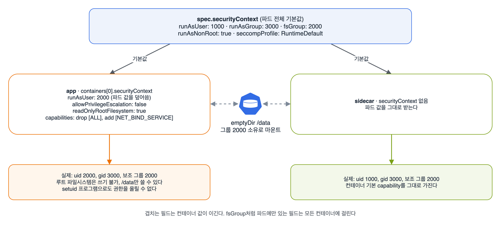

환경·구성·보안(25%)은 비중이 제일 큰데 절반 이상이 CKA에서 본 것(RBAC, 쿼터, LimitRange, Pod Security 라벨)이라, 오늘은 시험 안내 글에 '새로 볼 것'으로 적어 둔 SecurityContext와 capabilities, 그리고 앱 쪽에서 보는 ServiceAccount만 정리했다. 마지막에는 restricted 네임스페이스에서 거절당하지 않는 파드를 직접 만들어 봤다.

## 요약

- securityContext는 파드 수준(spec.securityContext)과 컨테이너 수준(containers[].securityContext) 두 군데에 있다. 겹치는 필드는 컨테이너 값이 이긴다.
- allowPrivilegeEscalation, capabilities, readOnlyRootFilesystem, privileged는 컨테이너에만 있고, fsGroup, supplementalGroups, sysctls는 파드에만 있다.
- capabilities는 CAP_ 없이 NET_ADMIN처럼 쓴다. drop: ["ALL"]로 다 빼고 필요한 것만 add하는 게 기본 패턴이다.
- restricted 네임스페이스에 들어가려면 컨테이너마다 runAsNonRoot, allowPrivilegeEscalation: false, capabilities drop ALL, seccompProfile RuntimeDefault가 맞아야 한다.
- 파드는 serviceAccountName의 토큰을 /var/run/secrets/kubernetes.io/serviceaccount에 받는다. 필요 없으면 automountServiceAccountToken: false를 쓰고, SA와 파드 둘 다 정했으면 파드 값이 이긴다.

## 1. securityContext: 파드 수준과 컨테이너 수준

같은 이름의 필드가 두 곳에 있어서 처음에 제일 헷갈렸다. v1.32 스키마에서 직접 필드 목록을 뽑아 봤다.

| 필드 | 파드 | 컨테이너 | 뜻 |
|---|---|---|---|
| runAsUser, runAsGroup | O | O | 프로세스의 uid, 기본 gid. runAsGroup이 없으면 gid는 0(root) |
| runAsNonRoot | O | O | true면 uid 0으로 시작하려는 컨테이너를 kubelet이 막는다 |
| seccompProfile | O | O | 시스템 콜 필터. RuntimeDefault가 런타임 기본 프로필 |
| fsGroup | O | X | 볼륨을 이 그룹 소유로 만들고, 모든 프로세스에 보조 그룹으로 넣는다 |
| supplementalGroups | O | X | 보조 그룹 추가 |
| sysctls | O | X | 파드 네임스페이스 커널 파라미터 |
| allowPrivilegeEscalation | X | O | false면 no_new_privs가 켜져 setuid로 권한을 못 올린다 |
| capabilities | X | O | root 권한 조각을 drop, add |
| readOnlyRootFilesystem | X | O | 컨테이너 루트 파일시스템을 읽기 전용으로 |
| privileged | X | O | 호스트 장치까지 거의 다 여는 특권 모드 |


_파드 값이 기본값이 되고, app 컨테이너는 runAsUser만 2000으로 덮어썼다. sidecar는 아무것도 안 써서 파드 값을 그대로 받는다_

그림의 파드를 YAML로 쓰면 이렇다.

```yaml
apiVersion: v1
kind: Pod
metadata:
  name: secure-web
spec:
  securityContext:
    runAsUser: 1000
    runAsGroup: 3000
    fsGroup: 2000
    runAsNonRoot: true
    seccompProfile:
      type: RuntimeDefault
  volumes:
  - name: data
    emptyDir: {}
  containers:
  - name: app
    image: busybox:1.36
    command: ["sh", "-c", "sleep 3600"]
    securityContext:
      runAsUser: 2000
      allowPrivilegeEscalation: false
      readOnlyRootFilesystem: true
      capabilities:
        drop: ["ALL"]
        add: ["NET_BIND_SERVICE"]
    volumeMounts:
    - name: data
      mountPath: /data
  - name: sidecar
    image: busybox:1.36
    command: ["sh", "-c", "sleep 3600"]
    volumeMounts:
    - name: data
      mountPath: /data
```

```bash
k exec secure-web -c app -- id                 # uid=2000 gid=3000, groups에 2000이 들어 있다
k exec secure-web -c sidecar -- id             # uid=1000 gid=3000
k exec secure-web -c app -- touch /x           # Read-only file system
k exec secure-web -c app -- sh -c 'touch /data/x && ls -ln /data'   # 그룹이 2000
k exec secure-web -c app -- grep Cap /proc/1/status                 # CapBnd가 거의 비어 있다
```

readOnlyRootFilesystem을 켜면 앱이 쓰는 경로가 막힌다. nginx 이미지는 /var/cache/nginx와 /var/run에 쓰기 때문에 그대로 켜면 바로 죽는다. 쓰는 경로마다 emptyDir를 마운트해 주면 된다.

## 2. capabilities

리눅스는 root 권한을 수십 개 조각(capability)으로 나눠 둔다. 컨테이너는 런타임이 정한 몇 개만 기본으로 갖고, 쿠버네티스에서는 drop과 add로 조절한다.

| capability | 하는 일 | 언제 보나 |
|---|---|---|
| NET_BIND_SERVICE | 1024 아래 포트 바인딩 | restricted에서 add가 허용되는 유일한 것 |
| NET_ADMIN | 네트워크 설정 변경(iptables, 라우팅) | 네트워크 도구 컨테이너 |
| SYS_TIME | 시스템 시계 변경 | 시간 동기화 |
| SYS_ADMIN | 마운트 등 광범위한 관리 권한 | 거의 root라서 피한다 |
| CHOWN, KILL, SETUID 등 | 파일 소유자 변경, 시그널, uid 변경 | baseline이 add를 허용하는 기본 묶음 |

```yaml
    securityContext:
      capabilities:
        add: ["NET_ADMIN", "SYS_TIME"]
```

이름은 CAP_NET_ADMIN이 아니라 NET_ADMIN으로 쓴다. 문서 예제가 이 형태다. Pod Security baseline은 add할 수 있는 capability를 13개(CHOWN, KILL, NET_BIND_SERVICE, SETUID 등)로 제한해서 NET_ADMIN이나 SYS_ADMIN을 넣으면 거절하고, restricted는 drop: ["ALL"]을 요구하면서 add는 NET_BIND_SERVICE만 허용한다.

## 3. restricted 네임스페이스를 통과하는 파드

네임스페이스 라벨과 세 가지 수준(privileged, baseline, restricted)은 CKA 때 정리했다. CKAD에서는 '이 네임스페이스에서 파드가 안 뜬다, 고쳐라' 쪽으로 나온다고 해서 restricted가 요구하는 것만 다시 모았다.

| 검사 | 요구 | 어디에 쓰나 |
|---|---|---|
| 루트 아닌 실행 | runAsNonRoot: true, runAsUser는 0이 아닐 것 | 파드 수준에 한 번 쓰면 된다 |
| seccomp | RuntimeDefault나 Localhost를 명시. 비워 두면 위반 | 파드 수준에 한 번 쓰면 된다 |
| 권한 상승 | allowPrivilegeEscalation: false | 컨테이너마다 |
| capabilities | drop에 ALL, add는 NET_BIND_SERVICE만 | 컨테이너마다 |
| 볼륨 종류 | configMap, secret, emptyDir, PVC, projected, downwardAPI, csi, ephemeral만 | hostPath는 안 된다 |
| baseline 항목 | privileged, hostNetwork, hostPath 등 금지 | 전부 |

```yaml
apiVersion: v1
kind: Pod
metadata:
  name: ok-pod
  namespace: secure
spec:
  securityContext:
    runAsNonRoot: true
    runAsUser: 1000
    seccompProfile:
      type: RuntimeDefault
  containers:
  - name: app
    image: busybox:1.36
    command: ["sh", "-c", "sleep 3600"]
    securityContext:
      allowPrivilegeEscalation: false
      capabilities:
        drop: ["ALL"]
```

세 모드는 걸리는 대상이 다르다. enforce는 파드에만 걸리고, warn과 audit은 디플로이먼트 같은 워크로드 리소스에도 걸린다. 그래서 restricted 네임스페이스에 규칙을 어긴 디플로이먼트를 만들면 경고만 나오고 디플로이먼트는 생긴다. 파드만 안 생긴다.

```bash
k get ns secure --show-labels                    # pod-security.kubernetes.io/enforce=restricted 확인
k apply -f web-deploy.yaml                       # Warning: would violate PodSecurity "restricted:latest": ...
k get deploy web -n secure                       # READY 0/1
k describe rs -n secure -l app=web               # FailedCreate ... violates PodSecurity "restricted:latest"
```

## 4. 앱 쪽에서 보는 ServiceAccount

RBAC 쪽(Role, RoleBinding)은 CKA 정리 그대로다. CKAD에서는 '파드가 어떤 SA로 도는지'와 '토큰을 붙일지 말지'를 본다.

- 네임스페이스마다 default SA가 있고, serviceAccountName을 안 쓰면 그걸 쓴다.
- 토큰은 projected 볼륨으로 /var/run/secrets/kubernetes.io/serviceaccount에 붙는다(token, ca.crt, namespace). 수명이 있고, 파드가 지워지면 무효가 된다.
- v1.24부터는 SA를 만들어도 토큰 Secret이 자동으로 생기지 않는다. 손으로 토큰이 필요하면 k create token을 쓴다.
- automountServiceAccountToken: false를 SA나 파드에 쓰면 토큰을 안 붙인다. 둘 다 쓰면 파드 값이 이긴다.

```yaml
apiVersion: v1
kind: ServiceAccount
metadata:
  name: pod-reader
  namespace: shop
---
apiVersion: rbac.authorization.k8s.io/v1
kind: Role
metadata:
  name: pod-reader
  namespace: shop
rules:
- apiGroups: [""]
  resources: ["pods"]
  verbs: ["get", "list", "watch"]
---
apiVersion: rbac.authorization.k8s.io/v1
kind: RoleBinding
metadata:
  name: pod-reader
  namespace: shop
roleRef:
  apiGroup: rbac.authorization.k8s.io
  kind: Role
  name: pod-reader
subjects:
- kind: ServiceAccount
  name: pod-reader
  namespace: shop
```

```bash
k set serviceaccount deploy/dashboard pod-reader -n shop      # 디플로이먼트의 SA 바꾸기(파드가 새로 뜬다)
k auth can-i list pods -n shop --as=system:serviceaccount:shop:pod-reader   # yes
# 파드 안에서 토큰으로 API 부르기
k exec -n shop deploy/dashboard -- sh -c 'TOKEN=$(cat /var/run/secrets/kubernetes.io/serviceaccount/token); curl -s --cacert /var/run/secrets/kubernetes.io/serviceaccount/ca.crt -H "Authorization: Bearer $TOKEN" https://kubernetes.default.svc/api/v1/namespaces/shop/pods | head'
```

파드의 serviceAccountName은 실행 중에 바꿀 수 없다. 파드라면 지우고 다시 만들고, 디플로이먼트라면 k set serviceaccount나 k edit로 템플릿을 바꾼다.

> **쉬운 설명**
>
> securityContext는 직원에게 주는 열쇠 꾸러미다. 파드 수준은 회사 공통 규정('전원 일반 사원 권한'), 컨테이너 수준은 개인별 예외라서 둘이 다르면 개인 쪽이 적용된다. capabilities는 마스터키를 쪼갠 개별 열쇠라서, drop ALL로 다 반납하고 꼭 필요한 열쇠 하나만 다시 받는다. restricted 네임스페이스는 보안 구역이라 입구 경비(어드미션)가 꾸러미를 검사하고, 디플로이먼트라는 채용 공고는 통과시켜도 실제로 들어오는 직원(파드)은 돌려보낸다. ServiceAccount는 앱의 사원증이고, 사원증이 필요 없는 앱은 automount를 꺼서 아예 안 받게 한다.

## 헷갈렸던 것들

- 같은 필드가 파드와 컨테이너에 다 있으면 컨테이너 값이 이긴다.
- allowPrivilegeEscalation, capabilities, readOnlyRootFilesystem은 컨테이너에만 있다. 파드 수준에 쓰면 unknown field로 거절된다.
- capabilities 이름에 CAP_를 붙이지 않는다.
- runAsNonRoot: true인데 이미지가 root로 돌게 돼 있고 runAsUser도 없으면 CreateContainerConfigError가 난다. runAsUser를 같이 준다.
- readOnlyRootFilesystem을 켜면 /tmp나 캐시 경로에 emptyDir를 따로 붙인다.
- restricted enforce는 파드에만 걸린다. 디플로이먼트가 READY 0이면 k describe rs로 FailedCreate 이유를 본다.
- restricted는 seccompProfile을 명시해야 한다. 비워 두는 것도 위반이다.
- automountServiceAccountToken은 파드 값이 SA 값을 이긴다.
- v1.24부터 SA 토큰 Secret이 자동으로 생기지 않는다.

## 용어 정리

| 용어 | 뜻 |
|---|---|
| securityContext | 파드나 컨테이너의 권한·사용자 설정 |
| capability | root 권한을 기능별로 쪼갠 조각 |
| no_new_privs | 프로세스가 부모보다 높은 권한을 얻지 못하게 하는 커널 플래그. allowPrivilegeEscalation: false가 켠다 |
| seccomp | 프로세스가 부를 수 있는 시스템 콜을 거르는 기능 |
| Pod Security 어드미션 | 네임스페이스 라벨에 따라 파드를 privileged, baseline, restricted 기준으로 검사하는 내장 어드미션 |
| automountServiceAccountToken | SA 토큰을 파드에 자동으로 붙일지 정하는 필드 |

## 복습 문제

**1.** Create a Pod named `nonroot` (`busybox:1.36`, `sleep 3600`). It must run as UID 1000, must not allow privilege escalation, and must use a read-only root filesystem while still allowing writes to `/tmp`.

**2.** Add the `NET_ADMIN` and `SYS_TIME` capabilities to the container of the Deployment `net-tool`.

**3.** The namespace `secure` enforces the `restricted` Pod Security Standard. None of the Pods of the Deployment `web` start. Find the cause and fix it.

**4.** In the namespace `shop`, create a ServiceAccount named `pod-reader`. Make the Deployment `dashboard` run with this ServiceAccount and be able to list the Pods in the same namespace. The Deployment `batch-runner` does not need a token, so it must not mount one.

## 답과 풀이

1. /tmp는 emptyDir로 따로 붙인다.

```bash
k run nonroot --image=busybox:1.36 $do -- sh -c 'sleep 3600' > nonroot.yaml
# spec.securityContext: {runAsUser: 1000, runAsNonRoot: true}
# containers[0].securityContext: {allowPrivilegeEscalation: false, readOnlyRootFilesystem: true}
# containers[0].volumeMounts: [{name: tmp, mountPath: /tmp}]
# volumes: [{name: tmp, emptyDir: {}}]
k apply -f nonroot.yaml
k exec nonroot -- sh -c 'touch /tmp/ok && touch /nope'   # 두 번째만 실패
```

2. capabilities는 컨테이너 수준이다. 디플로이먼트라 고치면 파드가 새로 뜬다.

```bash
k edit deploy net-tool
# containers[0].securityContext: {capabilities: {add: ["NET_ADMIN", "SYS_TIME"]}}
k rollout status deploy net-tool
```

3. 디플로이먼트가 아니라 ReplicaSet 이벤트에 이유가 나온다. 메시지에 빠진 항목이 다 적혀 있어서 그대로 채운다.

```bash
k describe rs -n secure -l app=web | grep -A3 FailedCreate
k edit deploy web -n secure
# template.spec.securityContext: {runAsNonRoot: true, runAsUser: 1000, seccompProfile: {type: RuntimeDefault}}
# containers[*].securityContext: {allowPrivilegeEscalation: false, capabilities: {drop: ["ALL"]}}
k get pods -n secure -l app=web
```

4. SA, Role, RoleBinding을 만들고 디플로이먼트 두 개를 고친다.

```bash
k create sa pod-reader -n shop
k create role pod-reader --verb=get,list,watch --resource=pods -n shop
k create rolebinding pod-reader --role=pod-reader --serviceaccount=shop:pod-reader -n shop
k set serviceaccount deploy/dashboard pod-reader -n shop
k auth can-i list pods -n shop --as=system:serviceaccount:shop:pod-reader
k patch deploy batch-runner -n shop -p '{"spec":{"template":{"spec":{"automountServiceAccountToken":false}}}}'
k exec -n shop deploy/batch-runner -- ls /var/run/secrets/kubernetes.io/serviceaccount   # 없어야 한다
```

## 참고 자료

- Kubernetes v1.32 문서, 파드와 컨테이너의 보안 컨텍스트 구성: <https://v1-32.docs.kubernetes.io/docs/tasks/configure-pod-container/security-context/>
- Kubernetes v1.32 문서, Pod Security Standards: <https://v1-32.docs.kubernetes.io/docs/concepts/security/pod-security-standards/>
- Kubernetes v1.32 문서, Pod Security 어드미션: <https://v1-32.docs.kubernetes.io/docs/concepts/security/pod-security-admission/>
- Kubernetes v1.32 문서, 파드의 ServiceAccount 구성: <https://v1-32.docs.kubernetes.io/docs/tasks/configure-pod-container/configure-service-account/>
- Linux man page, capabilities(7): <https://man7.org/linux/man-pages/man7/capabilities.7.html>
