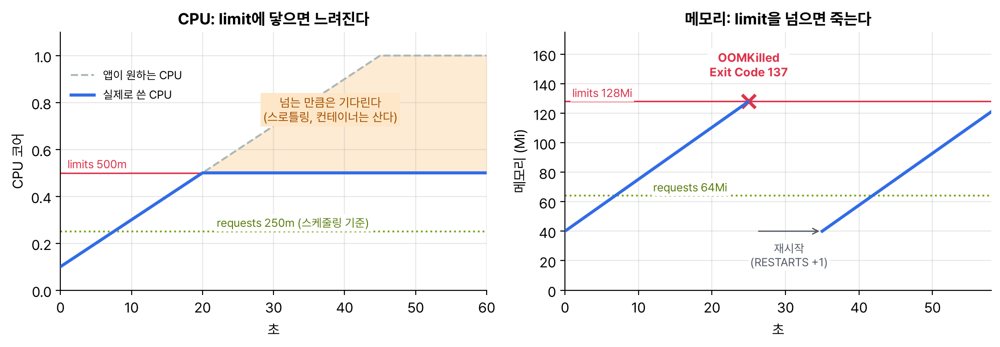

오후에 SecurityContext를 끝내고, 밤에는 CKA 때 본 ConfigMap·Secret, requests·limits, CRD를 앱 개발자 쪽 문제 모양으로 다시 훑었다. 개념은 CKA 정리 그대로라 여기에는 '이렇게 나오면 이렇게 푼다'만 모았다.

## 요약

- ConfigMap과 Secret을 넣는 방법은 키 하나를 환경 변수로(valueFrom), 통째로 환경 변수로(envFrom), 파일로(볼륨) 세 가지다. 자동으로 갱신되는 건 볼륨뿐이고 subPath는 예외다.
- Secret 값은 base64로 인코딩만 돼 있다. 암호화가 아니다.
- immutable: true인 ConfigMap·Secret은 내용을 못 바꾼다. 지우고 다시 만든다.
- CPU limit에 닿으면 느려지고(스로틀링), 메모리 limit을 넘으면 OOMKilled(Exit Code 137)로 죽는다.
- cpu·memory 쿼터가 있는 네임스페이스에서는 requests·limits가 없는 파드가 거절된다. LimitRange 기본값이 있으면 통과한다.
- CRD는 k get crd, k api-resources, k explain으로 찾아서 일반 리소스처럼 쓴다.

## 1. ConfigMap과 Secret 넣기

| 방법 | 컨테이너에서 보이는 모습 | 원본이 바뀌면 |
|---|---|---|
| env + valueFrom | 키 하나가 환경 변수 하나 | 반영 안 됨. 재시작해야 한다 |
| envFrom | 모든 키가 환경 변수. prefix를 붙일 수 있고, 이름 규칙에 안 맞는 키는 빠진다 | 반영 안 됨 |
| volume | 키마다 파일 하나 | 잠시 뒤 반영(kubelet 동기화 주기 + 캐시 지연) |
| volume + subPath | 파일 하나만 원하는 경로에 | 반영 안 됨 |

```bash
k create cm app-config --from-literal=MODE=prod --from-file=app.properties
k create secret generic db-cred --from-literal=user=app --from-literal=password='s3cr3t'
k create secret tls web-tls --cert=tls.crt --key=tls.key
k create secret docker-registry regcred --docker-server=registry.example.com --docker-username=u --docker-password=p
k get secret db-cred -o jsonpath='{.data.password}' | base64 -d     # s3cr3t
```

세 가지를 한 파드에 다 넣어 봤다.

```yaml
apiVersion: v1
kind: Pod
metadata:
  name: config-demo
spec:
  containers:
  - name: app
    image: busybox:1.36
    command: ["sh", "-c", "env; ls -l /etc/app /etc/db; sleep 3600"]
    env:
    - name: APP_MODE
      valueFrom:
        configMapKeyRef:
          name: app-config
          key: MODE
    envFrom:
    - prefix: DB_
      secretRef:
        name: db-cred
    volumeMounts:
    - name: config
      mountPath: /etc/app
    - name: db
      mountPath: /etc/db
      readOnly: true
  volumes:
  - name: config
    configMap:
      name: app-config
      items:
      - key: app.properties
        path: application.properties
  - name: db
    secret:
      secretName: db-cred
      defaultMode: 0400
```

env에는 APP_MODE, DB_user, DB_password가 생기고, /etc/app에는 application.properties 하나만, /etc/db에는 user와 password 파일이 생긴다. 볼륨을 디렉터리에 마운트하면 그 디렉터리 원래 내용은 가려진다. 기존 파일은 두고 하나만 넣으려면 subPath를 쓴다.

| Secret 타입 | 만드는 명령 | 쓰는 곳 |
|---|---|---|
| Opaque | k create secret generic | 아무 키·값 |
| kubernetes.io/tls | k create secret tls | 인그레스 TLS, 앱 인증서. 키는 tls.crt, tls.key |
| kubernetes.io/dockerconfigjson | k create secret docker-registry | 파드의 imagePullSecrets |
| kubernetes.io/basic-auth | YAML로(type 지정) | username, password 키 |
| kubernetes.io/service-account-token | YAML로(annotation에 SA 이름) | 만료 없는 SA 토큰이 꼭 필요할 때 |

YAML로 Secret을 쓸 때 data에는 base64 값을, stringData에는 평문을 쓴다. Secret은 기본적으로 etcd에 암호화 없이 저장되고, 그 네임스페이스에 파드를 만들 수 있으면 Secret을 마운트해서 읽을 수 있다. 그래서 'Secret이니까 안전하다'가 아니라 RBAC과 etcd 암호화까지 같이 챙겨야 안전하다.

immutable: true를 붙이면 data를 바꿀 수 없고 되돌릴 수도 없다. 바꾸려면 지우고 다시 만든 뒤 파드를 재시작한다.

## 2. requests와 limits에서 나오는 문제

QoS나 LimitRange 문법은 CKA 정리에 있다. CKAD에서는 증상을 보고 원인을 찾는 쪽으로 나와서 증상별로 묶었다.


_CPU는 limit을 넘는 만큼 기다리게 될 뿐 컨테이너는 산다. 메모리는 limit을 넘으면 커널이 프로세스를 죽이고, 컨테이너는 재시작된다(실제로는 메모리 압박이 감지될 때 죽어서 조금 늦을 수 있다)_

| 증상 | 원인 | 확인 |
|---|---|---|
| Pending, Insufficient cpu | requests가 어느 노드에도 안 들어간다 | k describe pod의 Events |
| RESTARTS가 늘고 OOMKilled, Exit Code 137 | 메모리 limit 초과 | k describe pod의 Last State |
| 재시작은 없는데 느리다 | CPU limit에서 스로틀링 | k top pod --containers |
| forbidden: exceeded quota | 네임스페이스 쿼터 합계 초과 | k describe quota |
| forbidden: failed quota ... must specify | 쿼터가 있는데 requests·limits가 없다 | 파드에 직접 쓰거나 LimitRange 기본값 |

```bash
k describe pod hungry | grep -A5 'Last State'      # Reason: OOMKilled, Exit Code: 137
k set resources deploy hungry --limits=memory=256Mi --requests=cpu=100m,memory=128Mi
k describe quota -n team-a                          # Used와 Hard 비교
k describe limitrange -n team-a                     # 기본 requests·limits
```

limit만 쓰고 request를 안 쓰면, LimitRange 같은 기본값이 없는 한 limit 값이 request로 복사된다. 그래서 limits.memory=1Gi만 썼다가 노드에 자리가 없어 Pending이 되는 일이 생긴다.

## 3. CRD와 오퍼레이터 써 보기

CRD를 직접 만드는 건 CKA에서 했다. CKAD에서는 이미 설치된 오퍼레이터의 리소스를 찾아서 쓰는 문제로 나온다. 오퍼레이터는 CRD로 새 리소스 종류를 등록하고, 컨트롤러가 그 리소스를 지켜보다가 실제 디플로이먼트나 서비스를 만들어 주는 구조다.

```bash
k get crd                                   # 등록된 CRD 목록
k api-resources --api-group=stable.example.com   # kind, 짧은 이름, 네임스페이스 범위인지
k explain crontab.spec                      # 스키마가 있으면 필드 설명이 나온다
k get crontabs -A                           # 일반 리소스처럼 조회
k get ct                                    # shortNames로도 된다
```

```yaml
apiVersion: stable.example.com/v1
kind: CronTab
metadata:
  name: nightly
spec:
  cronSpec: "0 3 * * *"
  image: my-cron-image:1.0
  replicas: 1
```

CRD는 클러스터 범위 리소스라 네임스페이스가 없다. CRD를 지우면 그 종류의 커스텀 리소스도 전부 지워지니, 문제에서 '리소스를 지워라'와 'CRD를 지워라'를 헷갈리면 안 된다.

> **쉬운 설명**
>
> ConfigMap은 책상에 붙여 두는 메모이고, Secret은 같은 메모를 봉투에 넣은 것이다. 그런데 봉투가 반투명(base64)이라 들고 갈 수 있는 사람(파드를 만들 수 있는 사람)은 다 읽는다. 환경 변수로 넣는 건 출근할 때 메모를 외우는 것이라 메모가 바뀌어도 다시 출근해야 알고, 볼륨은 벽에 붙인 메모라 바뀌면 곧 보인다. CPU limit은 도로 제한 속도라 과속하면 기다리게 할 뿐이고, 메모리 limit은 가방 크기라 넘치게 넣으면 그 자리에서 쫓겨난다. CRD는 회사에 새 서식을 등록하는 것이고, 오퍼레이터는 그 서식이 들어오면 실제 일을 처리하는 담당자다.

## 헷갈렸던 것들

- 환경 변수로 넣은 ConfigMap·Secret은 값을 바꿔도 반영이 안 된다. k rollout restart가 필요하다.
- subPath 마운트도 자동 갱신이 안 된다.
- 디렉터리에 ConfigMap 볼륨을 마운트하면 원래 있던 파일이 가려진다.
- 참조한 ConfigMap·Secret이 없으면 파드가 안 뜬다(환경 변수면 CreateContainerConfigError, 볼륨이면 ContainerCreating에서 멈춘다). optional: true면 비어 있는 채로 뜬다.
- envFrom은 이름 규칙에 안 맞는 키를 조용히 건너뛴다.
- Secret의 data는 base64, stringData는 평문이다.
- OOMKilled는 메모리 limit, 느린 건 CPU limit 쪽이다. 둘을 반대로 기억하지 않기.
- cpu·memory 쿼터가 있으면 requests·limits 없는 파드는 거절된다.
- CRD를 지우면 커스텀 리소스도 다 지워진다.

## 용어 정리

| 용어 | 뜻 |
|---|---|
| valueFrom | 환경 변수 값을 ConfigMap·Secret의 키 하나에서 가져오는 필드 |
| envFrom | ConfigMap·Secret의 모든 키를 환경 변수로 넣는 필드 |
| subPath | 볼륨의 파일 하나만 특정 경로에 마운트하는 필드 |
| immutable | 만든 뒤 내용을 못 바꾸게 하는 ConfigMap·Secret 필드 |
| OOMKilled | 메모리 limit을 넘어 커널이 컨테이너를 죽인 상태. Exit Code 137 |
| 스로틀링 | CPU limit에 닿은 컨테이너의 CPU 시간을 커널이 제한하는 것 |
| 오퍼레이터 | CRD와 컨트롤러로 특정 앱의 운영을 자동화하는 패턴 |

## 복습 문제

**1.** Mount the key `index.html` of the ConfigMap `web-index` into the nginx Deployment `web` as `/usr/share/nginx/html/index.html`. The other files in that directory must remain.

**2.** Update the Deployment `api` to use the key `password` of the Secret `db-cred` as the environment variable `DB_PASSWORD`.

**3.** The Pods of the Deployment `hungry` keep restarting. Find the cause, and raise the memory limit to `256Mi`.

**4.** An operator in the cluster has installed CRDs. Find the CRD in the group `stable.example.com`, and create a resource of that kind named `nightly` with `cronSpec` set to `"0 3 * * *"`.

## 답과 풀이

1. 디렉터리째 마운트하면 기존 파일이 가려지니 subPath로 파일 하나만 넣는다. 대신 ConfigMap을 바꿔도 자동 반영은 안 된다.

```bash
k edit deploy web
# volumes: [{name: index, configMap: {name: web-index}}]
# containers[0].volumeMounts: [{name: index, mountPath: /usr/share/nginx/html/index.html, subPath: index.html}]
k exec deploy/web -- ls /usr/share/nginx/html     # 50x.html도 그대로 있다
```

2. 키 하나라 valueFrom.secretKeyRef로 넣는다.

```bash
k edit deploy api
# containers[0].env:
# - name: DB_PASSWORD
#   valueFrom: {secretKeyRef: {name: db-cred, key: password}}
k exec deploy/api -- printenv DB_PASSWORD
```

3. Last State가 OOMKilled면 메모리 limit 문제다.

```bash
k describe pod -l app=hungry | grep -A3 'Last State'
k set resources deploy hungry --limits=memory=256Mi
k get pods -l app=hungry -w        # RESTARTS가 더 안 늘면 끝
```

4. 그룹으로 kind와 필드를 찾고, 위의 CronTab YAML처럼 만든다.

```bash
k get crd | grep stable.example.com
k api-resources --api-group=stable.example.com
k explain crontab.spec
k apply -f nightly.yaml
k get ct nightly
```

## 참고 자료

- Kubernetes v1.32 문서, ConfigMap: <https://v1-32.docs.kubernetes.io/docs/concepts/configuration/configmap/>
- Kubernetes v1.32 문서, ConfigMap을 쓰도록 파드 구성: <https://v1-32.docs.kubernetes.io/docs/tasks/configure-pod-container/configure-pod-configmap/>
- Kubernetes v1.32 문서, Secret: <https://v1-32.docs.kubernetes.io/docs/concepts/configuration/secret/>
- Kubernetes v1.32 문서, 파드와 컨테이너의 리소스 관리: <https://v1-32.docs.kubernetes.io/docs/concepts/configuration/manage-resources-containers/>
- Kubernetes v1.32 문서, ResourceQuota: <https://v1-32.docs.kubernetes.io/docs/concepts/policy/resource-quotas/>
- Kubernetes v1.32 문서, CustomResourceDefinition으로 API 확장: <https://v1-32.docs.kubernetes.io/docs/tasks/extend-kubernetes/custom-resources/custom-resource-definitions/>
- Kubernetes v1.32 문서, 오퍼레이터 패턴: <https://v1-32.docs.kubernetes.io/docs/concepts/extend-kubernetes/operator/>
