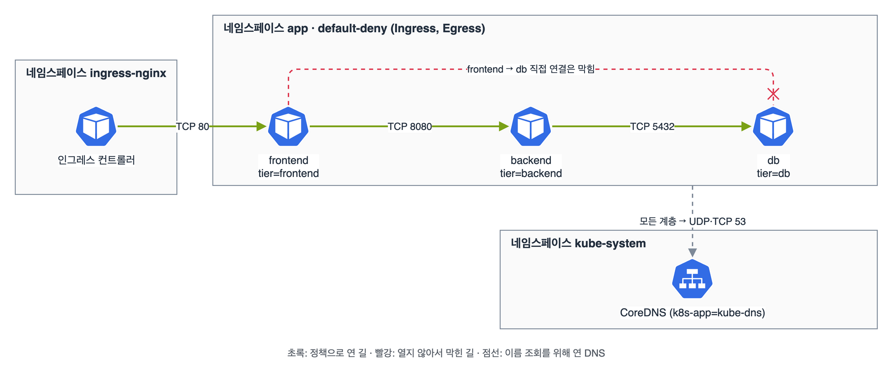

서비스와 네트워킹(20%) 정리. 범위는 'NetworkPolicy 기초', '서비스로 앱 접근 제공과 문제 해결', 'Ingress 규칙으로 앱 노출'이다. Service 종류, DNS 이름, 정책 문법(AND와 OR), Ingress 만들기는 CKA 때 다 정리해서, 오늘은 frontend, backend, db 3계층 앱에 정책을 처음부터 걸어 보는 연습과 '정책은 건드리지 말고 통하게 하라' 같은 문제 유형만 따로 모았다.

## 요약

- 3계층 앱은 기본 차단(Ingress, Egress) 하나, DNS 허용 하나, 계층마다 정책 하나씩으로 만든다.
- NetworkPolicy의 포트는 파드가 실제로 듣는 포트다. 서비스 port(80)가 아니라 targetPort(8080)를 쓴다.
- Egress를 막으면 DNS도 막힌다. kube-system의 CoreDNS로 UDP·TCP 53을 먼저 연다.
- '정책은 수정하지 말라'는 문제는 정책이 고르는 라벨을 파드에 붙여서 푼다. 디플로이먼트면 템플릿 라벨을 바꾼다.
- 서비스 targetPort에 포트 이름을 쓰면 컨테이너 포트 번호가 바뀌어도 서비스를 안 고쳐도 된다.

## 1. 3계층 앱에 정책 걸기

목표는 그림과 같다. 인그레스 컨트롤러에서 frontend로 80, frontend에서 backend로 8080, backend에서 db로 5432만 열고 나머지는 막는다. 이름으로 서비스를 찾아야 하니 DNS는 모든 계층에 연다.


_기본 차단 위에 초록 길만 연다. frontend에서 db로 바로 가는 길은 아무 정책도 열지 않아서 막힌다_

```yaml
apiVersion: networking.k8s.io/v1
kind: NetworkPolicy
metadata:
  name: default-deny
  namespace: app
spec:
  podSelector: {}
  policyTypes: ["Ingress", "Egress"]
---
apiVersion: networking.k8s.io/v1
kind: NetworkPolicy
metadata:
  name: allow-dns
  namespace: app
spec:
  podSelector: {}
  policyTypes: ["Egress"]
  egress:
  - to:
    - namespaceSelector:
        matchLabels:
          kubernetes.io/metadata.name: kube-system
      podSelector:
        matchLabels:
          k8s-app: kube-dns
    ports:
    - protocol: UDP
      port: 53
    - protocol: TCP
      port: 53
---
apiVersion: networking.k8s.io/v1
kind: NetworkPolicy
metadata:
  name: frontend
  namespace: app
spec:
  podSelector:
    matchLabels:
      tier: frontend
  policyTypes: ["Ingress", "Egress"]
  ingress:
  - from:
    - namespaceSelector:
        matchLabels:
          kubernetes.io/metadata.name: ingress-nginx
    ports:
    - protocol: TCP
      port: 80
  egress:
  - to:
    - podSelector:
        matchLabels:
          tier: backend
    ports:
    - protocol: TCP
      port: 8080
---
apiVersion: networking.k8s.io/v1
kind: NetworkPolicy
metadata:
  name: backend
  namespace: app
spec:
  podSelector:
    matchLabels:
      tier: backend
  policyTypes: ["Ingress", "Egress"]
  ingress:
  - from:
    - podSelector:
        matchLabels:
          tier: frontend
    ports:
    - protocol: TCP
      port: 8080
  egress:
  - to:
    - podSelector:
        matchLabels:
          tier: db
    ports:
    - protocol: TCP
      port: 5432
---
apiVersion: networking.k8s.io/v1
kind: NetworkPolicy
metadata:
  name: db
  namespace: app
spec:
  podSelector:
    matchLabels:
      tier: db
  policyTypes: ["Ingress"]
  ingress:
  - from:
    - podSelector:
        matchLabels:
          tier: backend
    ports:
    - protocol: TCP
      port: 5432
```

정리하면서 알게 된 것들이다.

| 포인트 | 내용 |
|---|---|
| 양쪽 다 열어야 한다 | Egress까지 막았으면 frontend의 egress와 backend의 ingress가 둘 다 있어야 통한다 |
| 포트는 파드 포트 | 정책은 서비스 주소가 파드 IP로 바뀐 뒤에 걸린다. 서비스가 80을 8080으로 보내면 정책에는 8080을 쓴다 |
| 같은 네임스페이스 | from이나 to에 podSelector만 쓰면 정책이 있는 네임스페이스의 파드만 뜻한다 |
| 네임스페이스 이름으로 고르기 | 모든 네임스페이스에 자동으로 붙는 kubernetes.io/metadata.name 라벨을 쓴다 |
| 허용은 합쳐진다 | frontend 파드는 allow-dns와 frontend 정책 둘 다에 걸리고, 둘의 허용이 더해진다 |

확인은 정책이 고르는 라벨을 붙인 임시 파드로 한다. 진짜 파드에 들어갈 필요가 없어서 편하다.

```bash
k -n app get netpol
k -n app describe netpol backend               # 누구를 고르고 무엇을 허용하는지 사람이 읽는 형태로
k -n app run t-fe --image=busybox:1.36 --labels=tier=frontend --rm -it --restart=Never -- sh
# 안에서
wget -qO- -T 2 backend:8080                    # 응답이 온다
nc -w 2 db 5432 < /dev/null && echo open       # 시간 초과. frontend에서 db로는 막혀 있다
nslookup backend                               # DNS가 되는지
```

## 2. '정책은 건드리지 말라'는 문제

시험 후기에서 자주 보이는 유형이다. 이미 정책이 여러 개 있고, '정책은 수정하지 말고 파드 X가 Y에 접속할 수 있게 하라'고 한다. 답은 정책이 허용하는 라벨을 파드에 맞추는 것이다.

```bash
k -n app get netpol -o yaml | grep -B2 -A6 'from:\|to:'   # 어떤 라벨을 허용하는지
k -n app get pods --show-labels
k -n app label pod report tier=backend --overwrite          # 파드 하나라면
k -n app patch deploy report -p '{"spec":{"template":{"metadata":{"labels":{"tier":"backend"}}}}}'   # 디플로이먼트라면
```

디플로이먼트의 파드에 직접 라벨을 붙이면 파드가 다시 만들어질 때 사라진다. 그래서 템플릿을 바꾼다. 셀렉터에 들어 있는 라벨(예: app=report)은 그대로 두고 새 라벨만 더한다. 셀렉터는 바꿀 수 없어서, 셀렉터 라벨을 건드리면 에러가 난다.

## 3. Service와 Ingress에서 앱 쪽이 챙길 것

서비스가 안 붙을 때 엔드포인트, 셀렉터, targetPort 순으로 보는 건 CKA 트러블슈팅 정리 그대로다. CKAD에서 새로 챙긴 건 세 가지다.

포트 이름. 컨테이너 포트에 이름을 붙이고 서비스 targetPort에 그 이름을 쓰면, 나중에 컨테이너 포트 번호를 바꿔도 서비스는 그대로 둘 수 있다.

```yaml
apiVersion: v1
kind: Service
metadata:
  name: api
  namespace: app
spec:
  selector:
    tier: backend
  ports:
  - port: 80
    targetPort: http
---
apiVersion: v1
kind: Pod
metadata:
  name: api
  namespace: app
  labels:
    tier: backend
spec:
  containers:
  - name: api
    image: nginx:1.27
    ports:
    - name: http
      containerPort: 80
```

포트 포워딩. 인그레스나 NodePort 없이 내 터미널에서 바로 확인할 때 쓴다.

```bash
k -n app port-forward svc/api 8080:80 &
curl -s localhost:8080 | head -3
kill %1
```

Ingress 확인. DNS가 없으니 Host 헤더를 직접 넣어 컨트롤러로 보낸다. Ingress가 가리키는 서비스는 Ingress와 같은 네임스페이스에 있어야 한다.

```bash
k -n ingress-nginx get svc                      # 컨트롤러의 NodePort 확인
curl -s -H 'Host: shop.example.com' http://<노드IP>:<NodePort>/api
k -n app describe ingress shop                  # 규칙과 백엔드 엔드포인트
```

k create ingress에서 경로를 /로 쓰면 pathType이 Exact가 되어 / 하나만 맞는다. 사이트 전체를 보내려면 /*로 써서 Prefix로 만든다. v1.32.2 kubectl로 만들어서 확인했다.

> **쉬운 설명**
>
> 3계층 정책은 회사 건물 출입 카드다. 기본 차단은 모든 문을 잠그는 것이고, 정책 하나하나가 '이 부서 카드로는 이 문만 열린다'는 권한이다. 나가는 문(Egress)과 들어가는 문(Ingress)이 따로 있어서 둘 다 열려야 지나갈 수 있다. DNS는 안내 데스크라서, 이 전화까지 막으면 누가 어디 있는지 몰라 아무 데도 못 간다. '정책은 건드리지 말라'는 문제는 문의 권한은 그대로 두고 사람에게 맞는 부서 카드(라벨)를 발급해 주는 것이다.

## 헷갈렸던 것들

- 정책의 포트는 서비스 port가 아니라 파드가 듣는 포트(targetPort)다.
- Egress까지 막았으면 보내는 쪽 egress와 받는 쪽 ingress를 둘 다 열어야 한다.
- Egress를 막으면 DNS부터 열어야 이름으로 찾을 수 있다.
- from에 podSelector만 쓰면 같은 네임스페이스 파드만 뜻한다.
- 네임스페이스는 kubernetes.io/metadata.name 라벨로 이름을 골라 쓸 수 있다.
- 디플로이먼트 파드 라벨은 템플릿에서 바꿔야 남는다. 셀렉터 라벨은 건드리지 않는다.
- Ingress의 백엔드 서비스는 같은 네임스페이스에 있어야 한다.
- k create ingress에서 /는 Exact, /*는 Prefix다.

## 용어 정리

| 용어 | 뜻 |
|---|---|
| 기본 차단(default deny) | podSelector가 비어 있어 네임스페이스의 모든 파드를 고르고, 허용 규칙이 없는 정책 |
| policyTypes | 정책이 다루는 방향. Ingress, Egress |
| kubernetes.io/metadata.name | 컨트롤 플레인이 모든 네임스페이스에 붙이는 이름 라벨 |
| 포트 이름(named port) | 컨테이너 포트에 붙인 이름. 서비스 targetPort나 프로브에서 번호 대신 쓴다 |
| port-forward | 내 터미널의 로컬 포트를 파드나 서비스로 이어 주는 kubectl 기능 |

## 복습 문제

**1.** The namespace `app` already has a default deny policy and a policy that allows DNS. Create a NetworkPolicy so that `backend` Pods (`tier=backend`) accept traffic only from `frontend` on port 8080 and can send traffic only to `db` (`tier=db`) on port 5432.

**2.** The Service `api` forwards port 80 to port 8080 on its Pods. To "allow only port 80 into api", someone set `port: 80` in the NetworkPolicy `api-in`, and now nothing gets through. Fix it.

**3.** Without modifying any NetworkPolicy in the namespace `app`, make the Pods of the Deployment `report` able to connect to `db` on port 5432.

**4.** In the namespace `app`, create an Ingress named `shop` with the class `nginx`. For the host `shop.example.com`, send all paths to the Service `web:80`, and send paths that start with `/api` to `api:80`. Verify by requesting `/api` through the controller.

## 답과 풀이

1. 위 backend 정책 그대로다. 기본 차단이 있으니 ingress와 egress를 둘 다 쓴다.

```bash
k apply -f backend-netpol.yaml
k -n app describe netpol backend
k -n app run t --image=busybox:1.36 --labels=tier=frontend --rm -it --restart=Never -- wget -qO- -T 2 backend:8080
```

2. 정책은 파드 포트 기준이라 8080을 써야 한다.

```bash
k -n app get svc api -o jsonpath='{.spec.ports[0].targetPort}'   # 8080
k -n app edit netpol api-in
# ingress[0].ports: [{protocol: TCP, port: 8080}]
```

3. db 정책이 허용하는 라벨을 확인하고, 디플로이먼트 템플릿에 그 라벨을 더한다.

```bash
k -n app get netpol db -o yaml | grep -A4 from
k -n app patch deploy report -p '{"spec":{"template":{"metadata":{"labels":{"tier":"backend"}}}}}'
k -n app get pods -l tier=backend
```

4. 모든 경로는 /*로 써야 Prefix가 된다. 더 긴 경로(/api)가 먼저 맞는다.

```bash
k -n app create ingress shop --class=nginx \
  --rule='shop.example.com/*=web:80' \
  --rule='shop.example.com/api*=api:80'
k -n app get ingress shop
curl -s -H 'Host: shop.example.com' http://<노드IP>:<NodePort>/api
```

## 참고 자료

- Kubernetes v1.32 문서, NetworkPolicy: <https://v1-32.docs.kubernetes.io/docs/concepts/services-networking/network-policies/>
- Kubernetes v1.32 문서, NetworkPolicy 선언: <https://v1-32.docs.kubernetes.io/docs/tasks/administer-cluster/declare-network-policy/>
- Kubernetes v1.32 문서, Service: <https://v1-32.docs.kubernetes.io/docs/concepts/services-networking/service/>
- Kubernetes v1.32 문서, 서비스 디버깅: <https://v1-32.docs.kubernetes.io/docs/tasks/debug/debug-application/debug-service/>
- Kubernetes v1.32 문서, Ingress: <https://v1-32.docs.kubernetes.io/docs/concepts/services-networking/ingress/>
- Kubernetes v1.32 문서, 포트 포워딩으로 클러스터 앱에 접근: <https://v1-32.docs.kubernetes.io/docs/tasks/access-application-cluster/port-forward-access-application-cluster/>
