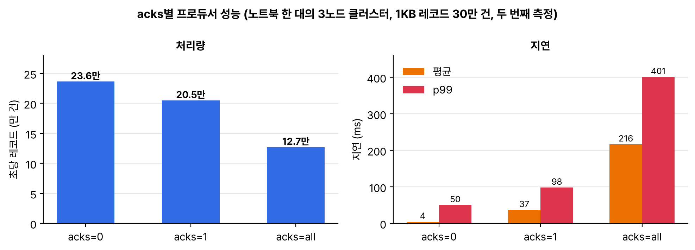

프로듀서가 send()를 부르면 실제로 무슨 일이 일어나는지 정리하고, acks 값을 바꿔 가며 kafka-producer-perf-test로 처리량과 지연을 재 봤다. 기본값은 4.1.0 클라이언트 라이브러리에서 직접 뽑아 확인했다.

## 요약

- send()는 바로 보내지 않는다. 직렬화, 파티션 결정을 거쳐 파티션별 배치에 쌓였다가 백그라운드 스레드가 묶어서 보낸다.
- 4.0부터 linger.ms 기본값이 0에서 5로 바뀌었다. 5ms까지 기다려 배치를 채운다.
- acks 기본값은 all, enable.idempotence 기본값은 true다. 3.0부터 기본으로 '중복 없이, 잃지 않게' 쪽이다.
- 키가 없으면 스티키 파티셔너가 한 배치를 한 파티션에 몰아 보내고 다음 배치는 다른 파티션으로 보낸다.
- 노트북 3노드 기준으로 acks=0, 1, all의 처리량이 초당 23.6만, 20.5만, 12.7만 건이었다. 평균 지연은 4, 37, 216ms였다.

## 1. send() 다음에 일어나는 일


flowchart TB
  subgraph r1["send() 호출 스레드"]
    direction LR
    A["send(레코드)"] --> S["직렬화<br>키, 값 → 바이트"]
    S --> P["파티셔너<br>파티션 결정"]
    P --> R["RecordAccumulator<br>파티션별 배치에 쌓기"]
  end
  subgraph r2["백그라운드"]
    direction LR
    T["Sender 스레드<br>batch.size 차거나 linger.ms 지나면<br>브로커별로 묶어 전송"] --> B["리더 브로커"]
    B -->|"acks 조건 만족"| C["콜백 / Future 완료"]
  end
  r1 --> r2


그래서 send() 직후에 프로그램을 끝내면 아직 배치에 남아 있던 레코드가 날아갈 수 있다. close()나 flush()를 불러야 남은 걸 다 보낸다.

## 2. 기본값 직접 확인

4.1.0 libs의 jar로 jshell을 띄워 ProducerConfig의 기본값을 출력했다.

```text
producer acks = all
producer linger.ms = 5
producer batch.size = 16384
producer enable.idempotence = true
producer retries = 2147483647
producer delivery.timeout.ms = 120000
producer max.in.flight.requests.per.connection = 5
producer compression.type = none
producer partitioner.ignore.keys = false
producer buffer.memory = 33554432
```

| 설정 | 기본값 | 내 정리 |
|---|---|---|
| acks | all | 리더가 ISR 전체의 복사를 확인한 뒤 성공 응답 |
| linger.ms | 5 | 4.0에서 0 → 5(KIP-1030). 배치를 조금 더 채워 효율을 높인다 |
| batch.size | 16384 | 파티션별 배치 최대 크기(바이트) |
| enable.idempotence | true | 재시도해도 같은 레코드가 두 번 쓰이지 않게 한다 |
| retries | 사실상 무한 | 대신 delivery.timeout.ms(2분) 안에서만 재시도 |
| compression.type | none | gzip, snappy, lz4, zstd 중 고를 수 있다 |

retries 기본값은 2147483647(약 21억)이라 사실상 무한이고, 실제 한도는 delivery.timeout.ms다. 2분 동안 성공 못 하면 실패로 끝난다.

## 3. 파티셔너

| 경우 | 파티션 정하는 법 |
|---|---|
| 파티션을 직접 지정 | 그 파티션 |
| 키가 있음 | murmur2(키) % 파티션 수. 지난 글에서 직접 계산해 봤다 |
| 키가 없음 | 스티키 파티셔닝. 한 파티션에 배치를 채워 보내고, 다음 배치는 다른 파티션으로. 브로커가 느리면 덜 보내는 방식(adaptive)도 기본으로 켜져 있다 |

예전에는 키 없는 레코드를 한 건씩 파티션에 돌아가며(라운드 로빈) 보냈는데, 그러면 배치가 작게 쪼개져 비효율적이라 스티키 방식으로 바뀌었다고 한다.

## 4. acks별 성능 직접 재 보기

3노드 클러스터에 복제 계수 3짜리 perf 토픽을 만들고, 1KB 레코드 30만 건을 제한 없이 보냈다. 같은 측정을 두 바퀴 돌렸다.

```bash
for a in 0 1 all; do
  bin/kafka-producer-perf-test.sh --topic perf --num-records 300000 --record-size 1024 --throughput -1 \
    --producer-props bootstrap.servers=$B acks=$a | tail -1
done
```

```text
# 두 번째 바퀴
300000 records sent, 236406.6 records/sec (230.87 MB/sec), 4.32 ms avg latency, 116.00 ms max latency, 0 ms 50th, 35 ms 95th, 50 ms 99th, 53 ms 99.9th.
300000 records sent, 204918.0 records/sec (200.12 MB/sec), 36.66 ms avg latency, 129.00 ms max latency, 27 ms 50th, 92 ms 95th, 98 ms 99th, 104 ms 99.9th.
300000 records sent, 127172.5 records/sec (124.19 MB/sec), 216.35 ms avg latency, 445.00 ms max latency, 215 ms 50th, 352 ms 95th, 401 ms 99th, 442 ms 99.9th.
```


_노트북 한 대에 노드 셋을 띄운 환경이라 절대값은 의미가 없고 차이만 본다. 첫 바퀴는 JVM이 덜 데워져서 셋 다 초당 10만 건 안팎으로 비슷했다_

| acks | 성공 응답 시점 | 잃을 수 있는 경우 |
|---|---|---|
| 0 | 보내자마자(응답 안 기다림) | 브로커가 못 받아도 모른다 |
| 1 | 리더가 로컬에 쓴 뒤 | 리더가 팔로워 복사 전에 죽으면 |
| all | ISR 전체가 복사한 뒤 | ISR 전체가 동시에 사라지지 않는 한 안전 |

acks=all이 느린 건 팔로워 두 대가 가져갈 때까지 기다려서다. 실제로는 노드 셋이 한 노트북의 디스크와 CPU를 나눠 쓰니 더 느려졌을 것이다. 제한 없이 밀어 넣는 측정이라, 지연에는 클라이언트 버퍼에서 기다린 시간도 들어 있다.

## 5. 콘솔 프로듀서로 해 본 것들

```bash
# acks 지정
bin/kafka-console-producer.sh --bootstrap-server $B --topic payments --request-required-acks all
# 압축
bin/kafka-console-producer.sh --bootstrap-server $B --topic payments --compression-codec zstd
```

복제 편에서 min.insync.replicas=3인 토픽에 acks=all로 보냈다가 NotEnoughReplicasException을 받은 것도 이 옵션으로 한 것이다.

> **쉬운 설명**
>
> 프로듀서는 우체국 창구 직원이다. 편지(레코드)를 받자마자 트럭을 부르지 않고, 행선지(파티션)별 바구니에 담아 두었다가 바구니가 차거나 5분(linger.ms=5ms)이 지나면 한꺼번에 보낸다. acks는 '배달 확인을 어디까지 받을까'다. 0은 확인 안 받고 보내고 끝, 1은 받는 우체국 한 곳의 도장, all은 복사본을 보관하는 우체국 전부의 도장이다. 도장을 많이 받을수록 안전하지만 오래 걸린다.

## 헷갈렸던 것들

- send()가 성공을 돌려줬다고 브로커에 들어간 게 아니다. Future나 콜백에서 확인해야 한다.
- acks=all은 '모든 복제본'이 아니라 'ISR의 모든 복제본'이다. 그래서 min.insync.replicas와 같이 써야 의미가 있다.
- 멱등 프로듀서는 기본으로 켜져 있지만, 프로듀서를 다시 시작하면 새 프로듀서 ID를 받는다. 재시작을 넘어선 중복 방지는 트랜잭션 쪽 이야기다.

## 용어 정리

| 용어 | 뜻 |
|---|---|
| 직렬화 | 키, 값 객체를 바이트로 바꾸는 것 |
| 배치 | 같은 파티션으로 갈 레코드 묶음 |
| linger.ms | 배치를 채우려고 기다리는 최대 시간 |
| 멱등 프로듀서 | 프로듀서 ID와 시퀀스 번호로 재시도 중복을 막는 프로듀서 |
| 스티키 파티셔닝 | 키 없는 레코드를 배치 단위로 한 파티션에 몰아 보내는 방식 |

## 참고 자료

- Apache Kafka 문서, 프로듀서 설정: <https://kafka.apache.org/41/configuration/producer-configs/>
- KIP-1030, 4.0 기본값 변경: <https://cwiki.apache.org/confluence/display/KAFKA/KIP-1030%3A+Change+constraints+and+default+values+for+various+configurations>
- KIP-794, 스티키 파티셔너 개선: <https://cwiki.apache.org/confluence/display/KAFKA/KIP-794%3A+Strictly+Uniform+Sticky+Partitioner>
- Apache Kafka 문서, 메시지 전달 보장: <https://kafka.apache.org/41/design/design/>
