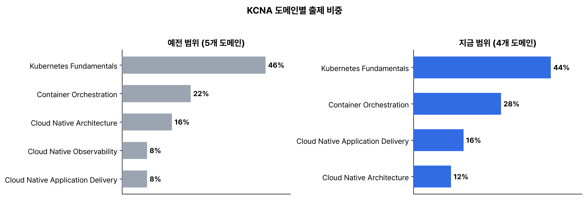

CKA와 CKAD를 따고 1년 넘게 지났다. 실기 시험 두 개는 붙었는데, 클라우드 네이티브 생태계 쪽은 실기에 거의 안 나와서 아는 게 띄엄띄엄이다. 그래서 KCNA를 보기로 했다. 시험 안내를 읽다 보니 출제 범위가 바뀌어 있었다. 블로그 글이나 요약 자료는 대부분 예전 범위 기준이라, CNCF의 공식 범위 PDF와 Linux Foundation의 변경 안내부터 읽고 정리했다.

## 요약

- 온라인 감독 객관식 60문항, 90분이다. 75% 이상이면 합격이고, 재시험 1회가 포함돼 있다. 자격은 2년 유효하다.
- 지금 범위는 4개 도메인이다. Kubernetes Fundamentals 44%, Container Orchestration 28%, Cloud Native Application Delivery 16%, Cloud Native Architecture 12%.
- 예전 범위(5개 도메인, 46/22/16/8/8)와 비교하면 Application Delivery가 8%에서 16%로, Container Orchestration이 22%에서 28%로 늘었다. Observability는 따로 있던 도메인에서 Cloud Native Architecture 안의 항목이 됐다.
- 어느 범위로 출제되는지는 시험 보는 날이 정한다. 바우처를 산 날, 첫 응시인지 재시험인지는 상관없다.

## 1. 시험 정보 (2026년 8월 기준)

| 항목 | 내용 |
|---|---|
| 형식 | 온라인 감독 객관식, 60문항 |
| 시간 | 90분. 한 문항에 1분 30초꼴이다 |
| 합격 기준 | 75% 이상 |
| 재시험 | 1회 포함 |
| 응시 기한 | 구매 후 12개월 |
| 유효 기간 | 2년 |
| 결과 | 보통 24시간 안에 메일로 온다고 한다 |

CKA, CKAD와 달리 터미널이 없다. 시험 중에 kubernetes.io 문서를 열어 볼 수도 없다. 합격선도 실기 두 시험(66%)보다 높은 75%다.

## 2. 출제 범위가 어떻게 바뀌었나

_왼쪽이 예전 범위, 오른쪽이 지금 범위다. Application Delivery가 두 배로 늘고, Observability 도메인이 없어졌다_

지금 범위는 [cncf/curriculum 저장소의 KCNA PDF](https://github.com/cncf/curriculum/blob/master/KCNA_Curriculum.pdf)에 있다.

| 도메인 | 비중 | 항목 |
|---|---:|---|
| Kubernetes Fundamentals | 44% | Kubernetes Core Concepts, Administration, Scheduling, Containerization |
| Container Orchestration | 28% | Networking, Security, Troubleshooting, Storage |
| Cloud Native Application Delivery | 16% | Application Delivery, Debugging |
| Cloud Native Architecture | 12% | Observability, Cloud Native Ecosystem and Principles, Cloud Native Community and Collaboration |

예전 범위는 이랬다.

| 도메인 | 비중 | 항목 |
|---|---:|---|
| Kubernetes Fundamentals | 46% | Kubernetes Resources, Kubernetes Architecture, Kubernetes API, Containers, Scheduling |
| Container Orchestration | 22% | Container Orchestration Fundamentals, Runtime, Security, Networking, Service Mesh, Storage |
| Cloud Native Architecture | 16% | Autoscaling, Serverless, Community and Governance, Roles and Personas, Open Standards |
| Cloud Native Observability | 8% | Telemetry & Observability, Prometheus, Cost Management |
| Cloud Native Application Delivery | 8% | Application Delivery Fundamentals, GitOps, CI/CD |

Linux Foundation 안내에는 도메인 구성은 거의 그대로이고 Observability만 Cloud Native Architecture 아래로 들어간다고 적혀 있다. 세부 항목은 '일부 추가·삭제, 표현 수정'이라고만 했고, 새 PDF에도 항목 이름만 있고 설명은 없다. 그래서 바뀐 점은 항목 이름으로만 비교할 수 있다.

- 새로 이름이 붙은 항목: Administration, Troubleshooting, Debugging
- 이름이 없어진 항목: Service Mesh, Autoscaling, Serverless, Roles and Personas, Open Standards, Prometheus, Cost Management, GitOps, CI/CD

이름이 없어졌다고 출제되지 않는다고 볼 근거는 없다. 서비스 메시는 Networking에, 오토스케일링·서버리스·오픈 표준은 Ecosystem and Principles에, GitOps와 CI/CD는 Application Delivery에, Prometheus와 비용 관리는 Observability에 들어간다고 보고 같이 정리한다.

| 지금 항목 | 같이 볼 예전 주제 | 정리한 글 |
|---|---|---|
| Kubernetes Core Concepts | Resources, Architecture, API | 핵심 개념 |
| Administration | 새 항목. kubectl, kubeconfig, 업그레이드, 버전 차이 | 클러스터 관리 |
| Scheduling | Scheduling | 스케줄링 |
| Containerization | Containers, Runtime | 컨테이너화 |
| Networking | Networking, Service Mesh | 네트워킹 |
| Security | Security | 보안 |
| Troubleshooting | 새 항목 | 트러블슈팅 |
| Storage | Storage | 스토리지 |
| Application Delivery | Application Delivery Fundamentals, GitOps, CI/CD | 애플리케이션 배포와 디버깅 |
| Debugging | 새 항목 | 애플리케이션 배포와 디버깅 |
| Observability | Telemetry & Observability, Prometheus, Cost Management | 관찰 가능성 |
| Cloud Native Ecosystem and Principles | Autoscaling, Serverless, Open Standards | 생태계, 원칙, 커뮤니티 |
| Cloud Native Community and Collaboration | Community and Governance, Roles and Personas | 생태계, 원칙, 커뮤니티 |

## 3. 범위는 시험 보는 날이 정한다

Linux Foundation은 새 범위를 2025년 11월 24일보다 이르지 않게 적용한다고 공지했고, 지금 CNCF 시험 페이지에는 새 도메인이 올라와 있다. 안내문에는 '구매일도, 첫 응시인지 재시험인지도 상관없고 시험 보는 날만 중요하다'고 적혀 있다. 예전에 산 바우처로 지금 보면 새 범위로 나온다.

자료를 고를 때는 비중 숫자를 본다. 46/22/16/8/8이 보이면 예전 범위다. 개념 설명은 그대로 써도 되지만, 도메인 비중이나 '이 도메인이 몇 문제' 같은 내용은 맞지 않는다.

## 4. 객관식이라 다르게 준비할 것

CKA 때는 손이 기억하면 됐는데, 객관식은 비슷한 것끼리 구분하는 문제가 많아 보인다. kube-scheduler와 kubelet, ConfigMap과 Secret, Ingress와 Gateway API, liveness와 readiness 프로브, Prometheus와 OpenTelemetry처럼 짝을 지어 차이를 적어 둔다. 문서를 볼 수 없으니 NodePort 기본 범위, 기본 네임스페이스 네 개처럼 실기 때 찾아보던 값도 외워야 한다.

> **쉬운 설명**
>
> KCNA는 운전면허 필기, CKA는 도로 주행이다. 도로 주행을 먼저 붙고 필기를 보는 셈이라 순서가 거꾸로지만, 필기에는 도로 주행에 안 나오는 것도 있다. 자동차 회사와 정비 업체 이름(CNCF 프로젝트), 교통 법규가 만들어지는 과정(커뮤니티와 거버넌스) 같은 것들이다. 그리고 이번에 필기 문제집 목차가 바뀌었다. 옛 문제집으로 공부하면 비중이 안 맞는다.

## 헷갈렸던 것들

- 예전 범위 자료가 아직 많다. 비중이 46/22/16/8/8이면 예전 것이다.
- Observability가 빠진 게 아니다. Cloud Native Architecture 안으로 들어갔다.
- 바우처를 산 날은 상관없다. 시험 보는 날이 범위를 정한다.
- 합격선은 75%로, CKA·CKAD의 66%보다 높다.

## 용어 정리

| 용어 | 뜻 |
|---|---|
| KCNA | Kubernetes and Cloud Native Associate. CNCF가 만들고 Linux Foundation이 운영하는 입문 자격 |
| CNCF | Cloud Native Computing Foundation. 쿠버네티스, Prometheus 같은 프로젝트를 맡는 재단. Linux Foundation 산하다 |
| 도메인 | 출제 범위의 큰 묶음. 비중이 붙어 있다 |
| 커리큘럼 PDF | 도메인과 세부 항목을 적은 공식 문서. cncf/curriculum 저장소에 있다 |

## 참고 자료

- CNCF, KCNA 시험 안내: <https://www.cncf.io/training/certification/KCNA/>
- Linux Foundation, KCNA 시험 안내: <https://training.linuxfoundation.org/certification/kubernetes-cloud-native-associate/>
- Linux Foundation, KCNA 범위 변경 안내: <https://training.linuxfoundation.org/kcna-program-changes/>
- CNCF, KCNA 출제 범위 PDF: <https://github.com/cncf/curriculum/blob/master/KCNA_Curriculum.pdf>
- Linux Foundation, 객관식 시험 자주 묻는 질문: <https://docs.linuxfoundation.org/tc-docs/certification/faq-mc>

