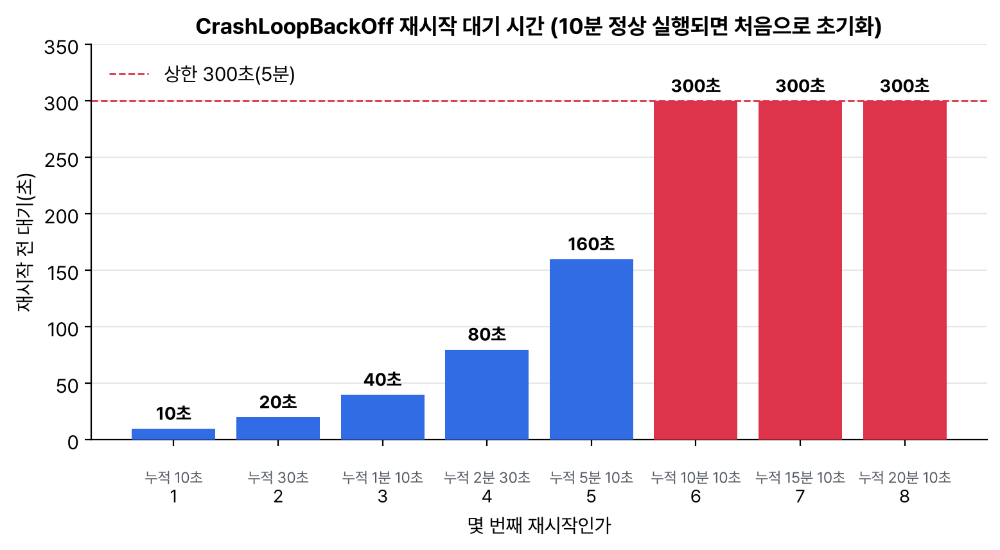

파드가 안 뜨면 습관처럼 로그부터 봤는데, 컨테이너가 시작도 못 했으면 로그는 비어 있다. 노드 배정, 이미지 받기, 컨테이너 시작 중 어디서 멈췄는지부터 가려야 한다. CKA 트러블슈팅 때 쓰던 확인 순서를 바탕으로 정리했고, kind로 일부러 고장을 내 본 실습도 붙였다.

## 요약

- 보는 순서는 `kubectl get`(상태), `describe`(Events), `logs`(`--previous`), `exec`나 `debug`다.
- `Pending` phase에는 노드를 기다리는 시간과 노드에서 컨테이너를 준비하는 시간이 모두 포함된다. 노드가 없고 Events에 `FailedScheduling`이 보이면 스케줄링 조건부터 본다.
- `ImagePullBackOff`는 이미지를 받지 못해 재시도 간격을 늘리는 중이라는 뜻이다. 이름, 태그, 레지스트리 권한과 연결을 확인한다.
- CrashLoopBackOff는 컨테이너가 계속 죽어서 재시작을 기다리는 상태다. 원인은 이전 컨테이너 로그(`--previous`)와 종료 코드에서 찾는다.
- `OOMKilled`는 메모리 부족으로 컨테이너가 종료됐다는 뜻이다. 메모리 limit과 노드 상태를 함께 확인한다. 종료 코드 137만으로는 OOM인지 알 수 없다.
- 파드는 Running인데 트래픽이 안 가면 readiness, 서비스 셀렉터, targetPort, NetworkPolicy 순서로 본다.
- Events는 기본 1시간만 남는다.

## 1. 기본 도구

```bash
kubectl get pods -o wide                       # 상태, 재시작 횟수, 노드, IP
kubectl describe pod web-7d4b9                 # 설정, 상태, 마지막 종료 이유, Events
kubectl get events -n shop --sort-by=.lastTimestamp
kubectl logs web-7d4b9 -c app                  # 컨테이너가 여럿이면 -c
kubectl logs web-7d4b9 --previous              # 죽기 전 컨테이너의 로그
kubectl logs deploy/web -f                     # 디플로이먼트의 파드 하나를 골라 따라 보기
kubectl exec -it web-7d4b9 -- sh               # 컨테이너 안에서 셸
kubectl debug -it web-7d4b9 --image=busybox:1.37 --target=app   # 임시 컨테이너로 붙기
kubectl debug node/worker-1 -it --image=busybox:1.37            # 노드 디버깅용 파드
kubectl top pods                               # metrics-server가 있어야 된다
kubectl port-forward svc/api 8080:80           # 내 PC에서 서비스로 바로 붙어 보기
```

셸이 없는 distroless 이미지에는 exec로 들어갈 수 없다. 이때 `kubectl debug`로 도구가 든 임시 컨테이너를 같은 파드에 붙인다. `--target`을 주면 대상 컨테이너의 프로세스까지 볼 수 있다.

## 2. 파드 상태별 원인

| 보이는 상태 | 뜻 | 흔한 원인 | 먼저 볼 것 |
|---|---|---|---|
| Pending, NODE 없음 | 아직 스케줄링하지 못했을 가능성이 크다 | requests를 만족하는 노드가 없다, 셀렉터·어피니티 불일치, 테인트, PVC가 Pending | `PodScheduled` 조건과 Events의 `FailedScheduling` |
| ContainerCreating이 오래 감 | 노드는 정해졌는데 컨테이너를 못 만든다 | 볼륨 마운트 실패, CNI 문제, 큰 이미지 | describe의 Events |
| ErrImagePull, ImagePullBackOff | 이미지를 못 받아서 재시도를 기다린다 | 이름이나 태그 오타, 비공개 레지스트리 인증(imagePullSecrets), 레지스트리 접근 불가 | describe의 Events |
| CreateContainerConfigError | 컨테이너 설정을 만들 수 없다 | 참조한 ConfigMap, Secret, 키가 없다 | describe의 Events |
| CrashLoopBackOff | 컨테이너가 계속 종료되어 재시작을 기다린다 | 설정 오류, 잘못된 명령, 의존 서비스 없음, liveness 실패 | `logs --previous`, describe의 Last State |
| Running인데 READY 0/1 | 떠 있지만 준비되지 않았다 | readiness 프로브 실패 | describe의 Events(Readiness probe failed) |
| Terminating이 오래 감 | 지우는 중에 멈췄다 | finalizer가 남음, 노드 연결 끊김 | `get -o yaml`의 finalizers |
| Evicted | kubelet이 파드를 축출했다 | 메모리나 디스크 부족 | Pod의 메시지와 Node Conditions |

`kubectl get pods`의 `STATUS`는 사람이 보기 좋게 만든 열이다. `ImagePullBackOff`가 보이는 파드의 `.status.phase`는 `Pending`일 수 있다. `kubectl get pod <이름> -o yaml`에서 phase와 `PodScheduled` 조건을 따로 보고, `describe`의 Events에서 어느 단계가 실패했는지 확인한다. [Pod 수명 주기](https://kubernetes.io/docs/concepts/workloads/pods/pod-lifecycle/)

컨테이너의 Last State에 `OOMKilled`가 있으면 메모리 limit 초과나 노드 전체의 OOM을 확인한다. 노드 압박을 감지한 kubelet이 파드를 먼저 내보낸 경우에는 파드에 `Evicted`가 남는다.

CrashLoopBackOff 상태에서 재시작 간격은 10초에서 시작해 두 배씩 늘어 최대 5분까지 간다. 컨테이너가 10분 동안 문제없이 돌면 처음으로 돌아간다. v1.35부터는 노드마다 kubelet 설정(`crashLoopBackOff.maxContainerRestartPeriod`)으로 최대 간격을 1초에서 300초 사이로 줄일 수 있다(beta). 기본값 자체를 1초 시작, 최대 60초로 줄이는 기능은 아직 alpha라서 기본으로 꺼져 있다.


_재시작마다 대기 시간이 두 배로 늘다가 5분에서 멈춘다_

종료 코드도 원인을 알려 준다.

| 종료 코드 | 뜻 |
|---|---|
| 0 | 정상 종료. Deployment 파드가 이걸 반복하면 앱이 할 일 없이 끝나는 것이다 |
| 1 | 앱이 낸 일반 오류 |
| 126, 127 | 명령을 실행할 수 없음, 명령을 찾을 수 없음 |
| 137 | SIGKILL(128+9). OOMKilled이거나 종료 유예 시간 안에 안 끝나서 강제 종료 |
| 143 | SIGTERM(128+15)을 받고 끝남 |

## 3. 서비스로 트래픽이 안 갈 때

예를 들어 `web` 네임스페이스의 파드에서 `shop`의 `api` Service를 부른다고 하자. 호출 파드에 `nslookup`이 있으면 `kubectl exec -n web <호출-파드> -- nslookup api.shop`으로 이름부터 확인한다. 아래 흐름에서 `api`와 `shop`은 Service 이름과 네임스페이스다.


flowchart TB
  A["1. 이름이 풀리나<br>debug 파드에서 nslookup api.shop"] --> B["2. 서비스가 있나, 포트가 맞나<br>kubectl get svc api -n shop"]
  B --> C["3. 엔드포인트가 있나<br>kubectl get endpointslices -n shop -l kubernetes.io/service-name=api"]
  C --> D["4. 준비된 엔드포인트가 없으면<br>셀렉터와 파드 라벨, 파드 READY"]
  D --> E["5. 준비된 엔드포인트가 있으면<br>targetPort가 컨테이너가 듣는 포트인가"]
  E --> F["6. 그래도 안 되면<br>NetworkPolicy, 앱 로그"]


서비스 셀렉터가 틀리면 에러 없이 엔드포인트만 빈다. 그래서 '연결 거부'나 '타임아웃'만 보이고 원인 메시지는 없다. 이름 풀이가 안 되면 kube-system의 CoreDNS 파드 상태와 로그를 본다.

## 4. 노드와 컨트롤 플레인 문제

| 증상 | 의심할 곳 |
|---|---|
| 노드 NotReady | kubelet이 멈췄거나(`journalctl -u kubelet`), 컨테이너 런타임이 멈췄거나(`crictl ps`), CNI가 없거나, 인증서가 만료됐다 |
| 노드 Conditions에 MemoryPressure, DiskPressure, PIDPressure | 자원 부족. kubelet이 파드를 내보내기 시작한다 |
| kubectl 명령이 전부 connection refused | kubeconfig의 현재 컨텍스트와 서버 주소부터 확인한다. 주소가 맞으면 API 서버가 해당 포트에서 듣는지, kubeadm 환경이라면 스태틱 파드가 떴는지 확인한다 |
| 새 파드에 노드가 배정되지 않았고 FailedScheduling 이벤트도 없다 | 스케줄러 상태, 파드의 schedulerName과 schedulingGates를 확인한다 |
| Deployment를 만들었는데 ReplicaSet이나 파드가 안 생긴다 | Deployment와 ReplicaSet의 Events에서 생성 거절을 먼저 확인한다. ReplicaSet도 생기지 않았다면 컨트롤러 매니저 상태도 본다 |
| `kubectl top`이 Metrics API를 찾을 수 없다고 한다 | metrics-server가 없다 |

노드가 끊기면 `node.kubernetes.io/unreachable` 테인트가 붙는다. 기본 톨러레이션은 300초라, 이후 축출이 진행될 수 있다. Deployment가 관리하는 파드라면 컨트롤러가 대체 파드를 만든다.

## 실습: 작은 서비스를 띄우고 고쳐 보기

표만 봐서는 상태가 어떻게 바뀌는지 그려지지 않아서, [kind](https://kind.sigs.k8s.io/docs/user/quick-start/)로 실습용 클러스터를 띄우고 일부러 고장을 내 봤다. Docker와 `kubectl`이 있으면 된다. 명령마다 `--context`를 붙여서 다른 클러스터를 건드리지 않게 했다.

```bash
kind create cluster --name kcna-lab --wait 2m
```

Deployment로 nginx를 띄우고, 다른 파드에서 Service 이름으로 접속되는지 봤다.

```bash
kubectl --context kind-kcna-lab create deployment web --image=nginx:1.28-alpine
kubectl --context kind-kcna-lab expose deployment web --port=80 --target-port=80
kubectl --context kind-kcna-lab rollout status deployment/web --timeout=120s
kubectl --context kind-kcna-lab get deployment,pods,service -l app=web
kubectl --context kind-kcna-lab run probe --image=busybox:1.37 --restart=Never --command -- wget -qO- http://web
kubectl --context kind-kcna-lab wait --for=jsonpath='{.status.phase}'=Succeeded pod/probe --timeout=90s
kubectl --context kind-kcna-lab logs pod/probe
```

마지막 명령에서 nginx 기본 페이지의 HTML이 나오면, `probe` 파드가 `web`을 이름으로 찾아 Service를 거쳐 접속한 것이다. `wait`가 시간 초과하면 `kubectl --context kind-kcna-lab describe pod/probe`로 이유를 본다.

그다음 없는 이미지 태그로 바꿔 봤다.

```bash
kubectl --context kind-kcna-lab set image deployment/web nginx=nginx:kcna-lab-no-such-tag
kubectl --context kind-kcna-lab get pods -l app=web -o wide
kubectl --context kind-kcna-lab describe pods -l app=web
kubectl --context kind-kcna-lab get pods -l app=web \
  -o 'custom-columns=NAME:.metadata.name,NODE:.spec.nodeName,PHASE:.status.phase,WAITING:.status.containerStatuses[0].state.waiting.reason'
```

몇 초 기다리면 새 파드는 **NODE가 채워져 있는데도** phase가 `Pending`이고, 대기 이유가 `ErrImagePull`에서 `ImagePullBackOff`로 바뀐다. Events에는 이미지 가져오기 실패가 남는다. 노드는 이미 정해졌으니 스케줄링이나 앱 로그를 볼 상황이 아니다. 기존 파드는 롤링 업데이트 중에도 계속 살아 있다.

되돌릴 때는 `rollout undo`를 쓰고 `rollout status`가 성공하는지까지 봤다. 기존 파드가 계속 응답하고 있어서 Service 접속만으로는 복구됐는지 알 수 없다.

```bash
kubectl --context kind-kcna-lab rollout undo deployment/web
kubectl --context kind-kcna-lab rollout status deployment/web --timeout=120s
kubectl --context kind-kcna-lab get pods -l app=web
```

다 본 뒤에는 클러스터를 지웠다.

```bash
kind delete cluster --name kcna-lab
```

## 헷갈렸던 것들

- CrashLoopBackOff는 원인이 아니라 결과다. 원인은 이전 컨테이너 로그와 종료 코드에 있다.
- 죽기 전 컨테이너의 로그는 `--previous`로 본다.
- Events는 기본 1시간 뒤 사라진다.
- `kubectl top`은 metrics-server가 있어야 된다.
- `FailedScheduling`이 없다고 바로 스케줄러 장애로 판단하지 않는다. 파드가 배정됐는지 먼저 확인한다.
- Service에 쓸 수 있는 엔드포인트가 없으면 셀렉터와 readiness부터 본다.
- 137은 OOM만 뜻하지 않는다. SIGKILL로 끝난 모든 경우다.

## 복습 문제

**1.** A Pod is in CrashLoopBackOff. Which command shows the logs of the container instance that crashed?

- A. `kubectl logs <pod> --follow`
- B. `kubectl describe node`
- C. `kubectl get events --watch`
- D. `kubectl logs <pod> --previous`

**2.** A Pod stays Pending, and its events say `0/3 nodes are available: 3 Insufficient memory.` What is the most likely fix?

- A. Increase the container's memory limit.
- B. Lower the Pod's memory request or add node capacity.
- C. Add a readiness probe.
- D. Change the imagePullPolicy.

**3.** A container's last state shows the reason OOMKilled and exit code 137. What does this mean?

- A. The image could not be pulled.
- B. The liveness probe timed out.
- C. The kernel killed the container in an out-of-memory situation.
- D. The node ran out of disk space.

**4.** A Service has no endpoints, even though Pods that seem to match it are running. What should you check first?

- A. Whether the Service selector matches the Pod labels and whether the Pods are Ready
- B. The kube-scheduler logs
- C. The health of the etcd cluster
- D. The kernel version of the nodes

**5.** Which status is shown when the kubelet cannot pull a container image and is waiting before it tries again?

- A. CrashLoopBackOff
- B. CreateContainerConfigError
- C. Evicted
- D. ImagePullBackOff

**6.** `kubectl top pods` returns an error saying the Metrics API is not available. What is most likely missing?

- A. CoreDNS
- B. kube-proxy
- C. metrics-server
- D. The container runtime

**7.** A running Pod's image has no shell. You need debugging tools inside the Pod. Which command helps?

- A. `kubectl exec -it <pod> -- sh`
- B. `kubectl debug -it <pod> --image=busybox --target=app`
- C. `kubectl attach <pod>`
- D. `kubectl cp <pod>:/ ./`

## 답과 풀이

1. **D** 재시작된 지금 컨테이너가 아니라 죽기 전 컨테이너의 로그를 봐야 해서 `--previous`다.
2. **B** 스케줄러는 requests로 판단한다. limits를 올려도 Pending은 풀리지 않는다.
3. **C** 137은 SIGKILL로 끝났다는 표시이고, `OOMKilled`가 메모리 부족으로 종료됐다는 단서다. 이 정보만으로 컨테이너 limit 초과와 노드 전체 OOM을 구별할 수는 없다.
4. **A** 셀렉터가 맞는 파드가 있는지와 EndpointSlice의 `ready` 상태를 본다. 일치하는 파드가 없거나 준비된 엔드포인트가 없으면 기본 설정의 Service는 그 파드에 트래픽을 보내지 않는다.
5. **D** 받기에 실패하면 ErrImagePull, 재시도를 기다리는 동안은 ImagePullBackOff다.
6. **C** `kubectl top`은 metrics-server가 제공하는 Metrics API를 읽는다.
7. **B** 임시 컨테이너를 붙인다. 셸이 없으니 exec는 실패한다.

## 참고 자료

- Kubernetes 문서, 애플리케이션 디버깅: <https://kubernetes.io/docs/tasks/debug/debug-application/>
- Kubernetes 문서, 파드 디버깅: <https://kubernetes.io/docs/tasks/debug/debug-application/debug-pods/>
- Kubernetes 문서, 실행 중인 파드 디버깅: <https://kubernetes.io/docs/tasks/debug/debug-application/debug-running-pod/>
- Kubernetes 문서, 서비스 디버깅: <https://kubernetes.io/docs/tasks/debug/debug-application/debug-service/>
- Kubernetes 문서, 파드 실패 원인 알아내기: <https://kubernetes.io/docs/tasks/debug/debug-application/determine-reason-pod-failure/>
- Kubernetes 문서, 클러스터 디버깅: <https://kubernetes.io/docs/tasks/debug/debug-cluster/>
- Kubernetes 문서, DNS 이름 풀이 디버깅: <https://kubernetes.io/docs/tasks/administer-cluster/dns-debugging-resolution/>
- Kubernetes 문서, 자원 지표 파이프라인: <https://kubernetes.io/docs/tasks/debug/debug-cluster/resource-metrics-pipeline/>
- Kubernetes 문서, 파드 수명 주기: <https://kubernetes.io/docs/concepts/workloads/pods/pod-lifecycle/>

